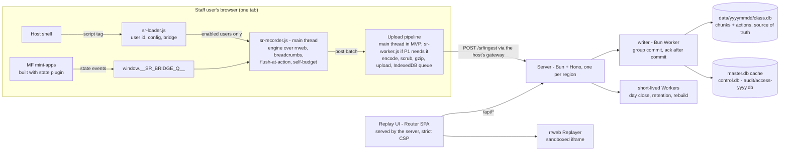
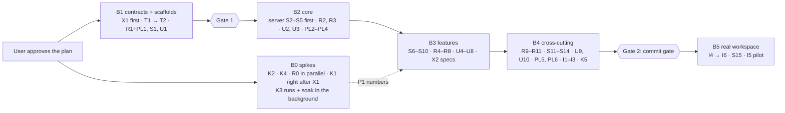

# 01 — Session replay
Status: draft v4 (v1: sub-plans 02–08; MVP2: 09; reviewed by architect, devil and auditor; awaiting approval) · Size: large

## Goal

Support and audit staff can open any user's session for a given day and replay it: the screen,
the app state, the network calls and the console messages (D43), in one timeline. Later (MVP2,
D44), the same data answers questions across users, such as top errors or tab usage. Sessions come from our module-federation
React apps (webpack and Vite, React 17/18/19; plain Redux in the MVP, D39). Recording must
never make those apps noticeably slower. Recorded users are **internal staff only** (D19).

**Anti-goals** (failure even if it "works"):
- The recorder causes jank, long tasks or memory growth in the apps.
- A replay looks complete but silently skipped changes (misleading audit evidence).
- Secrets (passwords, one-time codes, auth tokens) reach the server. In the MVP all other data, including personal data, is recorded on purpose (D18).
- Replaying runs app code or fires real requests (API calls, or asset GETs with the viewer's cookies).

## Scope

**v1 (user, 2026-11-10): the devil's MVP cut, plus the build plugin.** One staff app on one desk
as the pilot.
- **Console:** console lines are recorded (`error` and `warn` by default; the other levels by config) and shown as rows in the replay's action list (D43).
- **Recording:** `full` everywhere, pause-with-band. Everything is recorded except secrets (D18). Network capture is method, URL, status and timing only.
- **Build plugin:** **plain Redux** capture only. The pilot apps use Redux + React `useState`, with no RTK, Zustand or TanStack Query (user, 2026-11-10). `useState` is covered visually by the screen recording (D39).
- **Delivery:** upload pipeline behind `post(batch)` (main thread first, D11), `recordingId` + `seq`, write-ahead IndexedDB queue, kill switch.
- **Server:** ingest with a client-asserted userId read from `window` (D20), one-file-per-day storage, optional crypto-shredding.
- **Replay UI:** internal network only; no login in the MVP. A self-entered name and reason are logged for each open (D38). `oauth-proxy` comes later.

Per-column recording rate caps (D36) are in v1 as a mechanism, with no caps by default. A busy screen that still breaks the budget pauses with a band and raises a source fix (D8, D32).

**Deferred to v2+:**
- the `data` level, unless P1 forces it (the `mutationGate` hook is now in v1, D23);
- RTK, Zustand and TanStack Query wrappers in the build plugin; network bodies;
- the hash chain, signed manifests, `verify` and Object Lock;
- the `workerUrl` and Trusted Types rungs of the worker ladder;
- the multi-step self-budget;
- erasure tooling, legal-hold tooling, the role split and export (a written manual procedure covers the pilot);
- object-storage tiering, rage-click badges and live view;
- AI summaries;
- the `user-day` storage mode.
- canvas content and popout windows: lowest priority, possibly never (D34).
- Vite 8 (Rolldown) support for the build plugin; the MVP targets Vite 7.
- a mini-app filter in the replay UI's action list (user, Q27): actions from all apps show together;
- state capture for Redux Toolkit `configureStore` stores (D39);
- **analytics infrastructure (MVP2, plan 09, D44):** facts derived at ingest, `analytics.db`, backfill, the `$dom` tab reader, and a query API and CLI with saved queries. The query page comes after MVP2;
- a **grid data log**, AG Grid rows logged like Redux state (user, 2026-11-10): a TODO. A small spike in the B5 dry run decides whether and how (08 §13, I6, Q43).

The app loads only after a successful login, so the user id is known before the recorder starts (user, Q25).

## Decisions

IDs are kept stable across revisions so reviews can refer to them.

| # | Decision | Why | Who |
|---|---|---|---|
| D1 | Record the screen with **rrweb 2.x from npm** (`@rrweb/record`, `@rrweb/replay`, `@rrweb/types`). Every `@rrweb/*` package is pinned to one exact version, and **only `packages/recorder-engine` imports them** (D25). **One pin, chosen at B0 start** (the newest release at least 2 weeks old), is used by the spikes, the gate patch (D23) and production alike (devil X24). rrweb's network plugin is **not** used: the engine's own ~40-line fetch/XHR wrapper emits `sr:net` (architect A7, devil X5: the plugin loses status and timing once the 250-entry resource-timing buffer is full, and re-wraps every request body). | Framework-free, MIT, proven; replays in a sandboxed iframe without running app code. Spike 0002 confirmed it. | user |
| D2 | Screen and app state in **one timeline**. The engine stamps state and breadcrumb events **at capture time** and merges them into the stream itself. rrweb's `addCustomEvent` re-stamps events with the time of emit (`record.js:3513`). | Support needs what the user saw and what the store held, in the right order (devil M3). | user, devil |
| D3 | The recorder is plain TypeScript, loaded once by the host shell, outside every mini-app; no React or state-lib dependency. | One recorder covers all MF remotes (they share one DOM) at any React version. | user |
| D4 | **Build plugin in v1** (user, 2026-11-10). Written once with `unplugin` (webpack 5+, Vite, Rspack). It wraps **store-creation call sites** in the app's own source; in the MVP that's `createStore` and `legacy_createStore` from `redux` only (D39). The import statement and its module specifier stay; only the local binding is renamed, and a hoisted wrapper function takes the original name (07-L1). The plugin checks the outcome per file, not plugin names: if `'redux'` reaches it already rewritten, the build fails (07-L2). | One line per app's build config. An import redirect would break MF shared singletons: webpack's ConsumeSharedPlugin matches the raw import before resolution, and the Vite federation plugins could duplicate the library. | user, architect |
| D5 | **Bridge:** the store wrappers and the recorder meet through a global queue (`window.__SR_BRIDGE_Q__`) that whichever side loads first creates. That way stores created before the recorder starts are still registered. The wrappers **fail open** (try/catch, return the original) and check a kill flag. A manual 3-line registration is the fallback for stores the plugin can't see. | Store modules run before the recorder starts (devil M4); the kill switch must reach code compiled into apps. | leader, devil |
| D6 | Redux capture wraps the **reducer** (and `replaceReducer`), not `dispatch`. | Thunk and saga middleware bypass a patched `store.dispatch`. The spike confirmed it catches pending, rejected and fulfilled. | leader |
| D39 | **MVP state capture = plain Redux only** (user, 2026-11-10): the pilot apps use Redux + React `useState`. • The build plugin wraps `createStore` / `legacy_createStore` from `redux`. • RTK, Zustand and TanStack Query wrappers are deferred. • **`useState` isn't captured as state.** It lives inside React components, not in a store. What it shows on screen is in the DOM recording, but its values don't appear in the state panel. • Reading component state through React's DevTools hook (`__REACT_DEVTOOLS_GLOBAL_HOOK__`) is rejected for the MVP: it's version-specific, fragile, and costs time on every React commit. • A few apps use Redux Toolkit slices with their own store and Provider (user, Q39). **The MVP stays plain Redux** ("focus on MVP"): a store built with RTK's `configureStore` isn't captured; its screens are still recorded and the replay shows a `no-state` band. Redux 4.x is shared as a singleton across the remotes. | Smaller plugin and fixtures. The screen recording already shows what `useState` drives. | user, leader |
| D7 | Recording **starts automatically** and is always on. A "report a problem" button is optional and only marks a moment. | Long sessions; problems can't be predicted. Allowed for staff under D19. | user |
| D8 | **App performance first.** The recorder has a budget and degrades itself before it hurts the app. When completeness (D16) and performance clash, **performance wins**: the recorder pauses and the replay shows a band (user, 2026-11-10, Q14). | | user |
| D32 | **Every degradation raises a source fix** (user, 2026-11-10, Q14). When the self-budget pauses recording, the recorder reports a **hotspot**: app, remote, the busiest area (CSS path), mutations/s, how long it was degraded and how often. The server aggregates hotspots into a daily report per app, shown on a **Hotspots page in the replay UI** (user, Q18). The fix is at the source. First levers, in order, all measured in P1 (architect A2): an AG Grid cell renderer whose `refresh()` updates the existing text node instead of rebuilding the cell (rrweb records that as one small text change); cell flash off on the fastest columns; grids in hidden flexlayout tabs suspended; then batched grid updates at most a few times a second. Each keeps every state while making the screen and the recording cheaper. | Gaps are allowed only as a temporary state; each one becomes a tracked fix for the app team. | user |
| D33 | **Asset cache, built in and behind a setting** (user, 2026-11-10, Q15). The user doesn't expect missing assets in practice, but wants the capability ready. • **The upload pipeline** (in idle slices, or in the worker when it's enabled) finds image and font URLs in the events (`src`, `srcset`, CSS `url()`, `@font-face`). It only takes URLs matching an **allow-list of static asset paths** (e.g. `/assets/`, `/static/`, font hosts), so user-specific images such as avatars or document previews aren't collected. For each URL it hasn't seen, it fetches the file (`cache: 'force-cache'`, ≤ 2 MB, `image/*` and `font/*` only) and computes its sha256. It asks the server which hashes are missing and uploads only those. • **The stream** gets an `asset` event `{url, sha256, type}`. • **Server:** a content-addressed store `data/assets/<aa>/<sha256>` plus a metadata row. Each file is stored once for all users, and kept for the longest retention period after its last reference. • **Replay:** the ReplayEngine rewrites asset URLs to `/assets/<sha256>` before building, so the strict CSP (D30) still allows only our own origin. Old versions survive redeploys. | "Exact screen" (D16) includes icons and fonts; the live URLs can't be used (cookies, redeploys). | user, leader |
| D34 | **Canvas content and popout windows are not supported:** not in the MVP, lowest priority, and possibly never (user, 2026-11-10, Q16). They are explicit, visible exceptions to D16. A `<canvas>` replays as a hatched placeholder labelled "canvas not recorded" (via `insertStyleRules`), and an open popout shows a band "popout open, not recorded". `recordCanvas` and `UNSAFE_replayCanvas` stay off. | Keeps the recorder cheap and the replay sandbox strict; the auditor still sees where the gaps are. | user |
| D35 | **Generated identifiers** such as basket names `{SYMBOL}{Date.now()}` must **replay exactly as the user saw them**. Our filters must not rewrite them: in the MVP that holds by design, because only secrets are masked (D18) and there's no card-number rule. **No search by these names for now**; visual replay is enough (user, 2026-11-10). Explore search per scenario later. | Replay never re-runs app code, so names aren't regenerated; the only risk is our own privacy filters. | user |
| D36 | **Per grid + column recording rate caps** (user, 2026-11-10). Config can cap how often a cell's changes are recorded. Example: the app ticks `bid` 10×/s, but the recording keeps at most 2 states per second for that cell. • **Mapping:** app → grid (a stable `data-sr-grid="<id>"` on the grid container) → AG Grid column id (cells carry `col-id`) → `maxRate` (states/s). • **Defaults:** no caps; every change is recorded (D16). • **Mechanism:** the D23 gate holds each capped cell's changes and releases them at most `maxRate` times a second, plus **a flush at every user action**, so the screen is still exact at clicks and key presses. • **CPU:** held records are never processed by rrweb until release, so caps save real main-thread time, not only bytes. • **Audit transparency:** the config version and the capped columns go into session metadata, and the replay shows a legend such as "positions grid: bid/ask/mid recorded at 2/s". • **Config source:** the versioned server config, read with the kill switch (D22). Changes are reviewed ConfigMap edits, and each new version is logged, because lowering a rate lowers audit fidelity. | Gives app teams and admins a fine-grained, auditable lever for the busiest desk, instead of pausing everything (D8) or changing what users see (D32). Lines up with the upstream ask on rrweb PR #1933 (a per-element `sampling.mutation` function). | user, leader |
| D38 | **Replay UI access** (user, 2026-11-10, Q22). • **MVP: no access control.** The UI is reachable only on the internal network. Each open asks for a **name and a reason**, both self-entered. The access log records them plus the IP address. • **Chosen approach for later:** OpenShift `oauth-proxy` in front of the replay UI. It uses the cluster's existing login, puts the real viewer identity in the access log, and an allow-list says who may view. • **Grant scope** (user, 2026-11-10, Q30, Q31): one name + reason covers every session opened in that browser for 8 h. The session list and search need no prompt. Every search, open and chunk fetch is still logged. | Keeps the MVP simple. The trade-off is recorded in Risks: until `oauth-proxy` is on, anyone on the internal network can watch recordings, and the viewer name in the log is self-asserted. | user |
| D37 | **One deployment per region:** NAM, APAC, EMEA (user, 2026-11-10, Q21). Each has its own server, storage, config (allow-list, rate caps, kill switch) and replay UI. Recordings stay in their region. Each region's host apps point the recorder at that region's same-origin ingest path. Support uses their region's replay UI; **cross-region viewing is out of scope for the MVP**. The pilot runs in one region. | Data stays in its region, uploads stay close to users, and an outage in one region doesn't affect the others. | user |
| D9 | **Fidelity levels:** `full` everywhere (D16), except grid columns given a **recording rate cap** (D36). `block` stays available but **no areas are planned for it**: the apps have no ad slots or tickers (user, Q17). There's no area-wide `merge`; `data` is deferred. | D16 needs every UI state; rate caps are explicit, configured exceptions. | user |
| D10 | Every drop in fidelity is recorded and shown in the replay as a band: pauses, blocked areas, popouts, missing batches, quota. | An auditor must tell "nothing changed" from "not recorded in full". | leader |
| D11 | **The upload pipeline sits behind one interface, `post(batch)`** (encode, scrub, gzip, upload, IndexedDB queue, asset hashing). *(Confirmed by the user, 2026-11-10, Q20.)* • **MVP:** the pipeline runs on the **main thread** in idle slices (`requestIdleCallback`, ≤ 256 KB each). • **Worker:** a **separate same-origin bundle** (`sr-worker.js`, served by the host), switched on only if P1 shows the main-thread pipeline costs more than about 0.5 % CPU at S2. No `blob:` worker, no Service Worker. • **CSP:** none required on host apps for the MVP (user, Q3). The replay UI's own CSP (D30) is unaffected. | A worker moves scrubbing, gzip, upload, IndexedDB and garbage collection off the main thread, but `postMessage` still copies each batch on it. Estimated main-thread pipeline cost at the busiest desk: 0.5–1 % CPU; negligible elsewhere. Main-thread first is simpler: one code path, no loading logic, no CSP. | user (CSP, separate bundle), leader (main-thread first) |
| D12 | Server: Bun + Hono + SQLite. **Day files are the source of truth.** `master.db` is a catalog/cache that can be rebuilt from them on start. | A crash between two files can't create false "tampering" (devil M12). | user, devil |
| D13 | Replay UI: **TanStack Router SPA** + TanStack Query + Zustand (player state), built as static files and **served by the same Bun/Hono process** as ingest and the query API. Decided by the architect; the user agreed (2026-11-10, Q9). Replaces TanStack Start. | Replay is fully client-side, so Start's server features go unused. Hono isn't an extra hop: one process serves `/ingest`, `/api/*` and the UI. Start would add a second process, or would host ingest inside a UI framework that's been 1.0 only since 2026-10-13. One origin also means one login cookie later (`oauth-proxy`) and no CORS. Moving to Start later is incremental. | architect, user |
| D14 | Bun workspaces monorepo: `apps/`, `packages/`, `spike/`, `plan/`. | | user |
| D15 | All coding goes to the `coder` agent on the `sonnet` model. | | user |
| D16 | **Audit standard: every UI state, the exact screen the user saw** (user, 2026-11-10, Q1). Every DOM change is recorded in audit-relevant areas, **all the time**, not only at user actions; no merging that hides intermediate states. Actions are still marked in the capture phase (`pointerdown`, `pointerup`, `click`, `keydown`, `keyup`, `submit`), and the replay seeks to an action by its stream position. Server-side order, auth and API logs remain the record of what the *system* did. | Audit must be able to show what was on screen at any moment, not just at clicks. | user |
| D17 | **Build on rrweb, don't self-host** PostHog, OpenReplay or Sentry. Confirmed by the user, 2026-11-10, Q10. • None of them has every-UI-state recording with pause bands, hotspot reports, per-column rate caps, an access log, or one file per day. • Licences: OpenReplay is AGPLv3 with roles in its paid edition; Sentry is FSL; PostHog's self-hosted version is unsupported. • Each needs a ClickHouse/Kafka-class stack per region, against one Bun process here. The decision flips only if the team can't staff maintenance. | The part they'd save us, DOM record/replay, is rrweb, which we use anyway. | architect, user |
| D18 | **MVP: record and replay everything** (user, 2026-11-10, Q7). Inputs, text and app state, including server-cache data, are recorded exactly as the user saw them. Privacy rules are **revisited after the MVP**. **The only exception is secrets** (user, Q23): • password fields; • one-time codes (`autocomplete="one-time-code"`); • auth tokens: JWT and `Bearer` values, and `code`/`state`/`token`/`access_token`/`id_token`/`sig`/`key` URL parameters; • state keys named like secrets (`password`, `secret`, `token`, `otp`, matched on word and camelCase boundaries). These are masked or stripped in the browser. **Tightened after the devil review** (user, 2026-11-10): • more secret key names: `apiKey`, `privateKey`, `credentials`, `authorization`, `passphrase`, `pin`; plus `Basic` auth values; • token URL parameters are stripped **everywhere in the recording** (links, images, CSS `url()`, text, `#fragments`), not only in navigation and network rows; • a password field stays masked after a "show password" toggle; • narrower URL rule, so business parameters such as `?state=filled` or `?key=AAPL` replay exactly (D16, D35): `code` and `state` are stripped only on login-callback URLs (both present), `key` only as `api_key`, `apikey` or `access_key`; `token`, `access_token`, `id_token`, `refresh_token`, `client_secret`, `password` and `sig` always. *Earlier proposal, kept for the post-MVP review:* mask inputs by default + a reviewed unmask allow-list; an always-mask list; remote config may only tighten masking. | Audit wants the exact screen (D16); the user accepts the privacy trade-off for the MVP. | user |
| D19 | **Internal staff only** (user, 2026-11-10). Always-on recording under legitimate interest, with a **DPIA and a staff notice before the pilot**. A customer audience (consent before recording) is out of scope. | Customers would need consent first, stricter masking and an internet-facing ingest. | user |
| D20 | **Identity and ingest in the MVP: keep it simple, no tokens and no OIDC** (user, 2026-11-10, Q6). • The recorder reads the user id from a field the host sets on `window`. It reads `window.userId` by default, and the path is configurable. • The server **accepts the client-asserted userId**. • Protections that stay: &nbsp;&nbsp;– ingest is reachable only on the internal network, through the host's same-origin path; &nbsp;&nbsp;– ids are validated; &nbsp;&nbsp;– rate limit and daily quota per userId + IP; &nbsp;&nbsp;– a session is bound to the first userId it was seen with, and a different userId on the same session gets 403. • Every session is marked **identity: client-asserted** in metadata and in the replay UI. • **Later (v2):** a short-lived JWT from the host backend (`sub=userId`). The protocol keeps an optional `Authorization` header for it. | Simplest path for an internal pilot. The trade-off, recorded honestly: anyone on the internal network can upload a session under any userId, so the replay proves what the browser sent, not who sent it (see also D28). | user |
| D21 | `master.db` is one SQLite catalog in the same server process, rebuilt from the day files when needed. It isn't a separate server. There is one per regional deployment (D37). *(Confirmed by the user, 2026-11-10, Q8.)* **Amended (05-L2):** what must never be rebuilt lives beside it, not in it. `control.db` holds the wrapped user keys (only when D27 is on) and subjects, and is backed up off the PVC daily. `audit/access-<yyyy>.db` is the append-only access log, backed up the same way. Legal holds live in the ConfigMap (D22). `master.db` stays a pure cache. | No extra hop or consistency work at this scale. A rebuild of a cache that also held the access log and the keys would wipe the audit trail and make every encrypted chunk unreadable. | architect, user, leader |
| D22 | **Kill switch and gradual rollout in v1:** the recorder reads server config at start and on every upload response (on/off per app or user). Remote config may tighten masking only (D18). **Recording is not enabled for every user on day one** (user, 2026-11-10). It's enabled per user through an allow-list in the server config, and widened step by step. For a user who isn't enabled, the recorder only fetches the config and does nothing else: no rrweb and no listeners. The small loader runs for everyone; rrweb is downloaded only for enabled users (04-L1). Nothing starts before the user id is known, so there's no pre-identify buffer (04-L2). **Where config lives (05-L8; user, 2026-11-10):** a ConfigMap-mounted JSON file per region, reloaded when it changes. It holds the kill switch, allow-list, rate caps **and legal holds**. Edits go through Git review and cluster RBAC, and every new `version` is logged. A change reaches running tabs in **about 2 minutes**. For emergencies, an override file written with `oc exec` flips the kill switch in **about 20 s**. There is **no admin network endpoint or listener**; erasure is a written runbook (architect A14). **One central team** approves and operates config, including the override, for all three regions (user, Q35). | A recorder that hurts an app is switched off without a redeploy, and rollout risk stays small. With no login in the MVP (D38), an admin endpoint would let anyone on the network switch recording off or lower rate caps. | architect, user, leader |
| D23 | **Rate caps use the rrweb gate only** (user, 2026-11-10, after the architect and devil reviews). A ~6-line `mutationGate` hook, carried as a `bun patch` on the pinned rrweb (02 K1), lets the engine hold a capped cell's MutationRecords and hand them back to rrweb in order at release. rrweb then processes them against the live DOM, so it builds adds, `nextId` and drops itself. Held records are released at every user action, before every checkpoint, `stop`, `setRateCaps` and `record()` restart (devil X6). Our own emit-level merging (the old D23a) is **dropped**. Not `freezePage`. | The emit-level merge re-implemented rrweb's add/remove logic on serialized payloads: more main-thread work, bytes saved but no CPU, and it could drop nodes and stall seeks by 500 ms (architect A3, devil X6). The gate also gives exact `gateMs` timing for the self-budget, which otherwise can't see rrweb's mutation processing. `freezePage` doesn't merge (`record.js` :1565, :1756, :3516). A `MutationObserver` wrapper can't work, because rrweb fetches a native constructor from an iframe (:112-141). | user, architect, devil |
| D24 | **Adapters on npm rrweb, not a vendored copy** (user confirmed 2026-11-10). The gate (D23) is our one hook today. We fall back to a lean vendored copy only if we need more than 2 hooks, or a patch fails to re-apply on two upgrades in a row. Any hook is also proposed upstream, via PR #1933, but only after the user approves posting and with nothing proprietary in it. | An upgrade costs about half a day, against days for a fork. | user |
| D25 | **Anti-corruption layer:** `packages/recorder-engine` is the only importer of rrweb, enforced by a test. It exposes `RecorderEngine` (`start({mask, ignoreUrl, rateCaps?, gate?}) → {gateActive}`, `stop`, `mark`, `flush`, `checkpoint`, `take`, `setRateCaps`, `stats`) and `ReplayEngine` (`load(chunks) → {t0, t1, firstFrame}`, `append(chunks)`, `setGaps(missing)`, `seek({pos} \| {t})`, `play`, `pause`, `setSpeed`, `onMarker`, `onTick({t, pos})`, `onViewport`, `onUnknown`, `onSeekProgress`, `onEnd`, `destroy`); `RecorderEngine` also has `onFullSnapshot` and `dispose`. The exact types are in [04-recorder.md](04-recorder.md). | rrweb upgrades stay inside one package, covered by contract tests. | architect |
| D26 | **Storage: one file per UTC day for all users**, split by retention class: `data/<yyyymmdd>/<class>.db`. **Only one mode in v1.** The catalog records each session's files (`session_files`, 05-L7), so a later layout change (shards, per user) never needs a migration. | Far fewer files than per user per day (365 vs ~252k a year); one day close; cross-user audit search in one file. Two modes would double every erasure, retention and day-close path (devil M17). | user, devil |
| D27 | **Crypto-shredding, configurable, default off** (user, 2026-11-10). When on, a per-user data key (AES-GCM) encrypts chunk blobs and action payloads. `kind` and `name` stay plaintext for search. Keys are wrapped by a master key from an env var or the secret manager, never from the repo. Erasure then means deleting the key. **Data written while it's off can't be crypto-shredded later:** erasing it means the manual `VACUUM INTO` rewrite (devil M16). **Off for the pilot** (user, 2026-11-10, Q34). | Makes erasure cheap with day files, backups and write-once storage, and adds encryption at rest. | user, devil |
| D28 | **Integrity in v1:** a sha256 per chunk, checked on read. The UI says "unchanged since received", never "verified". Recordings are made by the client, so a user can forge their own. The hash chain, signed manifests and `verify` are deferred. | The original claim overstated what the chain proves (devil M8). | devil |
| D29 | **Recordings:** every page load gets a fresh in-memory `recordingId`, with `seq` from 0. A session groups recordings. The server de-duplicates on `(recordingId, seq)`. A repeated `seq` with a different sha256 is **stored and flagged, never dropped**. | Reloads, the keepalive tail, logout/login, eviction and duplicated tabs could collide on a `seq` and silently drop a full snapshot (devil B1). | devil |
| D30 | **The replay iframe can't fire live requests.** The replay UI sends a strict CSP, which the about:blank replay iframe inherits: `default-src 'none'; script-src 'self'; connect-src 'self'; style-src 'self' 'unsafe-inline'; img-src <ui-origin>/assets/ data: blob:; font-src <ui-origin>/assets/ data:; media-src <ui-origin>/assets/ data: blob:; frame-src 'none'; object-src 'none'; base-uri 'none'; form-action 'none'; frame-ancestors 'none'` (devil X14; R0 verifies that `frame-src 'none'` still allows rrweb's about:blank iframe). • `style-src 'unsafe-inline'` is needed because rrweb rebuilds recorded `<style>` elements and `style` attributes; inline CSS can't fetch anything, since `url()` is limited by `img-src` and `font-src` to the asset path. • The ReplayEngine rewrites **every** URL-bearing attribute and CSS URL, in snapshots and in later mutations, to `/assets/<sha256>` or to an inert `data:` URL (04). • `/api/*` refuses requests without the `X-SR-UI` header (03-L14), so a forged recording can't make the iframe call the API with the viewer's cookie. • **Two ports** (devil X15): ingest (`/sr/*`) on one, the UI, `/api/*` and `/assets/*` on the other with a Host check, each with its own NetworkPolicy. A gateway mistake can then never expose the replay UI to app users. • Cached assets get their own sandboxing CSP (05-L14). `UNSAFE_replayCanvas` is never enabled. | Otherwise recorded asset URLs fire GETs with the auditor's cookies, and forged batches could aim them at internal hosts or at our own API (devil M7, X14). | devil |
| D31 | **Server write path:** • All SQLite writes run in one `writer` Bun Worker. Reads run on the main thread through read-only WAL connections; they are cheap because chunks are served as stored gzip bytes (03-L8). Day close, retention and rebuild each run in a **short-lived Worker** per run, on read-only handles where they only check (architect A12, devil X17). Fall back to a resident `jobs` worker if S13 shows event-loop lag over 20 ms at p99. • Group commit every ~50–100 ms with a byte cap per transaction, `journal_mode=WAL`, `synchronous=FULL`. • **Ack only after commit**; a failed transaction returns 5xx to all its requests. • UTC days. The clock offset comes from a `sentAt` stamped on each upload attempt, sent in the `X-SR-Sent-At` header (03-L7). • Batches for a day that is already sealed go to **the current day's file**, linked through `session_files`. A late chunk may outlive the 30-day retention by its backlog age, at most 72 h (architect A13). | bun:sqlite is synchronous, so the event loop is the real limit. Acking before commit can lose data the client has already deleted (devil M11, M15). No late files means no late-file routing, sealing or rebuild cases. | devil, architect |
| D40 | **Repo tooling for the baseline:** Biome (one root `biome.json`) for lint and format; `bun test` for unit tests, with a happy-dom preload for browser packages and `fake-indexeddb` for the queue; Playwright (through `bunx`) for e2e, tagged by area. Each is pinned to the newest release at least 2 weeks old. Set up by the B1 root scaffold (X1). | One fast tool per job, all runnable with Bun, so tier-1 checks stay cheap for every slice. | leader |
| D41 | **WebSocket traffic is not recorded** (user, 2026-11-10, Q28). The apps receive market data over AMPS WebSockets; the recorder never wraps `WebSocket`. What the data does is captured by the screen recording (and by Redux where it lands there). No other replay or monitoring tool runs on the pilot pages. | The UI is recorded exactly (D16), so the raw feed adds volume and cost without audit value. | user |
| D42 | **The replay shows the recorded user's local time**, with UTC on hover (user, 2026-11-10, Q29). The recorder adds the user's IANA time zone and UTC offset to `sr:meta`; the UI shows `t + clockOffsetMs` in that zone. | Support works from what the user reports ("it happened at 9:05"). UTC on hover matches server logs. | user |
| D43 | **Console capture in v1** (user, 2026-11-10). Every level can be recorded (`error`, `warn`, `info`, `log`, `debug`); only `error` and `warn` are on by default, and the others are switched on per region in config (`console.levels`). Console capture **follows the record/replay rules** (user): only recorded users; the same config, allow-list and kill switch; the same 30-day retention; no separate expiry. The recorder wraps only the enabled methods and calls the original first. **Its cost is bounded:** the rate limit runs before any formatting, the formatter stops at the size cap (about 2 KB), and while recording is paused calls pass straight through. **Secrets are masked:** secret-named keys inside logged objects (`isSecretKey`), a token cut by the size cap, and URL passwords; then the pipeline scrubber runs, as for every event. Lines become `sr:console` events, shown as rows in the replay's action list with a level filter. The session's ⚠ badge counts uncaught errors plus `console.error` lines, and an error seen by both counts once. Console capture is named in the DPIA and staff notice before the pilot. | Errors caught by a React error boundary, and errors the app logs itself (AMPS client, handled fetch failures), never reach `window.onerror`, so `sr:error` alone misses them. | user; review fixes (devil B1, B2) |
| D44 | **Cross-session analytics: infrastructure in MVP2, not v1** (user, 2026-11-10; plan [09](09-analytics.md)). • **Facts:** the server derives them per batch at ingest (architect option c), idempotently, into `analytics.db`. Raw facts are kept 30 days and daily summaries 13 months, with catch-up and a backfill job. • **Tabs:** read from the page with config selectors into a built-in `$dom` store (labels; open, visible, and visible time from MVP2 start). • **Privacy:** clicks are named by stable ids, never cell text. Only recorded users are covered, checked on the server. • **Queries:** an API and CLI run saved query specs; the query page comes later. • **Access:** who may query is decided at MVP2 start, with the DPIA update. Until then, both analytics flags stay off. • **v1:** adds only console capture (D43), and ingest walks each batch once so `extract()` can plug in later. | The tool grows from support replay into usage and error analytics without a second pipeline, without extra browser work, and without a recorder release per new question. | user, architect; reviewed (architect, devil, auditor) |

## Design

### System overview

### Workspace layout

| Path | What |
|---|---|
| `packages/protocol` | Shared zod contracts (03): event tags, bridge message, ingest, config, query DTOs, position helpers; `./publish` entry with no imports. |
| `packages/recorder-engine` | The only code that imports rrweb (D25): `RecorderEngine`, `ReplayEngine`, capture-time stamping, the rate-cap gate (D23) (04). |
| `packages/recorder` | Browser recorder policy and upload pipeline. No framework deps. Ships IIFE bundles for `<script>` tags (`sr-loader.js`, `sr-recorder.js`, optional `sr-worker.js`; IIFE is needed for script attribution in LoAF) plus ESM (04). |
| `packages/state-plugin` | unplugin → Vite 7 and webpack 5 (call-site transform) + runtime Redux wrapper (07). |
| `apps/server` | Bun + Hono ingest and query API, one `writer` worker plus short-lived workers, storage; also serves the replay UI (05). |
| `apps/replay-ui` | Support UI (TanStack Router SPA), built and served by `apps/server` (06). |
| `fixtures/apps/` | Fixture apps imitating the real workspace: React 17 webpack 5 host, React 18/19 Vite 7 remotes (07). |
| `deploy/openshift/` | Kustomize base and one overlay per region (05). |
| `docs/integration/`, `examples/` | The integration guide and checked config samples (08). |
| `patches/` | The D23 gate patch: `bun patch` files, listed in the root `package.json` `patchedDependencies` (02, P1a). |
| `scripts/` | Repo tooling, e.g. `sync-agent-context.ts`. |
| `spike/*` | Throwaway; never imported. |

### Recorder → [04-recorder.md](04-recorder.md)

Two packages: `packages/recorder-engine` (the only rrweb importer, D25) and `packages/recorder`
(startup, policy and the upload pipeline, D3). In short:

- **Startup (D7, D20, D22):** a small `sr-loader.js` runs for everyone, after the first render and
  an idle callback. It waits for `window.userId` (the path is configurable), fetches the config,
  and loads `sr-recorder.js` (rrweb inside) **only for enabled users**. Nothing records before the
  user id is known, so the login page isn't recorded (Q25).
- **Sessions and recordings (D29):** sessionStorage holds `{sessionId, userId, live}`. Each page
  load and bfcache restore gets a fresh `recordingId`; a duplicated tab gets a new session.
- **One timeline (D2):** the engine owns the stream buffer and inserts `sr:*` events at capture
  time. Bridge messages are stamped with `Date.now()`, rrweb's own clock (03-L12).
- **Every UI state (D16):** `sampling.input = 'all'`, so typed text replays character by
  character. A capture-phase flush at every user action makes the frame exact at clicks and key
  presses. Full snapshots (checkpoints) run in idle time every 12 min, after 200k mutation
  records, and on route changes, with the slow-snapshot fallback (devil M10). After any batch the
  recorder had to drop, the next checkpoint runs at once (devil X1).
- **Masking (D18):** secrets only, through one shared function for rrweb and breadcrumbs (it also
  catches a password field after a "show password" toggle), plus a scrubber on the encoded batch
  for JWT, `Bearer` and `Basic` values and token URL parameters anywhere in the recording.
- **Rate caps (D36, D23):** the rrweb gate holds a capped cell's changes and releases them at most
  `maxRate` times a second and at every user action.
- **Self-budget (D8, D32):** 5 s cost windows, with exact rrweb time from the gate. A pause stops
  rrweb; a short probe decides when to resume with a fresh `record()` and snapshot, taken in idle
  time. Each resume emits a hotspot. A hidden tab keeps recording for up to 10 min, then stops
  with a band (devil X9). Popouts get their own band.
- **Upload (D11):** `post(batch)`. Events are encoded as they're taken, in idle slices. A batch is
  sealed every 5 s or at 1 MiB raw, within 1 s after a user action, and when the tab hides or
  closes (architect A10). It's gzipped, written to IndexedDB and uploaded with the same bytes on
  every retry, with a per-recording write key. Statuses follow 03. On `pagehide` a plain-JSON
  keepalive tail of at most 60 KB goes out and is also written to IndexedDB, then `sr:close`
  marks the clean end (devil X19). Queue caps: 50 MB or 72 h.
- **Network (v1):** method, URL, status and timing only, from the engine's own fetch/XHR wrapper,
  as `sr:net` events; no headers or bodies (devil M5, D1).
- **Kill switch:** read at start and whenever `X-SR-Config-Version` changes.

**Fidelity levels (v1):**

| Level | For | Recording |
|---|---|---|
| `full` | Default; order ticket, dialogs, account details | Every change |
| `full` + rate cap (D36) | Configured grid columns, e.g. bid/ask/mid | At most `maxRate` states/s per cell, flushed at every user action; legend in the replay |
| `block` | Areas with neither audit nor debug value | Placeholder, plus a band in the replay |

### State capture → [07-state-plugin.md](07-state-plugin.md) (v1: plain Redux, D39)

- **Build plugin** (unplugin: a webpack 5 `post` loader, Vite 7's normal phase). It renames the
  `createStore` / `legacy_createStore` import binding and adds a hoisted wrapper function with
  the original name. The `'redux'` specifier is untouched, so MF sharing still matches (D4).
- **Order safety:** a per-file outcome check, not a plugin-name rule (07-L2). It counts value
  imports of `createStore` / `legacy_createStore` in the raw source against the call sites it
  wrapped, so `import type { Reducer } from 'redux'` never trips it (devil X4). A mismatch fails
  the build and names the file.
- **Runtime:** wraps the reducer and `replaceReducer` (D6). It registers each store with a live
  handle and its `denyKeys`, and publishes the changed top-level keys as live references, stamped
  with `Date.now()` at capture; fails open; obeys the kill flag (D5, D22). Actions before the
  recorder starts are dropped; the recorder reads `getState()` itself at start and after every
  full snapshot (03-L11). For stores the plugin can't see, a 3-line `srAttach` fallback.
- **Where the cost goes:** serialization, the size caps (256 KB per top-level key, a total cap per
  snapshot) and secret-key redaction run in the recorder in idle time (04-L14), never inside the
  app's dispatch. `denyKeys` drops high-volume slices such as market data, for volume, not
  privacy; they show as "not recorded" in the state panel (devil X3).
- **Names and versions:** stores are named `<app>/redux#<n>`. Redux 4 and 5 are supported; the
  version is resolved per importing file at build time and checked again at runtime, because an
  MF singleton may run a different copy.

| Library | MVP? | Wrapped | Change source |
|---|---|---|---|
| Redux 4 / 5 | **yes** | `createStore`, `legacy_createStore` | the reducer argument and `replaceReducer` |
| RTK | deferred | `configureStore` | an added enhancer |
| Zustand | deferred | `create`, `createStore` | `api.subscribe((next, prev))` |
| TanStack Query | deferred | `new QueryClient` | cache subscriptions (keys and status) |
| React `useState` | **not captured** (D39) | — | visible only through the DOM recording |

### Server → [05-server.md](05-server.md)

- **One Bun + Hono process per region** (D37), on **two ports** (D30): `/sr/*` (config, ingest,
  asset upload) on the ingest port; `/api/*`, `/assets/:sha256` and the built replay UI (D13) on
  the UI port.
- **Ingest:** validated with the 03 schemas; the gzip bytes are stored as they arrived (03-L8).
  Limits and the daily quota are derived from P1's measured bytes per minute (architect A1); the
  quota is a fuse at about 3× a busy user's day, keyed on userId + IP. A global 503 with
  `Retry-After` under backpressure. A session is bound to its first userId, and a recording to
  its write key (403 otherwise). Identity is client-asserted (D20).
- **Write path (D31):** one `writer` Bun Worker does every SQLite write with group commit and acks
  after the day-file commit. Reads run on the main thread; day close, retention and rebuild run in
  short-lived Workers.
- **Storage (D26, D21 amended):** day files `data/<yyyymmdd>/<class>.db` (the source of truth; late
  batches go to the current day's file); `master.db` (cache); `control.db` (wrapped keys when
  D27 is on, subjects); `audit/access-<yyyy>.db` (append-only); a content-addressed asset store
  (D33). The schemas are in 05.
- **Access (D38):** `POST /api/access` with a name and reason sets a signed viewer cookie and an
  8 h grant for that session. Every search, open, chunk fetch and denied attempt is logged.
- **Config (D22 amended):** a ConfigMap file (kill switch, allow-list, rate caps, legal holds),
  about 2 min to take effect; an `oc exec` override file for an emergency kill in about 20 s; no
  admin listener.
- **Retention, holds, erasure:** files are deleted at day close plus 30 days; held sessions are
  copied and verified first. Erasure is a written runbook: delete the user's key (D27 on) or
  rewrite the day files with `VACUUM INTO` (D27 off). The staff notice says a person can still
  appear in other users' recordings.

#### Ops

- **Sizing model:** GB/day = users × hours × 60 × KB/min ÷ 10⁶.
  - Quiet screen: about 30 KB/min (from the spike).
  - Busy grid: about 100 KB/min was the first *assumption*. The architect estimates 1.5–7 MB/min gzip per busy user at S2 (each AG Grid cell change is a childList remove + add in rrweb, plus cell-flash attributes; A1). **P1 measures raw and gzip bytes per minute per scenario as a headline result**, and the quota, rate limits, PVC size and the S1 upload target are re-derived from it (05-L11).
  - With 30 % of users busy at the first assumption, that's about 24.5 MB per user per 8-hour day. The table below uses that assumption; **treat it as a floor until P1 reports.**

  **Our numbers** (user, Q5): 25–50 users per region (NAM, APAC, EMEA), about 250 users overall, and **30-day retention**.

  | Scope | Users | GB/day | Kept for 30 days | Busy-desk worst case (×2) |
  |---|---|---|---|---|
  | One region (pilot) | 50 | 1.2 | ~37 GB | ~75 GB |
  | All regions | 250 | 6.1 | ~184 GB | ~370 GB |

  At the first assumption these are small for one SQLite node per deployment (day files about 1.2 GB per region per day). At the architect's estimate a busy desk alone could add 10–50×, so P1's numbers decide the PVC size and whether busy desks need rate caps or a source fix first (D32).

- **Day files** are about 1.2 GB per region per day (6 GB if one global deployment). Even so:
  - day close (checkpoint, `journal_mode=DELETE`, sha256, read-only, backup) takes minutes and runs in a short-lived Worker on read-only handles, never blocking the writer;
  - a corrupt file affects every user that day;
  - **local disk only**, because WAL doesn't work on network filesystems;
  - on Windows, exclude the data folder from real-time antivirus scanning.
- **Backups:** closed day files never change, except through the logged erasure path, so a plain copy works. `control.db` and the audit files can't be rebuilt, so they're copied off the PVC daily, and the master key is escrowed outside the cluster; a restore drill runs before the pilot (devil X21). `master.db` can be rebuilt; back it up hourly with `VACUUM INTO` anyway.
- **Keys (D27):** the master key comes from an env var or the secret manager, never the repo or the data folder.
- **Retention: 30 days** (user, Q5), per retention class. Keep the access log for at least 2 years.
- **Deployment: Linux, on-prem OpenShift** (user, Q5):
  - The server runs as a **StatefulSet with 1 replica**, because SQLite allows one writer per file.
  - A deploy or restart briefly stops ingest. Recorders keep batches in IndexedDB and resend them, so nothing is lost.
  - Storage is a **ReadWriteOnce block-backed PVC** (e.g. Ceph RBD or local storage). **Never NFS or CephFS:** SQLite's WAL doesn't work on network filesystems.
  - Today's file is backed up with CSI `VolumeSnapshot`s; closed day files are copied to object storage, if the cluster has one.
  - The D27 master key comes from an OpenShift Secret or Vault.
  - Readiness and liveness probes; resource requests sized after P1.
  - Ingest is reached through the host app's route or gateway, on a same-origin path (D20).
- **Scaling path** (later): move closed day files to object storage, then shard day files by a hash of the userId (the `session_files` map makes both migration-free).
- **Monitoring:** alert on `seq` gaps, flagged duplicates, quota hits, self-budget pauses, a config answered `enabled` with no seq 0 within 5 min, and the config-fetch rate dropping to zero during business hours (a host deploy that lost the script tag; devil X20).
- **Hotspot report (D32):** a daily per-app report of degraded screens (area, rate, total gap time, affected users) on the replay UI's **Hotspots page** (user, Q18). It needs no external integration, and the data stays in the region. Email, ticket or chat delivery can come later.

### Replay UI → [06-replay-ui.md](06-replay-ui.md)

- **Stack (D13):** a TanStack Router SPA with code-based routes; filters and the play position
  live in the URL. TanStack Query holds server data and Zustand the player state. The
  `ReplayEngine` lives in a plain `PlayerController`, outside React state (06-L3).
- **Left:** filters by user and day; a session list with badges (errors, failed requests, reports).
- **Centre:** the replay iframe, scaled to fit, under the strict CSP (D30). Play/pause, back/next
  (previous/next action), speeds 0.5x 1x 1.5x 2x 4x 5x, and a scrubber with action markers and
  fidelity bands (03, bands and notes).
- **Right:** the action list (filter by kind; failed requests in red; click to seek; no mini-app filter in the MVP, Q27)
  and the state panel (Action / Diff / State tabs), rebuilt from snapshots plus actions.
- **Loading and seeking:** keyframe windows around the play head, fetched as stored gzip and
  inflated in the browser (03-L8). One Replayer holds the current and next window; the next is
  appended with `addEvent`, so window edges don't flash (architect A6). A window never crosses
  recordings. An action seek uses its stream position (D16); a time seek uses `t + 1 ms`; the
  first frame is the first DOM mutation after the first full snapshot. After a gap or an
  unreadable chunk the player shows "screen unknown" until the next full snapshot (devil X1).
  A seek takes under 2 s, except on the busiest desk, where it may take longer behind a progress
  bar (user, 2026-11-10).
- **Times:** every time is raw client time; the UI adds each recording's `clockOffsetMs` for
  display only (03-L12).
- **Access (D38):** a name and reason prompt before any session data loads. A **Hotspots page**
  lists the day's degraded screens (D32).
- **Deep links:** `/replay/:sessionId?pos=<recordingId:seq:idx>` or `?t=mm:ss`.

### Spike findings (commit 0002, `spike/rrweb-demo`)

- Recording from outside React works; RTK thunk actions and Zustand sets were captured.
- Masking verified: the PIN and card number were absent from stored data.
- The network plugin needs `recordHeaders` set to fill method and status. (Historical: the plugin is no longer used, D1.)
- Seeking is "strictly before": +1 ms needed.
- The first full snapshot is an empty `#root`.
- A user switch in the same tab must start a new session.
- A state change comes a few ms before its DOM update.
- An 8 s session was about 27 KB raw, 4 KB gzip; 23 of its 86 events were actions.
- The spike's breadcrumbs bypass masking (`recorder/index.ts:42-45, :81, :90`); fixed by D18's shared mask function.

## Acceptance (v1)

**Performance** *(budget confirmed by the user, 2026-11-10, Q13)*:
- [ ] On the P1 stress page:
  - main-thread overhead ≤ 3 % of wall-clock time at S1, and ≤ 5 % at S2 before the self-budget acts;
  - no long animation frame ≥ 50 ms in which recorder script takes ≥ 10 ms;
  - recorder callback p99 ≤ 4 ms;
  - the flush adds ≤ 4 ms at p95 inside a click;
  - ≤ 20 MB extra memory (page + worker) at 60 min, with no upward trend over an 8-hour soak;
  - upload ≤ 150 KB/min gzip at S1 *(target to be re-set from P1's measured bytes; architect A1)*.
- [ ] Recording starts on app load with no user step, and startup time is unchanged within noise.
- [ ] A slow full snapshot triggers the fallback (devil M10) without a pause → snapshot → pause loop.
- [ ] Console capture stays inside the budget above (D43, 02 P1 console scenarios):
  - 2,000 `console.debug` calls a second, with `debug` on;
  - a `console.warn` of a 10,000-row array.

  The rate limit runs before formatting, and formatting stops at the size cap.
- [ ] On S3, the recorder pauses with a band instead of slowing the app (D8), and a hotspot naming the busy grid shows up on the Hotspots page for that day, linked to the session (D32).

**Exactness:**
- [ ] Every UI state is recorded (D16): replay frames match a reference capture of the page at randomly sampled times, not only at actions (100 % in `full` areas). "Match" means the same DOM hash of `<body>` (rrweb snapshot of the live page vs the replay iframe at the same stream position), ignoring scroll offsets, `:hover` and running animations (devil X25).
- [ ] With each press held 150 ms and ticks arriving during it, the replay frame at every `sr:click` matches the screen at `click` time (100 %).
- [ ] Seeking to an action by stream position shows the frame before the app's reaction.
- [ ] State events appear before the click they precede, and after the action that caused them.

**Delivery:**
- [ ] Reload: the first snapshot of the new page is stored (no `seq` collision).
- [ ] Tab close: the unflushed tail arrives, or is recovered on the next start; a server restart at that moment loses nothing (the tail is also in IndexedDB). A recording that ends without `sr:close` shows "ended without clean close" (devil X19).
- [ ] A dropped batch (400/413, queue overflow) or an unreadable chunk shows a "screen unknown" band up to the next full snapshot; no frame inside it looks complete (devil X1).
- [ ] Logout/login in one tab, a duplicated tab, and a bfcache restore each give a separate recording with no loss.
- [ ] Offline, then reconnect: the queue drains without jank.
- [ ] The server down for hours: the backlog drains under the rate limit, and the app stays smooth.
- [ ] After laptop sleep, the recorder resumes and nothing is lost.
- [ ] A client clock 5 min off: markers, bands and windows still line up with the screen (all times raw, `clockOffsetMs` for display only; devil X2).
- [ ] A session across UTC midnight replays seamlessly across two day files.

**Fidelity bands:**
- [ ] Bands appear for: pause, block, popout, hidden tab past 10 min, missing batches, unreadable chunks, quota, a remote with no state captured.
- [ ] A `<canvas>` replays as the "canvas not recorded" placeholder (D34).

**Privacy and security:**
- [ ] Password fields, one-time codes, JWT/`Bearer` values, `token`-style URL parameters and secret-named state keys never reach the server (searched with the `grep-day` test helper, 05). That includes a password after a "show password" toggle, `Basic` values, and token parameters in links, images and CSS (D18). Everything else (inputs, text, state, `?state=filled`, `?key=AAPL`) replays exactly as typed or shown.
- [ ] The pipeline scrubber catches a JWT planted in the DOM and leaves a 16-digit trade id alone.
- [ ] Generated identifiers such as `{SYMBOL}{Date.now()}` (e.g. `AAPL1762743000000`) replay exactly as the user saw them, in the DOM, the action list and the state panel. The pipeline scrubber and the state redaction never rewrite them.
- [ ] A batch with a different userId on an existing session gets 403. Every session shows "identity: client-asserted" in the replay UI.
- [ ] The replay iframe makes no network request except `/assets/<sha256>` (strict CSP). A forged recording with relative URLs can't reach `/api/*` (no `X-SR-UI` header) or the ingest port (D30).
- [ ] Someone else's batch for an existing recording is refused (write key, 403), and a flood under one userId from another IP can't use up that user's quota (devil X16).
- [ ] Opening a session without a name and reason is blocked; the access log records the name, reason, IP and session.
- [ ] Console lines (D43) leak no secrets. All of these are masked before they leave the browser, checked with `grep-day`:
  - a JWT or `Bearer` value;
  - a JWT cut by the 2,000-character limit;
  - a `password` or `apiKey` key at any depth of a logged object;
  - a URL with a password (`wss://user:pw@host`).

**Build plugin:**
- [ ] Plain Redux actions are captured for React 17 + webpack 5, React 18 + Vite 7 and React 19 + Vite 7. That includes actions dispatched through thunk or saga middleware, and reducers added later with `replaceReducer`.
- [ ] Under MF with shared singletons, and with a remote built without the plugin, capture works where the plugin ran and sharing is unaffected.
- [ ] A store created before the recorder loads is registered.
- [ ] The kill flag turns the wrappers into pass-through.

**Host:**
- [ ] The upload pipeline stays within budget at S1/S2, on the main thread or with `sr-worker.js` if P1 turned it on. If the worker fails to start, the main thread takes over and that's recorded in session metadata.

**Replay:**
- [ ] List by user and date; play/pause, back/next, all speeds, scrubber, deep link, state panel.
- [ ] Empty, loading and error states.
- [ ] Console lines show as rows in the action list, with a level icon, the message and a repeat count, and a level filter. The session's ⚠ badge counts uncaught errors plus `console.error` lines, and an error seen by both counts once. A recording that hits the console cap shows a `console-capped` note. With the default config only `error` and `warn` are recorded. Adding `log` to `console.levels` records `console.log` lines from the next page load. The app's own console output and behaviour are unchanged (D43).
- [ ] A seek in a busy 8-hour session takes under 2 s. On the busiest desk it may take longer, with a progress bar (user, 2026-11-10).
- [ ] Asset cache on: after a redeploy changes an icon and a font, an older session still replays with the old icon and font, and the iframe requests only `/assets/<sha256>` on our origin.

**Storage:**
- [ ] With crypto-shredding on, deleting a user's key makes their chunks unreadable while others still replay.
- [ ] With it off, the manual erasure procedure works on a day file.
- [ ] A retention run keeps held sessions (copied to `data/holds/` and verified before deletion); a dry run only lists what it would delete.
- [ ] The kill switch stops the recorder without a host redeploy: within about 2 min through the ConfigMap, about 20 s through the `oc exec` override (D22).
- [ ] The P1 budget, startup time and seek time hold again when re-measured with the **built** bundles (02 K5; devil X24).
- [ ] A user who isn't on the allow-list loads only the config: no rrweb, no listeners, and no measurable overhead.

## Sub-plans and parallel execution

This plan is the **master**: goal, scope, decisions (D-rows), cross-cutting acceptance, risks and
the log. Each part has its own sub-plan with design, "how it works" code samples, guidelines,
acceptance and one-coder-run task slices. Sub-plans inherit every D-row from here and may add
local L-rows. A decision that affects more than one sub-plan is made here.

| Plan | Covers | Owns (no overlap) |
|---|---|---|
| [02-spikes.md](02-spikes.md) | P1 performance, P1a gate patch, P1b module federation | `spike/perf-grid/`, `spike/mf-plugin/`, `patches/` |
| [03-protocol.md](03-protocol.md) | Shared contracts: events, ingest, config, bridge, query API, golden fixtures | `packages/protocol/` |
| [04-recorder.md](04-recorder.md) | `recorder-engine` (rrweb adapters, incl. `ReplayEngine`) + browser recorder + upload pipeline | `packages/recorder-engine/`, `packages/recorder/` |
| [05-server.md](05-server.md) | Ingest, `writer` and short-lived workers, storage, query API, access log, retention, OpenShift | `apps/server/`, `deploy/openshift/` |
| [06-replay-ui.md](06-replay-ui.md) | Router SPA: sessions, player, actions, state, hotspots | `apps/replay-ui/` |
| [07-state-plugin.md](07-state-plugin.md) | Build plugin (call-site transform) + Redux wrapper + fixture apps | `packages/state-plugin/`, `fixtures/apps/` |
| [08-integration.md](08-integration.md) | How-to guide for the real workspace: packaging, host setup, build config, grids, rollout | `docs/integration/`, `examples/` |
| [09-analytics.md](09-analytics.md) | **MVP2, after the pilot:** analytics infrastructure: facts at ingest, `analytics.db`, backfill, `$dom` probe, query API + CLI | `apps/server/src/analytics/`, `packages/recorder/src/dom-probe/`, `packages/protocol/src/analytics.ts` |

### Batches

**Scheduling by dependencies** (architect A15). Batches group the work; they are not barriers.
A task starts as soon as its `depends on:` tasks are done and one of the **3 agent slots** is free
(qa counts as an agent). When two tasks are ready, the **server lane goes first**: it is the
critical path. Two hard gates only:
- **Gate 1, end of B1:** contracts and scaffolds reviewed; root `typecheck`, `lint` and `test` green.
- **Gate 2, the commit gate after B4:** full e2e once, then the qa `gate` browser check.

Only five tasks wait for P1's numbers (K3): R8 (budget), R9 (rate caps), R11 (worker mode),
S13 (load test) and S14 (sizing). K3 also decides whether R9 is deferred and whether R11 builds the
worker (Q19, D11). Everything else runs while the 8-hour soak is still going.

| Group | Tasks, in dependency order | Also waits for | Review |
|---|---|---|---|
| **B0** | K2 (P1 harness, with the startup and seek modes and R0's checks 3 and 5), K4 (P1b MF spike) and R0 (recorder checks) in parallel · K1 (gate patch) right after X1 · then K3 (runs + 8 h soak; the leader runs it in the background) | approval; K1 also X1 (both edit the root `package.json` and `.gitignore`) | results written back into 01, 02 and 04 from K2's `summarize.ts`; D11, the D36 defaults, Q19, and the R9, R11 and S13 calls |
| **B1** | X1 (root scaffold) first, with 03 T1 alongside · after T1: 04 R1 + 07 PL1 (one coder run), 05 S1, 03 T2 · after X1: 06 U1 | approval (not K3) | **Gate 1**; one batched reviewer run on **opus**: it includes the T1 contracts, which are additive-only from then on |
| **B2** | 05: S2 → S3a → S3b → S4 → S5a → S5b · 04: R2 ∥ R3 · 06: U2 → U3 · 07: PL2 ∥ (PL3 → PL4) | Gate 1; R3 also R0 | one reviewer run **per lane group** (S2–S5b, R2–R3, U2–U3, PL2–PL4), while that lane builds its next slice |
| **B3** | 05: S6 → S7 → S8 → S9 → S10 · 04: R4 → (R5 ∥ R6 ∥ R7a) → R7b → R8 · 06: U4a (may start once U1 and T2 are done) → U4b → (U5 ∥ U6 ∥ U7 ∥ U8) · qa: X2 gate-2 specs (`specs` mode) when a slot is free | R8: K3 | one reviewer run per lane group, as in B2 |
| **B4** | 04: R9 ∥ R10 ∥ R11 (R9 only if not deferred at K3; R10 + R11 in one coder run if K3 keeps the main-thread pipeline) · 05: S11 → S12 → S13 → S14 · 06: U9 → U10 · 07: PL5 → PL6 (one run if K4 was clean) · 08: I1 → I2, and I3 (a leader command) · 02: K5 (P1 on the built bundles, recorded into `apps/server`) · qa: PL7 and the browser contract specs | R9, R11, S13, S14: K3; R9: K1; K5: R11 and 05 S7 | **Gate 2: commit gate**; the busy-session items use K5's kept day files |
| **B5** | 08: I4 → I6 (grid data log spike, post-MVP TODO) · 05: S15 · 08: I5 (pilot, user-led); I3 adds only the registry name | the B5 open questions | pilot "done when" |

**Filler work.** U9, R10, PL5 and PL6 may start as soon as their `depends on:` lines are met, in
B2 or B3, to keep slots busy while R8, R9 and R11 wait for K3.

**Lean handoff at approval** (auditor): X1, T1 and K2 start. When X1 lands: K1, then U1. When T1
lands: S1, R1 + PL1, T2. K4 and R0 take the next free slots.

### Rules for parallel agents

1. **Contract first.** Code meets at `packages/protocol` (03). A lane that needs a contract change
   stops and asks the leader. Contract changes are additive only and get a Log line in 03.
2. **Mocks over waiting.** UI and server lanes use the 03 golden fixtures and a mocked API, so no
   lane waits for another to finish.
3. **One owner per file.** `owns:` is exclusive among tasks that can run at the same time. Shared root files
   (`package.json`, `tsconfig.base.json`, `.gitignore`) belong to X1, or to a task whose `owns:` names them (K1 adds `patchedDependencies`); later
   changes to them go through the leader.
4. **Tier-1 checks per slice** (type-check, lint, unit tests for the touched package). e2e runs once
   at gate 2, not per slice (global "Verifying cheaply").
5. **Coder on Sonnet** for every slice (D15); reviewer, qa and debugger are batched per the global rules.
6. **No code before approval.** These batches start only after the user approves this plan.
7. **Dependencies and the lockfile.** Each task adds the dependencies its sub-plan names to its own
   `package.json` in one `bun add`, as its first step; later additions go through the leader.
   `bun.lock` is derived from those files, so the leader owns it: when parallel tasks finish, the
   leader runs `bun install` once and commits `bun.lock` with the batch. The leader starts parallel
   tasks that install a few minutes apart. A task that hits a lockfile or `node_modules` error runs
   `bun install` once more before reporting it.

### Baseline here, integration there

This repo is the **baseline**. The real integration happens later in the user's own workspace
(webpack 5 host + Vite 7 remotes, Redux + `useState`, flexlayout-react + AG Grid, OpenShift per
region). Everything built here must be portable:
- packages publish to an internal registry;
- the server ships as a container image;
- there are no hard-coded paths;
- config comes from options or env.

The fixture apps (07) imitate the real workspace. [08-integration.md](08-integration.md) is the
step-by-step guide for B5.

## Tasks (cross-cutting; component tasks live in the sub-plans)

Component tasks, each with its `owns:` list and done-when check, live in the sub-plans: 02 K1–K5,
03 T1–T2, 04 R0–R11 (R7 split into R7a/R7b), 05 S1–S15 (S3 and S5 split into a/b), 06 U1–U10 (U4 split into U4a/U4b), 07 PL0–PL7, 08 I1–I6. The batch table above orders
them. The old master tasks map like this: P1, P1a, P1b → 02; P2 → 03 + 04; P3 → 05; P4 → 06;
P4b (assets) → 04 R10 + 05 S11 + 06 U10; P5 → 07.

- [x] P0 Spike 1: rrweb record and replay basics — owns: `spike/rrweb-demo/` — done: commit 0002.
- [x] **Leader, before approval:** one consistency pass over 01–08 (devil), then the `auditor` on
  the whole plan set (project CLAUDE.md). Findings go into the plans, then the user approves. Done 2026-11-10: devil in the architect + devil review (0008), auditor pass (0011, see Risks → Auditor pass).
- [ ] **X1 Root scaffold** — owns: root `package.json` (workspaces `apps/*`, `packages/*`, 
  `fixtures/apps/*` as a glob (Bun fails on an explicit workspace path that doesn't exist yet, and
  skips folders without a `package.json`), `spike/*`; the leader adds
  `fixtures/apps/shared/bridge-probe` when PL5 lands; scripts
  `typecheck`, `lint`, `format`, `test`, `e2e`, `fixtures:build`, `fixtures:serve`,
  `fixtures:e2e`, keeping `spike`, `sync:agents` and `check:agents`), `biome.json`,
  `tsconfig.base.json`, `.gitignore` (allow `*.yaml`, `*.yml`, `*.toml`, `*.cjs`, `*.conf`,
  `Dockerfile*`, `LICENSE`), `playwright.config.ts` (`testDir: 'e2e'`), `test/preload-dom.ts` (the shared happy-dom
  preload) — batch: **B1, first** — depends on: user approval — done when: `bun install`,
  `bun run typecheck`, `bun run lint`, `bun test` and `bun run check:agents` pass at the root.
- [ ] **X2 Gate-2 e2e specs** (qa, `specs` mode) — owns: `e2e/**`: a host page that loads the built
  recorder bundles against `apps/server`, and the specs for the Acceptance items above that need a
  browser — batch: B3 when a slot is free; first run at Gate 2 — depends on: this Acceptance list;
  03 T2 fixtures — done when: the specs compile and are tagged by area, with a small `@smoke` set;
  the busy-session seek and Hotspots items read K5's kept day files (02 K5).
  `spike/*` is left out of typecheck and lint.
- [ ] P6 Pilot hardening: monitoring alerts (05 S12), a written erasure and legal-hold procedure, a backup restore drill with the escrowed key (devil X21),
  and a kill-switch runbook (08 §6–§9) — owner: leader + user — before the pilot.
- [ ] Post-MVP: `oauth-proxy` in front of the replay UI (D38), recommended before rolling out
  beyond the pilot users.
- [ ] **DPIA and staff notice** — owner: user/DPO — before the pilot.
- [ ] Pilot (08 I5): one staff app, one desk in one region. Start with a few allow-listed users
  and widen towards the desk's 25–50 (D22). Two weeks. Done when there are no performance
  complaints and the budget holds in the field.

## Risks

| Risk | Mitigation / status |
|---|---|
| The browser creates a MutationRecord for every DOM change; JS can't remove that cost. | P1 A/B; `block` areas; `data` level in v2 if needed. |
| **The real max screen (≈3,100–8,800 cell changes/s, plus flash) may be more than full rrweb recording can handle within budget.** On the busiest desk, D8 could then pause recording for much of the day, against D16. | P1 measures it on the real tick profile. If it doesn't fit, D36 rate caps on the market-data columns come first, then a source fix or a larger budget (Q19). |
| `merge` savings look better in tests than reality (scripted input). | P1 uses realistic typing and checkpoints (devil M14). |
| Full snapshots of big grid pages exceed 50 ms. | Fallback interval and hysteresis (devil M10); P1 measures it. |
| Call-site transform order vs the federation plugin; stores created inside `node_modules`. | Per-file outcome check (07-L2); `include` option; `srAttach` fallback; P1b spike early (devil M14). |
| Patch drift: the gate patch (D23) must re-apply on every rrweb upgrade. | K1 keeps it to about 6 lines; contract tests on every bump; if it ever fails to apply, `gateActive` is false, caps switch off and a band says so. D24's vendoring rule applies after two failed upgrades. |
| Upgrading rrweb breaks replay of old recordings. | Golden recordings from each shipped version must replay; exact pins; wait 2 weeks after a release; contract tests on every bump. |
| Day files are large: slow day close; one corrupt file hits everyone that day. | At our scale, about 1.2 GB per region per day. Day close runs in a short-lived Worker; retention-class split; shards later via `storage_key`. |
| On OpenShift, the PVC could end up on NFS/CephFS, where SQLite's WAL breaks. | Require a ReadWriteOnce block-backed storage class; a startup check refuses to run on a network filesystem. |
| A single replica means brief ingest downtime on deploy or restart. | The client queue (IndexedDB) and retries absorb it; deploy outside trading hours. |
| Data written while crypto-shredding is off can't be shredded later. | A known trade-off of D27 (user chose default off); manual `VACUUM INTO` erasure; turn it on before the pilot if erasure requests are expected. |
| Recordings are client-asserted; a user can forge their own session. | The UI says "unchanged since received" (D28); server logs are the system of record (D16). |
| **MVP identity is client-asserted (D20):** anyone on the internal network can upload under any userId. | Internal network only; session binding; limits per userId + IP; "identity: client-asserted" shown on every session; JWT in v2. |
| **MVP replay UI has no login (D38):** anyone on the internal network can watch staff screens and trading data, and the viewer name in the log is self-asserted. The DPIA may object. | Internal network only (ideally restricted to the support team's network segment); name, reason and IP logged; `oauth-proxy` recommended before rolling out beyond the pilot users. |
| Images and fonts aren't captured by rrweb, and the strict CSP blocks live URLs. | Asset cache (D33), behind a setting. |
| Cached assets could hold personal data (avatars, document previews) that crypto-shredding can't reach, because assets are shared across users. | Only allow-listed static asset paths are collected (D33). |
| Canvas charts aren't recorded. | Not supported (D34); a placeholder labelled "canvas not recorded". |
| Popouts aren't recorded. | Not supported (D34); a band while open. |
| App data held in React `useState` never shows in the state panel (D39). | It's visible in the screen recording. Revisit if support needs it: either the app moves that state into Redux, or a DevTools-hook reader is added post-MVP. |
| **The MVP records all business and personal data unmasked (D18)**, and anyone on the internal network can view it (D38). | Secrets are still masked; DPIA and staff notice before the pilot; privacy review after the MVP; `oauth-proxy` before wider rollout. |
| Legal: recording staff. | DPIA and notice before the pilot (D19). |
| LoAF is Chromium-only. | Self-budget falls back to callback timing elsewhere. |
| rrweb 2.2.x releases are recent (2.2.1: 2026-11-06, 2.2.2: 2026-11-09). | One pin, the newest release at least 2 weeks old, chosen at B0 start and used by the spikes, the gate patch and production (D1). |
| Vite 8 bundles with Rolldown and Vite 7 with Rollup, so plugin hook order next to `@module-federation/vite` may differ between them. | **MVP targets Vite 7 only** (user, 2026-11-10). Vite 8 support is deferred and needs its own fixture and order check. (Tooling confirmed in Q4: webpack 5, Vite 7/8, `@module-federation/vite`, Node 22+; unplugin's requirements are met.) |

### Devil review resolution (2026-11-09)

| ID | Resolution |
|---|---|
| B1 | D29 `recordingId`; Delivery acceptance |
| M1 | Was the D23a childList rule; since 2026-11-10 rrweb handles it through the gate (D23) |
| M2 | D16 flush events + seek by position; Exactness acceptance |
| M3 | D2 capture-time stamping |
| M4 | D5 global queue, fail-open, kill flag |
| M5 | Network: method/URL/status/timing only in v1 |
| M6 | Superseded for the MVP by D18 (record everything except secrets); revisit in the post-MVP privacy review |
| M7 | D30 strict CSP on the replay UI |
| M8 | D28 "unchanged since received"; chain deferred |
| M9 | Write-ahead IndexedDB, uncompressed keepalive tail, Delivery acceptance |
| M10 | Snapshot fallback and hysteresis; checkpoints in P1 |
| M11 | D31 UTC, `sentAt` offset, late file (since 2026-11-10: the current day file, D31) |
| M12 | D12 day file = source of truth; `master.db` rebuildable |
| M13 | Popout band |
| M14 | P1b spike; realistic input; D23 rule covers S3 |
| M15 | D31 DB worker, group commit, `synchronous=FULL`, ack after commit |
| M16 | D27 crypto-shredding (optional, default off), retention-class files, verified hold copies |
| M17 | D26 one mode in v1 |
| Minor | `credentials: 'omit'`; no card-number rule in the MVP (D18); word-boundary redaction; buffer and queue caps; IIFE build; replay UI access control before the pilot (OIDC deferred by the user); `user-day` HMAC names apply only if that mode is ever added |

### Architect and devil review resolution (2026-11-10)

Architect findings A1–A16 and devil findings X1–X29 (7 blockers). Every item is accepted; four
needed the user and were answered on 2026-11-10 (A3, A5, A14 + X23, X7 + X26).

| ID | Resolution | Where |
|---|---|---|
| A1 | P1 measures raw and gzip bytes/min per scenario; quota, limits, PVC and the S1 target are derived from it | 02, 05-L11, Ops, Acceptance |
| A2 | Source-fix variants in P1 (renderer `refresh()`, flash off, hidden grids suspended); first levers in D32 | 02, D32, 08 |
| A3, X6 | Gate-only rate caps (user); held records released before checkpoint, stop, cap change, restart | D23, D36, 02 K1, 04 R9 |
| A4 | Hash of decoded body; stored gzip served framed; UI inflates | 03-L8, 05, 06, 04 R3 |
| A5 | Checkpoint by mutation count too; R0 measures the worst seek; busiest desk may exceed 2 s with progress (user) | 03 config, 04, Acceptance |
| A6 | One Replayer per span, next window appended with `addEvent` | 04, 06 |
| A7, X5 | Own fetch/XHR wrapper instead of rrweb's network plugin | D1, 04 |
| A8 | No `blockSelector`; CSRF values blanked in `route()` | 04 |
| A9, X3, X12, X13 | Store handle in `register`; no folding; snapshots after every full snapshot; `meta.deny`; kill only on an explicit config answer | 03-L11, 04, 07 |
| A10 | Seal at 5 s / 1 MiB, within 1 s after a user action | 03, 04-L8 |
| A11 | Lean chunk index; sparse action rows; UI derives state and request rows | 03, 05, 06 |
| A12, X17 | One writer worker; main-thread reads; short-lived workers for seal, retention, rebuild; drop the UTC-midnight checkpoint; "touches day" query | D31, 05, 04 |
| A13 | Late batches go to the current day file | D31, 05 |
| A14, X23 | Holds in the ConfigMap; no admin listener; erasure runbook; ~2 min config, ~20 s `oc exec` override (user) | D21, D22, 05, 08 |
| A15, X27 | Dependency scheduling, two gates; S3, S5, R7, U4 split; ownership overlaps fixed | Batches, 04, 05, 06 |
| A16 | No `Bun.*` in `packages/state-plugin/src`; one Node 22 fixture build (Q41) | 07 |
| X1 | Gap and unreadable bands run to the next full snapshot; "screen unknown"; checkpoint after a client drop | 03, 04, 05, 06 |
| X2 | Raw client time everywhere; `clockOffsetMs` per recording | 03-L12, 05, 06 |
| X4 | Probe counts value imports of the two functions; `import type` golden test | 07 |
| X7, X26 | Wider secret list, URL stripping everywhere with narrower params, show-password toggle (user) | D18, 04 |
| X8 | `take()` holds back ~3 s; `sr:click` stamped at the event's time | 04 |
| X9 | Hidden tab keeps recording up to 10 min; idle-time resume snapshots | 04, 02 |
| X10 | One oversize snapshot drop stops with a band; body limit sized from P1 | 04, 03, 05 |
| X11 | Per-key 256 KB cap plus a total cap; P1 adds a large audit slice | 04, 02 |
| X14, X15 | Full URL rewrite incl. mutations; tighter CSP; `X-SR-UI`; two ports | D30, 03, 04, 05, 08 |
| X16 | Write key per recording; first row per seq served; quota on userId + IP | 03-L13, 04, 05 |
| X18 | LRU de-dup map with 8-byte prefixes, preloaded before `decide()` | 05 |
| X19 | Tail also in IndexedDB; `sr:close`; "no clean close" note | 03, 04, 05, 06 |
| X20 | New silent-recorder alerts | Ops, 05 |
| X21 | Daily off-PVC copy of control and audit DBs; key escrow; restore drill | Ops, 05, P6 |
| X22 | IndexedDB `versionchange`/quota handling; 5 MB memory fallback | 04 |
| X24 | One rrweb pin at B0 start; K5 re-runs P1 on the built bundles | D1, 02 |
| X25 | Contract gaps closed (kinds, gaps, half-open ranges, anchors with `idx`, no-state rule, frame match, `grep-day`, new recording after 403) | 03, 04, 05, 06, Acceptance |
| X28, X29 | Stale samples fixed; recorder de-duplicates store names | 02, 04, 05 |

### Auditor pass (2026-11-10)

One auditor run over 01–08, after the open-question round. The goal and every Acceptance list are
unchanged. The leader applied:

| # | Change | Where |
|---|---|---|
| 1 | X1 runs first at approval, and K1 right after it. Before, X1 waited for K1, a spike of unknown length, and X1 gates all of B1. | Batches, 02 K1 |
| 2 | Dependencies: each task installs first thing, and the leader owns `bun.lock` (rule 7). X1's fixture workspaces use a glob, because Bun fails on an explicit workspace path that doesn't exist yet (checked with Bun 1.4). | Rules, X1 |
| 3 | New task X2 (qa): the gate-2 host page and specs in `e2e/**`, which had no owner. K5 records into `apps/server` and keeps its day files, so one run serves both K5 and the gate's busy-session seek and Hotspots items. | Tasks, 02 K5 |
| 4 | K2 builds the startup and seek modes that K5 needs, and takes R0's checks 3 (LoAF attribution) and 5 (worst seek). R0 no longer waits for K1 and K2; R3 waits for R0. | 02 K2, 04 R0, R3 |
| 5 | R1 and PL1 run as one coder run. | 04, 07 |
| 6 | K3 decides three things. Whether to defer R9 (the user's call then). Whether R11 builds only the outputs, in R10's run, if the main-thread pipeline stays; 04's worker Acceptance item now says "only if P1 turned the worker on", matching D11 and 01 Acceptance. And S13 waits for K3 and runs once. | Q19, 04, 05 |
| 7 | K2 ships `summarize.ts`, which prints the results table and the derived limits. I3's publish dry run moves to B4 as a leader command; B5 adds only the registry name. | 02, 08 |
| 8 | B2 and B3 are reviewed per lane group, while that lane builds its next slice. Gate 1's review runs on opus, because it includes the T1 contracts. | Batches |
| 9 | PL5 and PL6 run as one coder run if K4 was clean. | 07 |
| 10 | The batch table matches the `depends on:` lines (∥ = no order between them). U9, R10, PL5 and PL6 are filler work. U1 depends on X1. K1 owns `spike/gate-check/`. | Batches, 02, 06 |

Rejected, as the auditor also advised: running server slices in parallel; merging the tasks that
were split on purpose (T1+T2, S3a+b, S5a+b, U4a+b, R7a+b); trimming K5's runs; merging I1 and I2.

### Console and analytics review (2026-11-10)

Architect, devil and auditor reviewed commit 0012 (D43, D44, plan 09). The devil found 4 blockers.
All are fixed in the plans:

| Finding | Fix | Where |
|---|---|---|
| **B1:** objects logged to the console skip secret-key masking, and URL passwords get through. | A bounded console formatter masks secret-named keys with `isSecretKey`, which moves to `@sr/protocol/secrets`. The scrubber masks passwords in URLs. A token cut by the size cap is masked. | D43, 03, 04 |
| **B2:** the console wrapper has no cost limit. | The rate limit runs before formatting, and the formatter stops at the size cap. Calls pass straight through while recording is paused, and the wrapper's time counts in the self-budget. P1 gains console-flood and large-object scenarios. | D43, 02, 04 |
| **B3:** free text would be kept 13 months in analytics summaries. | Clicks are named by stable ids only, and summaries hold no example text. | 09 L6 |
| **B4:** fact counts depend on arrival order and can double. | Pure per-batch extraction, an idempotency guard table, catch-up, and a backfill of sealed files only. | 09 L1, L2 |
| The error badge double-counts, and `counts.errors` changes meaning. | `counts.errors` stays `sr:error` only, a new `counts.consoleErrors` holds console errors, and `same` marks an error seen twice. | 03-L15, 05, 06 |
| The shared limit drops real errors, and `count` misleads. | `sr:error` gets its own bucket, and a new `dropped` field counts what the limit dropped. | 03, 04 |
| Console rows have no total cap. | A per-recording cap (`maxPerRecording`, 2,000), with a `console-capped` note. | 03, 04 |
| Analytics isn't gated. | Flags are off by default (404 while off), the viewer grant applies until a login exists, and AN0 waits for Q1. | 09 L13 |

Also fixed in 09:
- one short-lived runner per query;
- summary days in the user's local time;
- an allow-list check on the server;
- fingerprint rules;
- erasure without `VACUUM`;
- backfill as a throttled job;
- every file named per task;
- one shared fixture generator;
- AN6 folded into AN0 and AN4.

**User decisions in this round:**
- visible time per tab is recorded from MVP2 start;
- console capture follows the record/replay rules, with no separate expiry for the chatty levels.

## Open questions

Answered by the user on 2026-11-10 in a one-by-one round (Q24–Q42). The console and analytics round (D43, D44) is answered too; MVP2 analytics questions live in [09](09-analytics.md) → Open questions. What is still open:

| # | When | Question | Status |
|---|---|---|---|
| 19 | after P1 | The busiest desk doesn't fit the budget, or its bytes per minute are far above the first assumption | First levers: the source fixes in D32 (cell renderer `refresh()`, hidden grids suspended), then D36 rate caps, then a larger budget or more storage for that desk. If `full` fits at S2 without caps, the leader asks the user at K3 whether to defer R9, with its Rate-caps Acceptance items and spec, to v2. If the main-thread pipeline stays at or under 0.5 % CPU (D11), R11 builds only the outputs, in R10's run. Decided with P1's numbers |
| 36 | before B5 | Internal npm registry and package scope (keep `@sr`?); image registry and per-region promotion | Not decided yet (user) |
| 37 | before B5 | Block storage class and VolumeSnapshotClass per cluster; object storage for closed day files and backups | Not known yet (user); the startup check refuses network filesystems anyway |
| 40 | before B5 | Pilot region, desk and first 2–3 users | Decide later (user) |
| 43 | after the B5 spike (08 I6) | Log AG Grid data like Redux state? If so, which way: read the replay DOM, snapshots only, or a coalesced row log? | TODO (user, 2026-11-10). Start with the coalesced row log (08 §13, option C); it reuses the MVP bridge, so the baseline needs no change |

**Answers from the 2026-11-10 round** (user):

| # | Answer | Where it lands |
|---|---|---|
| 24 | Most grids use AG Grid's **Viewport Row Model**: a viewport datasource calls `params.setRowData()` per AMPS message, on **conflated** AMPS subscriptions. **No cell flash.** | 02 P1 workload |
| 25 | The app loads only after a successful login, so `window.userId` is set before the recorder starts. There is no login page inside the app to record. | 04 |
| 26 | As proposed: upload at logout; leftovers stay tagged with the user id, upload at that user's next login on the same browser, expire after 72 h; another user never sends them. | 04 |
| 27 | **No mini-app filter in the MVP.** No `data-sr-app` marking. | Scope, 03, 04, 06, 08 |
| 28 | No other replay or monitoring tool. The apps use **AMPS over WebSockets**; WebSocket traffic is not recorded (D41). | D41, 04 |
| 29 | The replay shows the **recorded user's local time**, with UTC on hover (D42). | D42, 03, 06 |
| 30 | **Once per browser day:** one name + reason covers every session opened in that browser for 8 h. Every open and chunk fetch is still logged. | D38, 03, 05, 06 |
| 31 | The prompt appears only when opening a session; the list and search are free (logged with IP). | D38, 06 |
| 32 | The Hotspots page opens on yesterday. | 06 |
| 33 | One retention class, 30 days. | 05 |
| 34 | Crypto-shredding **off** for the pilot; erasure uses the rewrite runbook. | D27, 05 |
| 35 | **One central team** approves and operates config (allow-list, caps, holds, kill switch and the `oc exec` override) for all three regions. | D22, 05, 08 |
| 38 | A **Node.js-based proxy** sits in front of the host shell and forwards `/sr/*` to the region's ingest port. | 08 §2c |
| 39 | `window.userId` (the default); webpack's **built-in** `ModuleFederationPlugin`; Redux **4.x shared as a singleton**; plain `import { createStore } from 'redux'` in app code; no host CSP; **market data is not in Redux** (AMPS feeds the grids directly), so no `denyKeys` for the pilot. A few apps use Redux Toolkit slices with their own store and Provider: **MVP stays plain Redux** (D39), so those apps show a `no-state` band. | D39, 07, 08 |
| 41 | Node is available on the real-workspace machine (a different machine); the Node 22 build check happens in the B5 dry run there. | 07, 08 |
| 42 | The "config fetches dropped to zero" alert uses local market hours, 08:00–18:00 Mon–Fri per region, adjustable in config. Key escrow only matters if D27 is turned on later. | 05 |

Resolved earlier: Q1 (every UI state, D16), Q11 (staff only, D19), Q12 (adapters on npm, D24),
Q14 (performance wins, with a source fix raised: D8, D32), Q15 (asset cache behind a setting, D33), Q16 (no canvas or popouts, D34), Q17 (masked fields stay masked; no blocked areas planned: D9, D18), Q2 and Q2b (real screen shape and tick profile → P1 scenarios), Q3 (no host CSP in the MVP; a worker, if used, is a separate same-origin bundle), Q20 (main-thread pipeline first, D11), Q4 (webpack 5; Vite 7 and 8 with `@module-federation/vite`; Node 22+), Q5 (25–50 users per region, 250 overall, 30-day retention, on-prem OpenShift on Linux), Q21 (one deployment per region, D37), Q6 (no tokens or OIDC in the MVP; the userId comes from `window`, D20), Q22 (no replay UI login in the MVP; `oauth-proxy` later, D38), Q7 and Q23 (record everything except secrets in the MVP, D18), Q8 (`master.db` inside each regional server, D21), Q9 (Router SPA served by the Bun/Hono process, D13), Q10 (build on rrweb, D17), Q13 (performance budget confirmed), Q18 (hotspot report is a page in the replay UI). From the sub-plans: 05 Q8 (the ingest limits fit the recorder cadence: 05-L11, 04-L8). From the 2026-11-10 review (user): rate caps through the rrweb gate only (D23); config through the ConfigMap in about 2 min, an `oc exec` override in about 20 s, no admin listener (D22); the wider secret list and narrower URL stripping (D18); seeks on the busiest desk may exceed 2 s behind a progress bar (Acceptance).

## Log

- 2026-11-09 — First draft compiled from the brainstorm and spike 1.
- 2026-11-09 — Policy and technical architect proposals merged:
  - auth, privacy, tamper evidence, ops and sizing;
  - call-site transform instead of an import redirect;
  - worker loading ladder;
  - Router SPA;
  - coalescing instead of `freezePage`;
  - the P1 workload.
- 2026-11-09 — The user chose to vendor rrweb (D24). The architect then evaluated adapters versus vendoring and proposed adapters plus the anti-corruption layer (D25).
- 2026-11-09 — The user asked for one SQLite file per day as an option (D26).
- 2026-11-09 — Devil review: 1 blocker, 17 major, minor items, stale text and an MVP cut.
- 2026-11-10 — User decisions:
  - MVP cut, but the build plugin stays in v1;
  - one file per day with crypto-shredding, configurable and default off (D27);
  - adapters on npm (D24 confirmed);
  - internal staff only (D19).

  Plan rewritten as v2:
  - all devil findings resolved (see the resolution table) and stale text removed;
  - new decisions D27–D31;
  - P1b MF spike added alongside P1;
  - acceptance expanded with the missing awkward-state checks.
- 2026-11-10 — Q1 answered by the user: every UI state, the exact screen the user saw (D16
  rewritten). D9 makes `full` the only level for audit areas; D23 (merge) put on hold; P1's key
  question is now whether `full` fits the budget. New open questions Q14–Q17 follow from this.
- 2026-11-10 — Q14 answered: performance wins (pause with a band), and every degradation raises a
  source fix for the app team (D8 extended, new D32 hotspot report, Q18 added).
- 2026-11-10 — Q15 answered: prepare option A. New D33 asset cache, behind a setting: allow-listed
  static assets only, content-addressed, URLs rewritten at replay. Task P4b and an acceptance item
  added.
- 2026-11-10 — Q16 answered: canvas content and popout windows are not in the MVP, lowest
  priority, possibly never (D34); they show as a placeholder and a band.
- 2026-11-10 — Q17 answered: masked fields stay masked; no blocked areas are planned. `merge` is
  dropped from v1, since Q14 chose pause-with-band. The user raised generated unique names
  (`{SYMBOL}{Date.now()}`, e.g. basket names) as something that must be covered; an acceptance
  item was added.
- 2026-11-10 — Generated names: the user said visual replay is enough and there's no search for
  now; scenarios to be explored case by case (D35).
- 2026-11-10 — Q2 answered. The real screen: flexlayout with 10–25 grid tabs (visible and visited
  tabs mounted), 4 busy grids of up to 100 rows × 10 ticking columns, open all day. P1 scenarios
  rewritten around it: a tick-rate sweep, hidden-tab measurements and an 8-hour soak.
- 2026-11-10 — Q2b answered: up to 4 market-data cells per row tick 4/s; executions, totals and
  notionals tick slower. That's ≈3,100–8,800 cell changes/s on the real max screen. A new risk
  row and Q19 (decide after P1 if it doesn't fit) were added.
- 2026-11-10 — The user proposed per grid + column recording rate caps (e.g. the app ticks 10/s,
  the recording keeps 2/s). Added D36:
  - mapping via `data-sr-grid` + AG Grid `col-id`;
  - no caps by default;
  - a flush at every user action;
  - a server-side versioned config, admin-only and access-logged;
  - a replay legend.

  D9 and D23 updated, P1 variants and P1a (now likely needed) updated, Q19 reworded.
- 2026-11-10 — Q3: no host CSP in the MVP; a worker, if used, is a separate same-origin bundle.
  The user asked whether a worker is needed at all. D11 was rewritten as a proposal: the pipeline
  goes behind `post(batch)`, runs on the main thread first, and `sr-worker.js` is used only if P1
  shows more than about 0.5 % CPU at S2. The `blob:` ladder was dropped. Q20: the user confirmed.
- 2026-11-10 — Q4 answered: webpack 5; Vite 7 and 8 (mixed) with `@module-federation/vite`; Node
  22+; no originjs. P1b, P5 and the plugin acceptance now target these versions. A new risk covers
  Vite 8's Rolldown vs Vite 7's Rollup plugin order.
- 2026-11-10 — The user scoped the MVP to Vite 7. Vite 8 support is deferred; fixtures and
  acceptance updated.
- 2026-11-10 — Q5 answered: 25–50 users per region (NAM/APAC/EMEA), about 250 overall; 30-day
  retention; Linux, on-prem OpenShift. Updated:
  - the sizing (~37 GB per region, ~184 GB overall at 30 days);
  - a deployment section (StatefulSet with 1 replica, an RWO block PVC, no NFS, VolumeSnapshots, the key in a Secret or Vault);
  - two new risks.

  The pilot is now one desk in one region. Q21 (regional deployments) added.
- 2026-11-10 — The user said recording won't be enabled for every user on day one. D22 now covers
  a per-user allow-list rollout in the server config. Non-enabled users load only the config.
  Monitoring, the pilot task and acceptance updated.
- 2026-11-10 — Q21 answered: one deployment per region (NAM/APAC/EMEA), each with its own server,
  storage, config and replay UI (D37). Cross-region viewing is out of MVP scope.
- 2026-11-10 — Q6 answered: no OIDC and no tokens in the MVP; the userId comes from a field on
  `window`. D20 rewritten:
  - the userId is client-asserted, and every session is marked that way;
  - internal network only, with limits per userId + IP and session binding;
  - JWT in v2.

  Ingest, the queue, acceptance and P6 updated. Q22 (replay UI access control) added.
- 2026-11-10 — Q22 answered: `oauth-proxy` is the chosen approach, but not required for the MVP
  (D38). The MVP replay UI is internal network only, with a self-entered name and reason logged
  per open. A risk row and a post-MVP task were added.
- 2026-11-10 — Q7 answered: record and replay everything in the MVP, no masking; privacy to be
  revisited after the MVP (D18 rewritten). Q23 (secrets exception) asked before the other
  sections are updated.
- 2026-11-10 — Q23 answered: keep the secrets-only exception (passwords, one-time codes, auth
  tokens, secret-named state keys). Updated to match: the anti-goal, scope, recorder masking,
  scrubber (no card-number rule), state redaction, server-cache data (now recorded), D35,
  acceptance, risks and the devil-resolution table.
- 2026-11-10 — Q8 confirmed: the "reserved master instance" is the `master.db` catalog inside each
  regional server (D21).
- 2026-11-10 — The user said the MVP apps use plain Redux + React `useState`, with no RTK, Zustand or
  TanStack Query. Added D39: the plugin wraps only `createStore`/`legacy_createStore`, and
  `useState` is covered visually only. Scope, state capture, acceptance, P1b and risks updated.
- 2026-11-10 — Q9: the user asked the architect to decide and whether Hono adds a hop. It doesn't:
  one process serves ingest, the API and the static UI. D13 is final: a Router SPA served by
  `apps/server`.
- 2026-11-10 — Q10 confirmed: build on rrweb, don't self-host (D17).
- 2026-11-10 — Q13 confirmed: the performance budget in Acceptance stands.
- 2026-11-10 — Q18 answered: the daily hotspot report is a page in the replay UI (D32, Ops,
  Replay UI, acceptance updated). Only Q19 remains open, and it needs P1's numbers.
- 2026-11-10 — The user asked to split the plan so parallel agents can work at once, with code
  samples, how-tos and guidelines, and to prepare for the real workspace. Sub-plans 02–08
  written (02 and 03 by the leader; 04–08 drafted by agents, reviewed and merged by the leader).
  Merged back into this master:
  - D21 amended: `control.db` and `audit/access-<yyyy>.db` beside the `master.db` cache (05-L2);
  - D22 amended: the loader/recorder split, no pre-identify buffer, config as a ConfigMap file
    with no admin endpoint, admin on `127.0.0.1` (04-L1, L2; 05-L8, L9);
  - D25 updated to the engine APIs in 04; D30's CSP gains `style-src 'self' 'unsafe-inline'`
    and the other directives from 05-L13; D31 names the `writer` and `jobs` workers and the
    `X-SR-Sent-At` header; D4 follows 07's binding rename and outcome check; new D40 (tooling);
  - the Recorder, State capture, Server and Replay UI design sections cut to summaries that
    link to their sub-plans; the old storage schema removed (05 owns it); ingest limits set to
    05-L11; input sampling `all`, not `last` (04-L5);
  - the batch table now names every task; the old P1–P5 tasks moved to the sub-plans; new X1
    root scaffold; task ids made unique (02 K1–K4, 07 PL0–PL7);
  - open questions from every sub-plan consolidated as Q24–Q40.
- 2026-11-10 — The user asked the architect and devil to review the whole plan set for gaps,
  optimizations and a better design. Architect: 16 findings; devil: 7 blockers, 20 risks, 2 nits.
  The user answered the four calls (all as recommended): rate caps through the rrweb gate only
  (D23), ConfigMap config with an `oc exec` emergency override and no admin listener (D22), the
  wider secret list with narrower URL stripping (D18), and longer seeks with a progress bar on the
  busiest desk. Everything else was accepted by the leader and merged; see "Architect and devil
  review resolution". Main changes: D1, D18, D21, D22, D23, D24, D30, D31, D32, D36 rewritten;
  sizing marked as a floor until P1 measures bytes; dependency scheduling with two gates; new
  acceptance items; Q19 widened; Q41 added.
- 2026-11-10 — Sub-plans 02 and 04–08 revised for the review (drafted by agents in the
  scratchpad, checked and merged by the leader). Follow-ups merged here and in 03: a `caps-off`
  note; the write key kept with each queued batch, and fixed by the first stored batch if seq 0
  never arrives; chunk reads without `to` run to the end of the recording; `refresh_token`,
  `client_secret` and `password` added to the always-stripped URL parameters (they are auth
  secrets under D18); X1 waits for K1 (both edit root files); D25's API list completed. Erasure
  stays a runbook, whose steps call one `erase` request through the server's request-file CLI
  (05-L9), so the only writer stays the running server. New Q42 (key escrow location, business
  hours for the alert).
- 2026-11-10 — Open questions Q24–Q42 answered by the user one by one. Main effects: P1 now
  feeds a viewport datasource with `setRowData` per conflated AMPS message, no cell flash (Q24);
  no mini-app filter in the MVP (Q27); WebSocket traffic not recorded (new D41, Q28); the replay
  shows the recorded user's local time with UTC on hover (new D42, Q29); one name + reason per
  browser covers all sessions for 8 h (D38, Q30, Q31); crypto-shredding off for the pilot (D27,
  Q34); one central config team (D22, Q35); a Node.js proxy forwards `/sr/*` (Q38); Redux 4
  singleton, built-in MF plugin, no market data in Redux, and RTK `configureStore` apps not
  captured in the MVP (D39, Q39); the Node 22 check moves to the B5 dry run (Q41); alert hours
  08:00–18:00 local (Q42). Still open, before B5: Q36, Q37, Q40; after P1: Q19.
- 2026-11-10 — Post-MVP TODO added (user): a grid data log, AG Grid rows logged like Redux state. A small spike in the B5 dry run (08 §13, task I6) decides it; open question Q43. No change to v1 scope or Acceptance.
- 2026-11-10 — Auditor pass applied (leader): X1 first and K1 right after it; rule 7 for dependencies and `bun.lock`; X1's fixture workspaces as a glob; new X2 (gate-2 e2e specs in `e2e/**`) fed by K5's kept day files; K2 takes the startup and seek modes and R0's checks 3 and 5, so R0 runs at approval; R1 + PL1 one run; K3 decides R9's deferral, R11 as outputs only, and S13 runs once; `summarize.ts`; I3 to B4; per-lane-group reviews in B2–B3 and an opus Gate 1 review; batch table matches the dependencies, with filler work and a lean handoff. Goal and Acceptance unchanged.
- 2026-11-10 — Console and analytics brainstorm (user, architect): D43, console capture in v1 (all levels possible; `error` and `warn` on by default; rows in the action list; `console.error` counts as an error). D44, analytics infrastructure in MVP2 (new plan 09): the server derives facts at ingest, `analytics.db` with 30-day facts and 13-month summaries, backfill, the `$dom` tab reader from DOM labels (open and visible), recorded users only, a query API and CLI with saved queries, no page; access decided at MVP2 start. New Scope and Acceptance lines; 09 in the sub-plan table.
- 2026-11-10 — Console and analytics review merged (leader; architect, devil, auditor). Devil blockers B1 (console secrets) and B2 (console cost) fixed in D43, 03, 04 and 02; B3 and B4 fixed in 09. New Performance and Privacy Acceptance cases for console; the error badge counts uncaught plus console errors, once each. User: visible tab time is recorded from MVP2 start; console capture follows the record/replay rules (no separate expiry). See Risks → "Console and analytics review".
- 2026-11-10 — Status draft v4 (leader): the Goal names console messages (D43) and the MVP2 analytics follow-up (D44); 09 links its parent.
