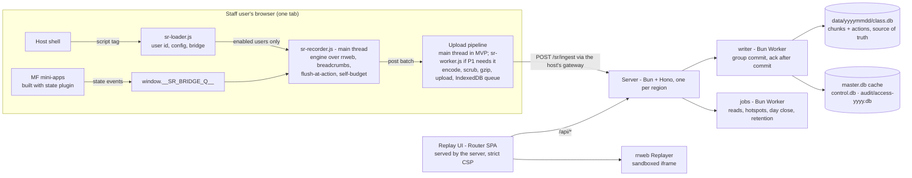
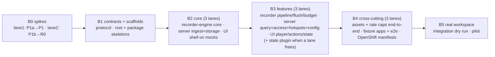

# 01 — Session replay
Status: draft v3 (split into sub-plans 02–08; awaiting approval) · Size: large

## Goal

Support and audit staff can open any user's session for a given day and replay it: the screen,
the app state and the network calls, in one timeline. Sessions come from our module-federation
React apps (webpack and Vite, React 17/18/19; plain Redux in the MVP, D39). Recording must
never make those apps noticeably slower. Recorded users are **internal staff only** (D19).

**Anti-goals** (failure even if it "works"):
- The recorder causes jank, long tasks or memory growth in the apps.
- A replay looks complete but silently skipped changes (misleading audit evidence).
- Secrets (passwords, one-time codes, auth tokens) reach the server. In the MVP all other data, including personal data, is recorded on purpose (D18).
- Replaying runs app code or fires real requests (API calls, or asset GETs with the viewer's cookies).

## Scope

**v1 (user, 2026-11-10): the devil's MVP cut, plus the build plugin.** One staff app on one desk
as the pilot.
- **Recording:** `full` everywhere, pause-with-band. Everything is recorded except secrets (D18). Network capture is method, URL, status and timing only.
- **Build plugin:** **plain Redux** capture only. The pilot apps use Redux + React `useState`, with no RTK, Zustand or TanStack Query (user, 2026-11-10). `useState` is covered visually by the screen recording (D39).
- **Delivery:** upload pipeline behind `post(batch)` (main thread first, D11), `recordingId` + `seq`, write-ahead IndexedDB queue, kill switch.
- **Server:** ingest with a client-asserted userId read from `window` (D20), one-file-per-day storage, optional crypto-shredding.
- **Replay UI:** internal network only; no login in the MVP. A self-entered name and reason are logged for each open (D38). `oauth-proxy` comes later.

Per-column recording rate caps (D36) are in v1 as a mechanism, with no caps by default. A busy screen that still breaks the budget pauses with a band and raises a source fix (D8, D32).

**Deferred to v2+:**
- the `mutationGate` hook (D23c) and the `data` level, unless P1 forces them;
- RTK, Zustand and TanStack Query wrappers in the build plugin; network bodies;
- the hash chain, signed manifests, `verify` and Object Lock;
- the `workerUrl` and Trusted Types rungs of the worker ladder;
- the multi-step self-budget;
- erasure tooling, legal-hold tooling, the role split and export (a written manual procedure covers the pilot);
- object-storage tiering, rage-click badges and live view;
- AI summaries;
- the `user-day` storage mode.
- canvas content and popout windows: lowest priority, possibly never (D34).
- Vite 8 (Rolldown) support for the build plugin; the MVP targets Vite 7.

## Decisions

IDs are kept stable across revisions so reviews can refer to them.

| # | Decision | Why | Who |
|---|---|---|---|
| D1 | Record the screen with **rrweb 2.x from npm** (`@rrweb/record`, `@rrweb/replay`, `@rrweb/types`, the network plugin). Every `@rrweb/*` package is pinned to one exact version, and **only `packages/recorder-engine` imports them** (D25). Production pins the newest release that is at least 2 weeks old when B1 starts. The P1 spikes use the installed 2.2.2. | Framework-free, MIT, proven; replays in a sandboxed iframe without running app code. Spike 0002 confirmed it. | user |
| D2 | Screen and app state in **one timeline**. The engine stamps state and breadcrumb events **at capture time** and merges them into the stream itself. rrweb's `addCustomEvent` re-stamps events with the time of emit (`record.js:3513`). | Support needs what the user saw and what the store held, in the right order (devil M3). | user, devil |
| D3 | The recorder is plain TypeScript, loaded once by the host shell, outside every mini-app; no React or state-lib dependency. | One recorder covers all MF remotes (they share one DOM) at any React version. | user |
| D4 | **Build plugin in v1** (user, 2026-11-10). Written once with `unplugin` (webpack 5+, Vite, Rspack). It wraps **store-creation call sites** in the app's own source; in the MVP that's `createStore` and `legacy_createStore` from `redux` only (D39). The import statement and its module specifier stay; only the local binding is renamed, and a hoisted wrapper function takes the original name (07-L1). The plugin checks the outcome per file, not plugin names: if `'redux'` reaches it already rewritten, the build fails (07-L2). | One line per app's build config. An import redirect would break MF shared singletons: webpack's ConsumeSharedPlugin matches the raw import before resolution, and the Vite federation plugins could duplicate the library. | user, architect |
| D5 | **Bridge:** the store wrappers and the recorder meet through a global queue (`window.__SR_BRIDGE_Q__`) that whichever side loads first creates. That way stores created before the recorder starts are still registered. The wrappers **fail open** (try/catch, return the original) and check a kill flag. A manual 3-line registration is the fallback for stores the plugin can't see. | Store modules run before the recorder starts (devil M4); the kill switch must reach code compiled into apps. | leader, devil |
| D6 | Redux capture wraps the **reducer** (and `replaceReducer`), not `dispatch`. | Thunk and saga middleware bypass a patched `store.dispatch`. The spike confirmed it catches pending, rejected and fulfilled. | leader |
| D39 | **MVP state capture = plain Redux only** (user, 2026-11-10): the pilot apps use Redux + React `useState`. • The build plugin wraps `createStore` / `legacy_createStore` from `redux`. • RTK, Zustand and TanStack Query wrappers are deferred. • **`useState` isn't captured as state.** It lives inside React components, not in a store. What it shows on screen is in the DOM recording, but its values don't appear in the state panel. • Reading component state through React's DevTools hook (`__REACT_DEVTOOLS_GLOBAL_HOOK__`) is rejected for the MVP: it's version-specific, fragile, and costs time on every React commit. | Smaller plugin and fixtures. The screen recording already shows what `useState` drives. | user, leader |
| D7 | Recording **starts automatically** and is always on. A "report a problem" button is optional and only marks a moment. | Long sessions; problems can't be predicted. Allowed for staff under D19. | user |
| D8 | **App performance first.** The recorder has a budget and degrades itself before it hurts the app. When completeness (D16) and performance clash, **performance wins**: the recorder pauses and the replay shows a band (user, 2026-11-10, Q14). | | user |
| D32 | **Every degradation raises a source fix** (user, 2026-11-10, Q14). When the self-budget pauses recording, the recorder reports a **hotspot**: app, remote, the busiest area (CSS path), mutations/s, how long it was degraded and how often. The server aggregates hotspots into a daily report per app, shown on a **Hotspots page in the replay UI** (user, Q18). The fix is at the source: throttle that screen's repaints, e.g. batched grid updates at most a few times a second, so the screen and the recording both stay cheap and complete. | Gaps are allowed only as a temporary state; each one becomes a tracked fix for the app team. | user |
| D33 | **Asset cache, built in and behind a setting** (user, 2026-11-10, Q15). The user doesn't expect missing assets in practice, but wants the capability ready. • **The upload pipeline** (in idle slices, or in the worker when it's enabled) finds image and font URLs in the events (`src`, `srcset`, CSS `url()`, `@font-face`). It only takes URLs matching an **allow-list of static asset paths** (e.g. `/assets/`, `/static/`, font hosts), so user-specific images such as avatars or document previews aren't collected. For each URL it hasn't seen, it fetches the file (`cache: 'force-cache'`, ≤ 2 MB, `image/*` and `font/*` only) and computes its sha256. It asks the server which hashes are missing and uploads only those. • **The stream** gets an `asset` event `{url, sha256, type}`. • **Server:** a content-addressed store `data/assets/<aa>/<sha256>` plus a metadata row. Each file is stored once for all users, and kept for the longest retention period after its last reference. • **Replay:** the ReplayEngine rewrites asset URLs to `/assets/<sha256>` before building, so the strict CSP (D30) still allows only our own origin. Old versions survive redeploys. | "Exact screen" (D16) includes icons and fonts; the live URLs can't be used (cookies, redeploys). | user, leader |
| D34 | **Canvas content and popout windows are not supported:** not in the MVP, lowest priority, and possibly never (user, 2026-11-10, Q16). They are explicit, visible exceptions to D16. A `<canvas>` replays as a hatched placeholder labelled "canvas not recorded" (via `insertStyleRules`), and an open popout shows a band "popout open, not recorded". `recordCanvas` and `UNSAFE_replayCanvas` stay off. | Keeps the recorder cheap and the replay sandbox strict; the auditor still sees where the gaps are. | user |
| D35 | **Generated identifiers** such as basket names `{SYMBOL}{Date.now()}` must **replay exactly as the user saw them**. Our filters must not rewrite them: in the MVP that holds by design, because only secrets are masked (D18) and there's no card-number rule. **No search by these names for now**; visual replay is enough (user, 2026-11-10). Explore search per scenario later. | Replay never re-runs app code, so names aren't regenerated; the only risk is our own privacy filters. | user |
| D36 | **Per grid + column recording rate caps** (user, 2026-11-10). Config can cap how often a cell's changes are recorded. Example: the app ticks `bid` 10×/s, but the recording keeps at most 2 states per second for that cell. • **Mapping:** app → grid (a stable `data-sr-grid="<id>"` on the grid container) → AG Grid column id (cells carry `col-id`) → `maxRate` (states/s). • **Defaults:** no caps; every change is recorded (D16). • **Mechanism:** D23 coalescing per cell. The cell keeps its latest value and emits at most `maxRate` times a second, plus **a flush at every user action**, so the screen is still exact at clicks and key presses. • **CPU:** the main-thread saving needs the gate (D23c, P1a). Emit-level (a) only cuts bytes. • **Audit transparency:** the config version and the capped columns go into session metadata, and the replay shows a legend such as "positions grid: bid/ask/mid recorded at 2/s". • **Config source:** the versioned server config, read with the kill switch (D22). Changes are reviewed ConfigMap edits, and each new version is logged, because lowering a rate lowers audit fidelity. | Gives app teams and admins a fine-grained, auditable lever for the busiest desk, instead of pausing everything (D8) or changing what users see (D32). Lines up with the upstream ask on rrweb PR #1933 (a per-element `sampling.mutation` function). | user, leader |
| D38 | **Replay UI access** (user, 2026-11-10, Q22). • **MVP: no access control.** The UI is reachable only on the internal network. Each open asks for a **name and a reason**, both self-entered. The access log records them plus the IP address. • **Chosen approach for later:** OpenShift `oauth-proxy` in front of the replay UI. It uses the cluster's existing login, puts the real viewer identity in the access log, and an allow-list says who may view. | Keeps the MVP simple. The trade-off is recorded in Risks: until `oauth-proxy` is on, anyone on the internal network can watch recordings, and the viewer name in the log is self-asserted. | user |
| D37 | **One deployment per region:** NAM, APAC, EMEA (user, 2026-11-10, Q21). Each has its own server, storage, config (allow-list, rate caps, kill switch) and replay UI. Recordings stay in their region. Each region's host apps point the recorder at that region's same-origin ingest path. Support uses their region's replay UI; **cross-region viewing is out of scope for the MVP**. The pilot runs in one region. | Data stays in its region, uploads stay close to users, and an outage in one region doesn't affect the others. | user |
| D9 | **Fidelity levels:** `full` everywhere (D16), except grid columns given a **recording rate cap** (D36). `block` stays available but **no areas are planned for it**: the apps have no ad slots or tickers (user, Q17). There's no area-wide `merge`; `data` is deferred. | D16 needs every UI state; rate caps are explicit, configured exceptions. | user |
| D10 | Every drop in fidelity is recorded and shown in the replay as a band: pauses, blocked areas, popouts, missing batches, quota. | An auditor must tell "nothing changed" from "not recorded in full". | leader |
| D11 | **The upload pipeline sits behind one interface, `post(batch)`** (encode, scrub, gzip, upload, IndexedDB queue, asset hashing). *(Confirmed by the user, 2026-11-10, Q20.)* • **MVP:** the pipeline runs on the **main thread** in idle slices (`requestIdleCallback`, ≤ 256 KB each). • **Worker:** a **separate same-origin bundle** (`sr-worker.js`, served by the host), switched on only if P1 shows the main-thread pipeline costs more than about 0.5 % CPU at S2. No `blob:` worker, no Service Worker. • **CSP:** none required on host apps for the MVP (user, Q3). The replay UI's own CSP (D30) is unaffected. | A worker moves scrubbing, gzip, upload, IndexedDB and garbage collection off the main thread, but `postMessage` still copies each batch on it. Estimated main-thread pipeline cost at the busiest desk: 0.5–1 % CPU; negligible elsewhere. Main-thread first is simpler: one code path, no loading logic, no CSP. | user (CSP, separate bundle), leader (main-thread first) |
| D12 | Server: Bun + Hono + SQLite. **Day files are the source of truth.** `master.db` is a catalog/cache that can be rebuilt from them on start. | A crash between two files can't create false "tampering" (devil M12). | user, devil |
| D13 | Replay UI: **TanStack Router SPA** + TanStack Query + Zustand (player state), built as static files and **served by the same Bun/Hono process** as ingest and the query API. Decided by the architect; the user agreed (2026-11-10, Q9). Replaces TanStack Start. | Replay is fully client-side, so Start's server features go unused. Hono isn't an extra hop: one process serves `/ingest`, `/api/*` and the UI. Start would add a second process, or would host ingest inside a UI framework that's been 1.0 only since 2026-10-13. One origin also means one login cookie later (`oauth-proxy`) and no CORS. Moving to Start later is incremental. | architect, user |
| D14 | Bun workspaces monorepo: `apps/`, `packages/`, `spike/`, `plan/`. | | user |
| D15 | All coding goes to the `coder` agent on the `sonnet` model. | | user |
| D16 | **Audit standard: every UI state, the exact screen the user saw** (user, 2026-11-10, Q1). Every DOM change is recorded in audit-relevant areas, **all the time**, not only at user actions; no merging that hides intermediate states. Actions are still marked in the capture phase (`pointerdown`, `pointerup`, `click`, `keydown`, `keyup`, `submit`), and the replay seeks to an action by its stream position. Server-side order, auth and API logs remain the record of what the *system* did. | Audit must be able to show what was on screen at any moment, not just at clicks. | user |
| D17 | **Build on rrweb, don't self-host** PostHog, OpenReplay or Sentry. Confirmed by the user, 2026-11-10, Q10. • None of them has every-UI-state recording with pause bands, hotspot reports, per-column rate caps, an access log, or one file per day. • Licences: OpenReplay is AGPLv3 with roles in its paid edition; Sentry is FSL; PostHog's self-hosted version is unsupported. • Each needs a ClickHouse/Kafka-class stack per region, against one Bun process here. The decision flips only if the team can't staff maintenance. | The part they'd save us, DOM record/replay, is rrweb, which we use anyway. | architect, user |
| D18 | **MVP: record and replay everything** (user, 2026-11-10, Q7). Inputs, text and app state, including server-cache data, are recorded exactly as the user saw them. Privacy rules are **revisited after the MVP**. **The only exception is secrets** (user, Q23): • password fields; • one-time codes (`autocomplete="one-time-code"`); • auth tokens: JWT and `Bearer` values, and `code`/`state`/`token`/`access_token`/`id_token`/`sig`/`key` URL parameters; • state keys named like secrets (`password`, `secret`, `token`, `otp`, matched on word and camelCase boundaries). These are masked or stripped in the browser. *Earlier proposal, kept for the post-MVP review:* mask inputs by default + a reviewed unmask allow-list; an always-mask list; remote config may only tighten masking. | Audit wants the exact screen (D16); the user accepts the privacy trade-off for the MVP. | user |
| D19 | **Internal staff only** (user, 2026-11-10). Always-on recording under legitimate interest, with a **DPIA and a staff notice before the pilot**. A customer audience (consent before recording) is out of scope. | Customers would need consent first, stricter masking and an internet-facing ingest. | user |
| D20 | **Identity and ingest in the MVP: keep it simple, no tokens and no OIDC** (user, 2026-11-10, Q6). • The recorder reads the user id from a field the host sets on `window`. It reads `window.userId` by default, and the path is configurable. • The server **accepts the client-asserted userId**. • Protections that stay: &nbsp;&nbsp;– ingest is reachable only on the internal network, through the host's same-origin path; &nbsp;&nbsp;– ids are validated; &nbsp;&nbsp;– rate limit and daily quota per userId + IP; &nbsp;&nbsp;– a session is bound to the first userId it was seen with, and a different userId on the same session gets 403. • Every session is marked **identity: client-asserted** in metadata and in the replay UI. • **Later (v2):** a short-lived JWT from the host backend (`sub=userId`). The protocol keeps an optional `Authorization` header for it. | Simplest path for an internal pilot. The trade-off, recorded honestly: anyone on the internal network can upload a session under any userId, so the replay proves what the browser sent, not who sent it (see also D28). | user |
| D21 | `master.db` is one SQLite catalog in the same server process, rebuilt from the day files when needed. It isn't a separate server. There is one per regional deployment (D37). *(Confirmed by the user, 2026-11-10, Q8.)* **Amended (05-L2):** what must never be rebuilt lives beside it, not in it. `control.db` holds legal holds, wrapped user keys and subjects, and is backed up. `audit/access-<yyyy>.db` is the append-only access log. `master.db` stays a pure cache. | No extra hop or consistency work at this scale. A rebuild of a cache that also held the access log and the keys would wipe the audit trail and make every encrypted chunk unreadable. | architect, user, leader |
| D22 | **Kill switch and gradual rollout in v1:** the recorder reads server config at start and on every upload response (on/off per app or user). Remote config may tighten masking only (D18). **Recording is not enabled for every user on day one** (user, 2026-11-10). It's enabled per user through an allow-list in the server config, and widened step by step. For a user who isn't enabled, the recorder only fetches the config and does nothing else: no rrweb and no listeners. The small loader runs for everyone; rrweb is downloaded only for enabled users (04-L1). Nothing starts before the user id is known, so there's no pre-identify buffer (04-L2). **Where config lives (05-L8, L9):** a ConfigMap-mounted JSON file per region, reloaded when it changes. Edits go through Git review and cluster RBAC, and every new `version` is logged. The MVP has **no admin HTTP endpoint**. Admin operations (rebuild, erase, hold, seal) use a second listener bound to `127.0.0.1`, reached with `oc exec`. | A recorder that hurts an app is switched off without a redeploy, and rollout risk stays small. With no login in the MVP (D38), an admin endpoint would let anyone on the network switch recording off or lower rate caps. | architect, user, leader |
| D23 | *Used per cell by D36's rate caps, not as an area-wide level.* **Coalescing in steps.** **(a)** Emit-level coalescing in the engine merges text and attribute changes by node id per window and releases them early at a flush. Style diffs are object-merged. For childList records it keeps the **first record's removes plus the last record's adds**, so cells never replay blank (devil M1). It saves bytes, not rrweb's per-record CPU. **(c)** A `mutationGate` hook (~6 lines, `bun patch`) only if P1 shows (a) misses the budget at S2/S3. Not `freezePage`. | `freezePage` doesn't merge (`record.js` :1565, :1756, :3516). A `MutationObserver` wrapper can't work, because rrweb fetches a native constructor from an iframe (:112-141). | architect, devil |
| D24 | **Adapters on npm rrweb, not a vendored copy** (user confirmed 2026-11-10). We fall back to a lean vendored copy only if we need more than 2 hooks, or a patch fails to re-apply on two upgrades in a row. Any hook is also proposed upstream, via PR #1933, but only after the user approves posting and with nothing proprietary in it. | An upgrade costs about half a day, against days for a fork. | user |
| D25 | **Anti-corruption layer:** `packages/recorder-engine` is the only importer of rrweb, enforced by a test. It exposes `RecorderEngine` (`start({mask, ignoreUrl, rateCaps?, gate?}) → {gateActive}`, `stop`, `mark`, `flush`, `checkpoint`, `take`, `setRateCaps`, `stats`) and `ReplayEngine` (`load(chunks) → {t0, t1, firstFrame}`, `seek({pos} \| {t})`, `play`, `pause`, `setSpeed`, `onMarker`, `onTick({t, pos})`, `onViewport`, `onEnd`, `destroy`). The exact types are in [04-recorder.md](04-recorder.md). | rrweb upgrades stay inside one package, covered by contract tests. | architect |
| D26 | **Storage: one file per UTC day for all users**, split by retention class: `data/<yyyymmdd>/<class>.db`. **Only one mode in v1.** The catalog records each session's files (`session_files`, 05-L7), so a later layout change (shards, per user) never needs a migration. | Far fewer files than per user per day (365 vs ~252k a year); one day close; cross-user audit search in one file. Two modes would double every erasure, retention and day-close path (devil M17). | user, devil |
| D27 | **Crypto-shredding, configurable, default off** (user, 2026-11-10). When on, a per-user data key (AES-GCM) encrypts chunk blobs and action payloads. `kind` and `name` stay plaintext for search. Keys are wrapped by a master key from an env var or the secret manager, never from the repo. Erasure then means deleting the key. **Data written while it's off can't be crypto-shredded later:** erasing it means the manual `VACUUM INTO` rewrite (devil M16). | Makes erasure cheap with day files, backups and write-once storage, and adds encryption at rest. | user, devil |
| D28 | **Integrity in v1:** a sha256 per chunk, checked on read. The UI says "unchanged since received", never "verified". Recordings are made by the client, so a user can forge their own. The hash chain, signed manifests and `verify` are deferred. | The original claim overstated what the chain proves (devil M8). | devil |
| D29 | **Recordings:** every page load gets a fresh in-memory `recordingId`, with `seq` from 0. A session groups recordings. The server de-duplicates on `(recordingId, seq)`. A repeated `seq` with a different sha256 is **stored and flagged, never dropped**. | Reloads, the keepalive tail, logout/login, eviction and duplicated tabs could collide on a `seq` and silently drop a full snapshot (devil B1). | devil |
| D30 | **The replay iframe can't fire live requests:** the replay UI sends a strict CSP (`default-src 'self'; img-src 'self' data: blob:; font-src 'self' data:; media-src 'self' data: blob:; style-src 'self' 'unsafe-inline'; script-src 'self'; connect-src 'self'; object-src 'none'; base-uri 'none'; form-action 'none'; frame-ancestors 'none'`), which the about:blank replay iframe inherits. `style-src 'unsafe-inline'` is needed because rrweb rebuilds recorded `<style>` elements and `style` attributes; inline CSS can't fetch anything, since `url()` is still limited by `img-src` and `font-src` (05-L13). Cached assets get their own sandboxing CSP (05-L14). Images and fonts come from our own asset cache (D33). `UNSAFE_replayCanvas` is never enabled. | Otherwise recorded asset URLs fire GETs with the auditor's cookies, and forged batches could aim them at internal hosts (devil M7). | devil |
| D31 | **Server write path:** • SQLite writes run in a `writer` Bun Worker; heavy reads and day close run in a `jobs` worker (05-L1). • Group commit every ~50–100 ms with a byte cap per transaction, `journal_mode=WAL`, `synchronous=FULL`. • **Ack only after commit**; a failed transaction returns 5xx to all its requests. • UTC days. The clock offset comes from a `sentAt` stamped on each upload attempt, sent in the `X-SR-Sent-At` header (03-L7). • Batches arriving after day close go to a linked late file, `data/<day>/late-<n>.db`. | bun:sqlite is synchronous, so the event loop is the real limit. Acking before commit can lose data the client has already deleted (devil M11, M15). | devil |
| D40 | **Repo tooling for the baseline:** Biome (one root `biome.json`) for lint and format; `bun test` for unit tests, with a happy-dom preload for browser packages and `fake-indexeddb` for the queue; Playwright (through `bunx`) for e2e, tagged by area. Each is pinned to the newest release at least 2 weeks old. Set up by the B1 root scaffold (X1). | One fast tool per job, all runnable with Bun, so tier-1 checks stay cheap for every slice. | leader |

## Design

### System overview

### Workspace layout

| Path | What |
|---|---|
| `packages/protocol` | Shared zod contracts (03): event tags, bridge message, ingest, config, query DTOs, position helpers; `./publish` entry with no imports. |
| `packages/recorder-engine` | The only code that imports rrweb (D25): `RecorderEngine`, `ReplayEngine`, capture-time stamping, rate-cap coalescing (04). |
| `packages/recorder` | Browser recorder policy and upload pipeline. No framework deps. Ships IIFE bundles for `<script>` tags (`sr-loader.js`, `sr-recorder.js`, optional `sr-worker.js`; IIFE is needed for script attribution in LoAF) plus ESM (04). |
| `packages/state-plugin` | unplugin → Vite 7 and webpack 5 (call-site transform) + runtime Redux wrapper (07). |
| `apps/server` | Bun + Hono ingest and query API, `writer` and `jobs` workers, storage; also serves the replay UI (05). |
| `apps/replay-ui` | Support UI (TanStack Router SPA), built and served by `apps/server` (06). |
| `fixtures/apps/` | Fixture apps imitating the real workspace: React 17 webpack 5 host, React 18/19 Vite 7 remotes (07). |
| `deploy/openshift/` | Kustomize base and one overlay per region (05). |
| `docs/integration/`, `examples/` | The integration guide and checked config samples (08). |
| `patches/` | Only if D23c is needed: `bun patch` files, listed in the root `package.json` `patchedDependencies` (02, P1a). |
| `scripts/` | Repo tooling, e.g. `sync-agent-context.ts`. |
| `spike/*` | Throwaway; never imported. |

### Recorder → [04-recorder.md](04-recorder.md)

Two packages: `packages/recorder-engine` (the only rrweb importer, D25) and `packages/recorder`
(startup, policy and the upload pipeline, D3). In short:

- **Startup (D7, D20, D22):** a small `sr-loader.js` runs for everyone, after the first render and
  an idle callback. It waits for `window.userId` (the path is configurable), fetches the config,
  and loads `sr-recorder.js` (rrweb inside) **only for enabled users**. Nothing records before the
  user id is known, so the login page isn't recorded (Q25).
- **Sessions and recordings (D29):** sessionStorage holds `{sessionId, userId, live}`. Each page
  load and bfcache restore gets a fresh `recordingId`; a duplicated tab gets a new session.
- **One timeline (D2):** the engine owns the stream buffer and inserts `sr:*` events at capture
  time. Bridge times are moved onto rrweb's clock, so laptop sleep can't reorder them.
- **Every UI state (D16):** `sampling.input = 'all'`, so typed text replays character by
  character. A capture-phase flush at every user action makes the frame exact at clicks and key
  presses. Full snapshots (checkpoints) run in idle time every 12 min and on route changes, with
  the slow-snapshot fallback (devil M10).
- **Masking (D18):** secrets only, through one shared function for rrweb and breadcrumbs, plus a
  scrubber for JWT and `Bearer` values on the encoded batch.
- **Rate caps (D36, D23):** per-cell coalescing in the engine; the gate path only when the P1a
  patch is present.
- **Self-budget (D8, D32):** 5 s cost windows. A pause stops rrweb; a short probe decides when to
  resume with a fresh `record()` and snapshot. Each resume emits a hotspot. Hidden tabs and
  popouts get their own bands.
- **Upload (D11):** `post(batch)`. A batch is sealed every 1 s or at 256 KB, encoded once, gzipped,
  written to IndexedDB and uploaded with the same bytes on every retry. Statuses follow 03. On
  `pagehide` a plain-JSON keepalive tail of at most 60 KB goes out. Queue caps: 50 MB or 72 h.
- **Network (v1):** method, URL, status and timing only, as `sr:net` events; no headers or bodies
  (devil M5).
- **Kill switch:** read at start and whenever `X-SR-Config-Version` changes.

**Fidelity levels (v1):**

| Level | For | Recording |
|---|---|---|
| `full` | Default; order ticket, dialogs, account details | Every change |
| `full` + rate cap (D36) | Configured grid columns, e.g. bid/ask/mid | At most `maxRate` states/s per cell, flushed at every user action; legend in the replay |
| `block` | Areas with neither audit nor debug value | Placeholder, plus a band in the replay |

### State capture → [07-state-plugin.md](07-state-plugin.md) (v1: plain Redux, D39)

- **Build plugin** (unplugin: a webpack 5 `post` loader, Vite 7's normal phase). It renames the
  `createStore` / `legacy_createStore` import binding and adds a hoisted wrapper function with
  the original name. The `'redux'` specifier is untouched, so MF sharing still matches (D4).
- **Order safety:** a per-file outcome check, not a plugin-name rule (07-L2). If `'redux'` reaches
  the transform already rewritten, the build fails and names the file.
- **Runtime:** wraps the reducer and `replaceReducer` (D6). It publishes the changed top-level keys
  as live references, stamped at capture time; fails open; obeys the kill flag (D5, D22). For
  stores the plugin can't see, a 3-line `srAttach` fallback.
- **Where the cost goes:** serialization, the 256 KB snapshot cap and secret-key redaction run in
  the recorder in idle time (04-L14), never inside the app's dispatch. `denyKeys` drops
  high-volume slices such as market data, for volume, not privacy.
- **Names and versions:** stores are named `<app>/redux#<n>`. Redux 4 and 5 are supported; the
  version is resolved per importing file at build time and checked again at runtime, because an
  MF singleton may run a different copy.

| Library | MVP? | Wrapped | Change source |
|---|---|---|---|
| Redux 4 / 5 | **yes** | `createStore`, `legacy_createStore` | the reducer argument and `replaceReducer` |
| RTK | deferred | `configureStore` | an added enhancer |
| Zustand | deferred | `create`, `createStore` | `api.subscribe((next, prev))` |
| TanStack Query | deferred | `new QueryClient` | cache subscriptions (keys and status) |
| React `useState` | **not captured** (D39) | — | visible only through the DOM recording |

### Server → [05-server.md](05-server.md)

- **One Bun + Hono process per region** (D37) serves `/sr/*` (config, ingest, asset upload),
  `/api/*`, `/assets/:sha256` and the built replay UI (D13).
- **Ingest:** validated with the 03 schemas. Default limits (05-L11): body 1 MiB, gunzip output
  16 MiB; per userId + IP 20 req/s with a burst of 100 and 8 MiB/min; 500 MB/day stored per user;
  a global 503 with `Retry-After` under backpressure. A session is bound to its first userId
  (403 otherwise). Identity is client-asserted (D20).
- **Write path (D31):** a `writer` Bun Worker does every SQLite write with group commit and acks
  after the day-file commit. A `jobs` worker does chunk reads, hotspot rollups, day close,
  retention and rebuilds.
- **Storage (D26, D21 amended):** day files `data/<yyyymmdd>/<class>.db` (the source of truth) plus
  `late-<n>.db`; `master.db` (cache); `control.db` (holds, keys, subjects); `audit/access-<yyyy>.db`
  (append-only); a content-addressed asset store (D33). The schemas are in 05.
- **Access (D38):** `POST /api/access` with a name and reason sets a signed viewer cookie and an
  8 h grant for that session. Every search, open, chunk fetch and denied attempt is logged.
- **Config (D22 amended):** a ConfigMap file with no admin endpoint; admin operations on
  `127.0.0.1`.
- **Retention, holds, erasure:** files are deleted at day close plus 30 days; held sessions are
  copied and verified first. Erasure deletes the user's key (D27 on) or rewrites the day files
  with `VACUUM INTO` (D27 off). The staff notice says a person can still appear in other users'
  recordings.

#### Ops

- **Sizing model:** GB/day = users × hours × 60 × KB/min ÷ 10⁶.
  - Quiet screen: about 30 KB/min (from the spike).
  - Busy grid: about 100 KB/min (*assumption*; P1 measures it).
  - With 30 % of users busy, that's about 24.5 MB per user per 8-hour day.

  **Our numbers** (user, Q5): 25–50 users per region (NAM, APAC, EMEA), about 250 users overall, and **30-day retention**.

  | Scope | Users | GB/day | Kept for 30 days | Busy-desk worst case (×2) |
  |---|---|---|---|---|
  | One region (pilot) | 50 | 1.2 | ~37 GB | ~75 GB |
  | All regions | 250 | 6.1 | ~184 GB | ~370 GB |

  These are small for one SQLite node per deployment. Day files are about 1.2 GB per region per day.

- **Day files** are about 1.2 GB per region per day (6 GB if one global deployment). Even so:
  - day close (checkpoint, `journal_mode=DELETE`, sha256, read-only, backup) takes minutes and runs in the `jobs` worker;
  - a corrupt file affects every user that day;
  - **local disk only**, because WAL doesn't work on network filesystems;
  - on Windows, exclude the data folder from real-time antivirus scanning.
- **Backups:** closed day files never change, except through the logged erasure path, so a plain copy works. `control.db` and the audit files can't be rebuilt, so they're always backed up. `master.db` can be rebuilt; back it up hourly with `VACUUM INTO` anyway.
- **Keys (D27):** the master key comes from an env var or the secret manager, never the repo or the data folder.
- **Retention: 30 days** (user, Q5), per retention class. Keep the access log for at least 2 years.
- **Deployment: Linux, on-prem OpenShift** (user, Q5):
  - The server runs as a **StatefulSet with 1 replica**, because SQLite allows one writer per file.
  - A deploy or restart briefly stops ingest. Recorders keep batches in IndexedDB and resend them, so nothing is lost.
  - Storage is a **ReadWriteOnce block-backed PVC** (e.g. Ceph RBD or local storage). **Never NFS or CephFS:** SQLite's WAL doesn't work on network filesystems.
  - Today's file is backed up with CSI `VolumeSnapshot`s; closed day files are copied to object storage, if the cluster has one.
  - The D27 master key comes from an OpenShift Secret or Vault.
  - Readiness and liveness probes; resource requests sized after P1.
  - Ingest is reached through the host app's route or gateway, on a same-origin path (D20).
- **Scaling path** (later): move closed day files to object storage, then shard day files by a hash of the userId (the `session_files` map makes both migration-free).
- **Monitoring:** alert on `seq` gaps, flagged duplicates, quota hits, self-budget pauses, and **enabled** users active in the app with no recording.
- **Hotspot report (D32):** a daily per-app report of degraded screens (area, rate, total gap time, affected users) on the replay UI's **Hotspots page** (user, Q18). It needs no external integration, and the data stays in the region. Email, ticket or chat delivery can come later.

### Replay UI → [06-replay-ui.md](06-replay-ui.md)

- **Stack (D13):** a TanStack Router SPA with code-based routes; filters and the play position
  live in the URL. TanStack Query holds server data and Zustand the player state. The
  `ReplayEngine` lives in a plain `PlayerController`, outside React state (06-L3).
- **Left:** filters by user and day; a session list with badges (errors, failed requests, reports).
- **Centre:** the replay iframe, scaled to fit, under the strict CSP (D30). Play/pause, back/next
  (previous/next action), speeds 0.5x 1x 1.5x 2x 4x 5x, and a scrubber with action markers and
  fidelity bands (03, bands and notes).
- **Right:** the action list (filter by kind and mini-app; failed requests in red; click to seek)
  and the state panel (Action / Diff / State tabs), rebuilt from snapshots plus actions.
- **Loading and seeking:** keyframe windows around the play head. An action seek uses its stream
  position (D16); a time seek uses `t + 1 ms`; the first frame is the first DOM mutation after the
  first full snapshot.
- **Access (D38):** a name and reason prompt before any session data loads. A **Hotspots page**
  lists the day's degraded screens (D32).
- **Deep links:** `/replay/:sessionId?pos=<recordingId:seq:idx>` or `?t=mm:ss`.

### Spike findings (commit 0002, `spike/rrweb-demo`)

- Recording from outside React works; RTK thunk actions and Zustand sets were captured.
- Masking verified: the PIN and card number were absent from stored data.
- The network plugin needs `recordHeaders` set to fill method and status.
- Seeking is "strictly before": +1 ms needed.
- The first full snapshot is an empty `#root`.
- A user switch in the same tab must start a new session.
- A state change comes a few ms before its DOM update.
- An 8 s session was about 27 KB raw, 4 KB gzip; 23 of its 86 events were actions.
- The spike's breadcrumbs bypass masking (`recorder/index.ts:42-45, :81, :90`); fixed by D18's shared mask function.

## Acceptance (v1)

**Performance** *(budget confirmed by the user, 2026-11-10, Q13)*:
- [ ] On the P1 stress page:
  - main-thread overhead ≤ 3 % of wall-clock time at S1, and ≤ 5 % at S2 before the self-budget acts;
  - no long animation frame ≥ 50 ms in which recorder script takes ≥ 10 ms;
  - recorder callback p99 ≤ 4 ms;
  - the flush adds ≤ 4 ms at p95 inside a click;
  - ≤ 20 MB extra memory (page + worker) at 60 min, with no upward trend over an 8-hour soak;
  - upload ≤ 150 KB/min gzip at S1.
- [ ] Recording starts on app load with no user step, and startup time is unchanged within noise.
- [ ] A slow full snapshot triggers the fallback (devil M10) without a pause → snapshot → pause loop.
- [ ] On S3, the recorder pauses with a band instead of slowing the app (D8), and a hotspot naming the busy grid shows up on the Hotspots page for that day, linked to the session (D32).

**Exactness:**
- [ ] Every UI state is recorded (D16): replay frames match a reference capture of the page at randomly sampled times, not only at actions (100 % in `full` areas).
- [ ] With each press held 150 ms and ticks arriving during it, the replay frame at every `sr:click` matches the screen at `click` time (100 %).
- [ ] Seeking to an action by stream position shows the frame before the app's reaction.
- [ ] State events appear before the click they precede, and after the action that caused them.

**Delivery:**
- [ ] Reload: the first snapshot of the new page is stored (no `seq` collision).
- [ ] Tab close: the unflushed tail arrives, or is recovered on the next start.
- [ ] Logout/login in one tab, a duplicated tab, and a bfcache restore each give a separate recording with no loss.
- [ ] Offline, then reconnect: the queue drains without jank.
- [ ] The server down for hours: the backlog drains under the rate limit, and the app stays smooth.
- [ ] After laptop sleep, the recorder resumes and nothing is lost.
- [ ] A client clock 5 min off: the replay lines up with server time.
- [ ] A session across UTC midnight replays seamlessly across two day files.

**Fidelity bands:**
- [ ] Bands appear for: pause, block, popout, missing batches, quota, a remote with no state captured.
- [ ] A `<canvas>` replays as the "canvas not recorded" placeholder (D34).

**Privacy and security:**
- [ ] Password fields, one-time codes, JWT/`Bearer` values, `token`-style URL parameters and secret-named state keys never reach the server (search stored data). Everything else (inputs, text, state) replays exactly as typed or shown.
- [ ] The pipeline scrubber catches a JWT planted in the DOM and leaves a 16-digit trade id alone.
- [ ] Generated identifiers such as `{SYMBOL}{Date.now()}` (e.g. `AAPL1762743000000`) replay exactly as the user saw them, in the DOM, the action list and the state panel. The pipeline scrubber and the state redaction never rewrite them.
- [ ] A batch with a different userId on an existing session gets 403. Every session shows "identity: client-asserted" in the replay UI.
- [ ] The replay iframe makes no network request to any origin (strict CSP).
- [ ] Opening a session without a name and reason is blocked; the access log records the name, reason, IP and session.

**Build plugin:**
- [ ] Plain Redux actions are captured for React 17 + webpack 5, React 18 + Vite 7 and React 19 + Vite 7. That includes actions dispatched through thunk or saga middleware, and reducers added later with `replaceReducer`.
- [ ] Under MF with shared singletons, and with a remote built without the plugin, capture works where the plugin ran and sharing is unaffected.
- [ ] A store created before the recorder loads is registered.
- [ ] The kill flag turns the wrappers into pass-through.

**Host:**
- [ ] The upload pipeline stays within budget at S1/S2, on the main thread or with `sr-worker.js` if P1 turned it on. If the worker fails to start, the main thread takes over and that's recorded in session metadata.

**Replay:**
- [ ] List by user and date; play/pause, back/next, all speeds, scrubber, deep link, state panel.
- [ ] Empty, loading and error states.
- [ ] A seek in a busy 8-hour session takes under 2 s.
- [ ] Asset cache on: after a redeploy changes an icon and a font, an older session still replays with the old icon and font, and the iframe requests only `/assets/<sha256>` on our origin.

**Storage:**
- [ ] With crypto-shredding on, deleting a user's key makes their chunks unreadable while others still replay.
- [ ] With it off, the manual erasure procedure works on a day file.
- [ ] A retention-job dry run leaves held sessions in `data/holds/`.
- [ ] The kill switch stops the recorder without a host redeploy.
- [ ] A user who isn't on the allow-list loads only the config: no rrweb, no listeners, and no measurable overhead.

## Sub-plans and parallel execution

This plan is the **master**: goal, scope, decisions (D-rows), cross-cutting acceptance, risks and
the log. Each part has its own sub-plan with design, "how it works" code samples, guidelines,
acceptance and one-coder-run task slices. Sub-plans inherit every D-row from here and may add
local L-rows. A decision that affects more than one sub-plan is made here.

| Plan | Covers | Owns (no overlap) |
|---|---|---|
| [02-spikes.md](02-spikes.md) | P1 performance, P1a gate patch, P1b module federation | `spike/perf-grid/`, `spike/mf-plugin/`, `patches/` |
| [03-protocol.md](03-protocol.md) | Shared contracts: events, ingest, config, bridge, query API, golden fixtures | `packages/protocol/` |
| [04-recorder.md](04-recorder.md) | `recorder-engine` (rrweb adapters, incl. `ReplayEngine`) + browser recorder + upload pipeline | `packages/recorder-engine/`, `packages/recorder/` |
| [05-server.md](05-server.md) | Ingest, `writer` and `jobs` workers, storage, query API, access log, retention, OpenShift | `apps/server/`, `deploy/openshift/` |
| [06-replay-ui.md](06-replay-ui.md) | Router SPA: sessions, player, actions, state, hotspots | `apps/replay-ui/` |
| [07-state-plugin.md](07-state-plugin.md) | Build plugin (call-site transform) + Redux wrapper + fixture apps | `packages/state-plugin/`, `fixtures/apps/` |
| [08-integration.md](08-integration.md) | How-to guide for the real workspace: packaging, host setup, build config, grids, rollout | `docs/integration/`, `examples/` |

### Batches

At most **3 agents at once** (global rules). Lanes in the same batch never share files (see
"Owns"). A batch starts when the batch before it has passed review.

| Batch | Lane 1 | Lane 2 | Lane 3 | Gate to pass before the next batch |
|---|---|---|---|---|
| **B0** | 02: K1 (P1a gate patch) → K2 (P1 harness) → K3 (runs + soak; the leader runs long measurements in the background) | 02: K4 (P1b MF spike, also 07's PL0) → 04: R0 (recorder checks spike) | — | Results written back into 01, 02 and 04; D11 and D36 defaults set; Q19 and Q24 answered |
| **B1** | 03: T1 (schemas, `publish`) → T2 (golden fixtures) | X1 (root scaffold, below) → 04: R1 → 07: PL1 | 05: S1 → 06: U1 (both after X1) | root `bun run typecheck`, `lint` and `bun test` green; one batched reviewer run (Sonnet is fine for scaffolds) |
| **B2** | 04: R2 (engine record core) → R3 (ReplayEngine core) | 05: S2 → S3 → S4 → S5 (storage, writer, ingest, startup/seal) | 06: U2 (API + mock) → U3 (shell, session list) | one batched reviewer run on the three lanes |
| **B3** | 04: R4 → R5, R6, R7 → R8 (loader, capture, state intake, pipeline, budget) | 05: S6 → S7 → S8 → S9 → S10 (access, query, config + hotspots, retention, crypto) | 06: U4 → U5, U6, U7 → U8 (player, controls, actions, state, access) | batched reviewer; qa writes the B4 specs in `specs` mode as lanes free up |
| **B3b** | 07: PL2 → PL3 → PL4 (runtime, transform, wiring), in the first lane that frees up | | | reviewer |
| **B4** | 04: R9 (rate caps) → R10 (assets) → R11 (worker mode, outputs) | 05: S11 (asset store) → 06: U9 (Hotspots), U10 (real server + CSP) → 05: S12 → S13 → S14 (metrics, load test, image + OpenShift) | 07: PL5 → PL6 (fixtures) → 08: I1 (examples) → I2 (guide pages); qa writes PL7 and the browser contract specs | **commit gate:** full e2e once, then the qa `gate` browser check |
| **B5** | 08: I3 (publish dry run) → I4 (real-workspace dry run) | 05: S15 (real overlays, registry, storage classes) | 08: I5 (pilot rollout, user-led) | pilot "done when" |

### Rules for parallel agents

1. **Contract first.** Code meets at `packages/protocol` (03). A lane that needs a contract change
   stops and asks the leader. Contract changes are additive only and get a Log line in 03.
2. **Mocks over waiting.** UI and server lanes use the 03 golden fixtures and a mocked API, so no
   lane waits for another to finish.
3. **One owner per file.** `owns:` in each slice is exclusive inside a batch. Shared root files
   (`package.json`, `tsconfig.base.json`, `.gitignore`) belong to the B1 scaffold slice, and later
   changes to them go through the leader.
4. **Tier-1 checks per slice** (type-check, lint, unit tests for the touched package). e2e runs once
   per batch gate, not per slice (global "Verifying cheaply").
5. **Coder on Sonnet** for every slice (D15); reviewer, qa and debugger are batched per the global rules.
6. **No code before approval.** These batches start only after the user approves this plan.

### Baseline here, integration there

This repo is the **baseline**. The real integration happens later in the user's own workspace
(webpack 5 host + Vite 7 remotes, Redux + `useState`, flexlayout-react + AG Grid, OpenShift per
region). Everything built here must be portable:
- packages publish to an internal registry;
- the server ships as a container image;
- there are no hard-coded paths;
- config comes from options or env.

The fixture apps (07) imitate the real workspace. [08-integration.md](08-integration.md) is the
step-by-step guide for B5.

## Tasks (cross-cutting; component tasks live in the sub-plans)

Component tasks, each with its `owns:` list and done-when check, live in the sub-plans: 02 K1–K4,
03 T1–T2, 04 R0–R11, 05 S1–S15, 06 U1–U10, 07 PL0–PL7, 08 I1–I5. The batch table above orders
them. The old master tasks map like this: P1, P1a, P1b → 02; P2 → 03 + 04; P3 → 05; P4 → 06;
P4b (assets) → 04 R10 + 05 S11 + 06 U10; P5 → 07.

- [x] P0 Spike 1: rrweb record and replay basics — owns: `spike/rrweb-demo/` — done: commit 0002.
- [ ] **Leader, before approval:** one consistency pass over 01–08 (devil), then the `auditor` on
  the whole plan set (project CLAUDE.md). Findings go into the plans, then the user approves.
- [ ] **X1 Root scaffold** — owns: root `package.json` (workspaces `apps/*`, `packages/*`, each
  fixture app and `fixtures/apps/shared/bridge-probe` by explicit path, `spike/*`; scripts
  `typecheck`, `lint`, `format`, `test`, `e2e`, `fixtures:build`, `fixtures:serve`,
  `fixtures:e2e`, keeping `spike`, `sync:agents` and `check:agents`), `biome.json`,
  `tsconfig.base.json`, `.gitignore` (allow `*.yaml`, `*.yml`, `*.toml`, `*.cjs`, `*.conf`,
  `Dockerfile*`, `LICENSE`), `playwright.config.ts`, `test/preload-dom.ts` (the shared happy-dom
  preload) — batch: **B1, first** — depends on: user approval — done when: `bun install`,
  `bun run typecheck`, `bun run lint`, `bun test` and `bun run check:agents` pass at the root.
  `spike/*` is left out of typecheck and lint.
- [ ] P6 Pilot hardening: monitoring alerts (05 S12), a written erasure and legal-hold procedure,
  and a kill-switch runbook (08 §6–§9) — owner: leader + user — before the pilot.
- [ ] Post-MVP: `oauth-proxy` in front of the replay UI (D38), recommended before rolling out
  beyond the pilot users.
- [ ] **DPIA and staff notice** — owner: user/DPO — before the pilot.
- [ ] Pilot (08 I5): one staff app, one desk in one region. Start with a few allow-listed users
  and widen towards the desk's 25–50 (D22). Two weeks. Done when there are no performance
  complaints and the budget holds in the field.

## Risks

| Risk | Mitigation / status |
|---|---|
| The browser creates a MutationRecord for every DOM change; JS can't remove that cost. | P1 A/B; `block` areas; `data` level in v2 if needed. |
| **The real max screen (≈3,100–8,800 cell changes/s, plus flash) may be more than full rrweb recording can handle within budget.** On the busiest desk, D8 could then pause recording for much of the day, against D16. | P1 measures it on the real tick profile. If it doesn't fit, D36 rate caps on the market-data columns come first, then a source fix or a larger budget (Q19). |
| `merge` savings look better in tests than reality (scripted input). | P1 uses realistic typing and checkpoints (devil M14). |
| Full snapshots of big grid pages exceed 50 ms. | Fallback interval and hysteresis (devil M10); P1 measures it. |
| Call-site transform order vs the federation plugin; stores created inside `node_modules`. | Per-file outcome check (07-L2); `include` option; `srAttach` fallback; P1b spike early (devil M14). |
| Patch drift, if D23c is ever needed. | Runtime `gateActive` check falls back to (a) with a band; contract tests. |
| Upgrading rrweb breaks replay of old recordings. | Golden recordings from each shipped version must replay; exact pins; wait 2 weeks after a release; contract tests on every bump. |
| Day files are large: slow day close; one corrupt file hits everyone that day. | At our scale, about 1.2 GB per region per day. Day close runs in the `jobs` worker; retention-class split; shards later via `storage_key`. |
| On OpenShift, the PVC could end up on NFS/CephFS, where SQLite's WAL breaks. | Require a ReadWriteOnce block-backed storage class; a startup check refuses to run on a network filesystem. |
| A single replica means brief ingest downtime on deploy or restart. | The client queue (IndexedDB) and retries absorb it; deploy outside trading hours. |
| Data written while crypto-shredding is off can't be shredded later. | A known trade-off of D27 (user chose default off); manual `VACUUM INTO` erasure; turn it on before the pilot if erasure requests are expected. |
| Recordings are client-asserted; a user can forge their own session. | The UI says "unchanged since received" (D28); server logs are the system of record (D16). |
| **MVP identity is client-asserted (D20):** anyone on the internal network can upload under any userId. | Internal network only; session binding; limits per userId + IP; "identity: client-asserted" shown on every session; JWT in v2. |
| **MVP replay UI has no login (D38):** anyone on the internal network can watch staff screens and trading data, and the viewer name in the log is self-asserted. The DPIA may object. | Internal network only (ideally restricted to the support team's network segment); name, reason and IP logged; `oauth-proxy` recommended before rolling out beyond the pilot users. |
| Images and fonts aren't captured by rrweb, and the strict CSP blocks live URLs. | Asset cache (D33), behind a setting. |
| Cached assets could hold personal data (avatars, document previews) that crypto-shredding can't reach, because assets are shared across users. | Only allow-listed static asset paths are collected (D33). |
| Canvas charts aren't recorded. | Not supported (D34); a placeholder labelled "canvas not recorded". |
| Popouts aren't recorded. | Not supported (D34); a band while open. |
| App data held in React `useState` never shows in the state panel (D39). | It's visible in the screen recording. Revisit if support needs it: either the app moves that state into Redux, or a DevTools-hook reader is added post-MVP. |
| **The MVP records all business and personal data unmasked (D18)**, and anyone on the internal network can view it (D38). | Secrets are still masked; DPIA and staff notice before the pilot; privacy review after the MVP; `oauth-proxy` before wider rollout. |
| Legal: recording staff. | DPIA and notice before the pilot (D19). |
| LoAF is Chromium-only. | Self-budget falls back to callback timing elsewhere. |
| rrweb 2.2.x releases are recent (2.2.1: 2026-11-06, 2.2.2: 2026-11-09). | Spikes use 2.2.2; production pins the newest release ≥ 2 weeks old at B1 start. |
| Vite 8 bundles with Rolldown and Vite 7 with Rollup, so plugin hook order next to `@module-federation/vite` may differ between them. | **MVP targets Vite 7 only** (user, 2026-11-10). Vite 8 support is deferred and needs its own fixture and order check. (Tooling confirmed in Q4: webpack 5, Vite 7/8, `@module-federation/vite`, Node 22+; unplugin's requirements are met.) |

### Devil review resolution (2026-11-09)

| ID | Resolution |
|---|---|
| B1 | D29 `recordingId`; Delivery acceptance |
| M1 | D23a childList rule |
| M2 | D16 flush events + seek by position; Exactness acceptance |
| M3 | D2 capture-time stamping |
| M4 | D5 global queue, fail-open, kill flag |
| M5 | Network: method/URL/status/timing only in v1 |
| M6 | Superseded for the MVP by D18 (record everything except secrets); revisit in the post-MVP privacy review |
| M7 | D30 strict CSP on the replay UI |
| M8 | D28 "unchanged since received"; chain deferred |
| M9 | Write-ahead IndexedDB, uncompressed keepalive tail, Delivery acceptance |
| M10 | Snapshot fallback and hysteresis; checkpoints in P1 |
| M11 | D31 UTC, `sentAt` offset, late file |
| M12 | D12 day file = source of truth; `master.db` rebuildable |
| M13 | Popout band |
| M14 | P1b spike; realistic input; D23 rule covers S3 |
| M15 | D31 DB worker, group commit, `synchronous=FULL`, ack after commit |
| M16 | D27 crypto-shredding (optional, default off), retention-class files, verified hold copies |
| M17 | D26 one mode in v1 |
| Minor | `credentials: 'omit'`; no card-number rule in the MVP (D18); word-boundary redaction; buffer and queue caps; IIFE build; replay UI access control before the pilot (OIDC deferred by the user); `user-day` HMAC names apply only if that mode is ever added |

## Open questions — proposed answers to confirm

Collected from all sub-plans. **A** = answer before approval (it changes a design detail).
**B0** = needed when the spikes start. **B5** = needed for the real-workspace integration only;
it doesn't block B0–B4.

| # | When | Question | Proposed answer | From |
|---|---|---|---|---|
| 24 | B0 | How do ticks reach AG Grid: `applyTransaction`, `applyTransactionAsync`, `rowNode.setDataValue`, or replacing `rowData`? Is cell flash on? | P1 mimics the real update path (02-L4) | 02 |
| 19 | after P1 | The busiest desk doesn't fit the budget | First lever: D36 rate caps on the market-data columns. Then a source fix (D32), or a larger budget for that desk | 01 |
| 25 | A | Nothing records until the user id is known, so the **login page isn't recorded**. OK? | Yes. D22 needs the user id for the allow-list check, and rrweb mustn't load before it (04-L2) | 04 Q1 |
| 26 | A | What happens to the upload queue at **logout**? | Upload that user's queue at once. Whatever can't be sent stays tagged with the user id, uploads when they log in again on that browser, and expires after 72 h. A purge only with `SessionRecorder.logout({ purge: true })` | 04 Q2 |
| 27 | A | How does the recorder know **which mini-app** a click came from? | Each remote's root element carries `data-sr-app="<name>"`, with the same name as the state plugin's `app` option | 04 Q3, 06 Q4 |
| 28 | A | Is another replay or monitoring tool (Sentry Replay, LogRocket, …) on the pilot pages? | If one is found, the recorder doesn't start and logs a console note: two recorders patch the same inputs | 04 Q4 |
| 29 | A | Times in the replay UI: viewer's local time, UTC, or the recorded user's time zone? | The viewer's local time, with UTC on hover | 06 Q1 |
| 30 | A | A viewer grant lasts 8 h per session and browser, so a reload skips the prompt. Right for audit? | Yes; every open and chunk fetch is still logged | 05-L10, 06 Q2 |
| 31 | A | Does the session list itself need a name and reason? | No; searches are logged | 06 Q3 |
| 32 | A | Default day on the Hotspots page | Yesterday (a complete day) | 06 Q5 |
| 33 | A | One retention class (`std`, 30 days) in v1? | Yes | 05 Q7 |
| 34 | A | Turn crypto-shredding on for the pilot? Data written while it's off can't be shredded later | Decide with the DPO as part of the DPIA; default off (D27) | 05 Q9 |
| 35 | A | Who approves an allow-list, rate-cap or kill-switch change in each region, and who can apply one out of hours? | A named owner per region approves the ConfigMap edit; the on-call support lead can flip the kill switch | 08 Q4 |
| 36 | B5 | Internal npm registry and package scope (keep `@sr`?); image registry and per-region promotion | — | 05 Q1, 08 Q1–Q2 |
| 37 | B5 | Block storage class and VolumeSnapshotClass per cluster; CronJob or OADP/Velero for snapshots; object storage for closed day files? | — | 05 Q2–Q3 |
| 38 | B5 | What sits in front of the host shell (nginx, API gateway, plain Route)? Does it proxy `/sr/*`, and which header carries the client IP? Support-network CIDRs for the Route allow-list; a SIEM target for access rows? | — | 05 Q4–Q6, 08 Q3 |
| 39 | B5 | The host's details: the global holding the user id; any CSP today; real versions of React, Redux, AG Grid, flexlayout-react, webpack, Vite; webpack's built-in MF plugin or `@module-federation/enhanced`; `redux` shared as one singleton on one major; stores made through CommonJS, namespace imports or a shared library; which slices hold market data (`denyKeys`) | — | 07 Q1–Q4, 08 Q5–Q7 |
| 40 | B5 | Which 2–3 users and which desk for stage 1, and which region runs the pilot? | — | 08 Q8 |

Resolved: Q1 (every UI state, D16), Q11 (staff only, D19), Q12 (adapters on npm, D24),
Q14 (performance wins, with a source fix raised: D8, D32), Q15 (asset cache behind a setting, D33), Q16 (no canvas or popouts, D34), Q17 (masked fields stay masked; no blocked areas planned: D9, D18), Q2 and Q2b (real screen shape and tick profile → P1 scenarios), Q3 (no host CSP in the MVP; a worker, if used, is a separate same-origin bundle), Q20 (main-thread pipeline first, D11), Q4 (webpack 5; Vite 7 and 8 with `@module-federation/vite`; Node 22+), Q5 (25–50 users per region, 250 overall, 30-day retention, on-prem OpenShift on Linux), Q21 (one deployment per region, D37), Q6 (no tokens or OIDC in the MVP; the userId comes from `window`, D20), Q22 (no replay UI login in the MVP; `oauth-proxy` later, D38), Q7 and Q23 (record everything except secrets in the MVP, D18), Q8 (`master.db` inside each regional server, D21), Q9 (Router SPA served by the Bun/Hono process, D13), Q10 (build on rrweb, D17), Q13 (performance budget confirmed), Q18 (hotspot report is a page in the replay UI). From the sub-plans: 05 Q8 (the ingest limits fit the recorder cadence of about 1 upload/s per tab: 05-L11, 04-L8).

## Log

- 2026-11-09 — First draft compiled from the brainstorm and spike 1.
- 2026-11-09 — Policy and technical architect proposals merged:
  - auth, privacy, tamper evidence, ops and sizing;
  - call-site transform instead of an import redirect;
  - worker loading ladder;
  - Router SPA;
  - coalescing instead of `freezePage`;
  - the P1 workload.
- 2026-11-09 — The user chose to vendor rrweb (D24). The architect then evaluated adapters versus vendoring and proposed adapters plus the anti-corruption layer (D25).
- 2026-11-09 — The user asked for one SQLite file per day as an option (D26).
- 2026-11-09 — Devil review: 1 blocker, 17 major, minor items, stale text and an MVP cut.
- 2026-11-10 — User decisions:
  - MVP cut, but the build plugin stays in v1;
  - one file per day with crypto-shredding, configurable and default off (D27);
  - adapters on npm (D24 confirmed);
  - internal staff only (D19).

  Plan rewritten as v2:
  - all devil findings resolved (see the resolution table) and stale text removed;
  - new decisions D27–D31;
  - P1b MF spike added alongside P1;
  - acceptance expanded with the missing awkward-state checks.
- 2026-11-10 — Q1 answered by the user: every UI state, the exact screen the user saw (D16
  rewritten). D9 makes `full` the only level for audit areas; D23 (merge) put on hold; P1's key
  question is now whether `full` fits the budget. New open questions Q14–Q17 follow from this.
- 2026-11-10 — Q14 answered: performance wins (pause with a band), and every degradation raises a
  source fix for the app team (D8 extended, new D32 hotspot report, Q18 added).
- 2026-11-10 — Q15 answered: prepare option A. New D33 asset cache, behind a setting: allow-listed
  static assets only, content-addressed, URLs rewritten at replay. Task P4b and an acceptance item
  added.
- 2026-11-10 — Q16 answered: canvas content and popout windows are not in the MVP, lowest
  priority, possibly never (D34); they show as a placeholder and a band.
- 2026-11-10 — Q17 answered: masked fields stay masked; no blocked areas are planned. `merge` is
  dropped from v1, since Q14 chose pause-with-band. The user raised generated unique names
  (`{SYMBOL}{Date.now()}`, e.g. basket names) as something that must be covered; an acceptance
  item was added.
- 2026-11-10 — Generated names: the user said visual replay is enough and there's no search for
  now; scenarios to be explored case by case (D35).
- 2026-11-10 — Q2 answered. The real screen: flexlayout with 10–25 grid tabs (visible and visited
  tabs mounted), 4 busy grids of up to 100 rows × 10 ticking columns, open all day. P1 scenarios
  rewritten around it: a tick-rate sweep, hidden-tab measurements and an 8-hour soak.
- 2026-11-10 — Q2b answered: up to 4 market-data cells per row tick 4/s; executions, totals and
  notionals tick slower. That's ≈3,100–8,800 cell changes/s on the real max screen. A new risk
  row and Q19 (decide after P1 if it doesn't fit) were added.
- 2026-11-10 — The user proposed per grid + column recording rate caps (e.g. the app ticks 10/s,
  the recording keeps 2/s). Added D36:
  - mapping via `data-sr-grid` + AG Grid `col-id`;
  - no caps by default;
  - a flush at every user action;
  - a server-side versioned config, admin-only and access-logged;
  - a replay legend.

  D9 and D23 updated, P1 variants and P1a (now likely needed) updated, Q19 reworded.
- 2026-11-10 — Q3: no host CSP in the MVP; a worker, if used, is a separate same-origin bundle.
  The user asked whether a worker is needed at all. D11 was rewritten as a proposal: the pipeline
  goes behind `post(batch)`, runs on the main thread first, and `sr-worker.js` is used only if P1
  shows more than about 0.5 % CPU at S2. The `blob:` ladder was dropped. Q20: the user confirmed.
- 2026-11-10 — Q4 answered: webpack 5; Vite 7 and 8 (mixed) with `@module-federation/vite`; Node
  22+; no originjs. P1b, P5 and the plugin acceptance now target these versions. A new risk covers
  Vite 8's Rolldown vs Vite 7's Rollup plugin order.
- 2026-11-10 — The user scoped the MVP to Vite 7. Vite 8 support is deferred; fixtures and
  acceptance updated.
- 2026-11-10 — Q5 answered: 25–50 users per region (NAM/APAC/EMEA), about 250 overall; 30-day
  retention; Linux, on-prem OpenShift. Updated:
  - the sizing (~37 GB per region, ~184 GB overall at 30 days);
  - a deployment section (StatefulSet with 1 replica, an RWO block PVC, no NFS, VolumeSnapshots, the key in a Secret or Vault);
  - two new risks.

  The pilot is now one desk in one region. Q21 (regional deployments) added.
- 2026-11-10 — The user said recording won't be enabled for every user on day one. D22 now covers
  a per-user allow-list rollout in the server config. Non-enabled users load only the config.
  Monitoring, the pilot task and acceptance updated.
- 2026-11-10 — Q21 answered: one deployment per region (NAM/APAC/EMEA), each with its own server,
  storage, config and replay UI (D37). Cross-region viewing is out of MVP scope.
- 2026-11-10 — Q6 answered: no OIDC and no tokens in the MVP; the userId comes from a field on
  `window`. D20 rewritten:
  - the userId is client-asserted, and every session is marked that way;
  - internal network only, with limits per userId + IP and session binding;
  - JWT in v2.

  Ingest, the queue, acceptance and P6 updated. Q22 (replay UI access control) added.
- 2026-11-10 — Q22 answered: `oauth-proxy` is the chosen approach, but not required for the MVP
  (D38). The MVP replay UI is internal network only, with a self-entered name and reason logged
  per open. A risk row and a post-MVP task were added.
- 2026-11-10 — Q7 answered: record and replay everything in the MVP, no masking; privacy to be
  revisited after the MVP (D18 rewritten). Q23 (secrets exception) asked before the other
  sections are updated.
- 2026-11-10 — Q23 answered: keep the secrets-only exception (passwords, one-time codes, auth
  tokens, secret-named state keys). Updated to match: the anti-goal, scope, recorder masking,
  scrubber (no card-number rule), state redaction, server-cache data (now recorded), D35,
  acceptance, risks and the devil-resolution table.
- 2026-11-10 — Q8 confirmed: the "reserved master instance" is the `master.db` catalog inside each
  regional server (D21).
- 2026-11-10 — The user said the MVP apps use plain Redux + React `useState`, with no RTK, Zustand or
  TanStack Query. Added D39: the plugin wraps only `createStore`/`legacy_createStore`, and
  `useState` is covered visually only. Scope, state capture, acceptance, P1b and risks updated.
- 2026-11-10 — Q9: the user asked the architect to decide and whether Hono adds a hop. It doesn't:
  one process serves ingest, the API and the static UI. D13 is final: a Router SPA served by
  `apps/server`.
- 2026-11-10 — Q10 confirmed: build on rrweb, don't self-host (D17).
- 2026-11-10 — Q13 confirmed: the performance budget in Acceptance stands.
- 2026-11-10 — Q18 answered: the daily hotspot report is a page in the replay UI (D32, Ops,
  Replay UI, acceptance updated). Only Q19 remains open, and it needs P1's numbers.
- 2026-11-10 — The user asked to split the plan so parallel agents can work at once, with code
  samples, how-tos and guidelines, and to prepare for the real workspace. Sub-plans 02–08
  written (02 and 03 by the leader; 04–08 drafted by agents, reviewed and merged by the leader).
  Merged back into this master:
  - D21 amended: `control.db` and `audit/access-<yyyy>.db` beside the `master.db` cache (05-L2);
  - D22 amended: the loader/recorder split, no pre-identify buffer, config as a ConfigMap file
    with no admin endpoint, admin on `127.0.0.1` (04-L1, L2; 05-L8, L9);
  - D25 updated to the engine APIs in 04; D30's CSP gains `style-src 'self' 'unsafe-inline'`
    and the other directives from 05-L13; D31 names the `writer` and `jobs` workers and the
    `X-SR-Sent-At` header; D4 follows 07's binding rename and outcome check; new D40 (tooling);
  - the Recorder, State capture, Server and Replay UI design sections cut to summaries that
    link to their sub-plans; the old storage schema removed (05 owns it); ingest limits set to
    05-L11; input sampling `all`, not `last` (04-L5);
  - the batch table now names every task; the old P1–P5 tasks moved to the sub-plans; new X1
    root scaffold; task ids made unique (02 K1–K4, 07 PL0–PL7);
  - open questions from every sub-plan consolidated as Q24–Q40.
