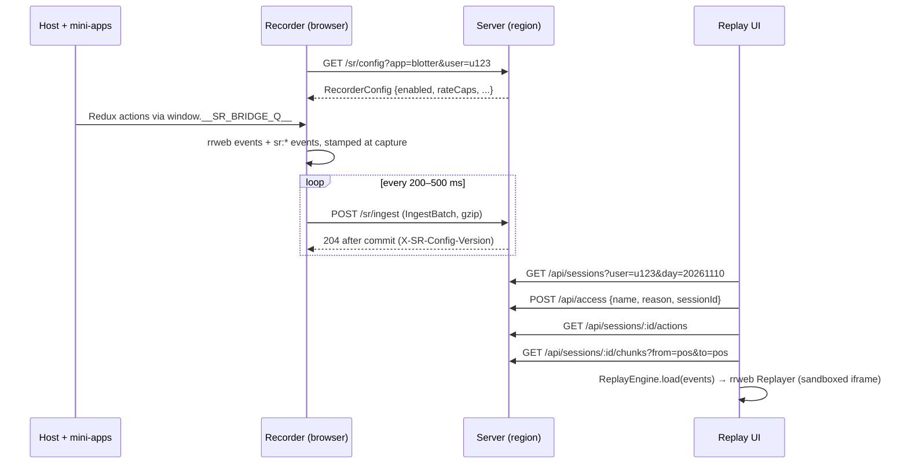

# 03 — Protocol (shared contracts)
Status: draft · Size: small · Parent: [01-session-replay.md](01-session-replay.md)

## Goal

One package, `packages/protocol`, that defines every shape crossing a boundary: browser ↔ server,
app ↔ recorder, server ↔ replay UI. With these contracts fixed first, the recorder, server, replay
UI and state plugin can be built **in parallel by different agents** against the same types, mocks
and golden fixtures. Nothing in this package has runtime dependencies other than `zod`.

## Decisions

Inherits D2, D5, D11, D16, D20, D22, D29, D33, D36 from the parent plan. Local decisions:

| # | Decision | Why |
|---|---|---|
| L1 | Our events are **rrweb custom events** (`type: 5`) whose `data.tag` starts with `sr:`. The engine stamps and inserts them itself; it never uses `record.addCustomEvent`, which re-stamps (D2). | rrweb's Replayer keeps working on the mixed stream and ignores tags it doesn't know. |
| L2 | Every event has a **stream position** `{ recordingId, seq, idx }`, where `idx` is its index in the batch. Seeking to an action uses its position, not its time (D16). | Positions are unique and ordered even when many events share a millisecond. |
| L3 | Protocol version `v: 1` on every batch, bridge message and config. Changes are **additive only**: new tags or fields, never renamed or removed ones. The replay UI ignores unknown tags. | Old recordings must replay after upgrades (golden-recording tests). |
| L4 | **`zod` schemas are the source of truth.** TypeScript types come from `z.infer`, and the server validates every request with the same schemas. | One definition and no drift; Hono's validator takes zod directly. |
| L5 | JSON on the wire. A batch body is `gzip` (`Content-Encoding: gzip`) or plain JSON. The `pagehide` tail sends plain JSON, because `CompressionStream` is async. | Simple and debuggable; gzip makes the size fine. |
| L6 | The package scope is `@sr/*` in this baseline. The real workspace may rename it (see [08-integration.md](08-integration.md)). | |

## Design

### How the data flows



### Events (`src/events.ts`)

```ts
// Sample — the shape to build, not final code.
import { z } from 'zod';

export const StreamPos = z.object({
  recordingId: z.string(),        // fresh per page load (D29)
  seq: z.number().int().min(0),   // batch number within the recording
  idx: z.number().int().min(0),   // event index within the batch
});

// Our custom event tags. rrweb's own event types (0–6) pass through untouched.
export const SrTag = z.enum([
  'sr:click', 'sr:input', 'sr:nav', 'sr:error', 'sr:report',
  'sr:state', 'sr:fidelity', 'sr:hotspot', 'sr:asset', 'sr:meta', 'sr:rate-caps',
]);

export const FidelityReason = z.enum([
  'pause-budget',      // D8: the self-budget paused recording
  'hidden-tab',        // the tab was in the background, so recording paused
  'popout',            // D34: popout open, not recorded
  'snapshot-slow',     // checkpoint interval stretched (devil M10)
  'missing-batches',   // a seq gap seen at ingest
  'quota',             // daily quota hit
  'pipeline-fallback', // the worker failed; main-thread pipeline took over (D11)
  'buffer-overflow',   // pre-identify or queue cap reached
  'no-state',          // a remote with no state captured
]);

export const SrPayload = {
  'sr:click':    z.object({ label: z.string(), selector: z.string() }),
  'sr:input':    z.object({ field: z.string(), value: z.string() }),        // secrets → '****' (D18)
  'sr:nav':      z.object({ url: z.string() }),                              // token params stripped
  'sr:error':    z.object({ message: z.string(), stack: z.string().optional() }),
  'sr:report':   z.object({ note: z.string().optional() }),
  'sr:state':    z.object({
    store: z.string(), kind: z.literal('redux'),
    op: z.enum(['snapshot', 'action']), type: z.string(),
    state: z.unknown().optional(),                                           // op = snapshot
    changes: z.record(z.unknown()).optional(),                               // op = action: top-level keys
  }),
  'sr:fidelity': z.object({ reason: FidelityReason, start: z.boolean(), detail: z.string().optional() }),
  'sr:hotspot':  z.object({ area: z.string(), mutationsPerSec: z.number(), pausedMs: z.number() }),
  'sr:asset':    z.object({ url: z.string(), sha256: z.string(), type: z.string() }),   // D33
  'sr:meta':     z.object({
    app: z.string(), appVersion: z.string().optional(), remotes: z.record(z.string()).optional(),
    libs: z.record(z.string()).optional(), pipeline: z.enum(['main', 'worker']),
    userAgent: z.string(), viewport: z.object({ w: z.number(), h: z.number() }),
  }),
  'sr:rate-caps': z.object({ configVersion: z.string(), caps: z.record(z.record(z.number())) }), // D36 legend
} as const;
```

An `sr:*` event on the wire is an rrweb custom event:

```json
{ "type": 5, "timestamp": 1762743000123,
  "data": { "tag": "sr:state",
            "payload": { "store": "blotter/redux#1", "kind": "redux", "op": "action",
                         "type": "orders/placed", "changes": { "orders": { "...": "..." } } } } }
```

### Ingest batch (`src/ingest.ts`)

```ts
export const IngestBatch = z.object({
  v: z.literal(1),
  sessionId: z.string().regex(/^[A-Za-z0-9_-]{1,64}$/),
  recordingId: z.string().regex(/^[A-Za-z0-9_-]{1,64}$/),
  seq: z.number().int().min(0),
  sentAt: z.number(),                                   // client clock at this upload attempt (D31)
  userId: z.string().regex(/^[A-Za-z0-9_.@-]{1,128}$/), // client-asserted in the MVP (D20)
  app: z.string(),
  events: z.array(z.unknown()).min(1),                  // rrweb events + sr:* events
});
```

`POST /sr/ingest` responses:

| Status | Meaning | What the recorder does |
|---|---|---|
| 204 | Committed (D31: acked only after commit) | Delete the batch from IndexedDB |
| 208 | Duplicate `(recordingId, seq)` with the same sha256 (a retry) | Delete the batch |
| 403 | The session is bound to another userId | Drop the batch, emit `sr:fidelity`, start a new session |
| 413 / 400 | Too big or invalid | Drop the batch, emit `sr:fidelity` |
| 429 | Rate limit or quota | Back off; after quota, stop for the day with a band |
| 5xx / network | Not stored | Keep it and retry with backoff |

Every 2xx response carries `X-SR-Config-Version`. If it differs from the cached config, the
recorder re-fetches the config. That's how the kill switch and rate caps reach running tabs (D22).

### Recorder config (`src/config.ts`)

```ts
export const RecorderConfig = z.object({
  v: z.literal(1),
  version: z.string(),                        // bumps on every admin change (audited)
  enabled: z.boolean(),                       // allow-list result for this user (D22)
  killSwitch: z.boolean(),
  checkpointMinutes: z.number().default(12),
  budget: z.object({ cpuPct: z.number(), longFrameMs: z.number(), resumeAfterMs: z.number() }),
  rateCaps: z.record(z.record(z.number().positive())).default({}),   // gridId → colId → max states/s (D36)
  assetCache: z.object({ enabled: z.boolean(), allow: z.array(z.string()) }), // D33
  pipeline: z.enum(['main', 'worker']).default('main'),              // D11
});
```

Sample served config for the pilot desk:

```json
{ "v": 1, "version": "2026-11-10.3", "enabled": true, "killSwitch": false,
  "checkpointMinutes": 12,
  "budget": { "cpuPct": 3, "longFrameMs": 50, "resumeAfterMs": 10000 },
  "rateCaps": { "positions": { "bid": 2, "ask": 2, "mid": 2 } },
  "assetCache": { "enabled": false, "allow": ["/assets/", "/static/"] },
  "pipeline": "main" }
```

### State bridge (`src/bridge.ts`)

```ts
export const BridgeMsg = z.object({
  v: z.literal(1),
  store: z.string(),                    // 'blotter/redux#1' or the devtools name
  kind: z.literal('redux'),             // MVP: plain Redux only (D39)
  op: z.enum(['register', 'action']),
  type: z.string().optional(),          // the action type
  state: z.unknown().optional(),        // register: full snapshot (size-capped)
  changes: z.record(z.unknown()).optional(),
  t: z.number(),                        // performance.timeOrigin + performance.now() at capture (D2)
});

// The global queue that whichever side loads first creates (D5).
declare global {
  interface Window { __SR_BRIDGE_Q__?: { push(msg: unknown): void; killed?: boolean } }
}
```

```ts
// How a store wrapper publishes. It fails open (D5): it never throws into the app.
export const publish = (msg: unknown) => {
  try {
    const q = (window.__SR_BRIDGE_Q__ ??= Object.assign([] as unknown[], { killed: false }));
    if (!q.killed) q.push(msg);
  } catch { /* never break the app */ }
};
```

### Query API for the replay UI (`src/query.ts`)

| Route | Returns |
|---|---|
| `GET /api/sessions?user=&day=yyyymmdd&hasErrors=` | `SessionSummary[]` (newest first) |
| `GET /api/sessions/:id` | `SessionDetail` (meta, recordings, segments, rate-cap legend, identity = "client-asserted") |
| `POST /api/access` `{ sessionId, name, reason }` | 204 + a short-lived viewer cookie; logged (D38) |
| `GET /api/sessions/:id/actions` | `ActionRow[]` with `pos`, `t`, `kind`, `name`, `summary` |
| `GET /api/sessions/:id/chunks?from=<pos>&to=<pos>` | Events between two positions, each chunk with sha256 ("unchanged since received", D28) |
| `GET /api/hotspots?day=&app=` | `HotspotRow[]` for the Hotspots page (D32) |
| `GET /assets/:sha256` | A cached asset (D33) |

```ts
export const ActionRow = z.object({
  pos: StreamPos, t: z.number(),
  kind: z.enum(['click', 'input', 'nav', 'error', 'state', 'net', 'fidelity', 'report']),
  name: z.string(), summary: z.string(), failed: z.boolean().optional(),
});
```

The replay UI calls these through Hono's typed client (`hc<QueryApi>`), so a renamed route fails
the type check rather than surfacing at runtime.

### Golden fixtures (`fixtures/`)

- `batch-v1-basic.json`: a full snapshot, clicks, an input, a nav, two Redux actions, one failed request.
- `batch-v1-fidelity.json`: a pause band, a hidden-tab band, a rate-cap legend.
- `session-v1-golden/`: a complete small recording. **Every future rrweb or protocol version must still replay it** (L3).

Every package tests against these fixtures, so parallel work meets at the same shapes.

## Acceptance

- [ ] Every schema has a passing and a failing test case.
- [ ] Golden fixtures validate against the schemas.
- [ ] The types compile in all consumer packages (`bunx tsc --noEmit` at the root).
- [ ] No runtime dependency except `zod`.

## Tasks

- [ ] T1 `packages/protocol` schemas, types and `publish` helper — owns: `packages/protocol/src/` — batch: **B1** — done when the Acceptance items pass.
- [ ] T2 Golden fixtures — owns: `packages/protocol/fixtures/` — batch: **B1** — done when the fixtures validate and one replays in the spike Replayer.

## Risks

| Risk | Mitigation |
|---|---|
| A late contract change ripples into every package. | Additive-only rule (L3); contract changes go through the leader and get a Log line. |
| `zod` adds weight to the recorder bundle. | The recorder imports types only (`import type`). Only the server validates at runtime. |

## Log

- 2026-11-10 — Created from plan 01 when the user asked to split the plan for parallel agents (leader).
