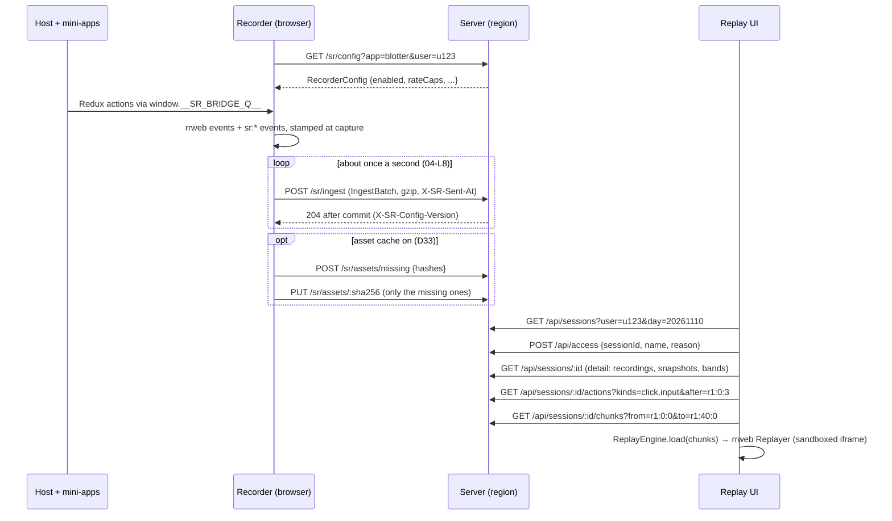

# 03 — Protocol (shared contracts)
Status: draft · Size: small · Parent: [01-session-replay.md](01-session-replay.md)

## Goal

One package, `packages/protocol`, that defines every shape crossing a boundary: browser ↔ server,
app ↔ recorder, server ↔ replay UI. With these contracts fixed first, the recorder, server, replay
UI and state plugin can be built **in parallel by different agents** against the same types, mocks
and golden fixtures. The package has two entries: `@sr/protocol` (zod schemas and types; its only
runtime dependency is `zod`) and `@sr/protocol/publish` (the bridge helper, with no imports at all).

## Decisions

Inherits D2, D5, D11, D16, D20, D22, D29, D33, D36 from the parent plan. Local decisions:

| # | Decision | Why |
|---|---|---|
| L1 | Our events are **rrweb custom events** (`type: 5`) whose `data.tag` starts with `sr:`. The engine stamps and inserts them itself; it never uses `record.addCustomEvent`, which re-stamps (D2). | rrweb's Replayer keeps working on the mixed stream and ignores tags it doesn't know. |
| L2 | Every event has a **stream position** `{ recordingId, seq, idx }`, where `idx` is its index in the batch. Seeking to an action uses its position, not its time (D16). | Positions are unique and ordered even when many events share a millisecond. |
| L3 | Protocol version `v: 1` on every batch, bridge message and config. Changes are **additive only**: new tags or fields, never renamed or removed ones. The replay UI ignores unknown tags. | Old recordings must replay after upgrades (golden-recording tests). |
| L4 | **`zod` schemas are the source of truth.** TypeScript types come from `z.infer`, and the server validates every request with the same schemas. zod 4 form throughout: `z.record(z.string(), X)`. | One definition and no drift; Hono's validator takes zod directly. zod 4.6's one-argument `z.record(X)` passes at runtime but fails the type check (05-C1). |
| L5 | JSON on the wire. A batch body is `gzip` (`Content-Encoding: gzip`) or plain JSON. The `pagehide` tail sends plain JSON, because `CompressionStream` is async. | Simple and debuggable; gzip makes the size fine. |
| L6 | The package scope is `@sr/*` in this baseline. The real workspace may rename it (see [08-integration.md](08-integration.md)). | |
| L7 | **`sentAt` travels in the `X-SR-Sent-At` header**, not in the body. | The recorder encodes and gzips a batch once and resends the same bytes on every retry (04-L9). A body field that changes per attempt would force a re-encode. |
| L8 | **Batch identity: `sha256 = SHA-256(JSON.stringify(events))`**, computed by the server on the parsed `events` (05-L4). | The tail is sent plain and retries are gzip, so hashing the body would make every retry look like a conflicting duplicate. |
| L9 | **Positions in URLs and query strings are `recordingId:seq:idx`** (`posKey`). Positions in different recordings are ordered by the recording order in `SessionDetail.recordings`. | One readable form for deep links, cursors and query parameters (06-C2). |
| L10 | **`@sr/protocol/publish` has no imports.** App bundles (through the state plugin's runtime) import only this entry; the recorder uses `import type` only. | zod must never ship into the apps or the recorder (07-L5). |
| L11 | **Until a recorder adopts the queue, `publish` folds each `action` into its store's `register` message.** An unadopted queue therefore holds one message per store. | A remote running on its own dev server has no recorder, and its queue must not grow without limit (07-G). Recording starts with one snapshot per store anyway (04, State intake). |

## Design

### How the data flows



### Events (`src/events.ts`)

```ts
// Sample — the shape to build, not final code.
import { z } from 'zod';

export const StreamPos = z.object({
  recordingId: z.string(),        // fresh per page load (D29)
  seq: z.number().int().min(0),   // batch number within the recording
  idx: z.number().int().min(0),   // event index within the batch
});

// Our custom event tags. rrweb's own event types (0–6) pass through untouched.
export const SrTag = z.enum([
  'sr:click', 'sr:input', 'sr:nav', 'sr:error', 'sr:report',
  'sr:state', 'sr:fidelity', 'sr:hotspot', 'sr:asset', 'sr:meta', 'sr:rate-caps',
  'sr:net', 'sr:redacted',
]);

export const FidelityReason = z.enum([
  'pause-budget',      // D8: the self-budget paused recording
  'hidden-tab',        // the tab was in the background, so recording paused
  'popout',            // D34: popout open, not recorded
  'snapshot-slow',     // checkpoint interval stretched (devil M10)
  'missing-batches',   // a seq gap, or batches the client had to drop
  'quota',             // daily quota hit
  'pipeline-fallback', // the worker failed; main-thread pipeline took over (D11)
  'buffer-overflow',   // the upload queue cap (50 MB / 72 h) dropped the oldest batches
  'no-state',          // a remote with no state captured
  'state-capped',      // a store snapshot or changed key was over the size cap and dropped (04-L14)
]);

const Rec = <T extends z.ZodTypeAny>(v: T) => z.record(z.string(), v);

export const SrPayload = {
  'sr:click':    z.object({ label: z.string(), selector: z.string(),
                            app: z.string().optional() }),                   // data-sr-app of the closest remote root
  'sr:input':    z.object({ field: z.string(), value: z.string(),          // secrets → '****' (D18)
                            app: z.string().optional() }),
  'sr:nav':      z.object({ url: z.string() }),                              // token params stripped
  'sr:error':    z.object({ message: z.string(), stack: z.string().optional() }),
  'sr:report':   z.object({ note: z.string().optional() }),
  'sr:state':    z.object({
    store: z.string(), kind: z.literal('redux'),
    op: z.enum(['snapshot', 'action']),
    type: z.string().optional(),                                             // op = action: the action type
    state: z.unknown().optional(),                                           // op = snapshot
    changes: Rec(z.unknown()).optional(),                                    // op = action: changed top-level keys
    removed: z.array(z.string()).optional(),                                 // op = action: deleted top-level keys
  }),
  'sr:fidelity': z.object({ reason: FidelityReason, start: z.boolean(), detail: z.string().optional() }),
  'sr:hotspot':  z.object({ area: z.string(), remote: z.string().optional(),
                            mutationsPerSec: z.number(), pausedMs: z.number() }),
  'sr:asset':    z.object({ url: z.string(), sha256: z.string(), type: z.string() }),   // D33
  'sr:meta':     z.object({
    app: z.string(), appVersion: z.string().optional(),
    remotes: Rec(z.string()).optional(),                                     // remote name → entry URL
    libs: Rec(z.string()).optional(), pipeline: z.enum(['main', 'worker']),
    userAgent: z.string(), viewport: z.object({ w: z.number(), h: z.number() }),
  }),
  'sr:rate-caps': z.object({ configVersion: z.string(), caps: Rec(Rec(z.number())) }), // D36 legend
  'sr:net':      z.object({ method: z.string(), url: z.string(),            // token params stripped
                            status: z.number().int(),                        // 0 = network error
                            ms: z.number() }),                               // 04-L16: replaces rrweb plugin events
  'sr:redacted': z.object({ jwt: z.number().int(), bearer: z.number().int() }), // scrubber counts per batch
} as const;
```

**Bands and notes.** A band is a `start: true` event plus a later `start: false` event with the
same reason. A note is a single `start: true` event with no end.

| Kind | Reasons | Replay UI (06) |
|---|---|---|
| Gap band (the screen is incomplete) | `pause-budget`, `hidden-tab`, `popout`, `missing-batches`, `quota`, `buffer-overflow` | hatched band, banner while the play head is inside |
| Band, screen still complete | `snapshot-slow`; `no-state` on the state lane | thin band |
| Note | `pipeline-fallback`, `state-capped` | a tick on the scrubber |

An `sr:*` event on the wire is an rrweb custom event:

```json
{ "type": 5, "timestamp": 1762743000123,
  "data": { "tag": "sr:state",
            "payload": { "store": "blotter/redux#1", "kind": "redux", "op": "action",
                         "type": "orders/placed", "changes": { "orders": { "...": "..." } },
                         "removed": ["draftTicket"] } } }
```

### Ingest batch (`src/ingest.ts`)

```ts
// Sample — the shape to build, not final code.
export const Id = z.string().regex(/^[A-Za-z0-9_-]{1,64}$/);
export const UserId = z.string().regex(/^[A-Za-z0-9_.@-]{1,128}$/); // client-asserted in the MVP (D20)

export const IngestBatch = z.object({
  v: z.literal(1),
  sessionId: Id,
  recordingId: Id,
  seq: z.number().int().min(0),
  userId: UserId,
  app: z.string(),
  events: z.array(z.unknown()).min(1),                  // rrweb events + sr:* events
});
// Not in the body: sentAt. It travels in the X-SR-Sent-At header (L7).
```

`POST /sr/ingest` request headers:

| Header | Value |
|---|---|
| `Content-Type` | `application/json` |
| `Content-Encoding` | `gzip`, or absent for the plain `pagehide` tail (L5) |
| `X-SR-Sent-At` | client `Date.now()` at this attempt, in ms. Required: the server corrects clock skew with `receivedAt − sentAt` (D31) |

The server computes `sha256` from the parsed events (L8). Responses:

| Status | Body | Meaning | What the recorder does |
|---|---|---|---|
| 204 | — | Committed (D31: acked only after commit). Also a same-`seq` batch with a **different** sha256: stored as a flagged duplicate, never dropped (05) | Delete the batch from IndexedDB |
| 208 | — | Duplicate `(recordingId, seq)` with the same sha256 (a retry) | Delete the batch |
| 400 | `{reason:'invalid'\|'expired'}` | Fails the schema, missing `X-SR-Sent-At`, or older than retention | Drop it; `missing-batches` band |
| 403 | `{reason:'user-mismatch'}` | The session is bound to another userId | Drop it; start a new session |
| 413 | — | Body over 1 MiB, or gunzip output over 16 MiB | Drop it; `missing-batches` band (the recorder splits batches before this, 04) |
| 429 | `{reason:'rate'\|'quota'}` + `Retry-After` | Per-user rate limit, or the daily quota | `rate`: wait `Retry-After`. `quota`: stop until UTC midnight with a `quota` band |
| 503 | `Retry-After` | Server backpressure (writer queue full, low disk) | Keep it; retry after `Retry-After` |
| other 5xx / network | — | Not stored | Keep it; retry with backoff |

Every 2xx response carries `X-SR-Config-Version`. If it differs from the cached config, the
recorder re-fetches the config. That's how the kill switch and rate caps reach running tabs (D22).

**Cadence and limits.** The recorder seals a batch about every 1 s or at 256 KB raw, with one
upload in flight per tab (04-L8). The server's default limits per userId + IP are 20 req/s with a
burst of 100 and 8 MiB/min, plus 500 MB/day stored per user (05-L11).

### Assets (`src/assets.ts`, D33, behind `assetCache.enabled`)

```ts
// Sample — the shape to build, not final code.
export const Sha256 = z.string().regex(/^[0-9a-f]{64}$/);
export const AssetMissingReq = z.object({ v: z.literal(1), hashes: z.array(Sha256).min(1).max(100) });
export const AssetMissingRes = z.object({ missing: z.array(Sha256) });
```

| Route | Body | Answer |
|---|---|---|
| `POST /sr/assets/missing` | `AssetMissingReq` | `AssetMissingRes`: the hashes the server doesn't have |
| `PUT /sr/assets/:sha256` | the raw bytes; `Content-Type: image/*` or `font/*`; at most 2 MB | 204; 400 if the bytes don't hash to `:sha256`; 413 if too big |
| `GET /assets/:sha256` | — | the cached asset, served with 05-L14's headers (replay UI only) |

### Recorder config (`src/config.ts`)

This is what the browser receives: the server has already resolved the allow-list for this user.
The file the server reads (a ConfigMap, 05-L8) has its own format, owned by 05.

```ts
// Sample — the shape to build, not final code.
export const RateCaps = z.record(z.string(), z.record(z.string(), z.number().positive())); // gridId → colId → max states/s (D36)

export const RecorderConfig = z.object({
  v: z.literal(1),
  version: z.string(),                        // bumps on every config change (logged)
  enabled: z.boolean(),                       // allow-list result for this user (D22)
  killSwitch: z.boolean(),
  checkpointMinutes: z.number().default(12),
  budget: z.object({ cpuPct: z.number(), longFrameMs: z.number(), resumeAfterMs: z.number() }),
  rateCaps: RateCaps.default({}),
  assetCache: z.object({ enabled: z.boolean(), allow: z.array(z.string()) }), // D33
  pipeline: z.enum(['main', 'worker']).default('main'),                      // D11
});
```

Sample served config for the pilot desk:

```json
{ "v": 1, "version": "2026-11-10.3", "enabled": true, "killSwitch": false,
  "checkpointMinutes": 12,
  "budget": { "cpuPct": 3, "longFrameMs": 50, "resumeAfterMs": 10000 },
  "rateCaps": { "positions": { "bid": 2, "ask": 2, "mid": 2 } },
  "assetCache": { "enabled": false, "allow": ["/static/img/", "https://fonts.corp.example/"] },
  "pipeline": "main" }
```

### State bridge (`src/bridge.ts` and `src/publish.ts`)

```ts
// Sample — the shape to build, not final code. src/bridge.ts
export const BridgeMsg = z.object({
  v: z.literal(1),
  store: z.string(),                    // '<app>/redux#<n>' (07-L9)
  kind: z.literal('redux'),             // MVP: plain Redux only (D39)
  op: z.enum(['register', 'action']),
  type: z.string().optional(),          // action: the action type
  state: z.unknown().optional(),        // register: the full state (a live reference)
  changes: z.record(z.string(), z.unknown()).optional(),  // action: changed top-level keys ({ $root } if not an object)
  removed: z.array(z.string()).optional(),                // action: deleted top-level keys
  meta: z.object({ app: z.string(), lib: z.string() }).optional(), // register: 'redux@4.2.1'
  t: z.number(),                        // performance.timeOrigin + performance.now() at capture (D2)
});

// The global queue that whichever side loads first creates (D5). The recorder adopts it by
// replacing `push` and setting `adopted`; the loader sets `killed` for non-enabled users (D22).
declare global {
  interface Window { __SR_BRIDGE_Q__?: unknown[] & { killed?: boolean; adopted?: boolean } }
}
```

Bridge messages hold **live references** to immutable Redux state. They never cross
`postMessage`; the recorder serializes, caps and redacts them in idle time (04-L14).

```ts
// Sample — the shape to build, not final code. src/publish.ts — no imports (L10).
type Msg = { store: string; op: string; state?: unknown; changes?: Record<string, unknown>; removed?: string[] };

/** How a store wrapper publishes. It fails open (D5): it never throws into the app. */
export const publish = (msg: Msg) => {
  try {
    const q = (window.__SR_BRIDGE_Q__ ??= Object.assign([] as unknown[], { killed: false }));
    if (q.killed) return;
    if (q.adopted || msg.op !== 'action') { q.push(msg); return; }
    // No recorder yet: fold the action into its store's register message (L11).
    const reg = q.find((m) => (m as Msg).store === msg.store) as Msg | undefined;
    if (reg) reg.state = fold(reg.state, msg);
  } catch { /* never break the app */ }
};

const fold = (state: unknown, m: Msg): unknown => {
  if (m.changes && '$root' in m.changes) return m.changes.$root;
  const next: Record<string, unknown> = { ...(state as Record<string, unknown>), ...m.changes };
  for (const k of m.removed ?? []) delete next[k];
  return next;
};
```

### Query API for the replay UI (`src/query.ts`)

| Route | Returns |
|---|---|
| `GET /api/sessions?user=&day=yyyymmdd&hasErrors=1&limit=50&cursor=` | `SessionPage` (newest first) |
| `GET /api/sessions/:id` | `SessionDetail` |
| `POST /api/access` (`AccessReq`) | 204 + the `sr_viewer` cookie and an 8 h grant for that session; logged (D38, 05-L10) |
| `GET /api/sessions/:id/actions?kinds=click,input&after=&to=&failedOnly=1&limit=1000` | `ActionPage` |
| `GET /api/sessions/:id/chunks?from=<posKey>&to=<posKey>&cursor=` | `ChunksResponse` |
| `GET /api/hotspots?day=yyyymmdd&app=` | `HotspotRow[]` for the Hotspots page (D32) |
| `GET /assets/:sha256` | A cached asset (D33) |

- **Errors:** detail, actions and chunks without a grant → 403 `{need:'access'}`. Unknown session
  → 404 `{error:'not-found'}` (it may live in another region, D37). Bad parameters → 400
  `{error:'invalid', issues}`.
- **Actions paging:** `after` is exclusive and `to` inclusive, both `posKey`s. `kinds` is a comma
  list of `ActionKind`. `failedOnly=1` keeps `net` rows only when `failed`; other kinds pass.
- The replay UI calls these through Hono's typed client (`hc<QueryApi>`). `QueryApi` is exported
  from `apps/server/src/api` (05); in B2 the UI uses its mock's type instead (06-L11). A renamed
  route then fails the type check rather than surfacing at runtime.

```ts
// Sample — the shape to build, not final code.
export const Day = z.string().regex(/^\d{8}$/);          // yyyymmdd, UTC
export const PosKey = z.string().regex(/^[A-Za-z0-9_-]{1,64}:\d+:\d+$/);

export const SessionSummary = z.object({
  sessionId: z.string(), userId: z.string(), app: z.string(),
  startedAt: z.number(), endedAt: z.number(),             // epoch ms, skew-corrected (D31)
  days: z.array(Day),                                     // the UTC days the session touches
  live: z.boolean(),                                      // a batch arrived in the last 2 min
  counts: z.object({ errors: z.number().int(), failedReqs: z.number().int(), reports: z.number().int(),
                     bands: z.number().int(), missingBatches: z.number().int() }),
  identity: z.literal('client-asserted'),                 // D20: nothing checked the user id
});
export const SessionPage = z.object({ items: z.array(SessionSummary), next: z.string().nullable() });

export const Band = z.object({
  reason: FidelityReason, recordingId: z.string(),
  from: z.number(), to: z.number().nullable(),            // epoch ms; to = null: still open
  detail: z.string().optional(),
});

export const SessionDetail = SessionSummary.extend({
  recordings: z.array(z.object({                          // ordered by startedAt (L9)
    recordingId: z.string(), startedAt: z.number(), endedAt: z.number(),
    lastSeq: z.number().int(), pipeline: z.enum(['main', 'worker']),
    gaps: z.array(z.object({ fromSeq: z.number().int(), toSeq: z.number().int() })),
  })),
  snapshots: z.array(z.object({                           // seek anchors: batches holding a full snapshot
    recordingId: z.string(), seq: z.number().int(), t: z.number() })),
  bands: z.array(Band),                                   // fidelity pairs + missing-batch gaps
  notes: z.array(z.object({ reason: FidelityReason, t: z.number(), detail: z.string().optional() })),
  rateCaps: z.array(z.object({ t: z.number(), configVersion: z.string(), caps: RateCaps })),
  meta: SrPayload['sr:meta'].partial().optional(),        // the latest sr:meta
  files: z.array(z.object({ day: Day, file: z.string() })), // for support debugging (05)
  legalHold: z.boolean(),
});

export const AccessReq = z.object({
  sessionId: z.string(), name: z.string().min(2).max(80), reason: z.string().min(3).max(200),
});

export const ActionKind = z.enum(['click', 'input', 'nav', 'error', 'state', 'net', 'fidelity', 'report', 'hotspot']);
export const ActionRow = z.object({
  pos: StreamPos, t: z.number(), kind: ActionKind,
  name: z.string(), summary: z.string(),
  failed: z.boolean().optional(),                         // net: status 0 or ≥ 400; error rows
  app: z.string().optional(),                             // the mini-app of a click or input
});
export const ActionPage = z.object({ items: z.array(ActionRow), next: PosKey.nullable() }); // next → `after`

export const Chunk = z.object({
  recordingId: z.string(), seq: z.number().int(), t0: z.number(), t1: z.number(),
  sha256: Sha256, integrity: z.enum(['ok', 'mismatch', 'unreadable']),  // D28; unreadable: key shredded
  events: z.array(z.unknown()),                           // empty when unreadable
});
export const ChunksResponse = z.object({
  chunks: z.array(Chunk),                                 // whole chunks covering [from, to], recording order then seq
  missing: z.array(z.object({ recordingId: z.string(), fromSeq: z.number().int(), toSeq: z.number().int() })),
  next: z.string().nullable(),                            // set when the 8 MiB cap cut the response
});

export const HotspotRow = z.object({
  app: z.string(), remote: z.string().nullable(), area: z.string(),
  pauses: z.number().int(), pausedMs: z.number(), peakMutationsPerSec: z.number(),
  users: z.number().int(),
  example: z.object({ sessionId: z.string(), pos: StreamPos }),   // the longest single pause
});
```

### Position helpers (`src/pos.ts`)

```ts
// Sample — the shape to build, not final code.
export const posKey = (p: StreamPos) => `${p.recordingId}:${p.seq}:${p.idx}`;

export const parsePos = (s: string): StreamPos | null => {
  const m = /^([A-Za-z0-9_-]{1,64}):(\d+):(\d+)$/.exec(s);
  return m ? { recordingId: m[1]!, seq: Number(m[2]), idx: Number(m[3]) } : null;
};

/** Recording order (index in SessionDetail.recordings), then seq, then idx (L9). */
export const comparePos = (a: StreamPos, b: StreamPos, order: ReadonlyMap<string, number>) =>
  (order.get(a.recordingId)! - order.get(b.recordingId)!) || a.seq - b.seq || a.idx - b.idx;
```

### Golden fixtures (`fixtures/`)

- `batch-v1-basic.json`: a full snapshot, clicks with `app`, an input, a nav, two Redux actions
  (one with `removed`), an `sr:net` with status 500, an `sr:redacted`.
- `batch-v1-fidelity.json`: a pause band, a hidden-tab band, a `state-capped` note, a rate-cap legend.
- `session-v1-golden/`: a complete small recording. **Every future rrweb or protocol version must
  still replay it** (L3).
- `query-v1/`: one sample response per query schema (`SessionPage`, `SessionDetail`, `ActionPage`,
  `ChunksResponse`, `HotspotRow[]`). 06's mock serves them and 05's tests compare against them.

Every package tests against these fixtures, so parallel work meets at the same shapes.

## Acceptance

- [ ] Every schema has a passing and a failing test case.
- [ ] Golden fixtures validate against the schemas.
- [ ] The types compile in all consumer packages (`bunx tsc --noEmit` at the root).
- [ ] No runtime dependency except `zod`; the built `@sr/protocol/publish` contains no imports.
- [ ] `publish`: never throws (even with a broken queue object); does nothing when `killed`; an
      unadopted queue still holds one message per store after 10,000 actions, with the folded
      state equal to the store's real state.
- [ ] `parsePos(posKey(p))` round-trips; `comparePos` orders across two recordings.

## Tasks

- [ ] T1 `packages/protocol`: schemas, types, position helpers and the `publish` entry — owns:
  `packages/protocol/{package.json,tsconfig.json,src/**,test/**}` — batch: **B1** — done when the
  Acceptance items pass and `exports` has `.` and `./publish`.
- [ ] T2 Golden fixtures — owns: `packages/protocol/fixtures/**` — batch: **B1** — depends on: T1 —
  done when the fixtures validate and `session-v1-golden` replays in the spike Replayer.

## Risks

| Risk | Mitigation |
|---|---|
| A late contract change ripples into every package. | Additive-only rule (L3); contract changes go through the leader and get a Log line here. |
| `zod` adds weight to the recorder or app bundles. | The recorder imports types only (`import type`); apps import only `@sr/protocol/publish` (L10). Only the server validates at runtime. |
| Folding in `publish` costs one object spread per action before the recorder adopts the queue. | It lasts only until adoption or the kill flag (startup, at most about a minute); `killed` makes it a no-op. |

## Log

- 2026-11-10 — Created from plan 01 when the user asked to split the plan for parallel agents (leader).
- 2026-11-10 — Contract requests from the 04, 05, 06 and 07 drafts merged (leader): zod 4
  `z.record` form; `sentAt` moved to `X-SR-Sent-At` (04-A); sha256 rule and flagged duplicates
  (05-C2); status bodies for 400/403/429 and 503 backpressure (05-C3); asset routes (05-C4);
  `sr:net` and `remote` on hotspots (05-C5); `sr:redacted` (04-B); `state-capped` (04-C); `app` on
  clicks and inputs (04-D, 06-C4); zod-free `publish` entry (04-E, 07-L5); `removed` and register
  `meta` (04-F, 06-C9); queue folding before adoption (07-G); `SessionPage`, `SessionDetail` (with
  `recordings`, `snapshots`, `bands`, `notes`, `live`), `ActionPage` paging, `ChunksResponse`,
  `HotspotRow`, `AccessReq` and the `posKey` URL form (05-C6, 06-C1–C6); bands vs notes table;
  `query-v1/` fixtures.
