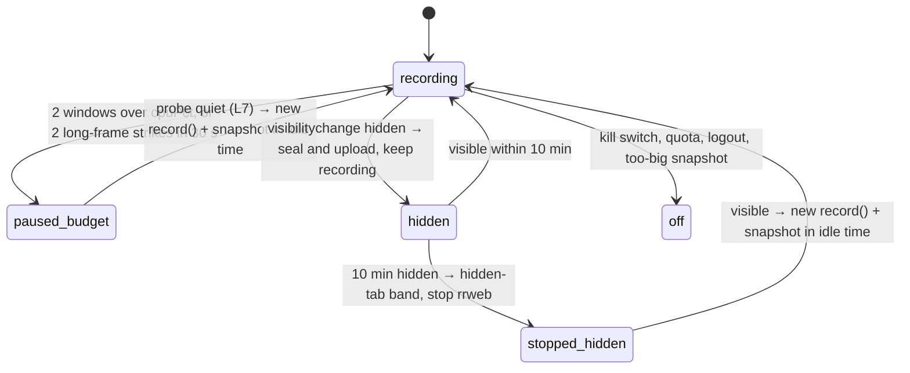

# 04 — Recorder
Status: draft · Size: large · Parent: [01-session-replay.md](01-session-replay.md)

## Goal

Build the browser side of session replay as two packages:
- **`packages/recorder-engine`**: the only code that imports rrweb (D25). It wraps `record()` on the
  record side and `Replayer` on the replay side. It knows rrweb's event shapes; nobody else does.
- **`packages/recorder`**: the policy around it (D3). Startup and allow-list gating, sessions,
  breadcrumbs, flush at action, the self-budget, the upload pipeline and the kill switch.

Success means: enabled users are recorded with every UI state (D16) inside the budget (D8); everyone
else pays one config fetch and nothing more; and the replay side seeks to any action exactly.

## Decisions

Inherited: D1, D2, D3, D5, D8, D10, D11, D16, D18, D20, D22, D23, D25, D29, D30, D32, D33, D34, D36;
from 03: L1 (`sr:*` custom events), L2 (stream positions), L3 (additive only), L5 (gzip or plain),
L7 (`sentAt` header), L8 (batch identity), L9 (`posKey`), L11 (store handle in `register`),
L12 (raw client time), L13 (write key).

| # | Decision | Why |
|---|---|---|
| L1 | **Two browser bundles.** `sr-loader.js` (small: options, user id, config, kill) runs for everyone. `sr-recorder.js` (rrweb + engine + pipeline) is injected only when the config says `enabled`. | D22 says non-enabled users get "no rrweb, no listeners". With the split, rrweb isn't even downloaded or parsed for them. |
| L2 | **Nothing starts until the user id is known.** No pre-identify event buffer. | The allow-list check needs the user id, and D22 forbids rrweb before it. The login page isn't recorded (Q25). |
| L3 | **The engine owns the stream buffer.** rrweb events are appended in emit order; `sr:*` events are inserted at their capture time. **`take()` holds back the last ~3 s**; `take(true)` hands over everything, and is used for the seal after a user action, on hide, on `pagehide` and at stop. | D2: rrweb's `addCustomEvent` re-stamps at emit (`record.js:3511-3513`). The hold-back lets late `sr:*` events (a bridge drain, a click stamped at its event time) still land in time order, so stream positions and time agree (X8). |
| L4 | **Bridge `t` is used as is.** It is `Date.now()` at capture, the clock rrweb stamps with (03-L12). No rebasing. | Both sides use the same clock now (architect A9), so there is nothing to convert. A rebase would only add jitter. |
| L5 | **`sampling.input = 'all'`**, not `'last'` as 01 says. | With `'last'`, rrweb listens to `change` only (`record.js:2160`), so typed text would appear only on blur. That breaks D16. |
| L6 | **Pause = stop rrweb; resume = a new `record()`**, which starts with a full snapshot. No `freezePage`. | `freezePage` keeps buffering (memory), and the browser still pays for every MutationRecord. Stopping removes both. |
| L7 | **Resume is decided by a probe:** every 10 s, a 1 s MutationObserver sample on the hotspot area only. The wait doubles after each repeated pause (10 s up to 5 min). | While paused our own cost is about zero, so "10 s under budget" alone proves nothing. |
| L8 | **Seal a batch every 5 s or at 1 MiB raw, within 1 s after a user action, and on hide and `pagehide`.** Take from the engine every 250 ms and **encode each event as it is taken**, in idle slices. One upload in flight per tab. | Fewer, larger batches mean fewer requests and chunk rows (architect A10, 05-L11). The seal after an action gets support the latest click fast. Encoding per event spreads the work, so a seal never stringifies 1 MiB at once. |
| L9 | **Encode once.** Each event's JSON text is made once. At seal the texts are joined, gzipped and stored, and every retry sends the same bytes. Batch identity is the SHA-256 of the decoded body (03-L8). | A gzip retry and the plain `pagehide` tail of the same batch decode to the same bytes, so the server dedupes them (208). `sentAt` and the write key travel in headers (03-L7, L13), so the body never changes. |
| L10 | **Duplicate tabs are found with a sessionStorage `live` marker.** It is set at start and again on a bfcache restore, and cleared on `pagehide`. No long-held Web Lock or BroadcastChannel. | A duplicated tab copies sessionStorage with the marker set; a reload or bfcache restore clears it first, then sets it again (devil X27). Held locks can block Chrome's back/forward cache (*unverified for current versions*). |
| L11 | **Monkey-patches are never restored; they go inert** (history, `window.open`, `fetch`, `XMLHttpRequest`). | If the app patched after us, restoring would undo the app's patch. |
| L12 | **ReplayEngine normalises timestamps** to strictly increasing in stream order (step 1/64 ms) and seeks to a position at `t + 1/128 ms`. | rrweb sorts by timestamp and applies events strictly before the seek time. Many events share a millisecond; binary fractions are exact in a double. |
| L13 | **Every URL in the replay is rewritten in a pre-pass:** snapshots, later mutations and style rules. Known assets become `/assets/<sha256>`; everything else becomes an inert `data:` URL. Each FullSnapshot is followed by the recording's `sr:asset` events again. | rrweb has no rewrite hook. The iframe then requests nothing but our assets (D30, devil X14), and each keyframe window stands alone (06-L4). |
| L14 | **`sr:state` values are serialized once, in idle time, key by key.** Each top-level key is capped at 256 KB, and a snapshot at about 2 MB. An over-cap key becomes `NotRecorded {why:'capped', bytes}` with a `state-capped` note; a denied key (`meta.deny`) becomes `NotRecorded {why:'denied'}`. The text is embedded as raw JSON at encode. | Redux state is immutable, so a held reference is a faithful snapshot. One walk, and live references never cross `postMessage`. A per-key cap keeps the rest of a big store visible instead of dropping the whole snapshot (devil X11); placeholders tell the viewer what's missing (X3). |
| L15 | *Removed 2026-11-10.* It was the release rule for emit-level coalescing, which D23 dropped. The id is not reused. | |
| L16 | **`sr:net {method, url, status, ms}` comes from the engine's own fetch/XHR wrapper** (about 40 lines). rrweb's network plugin is not used. | D1: the plugin loses status and timing once the 250-entry resource-timing buffer is full, and it wraps every request body (architect A7, devil X5). 05 builds `net` rows without parsing rrweb shapes (D25). |
| L17 | **Two base URLs.** The bundles (`sr-loader.js`, `sr-recorder.js`, `sr-worker.js`) sit together in one folder the host serves, outside `/sr/`, e.g. `/sr-recorder/1.4.0/`. The loader loads its siblings relative to its own `src`. The API base (`data-endpoint`, default `/sr`) is where config, ingest and asset upload go; the host's gateway routes it to the region's server (08 §2c). | The host controls the recorder version through its own build (08-L1), the gateway's `/sr/` route never collides with static files, and a versioned folder can be cached forever. (Leader, when merging 04 with 08.) |
| L18 | **A hidden tab keeps recording for up to 10 min**, then stops with a `hidden-tab` band. When it becomes visible again, recording restarts with a snapshot taken in idle time. | A quick look at another tab loses nothing; a tab left hidden for hours costs nothing (devil X9). |
| L19 | **After any batch the recorder drops, it checkpoints at once** (at most once a minute). A dropped batch that held a too-big FullSnapshot **stops recording for this page load** instead. | Incremental events after a gap can't be trusted until the next snapshot (X1). A snapshot too big to send would be followed by another one just as big (X10). |
| L20 | **A write key per recording** (03-L13): 16 random bytes, kept in memory, in sessionStorage and in each queued batch row, and sent as `X-SR-Write-Key`. | Leftover batches are sent by whichever tab starts next, so the key must travel with the batch. |

## Design

### Packages and outputs

| Path | Owns |
|---|---|
| `recorder-engine/src/record/` | `createRecorderEngine`: `record()` options, emit routing (Meta, CSRF), stream buffer and hold-back, masking, URL stripping, the fetch/XHR wrapper, gate plumbing, checkpoints, stats. |
| `recorder-engine/src/rate-caps/` | D36 + D23: cell lookup, held records, release timing. |
| `recorder-engine/src/replay/` | `createReplayEngine` (subpath `@sr/recorder-engine/replay`): load, append, normalise, gaps ("screen unknown"), seek, markers, URL rewrite, canvas placeholder; `assets.ts` maps `sr:asset` events to `/assets/<sha256>`. |
| `recorder/src/{loader,session,config}/` | `sr-loader.js` entry, user id, config and kill switch; sessions, recordings and write keys. |
| `recorder/src/{capture,state,budget}/` | Breadcrumbs, flush at action and hidden tab; queue adoption and the serializer; self-budget, pauses, hotspots, checkpoints. |
| `recorder/src/pipeline/encode/`, `pipeline/store/` | Per-event encode, seal, scrub, gzip, split; the IndexedDB queue and its memory fallback. |
| `recorder/src/pipeline/send/`, `pipeline/index.ts` | `post(batch)`, upload, status table, backoff, tail, leftovers. |
| `recorder/src/{assets,worker}/` | Asset collector; `sr-worker.js` entry. |

`Bun.build` (`format: 'iife'` is supported in Bun 1.4.4) emits `sr-loader.js`, `sr-recorder.js` and
`sr-worker.js` as IIFE files in `dist/iife/`, which the host copies into one versioned folder and
serves same-origin. It also emits ESM (`dist/esm/`, core via `import()`) and `.d.ts`. No URL is
hard-coded: bundle URLs come from the loader's own `src`, API URLs from `endpoint` (L17).

### Startup and gating (D20, D22)

```ts
// Sample — not final code. packages/recorder/src/loader/boot.ts
import type { RecorderConfig } from '@sr/protocol';             // types only: no zod in the bundle
import { readOptions, waitForUserId, afterFirstRenderAndIdle, loadScript, killQueue } from './util';
import { installHostApi } from './host-api';

export const boot = async () => {
  const opts = readOptions(document.currentScript);             // sync, before any await: currentScript is null later
                                                               // → app, endpoint, userIdPath, scriptBase (L17)
  let tried = false;
  const startFor = async (userId: string) => {                  // at most once per page load
    if (tried) return;
    tried = true;
    const q = new URLSearchParams({ app: opts.app, user: userId });
    const res = await fetch(`${opts.endpoint}/config?${q}`, { credentials: 'omit', cache: 'no-store',
      signal: AbortSignal.timeout(5_000) }).catch(() => null);
    const config = res?.ok ? ((await res.json().catch(() => null)) as RecorderConfig | null) : null;
    if (!config) return;                                        // no answer: off for this page load, not killed (X13)
    if (!config.enabled || config.killSwitch) return killQueue(); // explicit answer: wrappers pass through until reload
    await loadScript(new URL('sr-recorder.js', opts.scriptBase).href); // rrweb arrives only now (L1, L17)
    window.__SR_CORE__?.start({ opts, userId, config });       // the core adopts the queue, not the loader
  };
  installHostApi({ identify: (id) => void startFor(id) });     // window.SessionRecorder; later calls go to the core
  await afterFirstRenderAndIdle();
  const userId = await waitForUserId(opts.userIdPath, 60_000);  // window.userId by default (D20)
  if (userId) await startFor(userId);                           // none: stay off and unadopted
};
```

- **The loader never adopts the queue.** Before the core starts, `publish` keeps only `register`
  messages (03-L11), so the queue stays as small as the number of stores.
- **No user id:** stay off and unadopted. An invalid user id (03's regex) counts as no user.
  `identify(userId)` can start recording later.
- **A failed or timed-out config fetch:** off for this page load, but not killed. The next page load
  tries again. Performance wins over completeness (D8).
- **`killQueue()`** sets `killed` on the queue and empties it, so the state wrappers pass through
  (07). It runs only on an explicit answer (`enabled: false` or `killSwitch`), and it lasts until
  reload (X13).
- Host API on `window.SessionRecorder`: `identify`, `report(note?)`, `setMeta({appVersion, remotes})`, `logout()`.
- `sr:meta` also carries the user's time zone, `tz` (`Intl.DateTimeFormat().resolvedOptions().timeZone`) and `tzOffsetMin`, so the replay can show the user's local time (D42).

### Sessions, recordings, segments (D29)

- **Session:** sessionStorage `sr_session = {sessionId, userId, live}`. A new session when there is
  none, the user differs, `live` is already set (a duplicated tab, L10), or after any 403.
- **`live` marker:** set at start and again on a bfcache restore (`pageshow` with `persisted`);
  cleared on `pagehide` (X27).
- **Recording:** a fresh `recordingId` (`crypto.randomUUID()`) and write key per page load and per
  bfcache restore, with `seq` from 0. The write key is 16 bytes from `crypto.getRandomValues`, as
  base64url, kept in memory, in sessionStorage and in each queued batch row (L20).
- **A 403 starts a new session and a new recording** (03, X25). Either reason (`user-mismatch` or
  `write-key`) drops that recording's queued batches. Then the recorder releases held records,
  stops rrweb, makes new ids and a new write key, and starts a new `record()`, so seq 0 of the new
  recording holds a FullSnapshot.
- **User switch** (`identify` with another id): `sr:close {reason:'user-switch'}`, upload, then a new
  session and recording. **Logout:** `sr:close {reason:'logout'}`, upload the queue at once (Q26),
  stop, and un-adopt the queue (`adopted = false`), so the wrappers go back to sending only `register`.
- **Segments:** the server keeps files and seek anchors itself (05-L7), so no segment number is
  sent. When checkpoints run is in **Checkpoints** below.

### RecorderEngine over `record()` (D25)

```ts
// Sample — not final code. packages/recorder-engine/src/record/types.ts
export type RecorderEngine = {
  start(o: { mask: MaskRules; rateCaps?: RateCaps; gate?: 'auto' | 'off' }): { gateActive: boolean };
  stop(): void;                                         // releases held records, then stops rrweb (a pause)
  dispose(): void;                                      // stop + every patch inert: kill, logout, giant snapshot
  mark(tag: SrTag, payload: unknown, t?: number): void; // insert at capture time (D2); t defaults to Date.now()
  flush(): number;                                      // release held records now (D16); time of the last released event, or -Infinity
  checkpoint(): { ms: number };                         // releases held records, then takeFullSnapshot(true), timed
  take(all?: boolean): eventWithTime[];                 // events older than ~3 s; all = everything (L3)
  onFullSnapshot(cb: (t: number) => void): () => void;  // after every FullSnapshot: store snapshots, sr:asset
  setRateCaps(c: RateCaps): void;                       // releases held records first (X6)
  stats(): { ownMs: number; gateMs: number; mutations: number; areas?: Map<string, number> };
};
export declare const createRecorderEngine: (o: { ignoreUrl: (url: string) => boolean }) => RecorderEngine;
```

```ts
// Sample — not final code. packages/recorder-engine/src/record/engine.ts (excerpt)
import * as rr from '@rrweb/record';      // namespace import: a missing export is undefined, not a build error

const patched = typeof (rr as { mutationGateVersion?: unknown }).mutationGateVersion === 'number'; // 02 K1
const gateActive = o.gate !== 'off' && patched;
const stopRrweb = rr.record({
  emit: (e) => { const t0 = performance.now(); route(e); if (!inGate) ownMs += performance.now() - t0; },
  sampling: { mousemove: 50, scroll: 150, media: 500, input: 'all' },          // L5
  maskInputOptions: { password: true, text: true, email: true, tel: true, number: true,
                      search: true, url: true, textarea: true },              // so maskInputFn is asked
  maskInputFn: (text, el) => (isSecretInput(el) ? '****' : text),             // D18, fixed length
  recordCanvas: false, collectFonts: false, inlineImages: false,              // D34; assets via D33
  errorHandler: () => { rrwebErrors++; return true; },                        // never throw into the app
  ...(gateActive ? { mutationGate: gate } : {}),                              // D23; not in rrweb's types
});

let buf: eventWithTime[] = [];
const insertAt = (e: eventWithTime) => {            // sr:* events go in by capture time (L3)
  let i = buf.length;
  while (i > 0 && buf[i - 1].timestamp > e.timestamp) i--;   // usually 0–2 steps back
  buf.splice(i, 0, e);
};
const mark = (tag: SrTag, payload: unknown, t = Date.now()) =>
  insertAt({ type: EventType.Custom, timestamp: t, data: { tag, payload } } as eventWithTime);

const HOLD_BACK_MS = 3_000;
const take = (all = false) => {                     // L3: late sr:* events still land in order
  const cut = all ? buf.length : buf.findIndex((e) => e.timestamp > Date.now() - HOLD_BACK_MS);
  const n = cut < 0 ? buf.length : cut;
  return buf.splice(0, n);
};
```

- **`route(e)`** strips token parameters from Meta `href`, blanks CSRF values (see Masking), counts
  mutations, and appends. rrweb's own events are never re-stamped or reordered: they keep emit order.
- **The fetch/XHR wrapper** (L16) is installed by `createRecorderEngine`, once per page. It keeps
  reporting `sr:net` while rrweb is paused, and goes inert on `dispose()`.
- **A late `sr:*` event** older than the last `take()` lands at the head of the next batch. Its
  position stays unique; replay keeps stream order and lifts its time just past the event before it
  (L12). The 3 s hold-back makes this rare.
- rrweb's `record()` is a module singleton, so a second `start()` while running is refused. A unit
  test fails if any other package imports `rrweb` or `@rrweb/*`.

### Network capture (L16)

```ts
// Sample — not final code. packages/recorder-engine/src/record/net.ts
type Report = (n: { method: string; url: string; status: number; ms: number }) => void;

/** Wraps fetch and XHR once per page. Never reads bodies or headers. The app's call always goes out first. */
export const wrapNetwork = (ignoreUrl: (url: string) => boolean, report: Report) => {
  let live = true;
  const done = (method: string, url: string, status: number, t0: number) => {
    try { if (live && !ignoreUrl(url)) report({ method, url: stripTokenParams(absolute(url)), status, ms: performance.now() - t0 }); }
    catch { /* fail open */ }
  };

  const nativeFetch = window.fetch;
  window.fetch = function (this: unknown, input: RequestInfo | URL, init?: RequestInit) {
    const t0 = performance.now();
    const p = nativeFetch.apply(this, arguments as unknown as [RequestInfo | URL, RequestInit?]);
    if (!live) return p;
    let method = 'GET', url = '';
    try {
      url = input instanceof Request ? input.url : String(input);
      method = (init?.method ?? (input instanceof Request ? input.method : 'GET')).toUpperCase();
    } catch { return p; }
    // The app gets a derived promise with the same outcome, so its unhandled rejections still fire.
    return p.then((r) => { done(method, url, r.status, t0); return r; },
                  (err) => { done(method, url, 0, t0); throw err; });        // status 0 = network error
  };

  const meta = new WeakMap<XMLHttpRequest, { method: string; url: string }>();
  const { open, send } = XMLHttpRequest.prototype;
  XMLHttpRequest.prototype.open = function (this: XMLHttpRequest, method: string, url: string | URL) {
    try { meta.set(this, { method: String(method).toUpperCase(), url: String(url) }); } catch { /* fail open */ }
    return open.apply(this, arguments as unknown as Parameters<typeof open>);
  };
  XMLHttpRequest.prototype.send = function (this: XMLHttpRequest) {
    try {
      const m = meta.get(this), t0 = performance.now();
      if (live && m) this.addEventListener('loadend', () => done(m.method, m.url, this.status, t0), { once: true });
    } catch { /* fail open */ }
    return send.apply(this, arguments as unknown as Parameters<typeof send>);
  };
  return () => { live = false; };                    // inert, never restored (L11)
};
```

- `ms` runs from the call to the response: headers for `fetch`, `loadend` for XHR.
- The engine marks `sr:net` at the response time. `ignoreUrl` drops our own API base (config,
  ingest, assets), so the recorder never records itself.
- URLs are stripped with the D18 rule (see Masking). Nothing else from the request is kept.

### Masking and scrubbing (D18: secrets only)

```ts
// Sample — not final code. packages/recorder-engine/src/record/mask.ts (exported for breadcrumbs too)
const seenSecret = new WeakSet<Element>();           // stays masked after a "show password" toggle (X7)
const SECRET_AUTOCOMPLETE = /\b(current-password|new-password|one-time-code)\b/i;

export const isSecretInput = (el: Element | null): boolean => {
  if (!el) return false;
  if (seenSecret.has(el)) return true;
  const secret = (el as HTMLInputElement).type === 'password'
    || el.hasAttribute('data-rr-is-password')        // rrweb sets it when `type` leaves "password" (record.js:11144)
    || SECRET_AUTOCOMPLETE.test(el.getAttribute('autocomplete') ?? '');
  if (secret) seenSecret.add(el);
  return secret;
};
```

- **`isSecretInput(el)`** is the one shared function: rrweb's `maskInputFn`, `sr:input` values and
  `sr:click` labels all use it.
- **`stripTokenParams(url)`** for `sr:nav`, `sr:net`, Meta `href`, error-stack URLs and the popout
  band uses the narrower D18 rule. It always removes `token`, `access_token`, `id_token` and `sig`,
  and `key` only as `api_key`, `apikey` or `access_key`. It removes `code` and `state` only when
  both are present (a login callback). So `?state=filled` and `?key=AAPL` stay (D16, D35). Names
  match case-insensitively, in the query and in the `#fragment`.
- **CSRF values (no `blockSelector`, A8):** `route()` blanks the `content` of
  `meta[name*="csrf" i]` / `meta[name*="xsrf" i]` and the `value` of hidden inputs named like
  `csrf`/`xsrf`. On a FullSnapshot it finds them with one small `querySelectorAll` on the live page
  and clears the matching serialized attributes, found through rrweb's mirror (R0 confirms the
  mirror hands back the serialized node). Added nodes are checked by tag and name. Later attribute
  and Input events for a known CSRF id are blanked too. `blockSelector` would make rrweb run
  `matches()` on every node it serializes, on the hottest path.

```ts
// Sample — not final code. packages/recorder/src/pipeline/encode/scrub.ts
// Runs over all of each batch's encoded text. It works per event as each is encoded: no pattern can
// match the `"`, `,` or `}` between events, so the result is the same and each slice stays short.
// Every replacement keeps the JSON valid.
const JWT = /eyJ[\w-]{5,}\.[\w-]{5,}\.[\w-]{5,}/g;
const BEARER = /\bBearer\s+[\w.~+/-]{16,}=*/g;
const BASIC = /\bBasic\s+([A-Za-z0-9+/]{8,}={0,2})/g;         // only if it decodes to "user:password"
const QUERY = /[?#][^"'\\\s<>()]*=[^"'\\\s<>()]*/g;           // one URL's query and #fragment
const ALWAYS = new Set(['token', 'access_token', 'id_token', 'sig', 'api_key', 'apikey', 'access_key']);

const isUserPass = (b64: string) => { try { return /^[\x20-\x7e]+:[\x20-\x7e]*$/.test(atob(b64)); } catch { return false; } };

/** Token-style values become ****; `code` and `state` only together, as on a login callback (D18). */
const maskParams = (q: string, n: Redacted) => {
  const parts = q.slice(1).split(/([&#;])/);                   // keeps the separators
  const keys = new Set(parts.map((p) => p.split('=')[0]!.toLowerCase()));
  const callback = keys.has('code') && keys.has('state');
  return q[0] + parts.map((p) => {
    const i = p.indexOf('='), k = p.slice(0, i).toLowerCase();
    if (i < 0 || !(ALWAYS.has(k) || (callback && (k === 'code' || k === 'state')))) return p;
    n.urlParams++;
    return `${p.slice(0, i)}=****`;
  }).join('');
};

export const scrub = (text: string, n: Redacted) => text
  .replace(JWT, () => (n.jwt++, '****'))
  .replace(BEARER, () => (n.bearer++, 'Bearer ****'))
  .replace(BASIC, (m, b64) => (isUserPass(b64) ? (n.basic++, 'Basic ****') : m))  // "Basic Settings" stays
  .replace(QUERY, (q) => maskParams(q, n));
```

- The scrubber covers links, images, CSS `url()`, text and `#fragments` anywhere in the recording
  (D18). At seal, `sr:redacted {jwt, bearer, basic, urlParams}` is appended as the batch's last
  event when any count is above zero.
- Trade ids and generated names (D35) are never touched: none of the patterns can match them.

### Flush at action (D16)

```ts
// Sample — not final code. packages/recorder/src/capture/actions.ts
const ACTIONS = ['pointerdown', 'pointerup', 'click', 'keydown', 'keyup', 'submit'] as const;

/** The event's own time on rrweb's Date.now() clock (X8). Same instant as performance.timeOrigin +
 *  e.timeStamp while the clocks agree; measuring the event's age keeps it right after laptop sleep. */
const eventTime = (e: Event) => {
  const age = performance.now() - e.timeStamp;
  return age >= 0 && age < 10_000 ? Date.now() - age : Date.now();
};

export const installActionFlush = (engine: RecorderEngine, drainBridge: () => void, sealSoon: () => void) => {
  const onAction = (e: Event) => {
    try {
      const t = eventTime(e);
      drainBridge();                     // state captured before this action lands before it
      const released = engine.flush();   // held capped cells go to rrweb now: the screen is exact here
      if (e.type === 'click') engine.mark('sr:click', clickPayload(e.target), Math.max(t, released));
      sealSoon();                        // seal within 1 s (L8)
    } catch { /* never break the app; we never preventDefault or stop propagation */ }
  };
  for (const type of ACTIONS) window.addEventListener(type, onAction, { capture: true });
  return () => ACTIONS.forEach((type) => window.removeEventListener(type, onAction, { capture: true }));
};
```

- **The click is stamped at the event's own time** and inserted by time. Changes rrweb saw after the
  press but before our listener ran (ticks while the press waited in the queue) then sort after it.
- **Except after a release:** if held cells were released, the click goes right after them
  (`Math.max`), so capped cells show their exact values at the click. rrweb's own events keep
  their order, so the click can't go before the release.
- **Caveat:** an app listener on `window` in the capture phase that was registered before ours still
  runs first. Its synchronous DOM changes reach rrweb before our flush. The event-time stamp usually
  still sorts the click before them, but not when both fall in the same millisecond. React, AG Grid
  and flexlayout listen on their root or `document`, which run after `window`. R5 tests both orders.
- `change` emits a masked `sr:input`, also at its event time. `sr:nav` comes from patched
  `pushState`/`replaceState` plus `popstate`/`hashchange`, deduped by URL, with token parameters
  stripped. `sr:error` comes from `error` and `unhandledrejection`, deduped, at most 10/s, stacks
  cut to 4 KB; repeats fold into `count`.
- **Console (D43).** For each level in `config.console.levels` (default `error` and `warn`), the
  recorder wraps `console[level]` once at start.
  - The wrapper calls the original first, with the same arguments, so DevTools output and app
    behaviour don't change.
  - Then, inside `try/catch`, it formats the arguments: strings as they are; an `Error` as its
    message plus stack; other values with a capped, cycle-safe `JSON.stringify` (depth 3); DOM
    nodes as `<tag#id.class>`.
  - The line is cut to `maxChars` (2,000), passes the D18 scrubber, and becomes
    `sr:console {level, message, stack?, count}`.
  - A re-entry flag skips our own output and anything logged while we format.
  - Identical lines within 1 s fold into `count`.
  - `error` and `warn` share the 10/s limit with `sr:error`. `info`, `log` and `debug` have their
    own 10/s limit, and dropped lines are added to the next line's `count`.
  - On stop or kill, the wrappers stay but pass straight through (inert, like the other patches).
    A change to `levels` applies at the next start.
  - DevTools would show `sr-recorder.js` as the source of every console line, so R11 lists the
    bundle in its source map's `x_google_ignoreList`, and Chrome then shows the app's own call site.

### Rate caps (D36, D23: the rrweb gate only)

A capped cell is `[role="gridcell"][col-id]` inside `[data-sr-grid]`, with a rate in
`rateCaps[gridId][colId]`. `cellOf(node)` walks up from a record's target to its cell, cached in a
`WeakMap` by node.

**The patch (02 K1).** The P1a `bun patch` adds a `mutationGate(records, process)` option to
`record()` and exports a `mutationGateVersion` number. The engine sets
`gateActive = typeof mutationGateVersion === 'number'` through a namespace import, so an unpatched
rrweb still builds. The gate is installed whenever the patch is there, caps or not, because it also
times rrweb's mutation work for the self-budget (`gateMs`).

```ts
// Sample — not final code. packages/recorder-engine/src/rate-caps/gate.ts
/** rrweb calls this with each MutationObserver batch instead of processing it itself (P1a patch). */
const gate = (records: MutationRecord[], process: (r: MutationRecord[]) => void) => {
  const t0 = performance.now();
  inGate = true;
  try {
    lastProcess = process;                                 // the timer releases through it
    // Cells that a removal took away go first, so their last values land before the removal.
    if (held.size && records.some((r) => r.type === 'childList' && r.removedNodes.length > 0)) {
      release([...held.keys()].filter((cell) => !cell.isConnected));
    }
    const pass = records.filter((r) => !hold(r));          // hold() keeps a due-later capped cell's record
    if (pass.length) process(pass);
  } finally {
    inGate = false;
    gateMs += performance.now() - t0;                      // rrweb's processing included (D23)
  }
};
```

- **Hold:** a record passes straight through when its cell's last release is older than
  `1 / maxRate` s. Otherwise it is held until then. Per cell, the engine keeps childList records in
  order, and only the first characterData or attribute record per target and attribute name. rrweb
  reads the live value at release and compares it with that first `oldValue`, so style diffs come
  out right too.
- **Release** hands the held records back to rrweb in arrival order, and rrweb builds adds, `nextId`
  and drops itself. One timer releases each due cell at most `maxRate` times a second. Held records
  are also released at every user action (`flush()`), and before every checkpoint, `stop`,
  `setRateCaps` and `record()` restart (devil X6).
- **Records for a cell that is already gone** pass straight through. They happened in the same task
  as the removal, so they were never on screen, and rrweb drops them.
- **Without the patch**, `gateActive` is false and caps are off: every change is recorded,
  `sr:rate-caps` carries `caps: {}`, and a `caps-off` note says why (contract request H to 03). The
  self-budget then counts rrweb's mutation cost through LoAF or P1's per-mutation estimate (Risks).
- `sr:rate-caps {configVersion, caps}` is emitted at start and on every caps change.
- `gateMs` is the whole gate callback; `ownMs` counts `route()` only outside the gate, so nothing is
  counted twice.

### Checkpoints

`checkpoint()` releases held records, then takes a FullSnapshot in idle time (`requestIdleCallback`,
else `setTimeout`), and returns its duration. It runs:
- every `checkpointMinutes` (12);
- after `checkpointMutations` (200,000) mutation records since the last one, so a seek on a busy
  desk never replays more than that (A5);
- on a route change (debounced 2 s);
- at once after any batch of the current recording that the recorder drops (400, 413, queue
  overflow), at most once a minute (L19, X1).

Never within 60 s of the last one, except after a drop. There is no UTC-midnight checkpoint: the
server splits days itself (X17).

**After every FullSnapshot** (start, checkpoint, budget resume, hidden-tab restart, new recording),
the engine calls `onFullSnapshot`. The recorder then emits one `sr:state` snapshot per store (State
intake) and the recording's `sr:asset` events again (L13).

**Too-big snapshot (X10):** a FullSnapshot that can't be sent (over 4 MiB gzip or 16 MiB raw on its
own, or a 413 for its batch) is dropped once. Recording then stops for this page load
(`dispose()`), with a `missing-batches` band, `detail: 'snapshot-too-big'`. There is no retry: the
next snapshot would be just as big. `sr:close` still goes out at `pagehide`. P1 measures snapshot
sizes, and the server's body limit is sized from them.

**Slow-snapshot fallback (devil M10):** two runs over 50 ms in a row double the interval (up to 60
min) and open a `snapshot-slow` band with the time in `detail`. Three runs under 25 ms halve it back
towards the configured value and close the band. While the fallback is on, route-change checkpoints
are skipped.

### Self-budget, pauses and hotspots (D8, D32)



- **Cost per 5 s window:** `gateMs` (rrweb's mutation work, with the patch) + `ownMs` + recorder
  listener and pipeline time, all measured with `performance.now()`.
- **Long-frame strike:** a `long-animation-frame` entry ≥ `longFrameMs` in which our bundle's
  scripts took ≥ 10 ms. Whether LoAF attributes MutationObserver callbacks to our script is
  *unverified* (R0). Without LoAF (non-Chromium), only callback timing counts.
- **Hotspot area:** above 70 % of the budget, the engine counts mutation events per area (the closest
  `[data-sr-grid]`, else a 4-level `tag#id.class` path). It costs nothing the rest of the time.
- **Pause:** `sr:fidelity {reason:'pause-budget', start:true}`, then `stop()` (L6). Breadcrumbs,
  `sr:net` and state keep flowing. **Resume** closes the band and emits
  `sr:hotspot {area, mutationsPerSec, pausedMs}` (at `pagehide` if the tab closes while paused).
- **Hidden tab (L18, X9):** on hide, seal and upload, and keep recording. Hidden timers are
  throttled, so the buffer is also drained when it passes 2,000 events. After 10 min hidden, open a
  `hidden-tab` band and `stop()`. Visible again: start a new `record()` in idle time (with a 2 s
  timeout); its snapshot closes the band. P1 measures hide/show cycles.
- **Popouts (D34):** `window.open` is wrapped. A returned window opens a `popout` band (URL
  stripped), and polling `closed` every 2 s closes it. Canvas is never recorded.

### State intake (D5, D6, 03-L11)

- **The core adopts the queue when recording starts:** it reads the queued `register` messages (each
  with a live `handle` and `meta {app, lib, deny}`), replaces `push`, and sets `adopted = true`.
  Actions published before that were dropped by `publish` (03-L11).
- **Store names that clash** get a suffix: a second `register` with the same name and a different
  handle becomes `blotter/redux#1~2`, a third `~3` (X29). A handle seen before keeps its name.
- **Store snapshots after every FullSnapshot** (X12): for each store, `handle.getState()` (just a
  reference, cheap) becomes `sr:state {op:'snapshot'}`, stamped at the FullSnapshot's time so the
  pair sorts together. So every screen keyframe has a matching state.
- **`$root`:** if `getState()` isn't a plain object (an array, a primitive, `null`), the snapshot is
  `{ $root: value }`, capped like one key. Action changes for such stores already arrive as
  `{ $root }` (03, 07).
- **Actions** become `sr:state {op:'action', type, changes, removed}` at their `t` (L4), inserted
  with `mark`. They hold live references until serialized in idle time, before encode (L14).
- **`no-state`:** 10 s after recording starts, a band opens for each remote in `sr:meta.remotes` with
  no registered store of that `app`; it closes when one registers (03).

```ts
// Sample — not final code. packages/recorder/src/state/serialize.ts
const SECRET_WORDS = new Set(['password', 'secret', 'token', 'otp', 'credential', 'credentials',
  'authorization', 'passphrase', 'pin', 'apikey', 'privatekey']);           // D18, widened
const keyCache = new Map<string, boolean>();          // state keys repeat a lot, so this is ~free

/** Word and camelCase boundaries: apiKey, api_key, APIKey, privateKey, pins match;
 *  company, author, expandedRows, pinned, keyboard pass. */
export const isSecretKey = (k: string) => {
  let hit = keyCache.get(k);
  if (hit === undefined) {
    const words = k.replace(/([a-z0-9])([A-Z])/g, '$1 $2').toLowerCase().split(/[^a-z0-9]+/).filter(Boolean);
    const one = (w: string) => w.length > 3 && w.endsWith('s') ? w.slice(0, -1) : w;   // plurals
    hit = words.some((w, i) => SECRET_WORDS.has(w) || SECRET_WORDS.has(one(w))
                            || SECRET_WORDS.has(w + (words[i + 1] ?? '')));       // api + key, private + key
    keyCache.set(k, hit);
  }
  return hit;
};

const KEY_CAP = 256 * 1024;
const SNAPSHOT_CAP = 2 * 1024 * 1024;
const notRecorded = (why: 'denied' | 'capped', bytes?: number) =>
  JSON.stringify({ $sr: 'not-recorded', why, ...(bytes ? { bytes } : {}) });   // 03 NotRecorded

/** A snapshot or an action's `changes`, key by key (X3, X11). Returns JSON text and the capped keys. */
export const serializeKeys = (obj: Record<string, unknown>, denied: (k: string) => boolean) => {
  let room = SNAPSHOT_CAP;
  const parts: string[] = [], capped: string[] = [];
  for (const [k, v] of Object.entries(obj)) {
    let text: string;
    if (denied(k)) text = notRecorded('denied');                             // meta.deny: strings or '/re/flags'
    else if (isSecretKey(k)) text = '"****"';                                 // D18
    else {
      const r = serializeCapped(v, Math.min(KEY_CAP, room));                  // secret keys at any depth → '****'
      if (r.text === null) { capped.push(k); text = notRecorded('capped', r.bytes); }
      else { text = r.text; room -= r.bytes; }
    }
    parts.push(`${JSON.stringify(k)}:${text}`);
  }
  return { text: `{${parts.join(',')}}`, capped };
};
```

- `serializeCapped(value, cap)` is the old replacer walk: it stops counting past `cap`, drops
  functions and symbols, turns `bigint` into strings and treats circular state as over the cap.
  `bytes` is what it counted before stopping (a lower bound).
- Capped keys raise one `state-capped` note per snapshot or action, naming the store and the keys.

### Upload pipeline (D11)

`post(batch)` is the only entry point. Main-thread mode works in idle slices of at most 256 KB.
The path:
1. `take()` every 250 ms;
2. encode each event in idle slices: serialize state (L14), then JSON text, then scrub;
3. seal (5 s or 1 MiB raw, within 1 s after a user action, on hide and `pagehide`; assign `seq`);
4. join the texts, gzip (`CompressionStream`), write to IndexedDB;
5. `POST /sr/ingest` with `X-SR-Sent-At` and `X-SR-Write-Key`.

Worker mode moves scrub, gzip, IndexedDB and upload into `sr-worker.js`, which runs the same
`pipeline` code. Encoding stays on the main thread, because events hold live state references. If
the worker isn't ready within 3 s, the main thread takes over, emits `pipeline-fallback`, and
`sr:meta` says `pipeline: 'main'`. Retries back off from 1 s to 60 s with ±20 % jitter; the
`online` event resets the wait.

```ts
// Sample — not final code. packages/recorder/src/pipeline/send/status.ts
export const send = (b: QueuedBatch, ctx: PipelineCtx) =>
  fetch(ctx.ingestUrl, { method: 'POST', body: b.body, credentials: 'omit', headers: {
    'Content-Type': 'application/json', ...(b.encoding === 'gzip' ? { 'Content-Encoding': 'gzip' } : {}),
    'X-SR-Sent-At': String(Date.now()), 'X-SR-Write-Key': b.writeKey } }).catch(() => null); // 03-L7, L13

export const onResponse = async (b: QueuedBatch, res: Response | null, ctx: PipelineCtx) => {
  const version = res?.headers.get('X-SR-Config-Version');
  if (version && version !== ctx.config.version) void ctx.refetchConfig();  // kill switch, caps (D22)
  if (!res || res.status >= 500) return ctx.retryLater(b, res?.headers.get('Retry-After')); // 503 honours it
  if (res.status === 204 || res.status === 208) return ctx.queue.delete(b.key);
  const { reason } = await res.json().catch(() => ({ reason: undefined }));   // 03 status bodies
  if (res.status === 429) return reason === 'quota' ? ctx.stopUntilUtcMidnight() : ctx.retryAfter(b, res.headers.get('Retry-After'));
  if (res.status === 403) {                                                  // user-mismatch | write-key
    await ctx.queue.deleteRecording(b.recordingId);
    return ctx.newSessionAndRecording(`403 ${reason ?? ''}`);                // X25
  }
  await ctx.queue.delete(b.key);                                             // 400, 413: drop it
  ctx.dropped(b, `dropped by client: ${res.status}${reason ? ` ${reason}` : ''}`); // band + checkpoint, or stop (L19)
};
```

- **`dropped(b)`** opens a `missing-batches` band and checkpoints at once when `b` belongs to the
  current recording. If `b` held a FullSnapshot, it stops instead (Checkpoints). A dropped leftover
  of an old recording only counts.
- **IndexedDB `sr-queue`:** `batches` keyed `[recordingId, seq]` (body `Blob`, `encoding: 'gzip' |
  'plain'`, `writeKey`, `userId`, `sessionId`, `createdAt`, `attempts`); `owners` (`{recordingId,
  lastSeen}`, written every 30 s by each live tab); `assets` (url → sha256).
- **When IndexedDB misbehaves (X22):** a `versionchange` (another tab upgrades the schema) closes our
  connection, and the next write reopens it. A `blocked` open waits 5 s, then the queue runs in
  memory for this page load. `QuotaExceededError` drops the oldest batches with a `buffer-overflow`
  band and retries once. Without IndexedDB, the memory queue holds at most 5 MB, oldest dropped
  first with the same band.
- **Caps:** 50 MB or 72 h; the oldest go first, with a `buffer-overflow` band. `stopUntilUtcMidnight`
  stops the engine and shows a `quota` band until UTC midnight.
- **Leftovers:** batches whose owner was last seen over 2 min ago upload after the live queue is
  empty, at most 4 requests/s, with the write key from their row. A duplicate upload is harmless
  (208). They upload only while the same user id is on `window` (Q26).
- **Size:** a sealed batch over 4 MiB gzip (03's starting body limit) or 16 MiB raw is split at event
  boundaries. A single event over the limit is dropped (`dropped`, above).

```ts
// Sample — not final code. packages/recorder/src/pipeline/send/tail.ts
addEventListener('pagehide', () => {
  try {
    engine.mark('sr:close', { reason: 'pagehide' });                     // the clean end (X19)
    const bodies = [...ctx.unpersisted(), ...ctx.sealNow(engine.take(true))]; // plain JSON: the same bytes a gzip retry decodes to (03-L5, L8)
    let room = 60_000;                                                   // keepalive bodies share 64 KiB
    for (const b of bodies) {
      void ctx.queue.putBestEffort(b);                                   // also to IndexedDB: may finish, else lost
      if (b.bytes > room) continue;
      room -= b.bytes;
      void fetch(ctx.ingestUrl, { method: 'POST', body: b.text, keepalive: true, credentials: 'omit',
        headers: { 'Content-Type': 'application/json', 'X-SR-Sent-At': String(Date.now()),
                   'X-SR-Write-Key': b.writeKey } }).catch(() => {});
    }
    sessionLive(null);                                                   // L10
  } catch { /* never break the app */ }
});
```

- `sealNow` encodes what's left synchronously, usually under a second of events since the last
  idle slice. If both the keepalive and the IndexedDB write are lost, the server marks the
  recording `no-clean-close`.
- Never use `unload`: it blocks the bfcache.

### Config and kill switch (D22)

- The config is re-fetched when `X-SR-Config-Version` changes, and when a tab becomes visible with
  a config older than 15 min. A failed re-fetch keeps the current config.
- The server applies a ConfigMap change in about 2 min, or an `oc exec` override in about 20 s
  (D22). A busy tab learns it within one upload round trip; a tab with nothing to send costs nothing.
- **`killSwitch` or `enabled: false`:** mark `sr:close {reason:'kill'}`, send that last batch, then
  `dispose()` the engine, remove every listener, make patches inert, `killQueue()` (until reload),
  and stop uploading. IndexedDB is kept (72 h).
- New `rateCaps` apply at once (held records released first, plus a `sr:rate-caps` event);
  `checkpointMinutes`, `checkpointMutations` and `budget` from the next window; `pipeline` on the
  next page load.

### Asset collection (D33, behind `config.assetCache.enabled`)

Off by default. In idle slices, a regex over each encoded batch finds URLs matching
`assetCache.allow`: an entry starting with `/` is a path on the host's origin, and an `https://`
entry is an absolute prefix (a font host). For each new URL:
1. `fetch(url, { cache: 'force-cache' })`; keep only `image/*` or `font/*` of at most 2 MB;
2. hash it with `crypto.subtle.digest('SHA-256')`, at most 2 at a time and 20 a minute;
3. `POST /sr/assets/missing`, then `PUT /sr/assets/:sha256` for the misses (05-C4);
4. emit `sr:asset {url, sha256, type}` once per recording, and again after every FullSnapshot (L13).

### ReplayEngine (D25, `@sr/recorder-engine/replay`)

The API follows 06's needs (06-C10–C12) and the review (A6, X1, X25, X28):

```ts
// Sample — not final code. packages/recorder-engine/src/replay/types.ts
import type { ChunkMeta, StreamPos } from '@sr/protocol';
export type LoadChunk = { meta: ChunkMeta; events: unknown[] };   // one batch from 03's readChunks
export type SeqRange = { fromSeq: number; toSeq: number };        // inclusive, as in ChunksHeader.missing

export type ReplayEngine = {
  load(chunks: LoadChunk[]): Promise<{ t0: number; t1: number; firstFrame: StreamPos }>; // ONE recording
  append(chunks: LoadChunk[]): { t1: number };                    // the next window, through addEvent (A6)
  setGaps(missing: SeqRange[]): void;                             // applies to everything loaded after it
  seek(target: { pos: StreamPos } | { t: number }): void;
  play(): void; pause(): void; setSpeed(x: number): void;
  onMarker(cb: (m: { pos: StreamPos; tag: string; payload: unknown; t: number }) => void): () => void;
  onTick(cb: (p: { t: number; pos: StreamPos }) => void): () => void;  // rAF while playing
  onViewport(cb: (v: { width: number; height: number }) => void): () => void;
  onUnknown(cb: (u: { unknown: boolean; pos: StreamPos }) => void): () => void; // "screen unknown" starts or ends
  onSeekProgress(cb: (p: { done: number }) => void): () => void;  // 0..1; stepped seeks only (R0)
  onEnd(cb: () => void): () => void;
  destroy(): void;
};
export declare const createReplayEngine: (o: { root: HTMLElement; assetUrl?: (sha256: string) => string }) => ReplayEngine;
```

```ts
// Sample — not final code. packages/recorder-engine/src/replay/normalise.ts
import { posKey } from '@sr/protocol';
const STEP = 1 / 64;   // exact in a double, even at epoch-ms magnitudes (L12)

/** Continues from `st`, so an appended window keeps the order (A6). After a gap, incremental events
 *  are skipped until the next FullSnapshot: the screen is unknown there (X1). */
export const normalise = (chunks: LoadChunk[], st: NormaliseState): eventWithTime[] => {
  const out: eventWithTime[] = [];
  for (const c of chunks) {                                   // one recording, seq order (03 readChunks)
    const { recordingId, seq } = c.meta;
    if (st.isGap(seq) || c.meta.integrity === 'unreadable') { st.unknown ??= { recordingId, seq, idx: 0 }; continue; }
    c.events.forEach((raw, idx) => {
      const e = raw as eventWithTime;
      if (e.type === EventType.FullSnapshot) st.unknown = null;           // the screen is known again
      else if (st.unknown && e.type === EventType.IncrementalSnapshot) return;
      const t = Math.max(e.timestamp, st.prev + STEP);                   // strictly increasing in stream order
      out.push({ ...e, timestamp: t });
      st.timeAt.set(posKey({ recordingId, seq, idx }), t);              // 03 posKey takes a StreamPos
      st.prev = t;
    });
  }
  return out;
};

// pos: the frame right after that event, before the next. t: rrweb applies "strictly before" (+1 ms).
export const offsetFor = (target: { pos: StreamPos } | { t: number }, st: NormaliseState, t0: number) =>
  'pos' in target ? st.timeAt.get(posKey(target.pos))! - t0 + STEP / 2 : target.t - t0 + 1;
```

- **`load(chunks)`** takes the batches of **one recording** from 03's `readChunks`, in seq order.
  Chunks from two recordings are an error. **A window starts at a FullSnapshot's own position**
  (`SessionDetail.snapshots`, 03): `load` drops the first chunk's events before it, except the Meta
  event rrweb emits right before every FullSnapshot (it carries the viewport). Then it normalises,
  rewrites URLs (L13) and builds `new Replayer(events, { root, speed, skipInactive: false,
  mouseTail: false, pauseAnimation: true, UNSAFE_replayCanvas: false,
  insertStyleRules: CANVAS_PLACEHOLDER, logger })`.
- **`firstFrame`** is the window's FullSnapshot position. For a recording's first snapshot (an empty
  `#root`, spike), it is the first Mutation after it.
- **`append(chunks)`** adds the next window of the same recording with `replayer.addEvent`, so
  playback crosses the window edge with no rebuild flash (A6). Normalising continues from the last
  timestamp. A back seek or an evicted window means a new `load` (06).
- **Gaps (X1):** `setGaps(missing)` takes the missing seq ranges (`ChunksHeader.missing`,
  `SessionDetail.recordings[].gaps`). A hole in the chunk seqs and an `unreadable` chunk count too.
  From a gap to the next FullSnapshot, the engine skips incremental events, draws a "screen
  unknown" overlay over the iframe and fires `onUnknown`. Markers inside still fire. A seek to a
  skipped position lands on the nearest kept event before it, under the overlay.
- **The URL rewrite (L13, D30, X14)** runs on FullSnapshot nodes, added nodes in later mutations,
  attribute mutations (including `style` diffs), `_cssText`, `<style>` text, StyleSheetRule,
  StyleDeclaration and adopted-stylesheet events. It covers `src`, `srcset`, `href` (on `link`, `a`
  and SVG), `xlink:href`, `poster`, `background`, `action`, `formaction`, `data`, inline `style`,
  CSS `url()`, `@import` and quoted URLs in `image-set()`. A known asset becomes
  `assetUrl(sha256)`; any other URL, including `blob:` and `javascript:`, becomes the inert
  `data:,`. `data:` URLs and fragment-only `#id` references (SVG sprites, `url(#gradient)`) stay.
  The rewrite and the inert rule are R3; R10 only supplies the asset map from `sr:asset` events.
  rrweb's iframe is already `sandbox="allow-same-origin"` without scripts (`replay.js:5156`).
- **Long seeks (A5):** R0 measures the worst seek, to the end of a 12-min S2 window. If it takes over
  2 s, `seek` moves forward in steps and reports `onSeekProgress`, so 06 can show a progress bar.
- **Markers** come from rrweb's `custom-event`. They are muted while a seek applies events
  synchronously inside `pause()`, so a seek never floods the state panel.
- **Canvas placeholder:** `canvas { background: <data: SVG "canvas not recorded">, repeating-linear-gradient(45deg, #d6d6d6 0 6px, #f2f2f2 6px 12px) !important; outline: 1px dashed #888 }`.
  `insertStyleRules` adds it with CSSOM `insertRule` into an empty `<style>` (`replay.js:14808`), which
  still needs `style-src 'unsafe-inline'` (D30).
- **Golden compatibility:** every fixture in `packages/protocol/fixtures/session-v1-golden/` loads
  with zero rrweb warnings, and the DOM hash at every `sr:click` matches the stored one. This runs
  on every rrweb bump.

The contracts used above are in 03: `X-SR-Sent-At`, `X-SR-Write-Key`, `sr:redacted` (with `basic`
and `urlParams`), `sr:close`, `state-capped`, `NotRecorded`, the store handle and `meta.deny`, `app`
on clicks and inputs, the 400/403/429/503 bodies, the asset routes, `sr:net`, `removed`,
`checkpointMutations`, `readChunks` and `ChunkMeta`. **Still needed (contract request H):** a
`caps-off` note in `FidelityReason`, for "caps configured, but the gate patch is missing".

## Guidelines

**Do**
- Wrap every listener, patch and callback in `try/catch` and fail open. The app must never see our errors.
- In every wrapper, call the original first and return the app's own outcome. Never read request bodies or headers.
- Measure everything you add: own time goes into `stats()` and the budget.
- Use `import type` from `@sr/protocol` in browser code. Zod never ships in the recorder.
- Keep rrweb calls and types inside `recorder-engine`; the recorder talks to `RecorderEngine` only.
- Release held records before anything that snapshots, stops or restarts rrweb.
- Handle `pagehide`, `visibilitychange` and `pageshow`; test reload, bfcache, a duplicated tab, sleep and a long-hidden tab.
- Mask through the one shared function, for rrweb and breadcrumbs alike.

**Don't**
- Don't call `record.addCustomEvent` (it re-stamps), `freezePage`, `checkoutEveryNms` or `recordCanvas`.
- Don't use rrweb's network plugin or `blockSelector`.
- Don't re-stamp or reorder rrweb's own events. Only `sr:*` events are inserted by time.
- Don't add a `MutationObserver` of our own, except the short resume probe (L7).
- Don't serialize inside an input handler. The flush only orders events and releases held records.
- Don't use `unload`, `localStorage` for the queue, or sync XHR.
- Don't log user data. Debug logging sits behind `?srDebug=1` and prints counts only.

## Acceptance

**Startup and gating**
- [ ] Non-enabled user (`enabled: false`): one config request; no `sr-recorder.js` request, no listeners; `killed` set on the queue until reload.
- [ ] Config fetch fails or times out: recording stays off for this page load; the queue is neither killed nor adopted (it holds only `register` messages); the app is unaffected.
- [ ] No `window.userId` for 60 s: nothing starts and the queue stays unadopted; a later `identify()` starts it.
- [ ] Two tabs, a reload, a duplicated tab and a bfcache restore each get the right session and recording ids (D29). After a bfcache restore the `live` marker is set again, so duplicating that tab still gives a new session.

**Engine and exactness**
- [ ] `sr:*` events sit in capture-time order among rrweb events, including bridge messages drained up to 3 s late, and after a simulated sleep.
- [ ] Typing shows each character in replay (L5). Password and one-time-code fields show `****`, and so does a password field after a "show password" toggle.
- [ ] With ticks during a 150 ms press, seeking to each `sr:click` shows the frame before the app's reaction; with capped cells held, the frame shows their exact values.
- [ ] `sr:net` has the right method, URL, status (0 for a network error) and `ms` for fetch and XHR, also after 300 requests, when the resource-timing buffer is full. Our own endpoint never appears.
- [ ] Console (D43): with the default config, `console.error` and `console.warn` become `sr:console` events with level, message, stack and count. `info`, `log` and `debug` are recorded only when `console.levels` lists them. The app's console output and return values are unchanged. A value that throws in `toJSON`, a circular object and a 1 MB string are capped without throwing. A JWT in a console argument is scrubbed. The recorder's own logging is never captured. A flood of 1,000 lines a second stays within the limit, with the drops counted.
- [ ] App requests behave as without the recorder: the same outcome, unhandled rejections still fire, bodies and headers untouched.
- [ ] A CSRF `<meta>` and a hidden CSRF input replay with empty values, in the first snapshot and when added later.
- [ ] The no-rrweb-import test passes; an rrweb internal error never reaches the app.

**Rate caps**
- [ ] `bid` capped at 2/s: ≤ 2 states/s per cell, the exact value at every click and key press, no blank cell.
- [ ] A checkpoint, `stop`, cap change or `record()` restart while cells are held replays the same values as the live page (X6).
- [ ] A row removed while its cells are held replays their last values, then the removal, with zero rrweb warnings of any kind.
- [ ] Without the patch, `gateActive` is false: caps are off, every change is recorded, and a `caps-off` note says so.

**Budget, checkpoints and bands**
- [ ] Forced over budget: a `pause-budget` band, a `sr:hotspot` naming the grid, no pause → snapshot → pause loop.
- [ ] Two slow checkpoints double the interval and open a `snapshot-slow` band.
- [ ] After 200,000 mutation records a checkpoint runs, even before 12 min.
- [ ] Hidden tab: under 10 min, nothing is lost and there is no band. Past 10 min, a `hidden-tab` band opens and rrweb stops. Visible again, a snapshot taken in idle time closes the band.
- [ ] A FullSnapshot too big to send stops recording for this page load with one `missing-batches` band (`detail: 'snapshot-too-big'`) and no retry loop.
- [ ] Popout bands open and close correctly; a canvas replays as the placeholder.

**State**
- [ ] Every FullSnapshot (start, checkpoint, budget resume, hidden-tab restart, new recording) is followed by one `sr:state` snapshot per store, read through `getState()`.
- [ ] A key in `meta.deny` shows as "not recorded" (`denied`). A 300 KB key shows as `capped`, with a `state-capped` note, while the store's other keys are recorded.
- [ ] Two stores registered as `blotter/redux#1` are recorded as `blotter/redux#1` and `blotter/redux#1~2`.
- [ ] `apiKey`, `api_key`, `privateKey`, `credentials`, `authorization`, `passphrase` and `pin` are masked; `company`, `author`, `expandedRows`, `pinned` and `keyboard` are kept.
- [ ] A store whose state isn't a plain object is recorded as `{ $root }`.

**Pipeline**
- [ ] Batches seal every 5 s or at 1 MiB raw, within 1 s after a click, and on hide.
- [ ] Status table: 204/208 delete; 5xx retries (503 after `Retry-After`); 403 `user-mismatch` or `write-key` starts a new session and a new recording, whose first batch holds a FullSnapshot; 400/413 drop with a `missing-batches` band and a checkpoint at once; 429 `rate` waits; 429 `quota` stops until UTC midnight.
- [ ] Tab close: the tail ends with `sr:close {reason:'pagehide'}`, arrives by keepalive (≤ 60 KB) and is also in IndexedDB. With the server down at that moment, the next start uploads it; if both arrive, the second gets 208.
- [ ] IndexedDB: another tab's upgrade (`versionchange`) and a `blocked` open don't stall recording; `QuotaExceededError` drops the oldest batches with a `buffer-overflow` band; without IndexedDB the memory queue stays ≤ 5 MB.
- [ ] Offline for an hour, then back: the queue drains with no long frame from the recorder.
- [ ] Scrubber: a JWT, a `Bearer` token and a `Basic` value planted in the DOM are masked. Token parameters in `<a href>`, ``, CSS `url()`, text and `#fragments` are masked. `?state=filled`, `?key=AAPL`, "Basic Settings", a 16-digit trade id and `AAPL1762743000000` are kept. `sr:redacted` counts match.
- [ ] Worker mode (only if P1 turned the worker on, D11; as 01 Acceptance says): a worker that never answers falls back within 3 s with `pipeline-fallback`.
- [ ] Kill switch mid-session: recording stops within one upload round trip, with no reload; the last batch carries `sr:close {reason:'kill'}`.

**Assets and replay**
- [ ] Assets off: no asset requests. On: allow-listed images and fonts only, ≤ 2 MB, each uploaded once.
- [ ] `ReplayEngine` handles empty input, a window without a full snapshot (error), chunks from two recordings (error), unknown `sr:*` tags, `destroy` during `load`, and a seek past the end.
- [ ] `append` adds the next window without a rebuild flash; a seek across the join lands on the right frame.
- [ ] After a gap or an unreadable chunk, the player shows "screen unknown" (and `onUnknown` fires) until the next FullSnapshot; no frame inside it looks complete.
- [ ] URLs in `src`, `srcset`, `link`/`a`/SVG `href`, `poster`, `background`, inline styles and `<style>` text with `@import`, in the snapshot and in later mutations and style rules: the iframe requests nothing but `/assets/<sha256>`. SVG `#id` references still render.
- [ ] Golden recordings replay with matching hashes.

## Tasks

- [ ] **R0 Recorder checks spike** — owns: `spike/recorder-checks/` — batch: B0, at approval — depends on: user approval, the rrweb pin (02-L5) — done when: findings are logged here for (1) seek by normalised position; (2) the D30 CSP: replay styling with `style-src 'unsafe-inline'`, and `frame-src 'none'` still allowing rrweb's about:blank iframe; (3) moved to 02 K2 (LoAF attribution); (4) `Bun.build` IIFE and worker outputs; (5) moved to 02 K2 (the worst seek, A5); (6) `DecompressionStream` over the framed chunk response (A4); (7) appending a window with `addEvent`, with no flash (A6); (8) rrweb's mirror handing back the serialized node of a live element (CSRF blanking).
- [ ] **R1 Package scaffolds** — owns: `packages/recorder-engine/{package.json,tsconfig.json,test/setup.ts}`, `packages/recorder/{package.json,tsconfig.json,build.ts,test/setup.ts}` — batch: B1 — depends on: 03 T1 — done when: `bunx tsc --noEmit` and lint pass for both, and `bun test` runs the no-rrweb-import guard (happy-dom preload). Runs in one coder run with 07 PL1 (01 auditor pass).
- [ ] **R2 Engine record core** — owns: `packages/recorder-engine/src/record/**`, `src/index.ts`, and a no-caps stub `src/rate-caps/index.ts` that R9 replaces — batch: B2 — depends on: R1 — done when: unit tests (`record` mocked) cover insert order, the 3 s hold-back and `take(true)`, Meta and CSRF routing, the fetch/XHR wrapper (fail open, same outcome, ignored endpoint), masking (including the toggle), token stripping, `gateActive` detection, the release hooks and checkpoint timing; type-check and lint pass.
- [ ] **R3 ReplayEngine core** — owns: `packages/recorder-engine/src/replay/{engine,normalise,gaps,rewrite,placeholders,types}.ts` — batch: B2 — depends on: R1, R0, 03 T2 — done when: unit tests cover normalise and offsets, `append`, gaps and "screen unknown", the window-start rule, muted markers during seek, `firstFrame`, the URL rewrite with unknown URLs made inert (every attribute kind, mutations, style rules, `@import`, `#id` kept), and the error cases; type-check and lint pass.
- [ ] **R4 Loader, sessions, config** — owns: `packages/recorder/src/{loader,session,config}/**` — batch: B3 — depends on: R2 — done when: unit tests cover gating (core never requested when not enabled), the queue left unadopted by the loader, kill only on an explicit answer, a failed fetch leaving it off but not killed, the user-id path and `identify()`, the session, duplicate and bfcache rules (marker set again), the write key, version re-fetch and the kill switch.
- [ ] **R5 Capture** (breadcrumbs, flush at action, nav, errors, console, hidden tab, popout) — owns: `packages/recorder/src/capture/**` — batch: B3 — depends on: R4 — done when: unit tests cover listener order, event-time stamping and the click-after-release rule, masked labels and values, dedupe and rate limits, the 10-min hidden-tab rule, inert patches, and console capture (D43: levels from config, the original called first, formatting caps, scrubbing, the re-entry guard, repeat folding and the per-group limits).
- [ ] **R6 State intake and serializer** — owns: `packages/recorder/src/state/**` — batch: B3 — depends on: R4 — done when: unit tests cover queue adoption, store snapshots after every FullSnapshot, `~2` names, `$root`, capture-time insertion, the per-key and snapshot caps, denied keys, `isSecretKey` (the masked and kept lists in Acceptance) and circular state.
- [ ] **R7a Pipeline: encode and store** — owns: `packages/recorder/src/pipeline/{encode,store}/**` — batch: B3 — depends on: R4 — done when: unit tests (`fake-indexeddb`) cover per-event encoding in idle slices, the seal rules, scrubbing (JWT, `Bearer`, `Basic`, URL params, and the kept cases), `sr:redacted`, gzip, splitting and the single oversize event, and the IndexedDB queue with `versionchange`, `blocked`, quota, the 5 MB memory fallback and the 50 MB / 72 h caps.
- [ ] **R7b Pipeline: send** — owns: `packages/recorder/src/pipeline/{send/**,index.ts}` — batch: B3 — depends on: R7a — done when: unit tests (mocked `fetch`) cover the status table (both 403 reasons), the headers, backoff and `Retry-After`, the drop → checkpoint and too-big-snapshot rules, the keepalive budget, the tail in IndexedDB plus `sr:close`, and leftovers with their write keys.
- [ ] **R8 Budget, pauses, hotspots, checkpoints** — owns: `packages/recorder/src/budget/**` — batch: B3 — depends on: R5, R7b, K3 — done when: fake-timer tests cover the pause rules, probe backoff, hysteresis, the snapshot fallback, the mutation-count checkpoint, the checkpoint after a drop (at most once a minute) and hotspot emission.
- [ ] **R9 Rate caps** — owns: `packages/recorder-engine/src/rate-caps/**` — batch: B4 — depends on: R2, K1, K3; **if K3 shows `full` fits at S2 without caps, the leader asks the user whether to defer R9, its Rate-caps Acceptance items and its spec to v2** (01 Q19) — done when: unit tests (fake gate and records) cover holding (pass-through when due, the first record per target and attribute, childList in order), arrival-order release, `maxRate` timing, release at actions and before checkpoint, `stop`, `setRateCaps` and restart, release before a removal, and caps off without the patch; the browser contract spec "a capped grid with row removals replays with zero rrweb warnings of any kind" is written and passes at the gate.
- [ ] **R10 Assets** — owns: `packages/recorder/src/assets/**`, `packages/recorder-engine/src/replay/assets.ts` — batch: B4 — depends on: R3, R7a, 05-C4 — done when: unit tests cover allow-list matching, type and size limits, the missing-hash flow, re-announcing after every FullSnapshot, and mapping `sr:asset` events to `/assets/<sha256>` through R3's rewrite hook.
- [ ] **R11 Worker mode and outputs** — owns: `packages/recorder/src/worker/**`, `packages/recorder/build.ts` (created in R1) — batch: B4 — depends on: R7b, K3; **if K3 keeps the main-thread pipeline (D11), R11 builds only the outputs, in the same coder run as R10, and the worker part waits** — done when: unit tests cover the handshake and the 3 s fallback (worker only); `bun run build` emits three IIFE bundles, ESM and `.d.ts`; `exports` and `files` are set; each bundle's source map lists it in `x_google_ignoreList` (D43; a post-build step adds the field if `Bun.build` doesn't).
- Browser contract tests (golden replay, exactness at clicks, the R9 zero-warnings spec, no iframe requests) are written by qa in `specs` mode during B4 and run at the gate. Real-workspace integration is B5 (08).

## Risks

| Risk | Mitigation |
|---|---|
| The D30 CSP blocks inline styles, or `frame-src 'none'` blocks rrweb's iframe. | `style-src 'unsafe-inline'` is in D30; R0 verifies both. |
| LoAF may not attribute MutationObserver work to our script, hiding rrweb's main cost without the gate. | R0 measures. With the gate, `gateMs` is exact; without it, P1 calibrates a cost per mutation event. |
| The gate patch fails to apply on an rrweb bump. | `gateActive` goes false, caps switch off with a `caps-off` note, and contract tests catch it on the bump. D24's vendoring rule applies after two failed upgrades. |
| A full snapshot of 25 mounted grid tabs is too big to send. | Recording stops with a band instead of looping (L19). P1 measures snapshot sizes; the body limit is sized from them, and P1 decides on suspending hidden grids (D32). |
| Our fetch/XHR wrapper changes how app requests behave. | The original call goes out first, the app gets the same outcome, nothing reads bodies or headers, and the wrapper fails open. Acceptance compares with the unwrapped page. |
| The URL scrubber masks a business value, or misses a secret. | The narrower D18 rule; `Basic` only when it decodes to `user:password`; Acceptance lists the kept cases (`?state=filled`, `?key=AAPL`, trade ids). |
| The console wrapper changes app logging, or DevTools shows our bundle as the source of every line (D43). | The original is called first with the same arguments; formatting runs in `try/catch`; `x_google_ignoreList` in the source map (R11); R5 tests. |
| AMPS WebSocket traffic isn't in the recording (D41). | The screen and Redux capture show its effect; the fetch/XHR wrapper never touches `WebSocket`. |
| Fractional timestamps could upset a future rrweb. | Golden tests on every bump; recordings stay raw, only replay normalises. |
| The keepalive tail is lost on a crash. | At most about 8 s of events (5 s seal + 3 s hold-back), and about 1 s after a user action; IndexedDB holds the rest. |
| A hidden tab that keeps recording costs CPU. | It stops after 10 min (L18); P1 measures hide/show cycles. |

## Open questions

All answered by the user on 2026-11-10 (01, Q25–Q28):
1. **Before the user id (L2):** the app loads only after a successful login, so `window.userId` is set before the recorder starts. Nothing to buffer.
2. **The queue at logout:** as proposed. Upload that user's queue at once; leftovers stay tagged with the user id, upload at that user's next login on the same browser, and expire after 72 h. Purge only with `SessionRecorder.logout({ purge: true })`.
3. **Mini-app of a click:** no mini-app filter in the MVP. The recorder doesn't look for `data-sr-app`; `app` on clicks and inputs stays unset (03 keeps it reserved).
4. **Other tools:** none on the pilot pages, so there is no refuse-to-start rule. The apps use AMPS over WebSockets, which the recorder never wraps or records (D41).

## Log

- 2026-11-10 — drafted for the plan split (agent)
- 2026-11-10 — Reviewed and merged into `plan/` by the leader. Contract requests A–G applied in 03. Added L17 (bundle folder vs API base) to line up with 08. Open questions tracked in 01 as Q25–Q28.
- 2026-11-10 — Architect and devil review merged (leader): `take()` holds back 3 s and clicks are stamped at their event time (L3, X8); bridge `t` used as is, the L4 rebase dropped (A9); seal at 5 s / 1 MiB with per-event encoding, identity per 03-L8 (L8, L9, A10); gate-only rate caps with releases before checkpoint, `stop`, cap change and restart, release before removals, L15 and the emit-level coalescer removed (D23, A3, X6); own fetch/XHR wrapper for `sr:net`, no network plugin and no `blockSelector`, CSRF values blanked in `route()` (L16, A7, X5, A8); masking widened: show-password toggle, `Basic`, URL params anywhere with the narrower rule, more secret key words (D18, X7, X26); per-key state caps with `NotRecorded` placeholders, denied keys, store snapshots after every FullSnapshot, `~2` names, `$root` (L14, X3, X11, X12, X29); the core adopts the queue, kill only on an explicit answer (X13); checkpoints by mutation count and after drops, no UTC-midnight checkpoint, the too-big-snapshot stop (L19, A5, X1, X10, X17); hidden tab records up to 10 min (L18, X9); write key per recording, new session and recording after any 403, `live` marker set again on bfcache restore (L20, X16, X25, X27); tail in IndexedDB plus `sr:close`, IndexedDB failure handling (X19, X22); the full URL rewrite with its inert part in R3 (L13, X14, X27); ReplayEngine `load` of one recording, `append`, `setGaps`, `onUnknown`, `onSeekProgress`, windows starting at a FullSnapshot, `posKey(StreamPos)` (A5, A6, X1, X25, X28); R0 checks added; R7 split into R7a/R7b; R8, R9 and R11 wait for K3, R9 also for K1. Contract request H (`caps-off` note) sent to 03.
- 2026-11-10 — Open questions answered (user): no pre-login buffering needed; logout queue as proposed; no mini-app tagging; no other tools, WebSockets not recorded (D41); `sr:meta` carries `tz` and `tzOffsetMin` (D42).
- 2026-11-10 — Auditor pass (01): R0 runs at approval without waiting for K1/K2, and its checks 3 and 5 move to 02 K2; R3 waits for R0; R1 runs with 07 PL1; K3 decides R9's deferral (user's call) and whether R11 builds only the outputs in R10's run; the worker Acceptance item is conditional, matching D11.
- 2026-11-10 — Console capture (01 D43): the console wrapper rules in Capture, an Acceptance item, R5 covers it, R11 adds `x_google_ignoreList` to the source maps, and a Risks row. MVP2 adds the DOM probe in `src/dom-probe/` (09 AN5).
