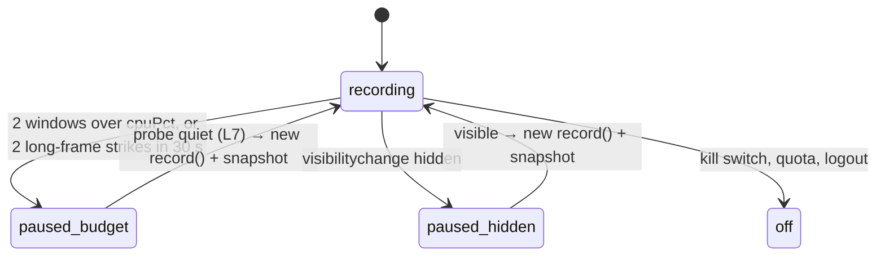

# 04 — Recorder
Status: draft · Size: large · Parent: [01-session-replay.md](01-session-replay.md)

## Goal

Build the browser side of session replay as two packages:
- **`packages/recorder-engine`**: the only code that imports rrweb (D25). It wraps `record()` on the
  record side and `Replayer` on the replay side. It knows rrweb's event shapes; nobody else does.
- **`packages/recorder`**: the policy around it (D3). Startup and allow-list gating, sessions,
  breadcrumbs, flush at action, the self-budget, the upload pipeline and the kill switch.

Success means: enabled users are recorded with every UI state (D16) inside the budget (D8); everyone
else pays one config fetch and nothing more; and the replay side seeks to any action exactly.

## Decisions

Inherited: D1, D2, D3, D5, D8, D10, D11, D16, D18, D20, D22, D23, D25, D29, D32, D33, D34, D36;
from 03: L1 (`sr:*` custom events), L2 (stream positions), L3 (additive only), L5 (gzip or plain).

| # | Decision | Why |
|---|---|---|
| L1 | **Two browser bundles.** `sr-loader.js` (small: options, user id, config, bridge) runs for everyone. `sr-recorder.js` (rrweb + engine + pipeline) is injected only when the config says `enabled`. | D22 says non-enabled users get "no rrweb, no listeners". With the split, rrweb isn't even downloaded or parsed for them. |
| L2 | **Nothing starts until the user id is known.** No pre-identify event buffer. | The allow-list check needs the user id, and D22 forbids rrweb before it. 01's 2 MB pre-identify buffer contradicts this (open question 1). |
| L3 | **The engine owns the stream buffer.** rrweb events are appended in emit order; `sr:*` events are inserted at their capture time; `take()` hands them to the recorder. | D2: rrweb's `addCustomEvent` re-stamps at emit (`record.js:3511-3513`). Inserting by time keeps stream positions and time in the same order. |
| L4 | **Bridge times are rebased** to rrweb's clock at intake: `t + (Date.now() − (timeOrigin + performance.now()))`. | 03 stamps bridge messages on the performance clock; rrweb uses `Date.now()` (`record.js:233`). The two drift apart, badly after laptop sleep. |
| L5 | **`sampling.input = 'all'`**, not `'last'` as 01 says. | With `'last'`, rrweb listens to `change` only (`record.js:2160`), so typed text would appear only on blur. That breaks D16. |
| L6 | **Pause = stop rrweb; resume = a new `record()`**, which starts with a full snapshot. No `freezePage`. | `freezePage` keeps buffering (memory), and the browser still pays for every MutationRecord. Stopping removes both. |
| L7 | **Resume is decided by a probe:** every 10 s, a 1 s MutationObserver sample on the hotspot area only. The wait doubles after each repeated pause (10 s up to 5 min). | While paused our own cost is about zero, so "10 s under budget" alone proves nothing. |
| L8 | **Seal a batch every 1 s or at 256 KB raw.** Drain the engine every 250 ms. One upload in flight per tab. | 05 asks for about 1 upload/s (05-C7). The short drain keeps the unsealed `pagehide` tail small. |
| L9 | **Encode once:** stringify + scrub → gzip → IndexedDB → upload the same bytes on every retry. | 05-L4 hashes the parsed events, so identical bytes always dedupe to 208 and retries never re-gzip. Needs `sentAt` outside the body (contract request A). |
| L10 | **Duplicate tabs are found with a sessionStorage "live" marker**, cleared on `pagehide`. No long-held Web Lock or BroadcastChannel. | A duplicated tab copies sessionStorage; a reload clears the marker first. Held locks can block Chrome's back/forward cache (*unverified for current versions*). |
| L11 | **Monkey-patches are never restored; they go inert** (history, `window.open`). | If the app patched after us, restoring would undo the app's patch. |
| L12 | **ReplayEngine normalises timestamps** to strictly increasing in stream order (step 1/64 ms) and seeks to a position at `t + 1/128 ms`. | rrweb sorts by timestamp and applies events strictly before the seek time. Many events share a millisecond; binary fractions are exact in a double. |
| L13 | **Asset URLs are rewritten in a pre-pass**; unknown URLs become inert `data:` URLs. Each checkpoint re-announces the recording's `sr:asset` events. | rrweb has no rewrite hook. The iframe then requests nothing (D30), and each keyframe window stands alone (06-L4). |
| L14 | **`sr:state` values are serialized once, in idle time**, by a capped, redacting replacer, and embedded as raw JSON at encode. | Redux state is immutable, so a held reference is a faithful snapshot. One walk, and live references never cross `postMessage`. |
| L15 | **Coalesced cell changes are stamped at release time.** Any non-capped payload with adds or removes first releases every held cell. | rrweb events keep their emit order, and a row the app removes can't orphan held cell changes. |
| L16 | **Network capture becomes `sr:net {method, url, status, ms}`.** The engine converts rrweb's network-plugin events and drops the originals. | 05-C5: the server builds `net` rows without parsing rrweb shapes (D25). The Replayer ignores plugin events anyway. |
| L17 | **Two base URLs.** The bundles (`sr-loader.js`, `sr-recorder.js`, `sr-worker.js`) sit together in one folder the host serves, outside `/sr/`, e.g. `/sr-recorder/1.4.0/`. The loader loads its siblings relative to its own `src`. The API base (`data-endpoint`, default `/sr`) is where config, ingest and asset upload go; the host's gateway routes it to the region's server (08 §2c). | The host controls the recorder version through its own build (08-L1), the gateway's `/sr/` route never collides with static files, and a versioned folder can be cached forever. (Leader, when merging 04 with 08.) |

## Design

### Packages and outputs

| Path | Owns |
|---|---|
| `recorder-engine/src/record/` | `createRecorderEngine`: `record()` options, emit routing, stream buffer, masking, URL stripping, checkpoints, stats. |
| `recorder-engine/src/rate-caps/` | D36: cell lookup, emit-level coalescer (D23a), gate adapter (D23c). |
| `recorder-engine/src/replay/` | `createReplayEngine` (subpath `@sr/recorder-engine/replay`): load, normalise, seek, markers, asset rewrite, canvas placeholder. |
| `recorder/src/{loader,session,config}/` | `sr-loader.js` entry, user id, config and kill switch; sessions and recordings. |
| `recorder/src/{capture,state,budget}/` | Breadcrumbs and flush at action; bridge intake and serializer; self-budget, pauses, hotspots, checkpoints. |
| `recorder/src/{pipeline,assets,worker}/` | `post(batch)`, scrub, gzip, IndexedDB queue, upload, tail; asset collector; `sr-worker.js` entry. |

`Bun.build` (`format: 'iife'` is supported in Bun 1.4.4) emits `sr-loader.js`, `sr-recorder.js` and
`sr-worker.js` as IIFE files in `dist/iife/`, which the host copies into one versioned folder and
serves same-origin. It also emits ESM (`dist/esm/`, core via `import()`) and `.d.ts`. No URL is
hard-coded: bundle URLs come from the loader's own `src`, API URLs from `endpoint` (L17).

### Startup and gating (D20, D22)

```ts
// Sample — not final code. packages/recorder/src/loader/boot.ts
import type { RecorderConfig } from '@sr/protocol';             // types only: no zod in the bundle
import { readOptions, waitForUserId, afterFirstRenderAndIdle, loadScript } from './util';
import { adoptBridge } from './bridge';

export const boot = async () => {
  const opts = readOptions(document.currentScript);             // sync, before any await: currentScript is null later
                                                               // → app, endpoint, userIdPath, scriptBase (L17)
  const bridge = adoptBridge();                                // keeps register messages from early stores (D5)
  await afterFirstRenderAndIdle();
  const userId = await waitForUserId(opts.userIdPath, 60_000);  // window.userId by default (D20)
  if (!userId) return bridge.kill();
  const q = new URLSearchParams({ app: opts.app, user: userId });
  const res = await fetch(`${opts.endpoint}/config?${q}`, { credentials: 'omit', cache: 'no-store' }).catch(() => null);
  const config = res?.ok ? ((await res.json()) as RecorderConfig) : null;
  if (!config?.enabled || config.killSwitch) return bridge.kill(); // D22: no rrweb, no listeners
  await loadScript(new URL('sr-recorder.js', opts.scriptBase).href); // rrweb arrives only now (L1, L17)
  window.__SR_CORE__?.start({ opts, userId, config, bridge });
};
```

- `bridge.kill()` sets `killed` on the queue and empties it, so the state wrappers pass through
  (07). A failed config fetch also kills: performance wins over completeness (D8).
- An invalid user id (03's regex) counts as "no user". `identify(userId)` can supply it later.
- Host API on `window.SessionRecorder`: `identify`, `report(note?)`, `setMeta({appVersion, remotes})`, `logout()`.

### Sessions, recordings, segments (D29)

- **Session:** sessionStorage `sr_session = {sessionId, userId, live}`. A new session when there is
  none, the user differs, `live` is set (a duplicated tab, L10), or after a 403. `pagehide` clears `live`.
- **Recording:** a fresh `recordingId` (`crypto.randomUUID()`) per page load and per bfcache restore
  (`pageshow.persisted`), with `seq` from 0. A user switch uploads, then starts a new session and recording.
- **Segments:** the server keeps files and seek anchors itself (05-L7), so no segment number is
  sent. Checkpoints follow 01's rules instead: first input after 30 min idle, hourly, UTC midnight.

### RecorderEngine over `record()` (D25)

```ts
// Sample — not final code. packages/recorder-engine/src/record/types.ts
export type RecorderEngine = {
  start(o: { mask: MaskRules; ignoreUrl: (url: string) => boolean; rateCaps?: RateCaps;
             gate?: 'auto' | 'off' }): { gateActive: boolean };
  stop(): void;                                         // releases held cells, then stops rrweb
  mark(tag: SrTag, payload: unknown, t?: number): void; // insert at capture time (D2)
  flush(): void;                                        // release coalesced cells now (D16)
  checkpoint(): { ms: number };                         // takeFullSnapshot(true), timed
  take(): eventWithTime[];                              // the stream since the last take
  setRateCaps(c: RateCaps): void;
  stats(): { ownMs: number; gateMs: number; mutationEvents: number; areas?: Map<string, number> };
};
```

```ts
// Sample — not final code. packages/recorder-engine/src/record/engine.ts (excerpt)
const stopRrweb = record({
  emit: (e) => { const t0 = performance.now(); route(e); ownMs += performance.now() - t0; },
  sampling: { mousemove: 50, scroll: 150, media: 500, input: 'all' },          // L5
  maskInputOptions: { password: true, text: true, email: true, tel: true, number: true,
                      search: true, url: true, textarea: true },              // so maskInputFn is asked
  maskInputFn: (text, el) => (isSecretInput(el) ? '****' : text),             // D18, fixed length
  blockSelector: 'meta[name*="csrf" i], meta[name*="xsrf" i], input[type="hidden"][name*="csrf" i]',
  recordCanvas: false, collectFonts: false, inlineImages: false,              // D34; assets via D33
  errorHandler: () => { rrwebErrors++; return true; },                        // never throw into the app
  plugins: [getRecordNetworkPlugin({
    initiatorTypes: ['fetch', 'xmlhttprequest'],
    recordHeaders: { request: false, response: false },                       // spike: needed for method + status
    transformRequestFn: (r) => (o.ignoreUrl(r.name) ? undefined : { ...r, name: stripTokenParams(r.name) }),
  })],
});

let buf: eventWithTime[] = [];
const insertAt = (e: eventWithTime) => {            // sr:* events go in by capture time (L3)
  let i = buf.length;
  while (i > 0 && buf[i - 1].timestamp > e.timestamp) i--;   // usually 0–2 steps back
  buf.splice(i, 0, e);
};
const mark = (tag: SrTag, payload: unknown, t = Date.now()) =>
  insertAt({ type: EventType.Custom, timestamp: t, data: { tag, payload } } as eventWithTime);
```

`route(e)` strips token parameters from Meta `href`, turns `rrweb/network@1` plugin events into
`sr:net` marks at each request's end time (L16), sends Mutation events through the coalescer when
caps exist, and appends everything else. An `sr:*` event older than the last `take()` lands at the
head of the next batch: its position stays unique, and replay sorts by time. rrweb's `record()` is a
module singleton, so a second `start()` is refused. A unit test fails if any other package imports
`rrweb` or `@rrweb/*`.

### Masking and scrubbing (D18: secrets only)

- **`isSecretInput(el)`:** `type=password`, or `autocomplete` containing `current-password`,
  `new-password` or `one-time-code`. The same function masks `sr:input` values and `sr:click` labels.
- **`stripTokenParams(url)`** removes `code|state|token|access_token|id_token|sig|key` from nav,
  Meta, `sr:net` and error-stack URLs.
- **Pipeline scrubber**, on the encoded JSON before gzip and IndexedDB: `eyJ[\w-]{5,}\.[\w-]{5,}\.[\w-]{5,}`
  (JWT) and `Bearer\s+[\w.~+/-]+=*` become `****`. Neither pattern can match `"` or `\`, so the JSON
  stays valid. Counts go into a marker (request B). Trade ids and generated names (D35) are never touched.

### Flush at action (D16)

```ts
// Sample — not final code. packages/recorder/src/capture/actions.ts
const ACTIONS = ['pointerdown', 'pointerup', 'click', 'keydown', 'keyup', 'submit'] as const;

export const installActionFlush = (engine: RecorderEngine, drainBridge: () => void) => {
  const onAction = (e: Event) => {
    try {
      drainBridge();                     // state captured before this action lands before it
      engine.flush();                    // held rate-capped cells: the screen is exact here
      if (e.type === 'click') engine.mark('sr:click', clickPayload(e.target)); // masked label
    } catch { /* never break the app; we never preventDefault or stop propagation */ }
  };
  for (const type of ACTIONS) window.addEventListener(type, onAction, { capture: true });
  return () => ACTIONS.forEach((type) => window.removeEventListener(type, onAction, { capture: true }));
};
```

Our listener runs first (window, capture phase), so the app's reaction lands after the `sr:click`
and seeking to the click shows the frame before it. `change` emits a masked `sr:input`. `sr:nav`
comes from patched `pushState`/`replaceState` plus `popstate`/`hashchange`, deduped by URL.
`sr:error` comes from `error` and `unhandledrejection`, deduped, at most 10/s, stacks cut to 4 KB.

### Rate caps (D36, D23)

A capped cell is `[role="gridcell"][col-id]` inside `[data-sr-grid]`, with a rate in
`rateCaps[gridId][colId]`. `cellOf(id)` goes mirror id → node → cell, cached in a `WeakMap` by node.

```ts
// Sample — not final code. packages/recorder-engine/src/rate-caps/coalesce.ts
/** Split one rrweb mutation payload: capped-cell parts are held, the rest passes through. */
export const split = (m: mutationData, cellOf: CellOf, held: HeldMap): mutationData => {
  const pass: mutationData = { source: IncrementalSource.Mutation, texts: [], attributes: [], removes: [], adds: [] };
  for (const t of m.texts) { const c = cellOf(t.id); if (c) hold(held, c).texts.set(t.id, t.value); else pass.texts.push(t); }
  for (const a of m.attributes) { const c = cellOf(a.id); if (c) mergeAttrs(hold(held, c), a); else pass.attributes.push(a); }
  for (const r of m.removes) {
    const c = cellOf(r.parentId);
    if (!c) { pass.removes.push(r); continue; }
    const h = hold(held, c);
    if (dropHeldAdd(h, r.id)) continue;   // added and removed inside the window (and its held children)
    h.removes.set(r.id, r);               // D23 childList rule: first removes + last adds survive
  }
  for (const a of m.adds) { const c = cellOf(a.parentId); if (c) hold(held, c).adds.set(a.node.id, a); else pass.adds.push(a); }
  return pass;
};
```

- Text keeps the latest value; attributes merge per name; style diffs merge per property.
- One timer releases each due cell at most `maxRate` times a second, as one Mutation event stamped
  at release (L15). The Replayer applies removes, then adds, texts and attributes.
- `flush()` releases everything; so does any non-capped payload with adds or removes, before it's appended.
- **Gate (D23c), only with the P1a patch:** `gateActive = gate !== 'off' && typeof record.setMutationGate === 'function'`.
  The patch calls `gate(records, reprocess)` at the top of `MutationBuffer.processMutations`
  (`record.js:1565`). The engine holds a cell's records (the first per target and attribute, plus the
  childList rule) and calls `reprocess(held)` on release, on the same timing as (a). Without the patch,
  (a) runs alone.
- `sr:rate-caps {configVersion, caps}` is emitted at start and on every caps change.

### Checkpoints

`checkpoint()` runs in idle time (`requestIdleCallback`, else `setTimeout`) every `checkpointMinutes`
(12), on a route change (debounced 2 s) and on the segment rules, never within 60 s of the last one.
Afterwards it emits one `sr:state` snapshot per known store and re-announces `sr:asset` events (L13).

**Slow-snapshot fallback (devil M10):** `checkpoint()` returns its duration. Two runs over 50 ms in
a row double the interval (up to 60 min) and open a `snapshot-slow` band with the time in `detail`.
Three runs under 25 ms halve it back towards the configured value and close the band. While the
fallback is on, route-change checkpoints are skipped.

### Self-budget, pauses and hotspots (D8, D32)



- **Cost per 5 s window:** engine `ownMs` + `gateMs` + recorder listener and pipeline time, all
  measured with `performance.now()`.
- **Long-frame strike:** a `long-animation-frame` entry ≥ `longFrameMs` in which our bundle's
  scripts took ≥ 10 ms. Whether LoAF attributes MutationObserver callbacks to our script is
  *unverified* (R0). Without LoAF (non-Chromium), only callback timing counts.
- **Hotspot area:** above 70 % of the budget, the engine counts mutation events per area (the closest
  `[data-sr-grid]`, else a 4-level `tag#id.class` path). It costs nothing the rest of the time.
- **Pause:** `sr:fidelity {reason:'pause-budget', start:true}`, then stop rrweb (L6). Breadcrumbs and
  state keep flowing. **Resume** closes the band and emits `sr:hotspot {area, mutationsPerSec, pausedMs}`
  (at `pagehide` if the tab closes while paused).
- **Hidden tab:** a `hidden-tab` band; seal and upload; stop rrweb. Visible again: restart with a snapshot.
- **Popouts (D34):** `window.open` is wrapped. A returned window opens a `popout` band (URL
  stripped), and polling `closed` every 2 s closes it. Canvas is never recorded.

### State intake (D5, D6)

- The loader replaces `push` on the existing queue object, so wrappers that publish later reach us.
- At start, queued messages build a per-store model (`register` state plus top-level `changes`).
  One `snapshot` per store is then emitted, stamped at recording start.
- Later messages become `sr:state` events at their rebased capture time (L4), inserted with `mark`.
  They hold live references until serialized in idle time before sealing (L14).

```ts
// Sample — not final code. packages/recorder/src/state/serialize.ts
const SECRET_WORDS = new Set(['password', 'secret', 'token', 'otp']);
const keyCache = new Map<string, boolean>();          // state keys repeat a lot, so this is ~free

export const isSecretKey = (k: string) => {
  let hit = keyCache.get(k);
  if (hit === undefined) {                             // word + camelCase boundaries: company, author pass
    hit = k.replace(/([a-z0-9])([A-Z])/g, '$1 $2').toLowerCase().split(/[^a-z0-9]+/).some((w) => SECRET_WORDS.has(w));
    keyCache.set(k, hit);
  }
  return hit;
};

/** JSON text with secrets as '****'. Null past `cap` bytes: a partial snapshot would mislead. */
export const serializeCapped = (value: unknown, cap = 256 * 1024): string | null => {
  let size = 0;
  try {
    const text = JSON.stringify(value, (k, v) => {
      if (size > cap) return undefined;                // stop walking cheaply
      if (k && isSecretKey(k)) return '****';          // D18
      if (typeof v === 'function' || typeof v === 'symbol') return undefined;
      if (typeof v === 'bigint') return String(v);
      size += k.length + (typeof v === 'string' ? v.length + 4 : 8);
      return v;
    });
    return size > cap ? null : (text ?? 'null');
  } catch { return null; }                             // circular state: treated as over the cap
};
```

A `null` drops that snapshot or changed key and emits a marker naming the store and keys (request C).

### Upload pipeline (D11)

`post(batch)` is the only entry point. Main-thread mode works in idle slices of at most 256 KB.
Worker mode posts sealed batches to `sr-worker.js`, which runs the same `pipeline/core.ts`. If the
worker isn't ready within 3 s, the main thread takes over, emits `pipeline-fallback`, and `sr:meta`
says `pipeline: 'main'`. The path: `take()` every 250 ms → seal (1 s or 256 KB, assign `seq`) →
serialize state, stringify, scrub → gzip (`CompressionStream`) → IndexedDB → `POST /sr/ingest`.
Retries back off from 1 s to 60 s with ±20 % jitter; the `online` event resets the wait.

```ts
// Sample — not final code. packages/recorder/src/pipeline/status.ts
export const onResponse = async (b: QueuedBatch, res: Response | null, ctx: PipelineCtx) => {
  const version = res?.headers.get('X-SR-Config-Version');
  if (version && version !== ctx.config.version) void ctx.refetchConfig();  // kill switch, caps (D22)
  if (!res || res.status >= 500) return ctx.retryLater(b);                 // keep it; 503 honours Retry-After
  if (res.status === 204 || res.status === 208) return ctx.queue.delete(b.key);
  if (res.status === 429) {
    const { reason } = await res.json().catch(() => ({ reason: 'rate' })); // 05-C3
    return reason === 'quota' ? ctx.stopForDay() : ctx.retryAfter(b, res.headers.get('Retry-After'));
  }
  await ctx.queue.delete(b.key);                                           // 400, 403, 413: drop it
  if (res.status === 403) return ctx.newSession('session bound to another user');
  ctx.band('missing-batches', `dropped by client: ${res.status}`);
};
```

- **IndexedDB `sr-queue`:** `batches` keyed `[recordingId, seq]` (gzip `Blob`, `userId`, `sessionId`,
  `createdAt`, `attempts`); `owners` (`{recordingId, lastSeen}`, written every 30 s by each live tab);
  `assets` (url → sha256). Without IndexedDB the queue lives in memory only.
- **Caps:** 50 MB or 72 h; the oldest go first, with a `buffer-overflow` band. `stopForDay` stops
  the engine and shows a `quota` band until UTC midnight.
- **Leftovers:** batches whose owner was last seen over 2 min ago upload after the live queue is
  empty, at most 4 requests/s. A duplicate upload is harmless (208). They upload only while the same
  user id is on `window` (open question 2).
- **Size:** a sealed batch that gzips over 1 MiB is split at event boundaries. A single event over
  the limit (a giant snapshot) is dropped with a band, and the next checkpoint is brought forward.

```ts
// Sample — not final code. packages/recorder/src/pipeline/tail.ts
addEventListener('pagehide', () => {
  const bodies = [...ctx.unpersisted(), ...ctx.sealNow(engine.take())]; // plain JSON, no gzip (03-L5)
  let room = 60_000;                                                   // keepalive bodies share 64 KiB
  for (const body of bodies) {
    const bytes = utf8Length(body);
    if (bytes > room) { void ctx.queue.putBestEffort(body); continue; } // may finish; else lost
    room -= bytes;
    void fetch(ctx.ingestUrl, { method: 'POST', body, keepalive: true, credentials: 'omit',
      headers: { 'Content-Type': 'application/json', 'X-SR-Sent-At': String(Date.now()) } }).catch(() => {});
  }
  sessionLive(null);                                                   // L10
});
```

Never use `unload`: it blocks the bfcache. A hidden tab also seals and uploads.

### Config and kill switch (D22)

- The config is re-fetched when `X-SR-Config-Version` changes, and when a tab becomes visible with
  a config older than 15 min.
- **`killSwitch` or `enabled: false`:** stop the engine, remove every listener, make patches inert,
  `bridge.kill()`, and stop uploading after the request in flight. IndexedDB is kept (72 h).
- New `rateCaps` apply at once (plus a `sr:rate-caps` event); `checkpointMinutes` and `budget` from
  the next window; `pipeline` on the next page load.

### Asset collection (D33, behind `config.assetCache.enabled`)

Off by default. In idle slices, a regex over each encoded batch finds URLs matching
`assetCache.allow`: an entry starting with `/` is a path on the host's origin, and an `https://`
entry is an absolute prefix (a font host). For each new URL:
1. `fetch(url, { cache: 'force-cache' })`; keep only `image/*` or `font/*` of at most 2 MB;
2. hash it with `crypto.subtle.digest('SHA-256')`, at most 2 at a time and 20 a minute;
3. `POST /sr/assets/missing`, then `PUT /sr/assets/:sha256` for the misses (05-C4);
4. emit `sr:asset {url, sha256, type}` once per recording, and again after each checkpoint (L13).

### ReplayEngine (D25, `@sr/recorder-engine/replay`)

The API follows 06's needs (06-C10–C12):

```ts
// Sample — not final code. packages/recorder-engine/src/replay/types.ts
export type LoadChunk = { recordingId: string; seq: number; events: unknown[] };  // 05 ChunksResponse rows
export type ReplayEngine = {
  load(chunks: LoadChunk[]): Promise<{ t0: number; t1: number; firstFrame: StreamPos }>;
  seek(target: { pos: StreamPos } | { t: number }): void;
  play(): void; pause(): void; setSpeed(x: number): void;
  onMarker(cb: (m: { pos: StreamPos; tag: string; payload: unknown; t: number }) => void): () => void;
  onTick(cb: (p: { t: number; pos: StreamPos }) => void): () => void;  // rAF while playing
  onViewport(cb: (v: { width: number; height: number }) => void): () => void;
  onEnd(cb: () => void): () => void;
  destroy(): void;
};
export declare const createReplayEngine: (o: { root: HTMLElement; assetUrl?: (sha256: string) => string }) => ReplayEngine;
```

```ts
// Sample — not final code. packages/recorder-engine/src/replay/normalise.ts
const STEP = 1 / 64;   // exact in a double, even at epoch-ms magnitudes (L12)

export const normalise = (chunks: LoadChunk[]) => {
  const events: eventWithTime[] = [];
  const timeAt = new Map<string, number>();                // posKey → normalised timestamp
  let prev = -Infinity;
  for (const c of [...chunks].sort(byRecordingStartThenSeq)) {
    c.events.forEach((raw, idx) => {
      const e = raw as eventWithTime;
      const t = Math.max(e.timestamp, prev + STEP);         // strictly increasing in stream order
      events.push({ ...e, timestamp: t });
      timeAt.set(posKey(c.recordingId, c.seq, idx), t);
      prev = t;
    });
  }
  return { events, timeAt };
};

// pos: the frame right after that event, before the next. t: rrweb applies "strictly before" (+1 ms).
export const offsetFor = (target: { pos: StreamPos } | { t: number }, n: Normalised, t0: number) =>
  'pos' in target ? n.timeAt.get(posKeyOf(target.pos))! - t0 + STEP / 2 : target.t - t0 + 1;
```

- **`load`** normalises, rewrites asset URLs from the window's `sr:asset` events (L13), then builds
  `new Replayer(events, { root, speed, skipInactive: false, mouseTail: false, pauseAnimation: true,
  UNSAFE_replayCanvas: false, insertStyleRules: CANVAS_PLACEHOLDER, logger })`. `firstFrame` is the
  first Mutation after the first FullSnapshot (spike).
- **The rewrite** covers `src`, `srcset` and `style` attributes in FullSnapshot and added nodes,
  `_cssText`, StyleSheetRule and StyleDeclaration events. rrweb's iframe is already
  `sandbox="allow-same-origin"` without scripts (`replay.js:5156`).
- **Markers** come from rrweb's `custom-event`. They are muted while a seek applies events
  synchronously inside `pause()`, so a seek never floods the state panel.
- **Canvas placeholder:** `canvas { background: <data: SVG "canvas not recorded">, repeating-linear-gradient(45deg, #d6d6d6 0 6px, #f2f2f2 6px 12px) !important; outline: 1px dashed #888 }`.
  `insertStyleRules` adds it with CSSOM `insertRule` into an empty `<style>` (`replay.js:14808`), which
  still needs `style-src 'unsafe-inline'` (05-C8, 06-C14).
- **Golden compatibility:** every fixture in `packages/protocol/fixtures/session-v1-golden/` loads
  with zero "node not found" warnings, and the DOM hash at every `sr:click` matches the stored one.
  This runs on every rrweb bump.

The contracts used above (`X-SR-Sent-At`, `sr:redacted`, `state-capped`, `app` on clicks and
inputs, the 429/503 bodies, the asset routes, `sr:net`, `removed`) are now in 03.

## Guidelines

**Do**
- Wrap every listener, patch and callback in `try/catch` and fail open. The app must never see our errors.
- Measure everything you add: own time goes into `stats()` and the budget.
- Use `import type` from `@sr/protocol` in browser code. Zod never ships in the recorder.
- Keep rrweb calls and types inside `recorder-engine`; the recorder talks to `RecorderEngine` only.
- Handle `pagehide`, `visibilitychange` and `pageshow`; test reload, bfcache, a duplicated tab and sleep.
- Mask through the one shared function, for rrweb and breadcrumbs alike.

**Don't**
- Don't call `record.addCustomEvent` (it re-stamps), `freezePage`, `checkoutEveryNms` or `recordCanvas`.
- Don't add a `MutationObserver` of our own, except the short resume probe (L7).
- Don't serialize inside an input handler. The flush only orders events and releases cells.
- Don't use `unload`, `localStorage` for the queue, or sync XHR.
- Don't log user data. Debug logging sits behind `?srDebug=1` and prints counts only.

## Acceptance

**Startup and gating**
- [ ] Non-enabled user: one config request; no `sr-recorder.js` request, no listeners; `killed` set on the queue.
- [ ] Config fetch fails or times out: recording stays off and the app is unaffected.
- [ ] No `window.userId` for 60 s: nothing starts; a later `identify()` starts it.
- [ ] Two tabs, a reload, a duplicated tab and a bfcache restore each get the right session and recording ids (D29).

**Engine and exactness**
- [ ] `sr:*` events sit in capture-time order among rrweb events, including after a simulated sleep (L4).
- [ ] Typing shows each character in replay (L5); password and one-time-code fields show `****`.
- [ ] With ticks during a 150 ms press, seeking to each `sr:click` shows the frame before the app's reaction.
- [ ] The no-rrweb-import test passes; an rrweb internal error never reaches the app.

**Rate caps**
- [ ] `bid` capped at 2/s: ≤ 2 states/s per cell, the exact value at every click and key press, no blank cell.
- [ ] A row removed while its cells are held replays without "node not found" warnings.
- [ ] Without the patch, `gateActive` is false and (a) runs alone.

**Budget and bands**
- [ ] Forced over budget: a `pause-budget` band, a `sr:hotspot` naming the grid, no pause → snapshot → pause loop.
- [ ] Two slow checkpoints double the interval and open a `snapshot-slow` band.
- [ ] Hidden-tab and popout bands open and close correctly; a canvas replays as the placeholder.

**Pipeline**
- [ ] 204/208 delete; 5xx retries; 403 starts a new session; 400/413 drop with a band; 429 `rate` waits; 429 `quota` stops for the day.
- [ ] Tab close: the tail arrives by keepalive (≤ 60 KB), or from IndexedDB on the next start.
- [ ] Offline for an hour, then back: the queue drains with no long frame from the recorder.
- [ ] A JWT planted in the DOM is scrubbed; a 16-digit trade id isn't.
- [ ] Worker mode: a worker that never answers falls back within 3 s with `pipeline-fallback`.
- [ ] Kill switch mid-session: recording stops within one upload round trip, with no reload.

**Assets and replay**
- [ ] Assets off: no asset requests. On: allow-listed images and fonts only, ≤ 2 MB, each uploaded once.
- [ ] `ReplayEngine` handles empty input, a window without a full snapshot (error), unknown `sr:*` tags, `destroy` during `load`, and a seek past the end.
- [ ] The replay iframe requests nothing but `/assets/<sha256>`; golden recordings replay with matching hashes.

## Tasks

- [ ] **R0 Recorder checks spike** — owns: `spike/recorder-checks/` — batch: B0 — depends on: none — done when: findings are logged here for (1) seek by normalised position, (2) replay styling under the D30 CSP with and without `style-src 'unsafe-inline'`, (3) LoAF attribution of MutationObserver callbacks to an IIFE script URL, and (4) `Bun.build` IIFE and worker outputs.
- [ ] **R1 Package scaffolds** — owns: `packages/recorder-engine/{package.json,tsconfig.json,test/setup.ts}`, `packages/recorder/{package.json,tsconfig.json,build.ts,test/setup.ts}` — batch: B1 — depends on: 03 T1 — done when: `bunx tsc --noEmit` and lint pass for both, and `bun test` runs the no-rrweb-import guard (happy-dom preload).
- [ ] **R2 Engine record core** — owns: `packages/recorder-engine/src/record/**`, `src/index.ts` — batch: B2 — depends on: R1 — done when: unit tests (`record` mocked) cover insert order, `take`, Meta and `sr:net` routing, masking, token stripping and checkpoint timing; type-check and lint pass.
- [ ] **R3 ReplayEngine core** — owns: `packages/recorder-engine/src/replay/{engine,normalise,placeholders,types}.ts` — batch: B2 — depends on: R1, 03 T2 — done when: unit tests cover normalise and offsets, muted markers during seek, `firstFrame` and the error cases; type-check and lint pass.
- [ ] **R4 Loader, sessions, config** — owns: `packages/recorder/src/{loader,session,config}/**` — batch: B3 — depends on: R2 — done when: unit tests cover gating (core never requested when not enabled), the user-id path, session/duplicate/bfcache rules, version re-fetch and the kill switch.
- [ ] **R5 Capture** (breadcrumbs, flush at action, nav, errors, hidden tab, popout) — owns: `packages/recorder/src/capture/**` — batch: B3 — depends on: R4 — done when: unit tests cover listener order, masked labels and values, dedupe and rate limits, and inert patches.
- [ ] **R6 State intake and serializer** — owns: `packages/recorder/src/state/**` — batch: B3 — depends on: R4 — done when: unit tests cover queue adoption, rebasing, the store model, capture-time insertion, the 256 KB cap, `isSecretKey` (`company`, `author`, `expandedRows` pass) and circular state.
- [ ] **R7 Pipeline (main thread)** — owns: `packages/recorder/src/pipeline/**` — batch: B3 — depends on: R4 — done when: unit tests with `fake-indexeddb` and a mocked `fetch` cover sealing, scrubbing, the status table, backoff, caps, splitting, the keepalive budget and leftovers.
- [ ] **R8 Budget, pauses, hotspots, checkpoints** — owns: `packages/recorder/src/budget/**` — batch: B3 — depends on: R5, R7 — done when: fake-timer tests cover the pause rules, probe backoff, hysteresis, the snapshot fallback and hotspot emission.
- [ ] **R9 Rate caps** — owns: `packages/recorder-engine/src/rate-caps/**` — batch: B4 — depends on: R2; P1a for the gate path — done when: unit tests cover the merge rules (text, attribute, style, childList), `maxRate` timing, flush release, the structural-release rule and `gateActive` false.
- [ ] **R10 Assets** — owns: `packages/recorder/src/assets/**`, `packages/recorder-engine/src/replay/assets.ts` — batch: B4 — depends on: R3, R7, 05-C4 — done when: unit tests cover allow-list matching, type and size limits, the missing-hash flow, re-announcing, and the rewrite with unknown URLs made inert.
- [ ] **R11 Worker mode and outputs** — owns: `packages/recorder/src/worker/**`, `packages/recorder/build.ts` (created in R1) — batch: B4 — depends on: R7 — done when: unit tests cover the handshake and the 3 s fallback; `bun run build` emits three IIFE bundles, ESM and `.d.ts`; `exports` and `files` are set.
- Browser contract tests (golden replay, exactness at clicks, no iframe requests) are written by qa in `specs` mode during B4 and run at the gate. Real-workspace integration is B5 (08).

## Risks

| Risk | Mitigation |
|---|---|
| The D30 CSP blocks inline styles: replays lose CSS and the canvas placeholder. | 05-C8 / 06-C14 add `style-src 'unsafe-inline'`; R0 verifies. |
| LoAF may not attribute MutationObserver work to our script, hiding rrweb's main cost without the gate. | R0 measures. With the gate, `gateMs` is exact; without it, P1 calibrates a cost per mutation event. |
| A full snapshot of 25 mounted grid tabs exceeds 1 MiB gzip. | Split, else drop with a band and checkpoint earlier. P1 measures the size and decides on `block` for hidden tabs. |
| Emit-level coalescing still pays rrweb's per-record CPU (D23a). | The gate (P1a) behind `gateActive`; pauses still protect the app (D8). |
| Another replay tool on the page (Sentry, LogRocket) double-patches inputs. | Detect it and refuse to start, with a console note (open question 4). |
| Fractional timestamps could upset a future rrweb. | Golden tests on every bump; recordings stay raw, only replay normalises. |
| The keepalive tail is lost on a crash. | At most about 1 s of events (L8); IndexedDB holds the rest. |

## Open questions

Tracked in 01 as Q25–Q28 (answers are recorded there first).

1. **Pre-identify buffer (01) vs D22.** Proposed: nothing records until the user id is known (L2), so the login page isn't recorded. OK?
2. **"Cleared on logout" (01) vs "logout/login loses nothing" (01 Acceptance).** Proposed: on logout, upload that user's queue at once. Whatever can't be sent stays tagged with that user id, uploads when they return, and expires after 72 h. Purge only on `SessionRecorder.logout({ purge: true })`.
3. **Mini-app of a click (06 Q4).** Proposed: each remote's root carries `data-sr-app="<name>"`, and clicks and inputs get an optional `app` (request D). The names must match the state plugin's `app` and `setMeta({remotes})`, so a `no-state` band can be raised for remotes with no store.
4. **Another replay tool on the pilot pages?** If yes, the refuse-to-start rule needs a decision.

## Log

- 2026-11-10 — drafted for the plan split (agent)
- 2026-11-10 — Reviewed and merged into `plan/` by the leader. Contract requests A–G applied in 03. Added L17 (bundle folder vs API base) to line up with 08. Open questions tracked in 01 as Q25–Q28.
