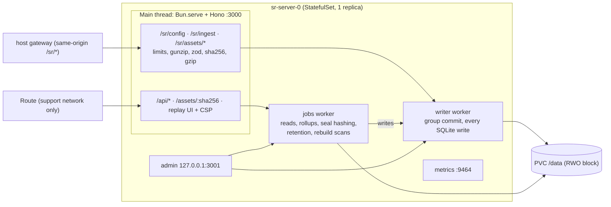
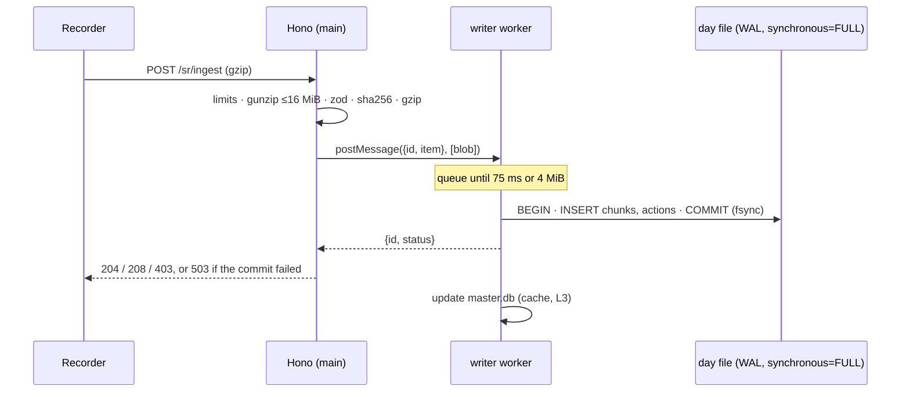

# 05 — Server
Status: draft · Size: large · Parent: [01-session-replay.md](01-session-replay.md)

## Goal

`apps/server` is one Bun process per region (D37). It does four jobs:
- takes recorder batches and stores them safely, acking a batch only once it is on disk;
- keeps one SQLite file per UTC day as the source of truth;
- serves the replay UI and its query API behind a strict CSP;
- runs the day close, retention and erasure jobs.

It must never lose a batch it has acked, never store a duplicate silently, and never let a replay fire a live request.
It runs on OpenShift as a single-replica StatefulSet on block storage. Contracts come from [03-protocol.md](03-protocol.md).

## Decisions

Inherited: D12, D13, D20, D21, D22, D26, D27, D28, D29, D30, D31, D32, D33, D36, D37, D38. From 03: L2 (stream positions), L3 (additive only), L4 (zod is the source of truth), L5 (gzip or plain JSON).

| # | Decision | Why |
|---|---|---|
| L1 | **Two Bun Workers.** `writer` does every SQLite write in short transactions. `jobs` does chunk and action reads, hotspot rollups, day-close hashing, retention and rebuild scans. Its writes go through `writer`. | With a single worker, one 300 ms chunk read or one 1.2 GB hash would delay every ack. D31 wants long work off the event loop *and* off the commit path. |
| L2 | **Three kinds of state file instead of one `master.db`.**<br>• `master.db` is a pure cache and can be rebuilt.<br>• `control.db` holds legal holds, wrapped user keys and subjects. It is never rebuilt and is backed up.<br>• `audit/access-<yyyy>.db` is append-only. | 01 puts `access_log` and `user_keys` in `master.db`, but `master.db` is meant to be deleted and rebuilt (D12). A rebuild would wipe the audit trail and every encryption key. |
| L3 | **Ack after the day-file commit.** `master.db` is updated afterwards, in its own transaction. If that update fails, the session is marked for repair. | SQLite transactions over several WAL databases aren't atomic as a set. The day file is the truth, so a catalog error must never un-ack or lose data. |
| L4 | **`sha256` is the SHA-256 of `JSON.stringify(events)`**, computed by the server on the parsed events. Not on the request body. | `sentAt` changes on every attempt, and the tail is sent plain while retries are gzip. Hashing the body would flag every retry as a conflicting duplicate. |
| L5 | **De-dup checks an in-memory `seq → sha256` map per recording.** The map is loaded from the session's files the first time the recording is seen. | A retry can land in a different file (day file vs late file), so a per-file key alone would store it twice. A global catalog of every `seq` would hold about 200 M rows at 30 days. |
| L6 | **Batch day = UTC day of `t0 + (receivedAt − sentAt)`.** A day is sealed at 00:00 UTC plus a 30 min grace. After that, its batches go to `late-<n>.db`. | Implements D31. The grace absorbs normal in-flight traffic, so late files hold only real backlog. |
| L7 | **No `segments` table.** `session_files` and `snapshots` replace it. | `IngestBatch` has no segment field. What readers actually need is the file map and the seek anchors. |
| L8 | **Recorder config is a ConfigMap-mounted JSON file**, reloaded when it changes. There is no admin HTTP endpoint in the MVP. | The MVP has no login (D38). An open admin endpoint would let anyone on the internal network turn recording off or lower rate caps. ConfigMap edits go through Git review and cluster RBAC, and the server logs each new version. |
| L9 | **Admin operations** (rebuild, erase, hold, retention dry run, seal) run on a second listener bound to `127.0.0.1:3001`, reached with `oc exec`. | Cluster RBAC is the authentication. The server stays the only process that writes the files. |
| L10 | **Viewer grant:** a signed cookie `sr_viewer={vid,name}` plus an in-memory grant per (vid, session), created by `POST /api/access`. A grant lasts 8 h or until the server restarts. | Meets D38 (a name and reason for each open) without a login. A restart only costs a re-prompt. |
| L11 | **Default limits:**<br>• body 1 MiB; gunzip output 16 MiB;<br>• per userId + IP: 20 req/s with a burst of 100, and 8 MiB/min;<br>• 500 MB/day stored per user;<br>• global `503` + `Retry-After` when the writer queue is over 64 MiB or free disk is under `SR_MIN_FREE_BYTES`. | 01's "60/min" example is below the recorder's own cadence: 03 sends a POST every 200–500 ms, which is 120–300 per minute. |
| L12 | **Pinned versions:**<br>• `hono` 4.13.x with `@hono/bun` 1.0.x, not hono 5 (still an rc);<br>• `zod` 4.6.x, `@hono/zod-validator` 0.9.x;<br>• `pino` for logs, `prom-client` for metrics.<br>Each is pinned to the newest release that is at least 2 weeks old. | `hono/bun` is deprecated in 4.13 in favour of `@hono/bun`, so the later move to v5 stays small. |
| L13 | **UI CSP** = D30 plus `style-src 'self' 'unsafe-inline'; script-src 'self'; connect-src 'self'; object-src 'none'; base-uri 'none'; form-action 'none'; frame-ancestors 'none'`. | The about:blank replay iframe inherits the CSP. rrweb rebuilds recorded `<style>` elements and `style` attributes, and `default-src 'self'` blocks both, so replays would lose all their CSS. D30 needs amending. |
| L14 | **`/assets/:sha256` is served with** `Content-Security-Policy: default-src 'none'; style-src 'unsafe-inline'; sandbox` and `nosniff`. | Without it, a cached SVG opened directly on our origin could run script. |

## Design

### How it works



**Files on the PVC (`SR_DATA_DIR`, default `/data`):**

| Path | What |
|---|---|
| `<yyyymmdd>/<class>.db` | Day file, one per retention class (D26). v1 has a single class, `std` (30 days). |
| `<yyyymmdd>/late-<n>.db` | Batches for that day that arrived after the seal. |
| `<file>.sha256` | Written at the seal. Lets `day_files` be rebuilt. |
| `master.db` | Cache (L2). Safe to delete. |
| `control.db` | Legal holds, wrapped user keys, subjects. Never rebuilt. |
| `audit/access-<yyyy>.db` | Append-only access log, kept for at least 2 years. |
| `holds/<sessionId>.db` | Verified legal-hold copies. |
| `assets/<aa>/<sha256>` | Content-addressed assets (D33). |

**Startup order:**
1. Parse the env with zod.
2. Run the filesystem check (below).
3. Open `control.db` and the current audit file.
4. Open `master.db`. If it is missing or its `user_version` is old, run a **full rebuild**. Otherwise **repair** the sessions touched by unsealed files (idempotent rollups, a few seconds).
5. Start `writer` and `jobs`, load the config, turn `/healthz/ready` green, then seal any overdue days.

**Shutdown:** on SIGTERM, `server.stop()`, then flush the writer queue (commit and reply), then exit.

### Routes

| Route | Caller | Notes |
|---|---|---|
| `GET /sr/config?app=&user=` | recorder | `RecorderConfig` (03) plus `X-SR-Config-Version`, with `Cache-Control: no-store`. An unknown app gets `enabled:false`. |
| `POST /sr/ingest` | recorder | See Ingest. |
| `POST /sr/assets/missing`, `PUT /sr/assets/:sha256` | recorder | D33 negotiation. Not in 03 yet: see C4. |
| `GET /api/sessions` | UI | From `master.db`. Logged as `search`. |
| `POST /api/access` | UI | `{sessionId, name, reason}` → 204, plus the cookie and a grant (L10). Logged as `open`. |
| `GET /api/sessions/:id`, `…/actions`, `…/chunks` | UI | Need a grant, or they return 403 `{need:'access'}` and log a `denied` row. |
| `GET /api/hotspots?day=&app=` | UI | Aggregation, see below. |
| `GET /assets/:sha256` | replay iframe | The route only matches `[a-f0-9]{64}`. Immutable cache headers plus L14. |
| `GET /healthz/live`, `/healthz/ready` | probes | `ready` = rebuild done, fs check passed, writer heartbeat under 10 s, disk above the floor. |
| `GET /*` | browser | The replay UI static build, plus `index.html` as the SPA fallback, with the L13 CSP. |

- Query routes are chained and exported as `export type QueryApi = typeof api`, so the UI can use `hc<QueryApi>`.
- Use `zValidator('query' | 'json' | 'param', schema)` on `/api/*`.
- Ingest parses the body by hand (gzip, see below).
- The replay UI build must not use Vite's default `assetsDir: 'assets'`, because it would collide with `/assets/:sha256` (C9).

### Ingest

1. `bodyLimit({ maxSize: 1 MiB })` returns 413. `Bun.serve({ maxRequestBodySize: 2 MiB })` is the backstop.
2. Decode the body. If `Content-Encoding: gzip`, use `gunzipSync(raw, { maxOutputLength: 16 MiB })`. Bun throws `ERR_BUFFER_TOO_LARGE`, which maps to 413. Otherwise the body is plain JSON, whatever the `Content-Type` (the `pagehide` tail).
3. Validate with `IngestBatch.safeParse`. Failure → 400.
4. Rate limit (token bucket per `userId|ip`) and daily quota per user → 429 with `{reason:'rate'|'quota'}` and `Retry-After` (C3). Global backpressure → 503 with `Retry-After`.
5. Prepare the chunk on the main thread:
   - `eventsJson = JSON.stringify(events)`, `sha256` (L4), `blob = gzip(eventsJson)`;
   - `t0`/`t1`, `offsetMs = receivedAt − sentAt` (`sentAt` from the `X-SR-Sent-At` header, 03-L7), and the day (L6);
   - `hasFull`: the chunk holds an rrweb event with `type 2`;
   - action rows from the `sr:*` events: `click`, `input`, `nav`, `error`, `report`, `fidelity`, `net` (C5), `hotspot`, `asset`, `meta`, `rate-caps`.
6. Hand the chunk to `writer` and wait for the commit. Map the result to 204 / 208 / 403 / 503.
7. Every 2xx carries `X-SR-Config-Version`.

**Rules inside `writer` (`decide`):**
- **Binding:** the session is bound to the first userId seen for it, so a different userId gets 403 (D20). The bindings live in memory, backed by `master.db`.
- **Same `(recordingId, seq)` with the same `sha256`:** 208, nothing written.
- **Same `(recordingId, seq)` with a different `sha256`:** stored with `dup_of_seq` set, counted in `flagged_dups`, answered 204. It is never dropped (D29).
- **Gaps:** `recordings.max_seq + 1 − chunk_count` gives the gaps, which are shown as `missing-batches` bands in `SessionDetail`.

**Client IP:** `X-Forwarded-For` is trusted only when the socket peer (`getConnInfo` from `@hono/bun`) is inside `SR_TRUSTED_PROXY_CIDRS`.

### Write path (D31: group commit, ack after commit)



```ts
// Sample — not final code. src/db/rpc.ts — request/response over a Bun Worker.
type Reply = { id: number; ok: boolean; value?: unknown; error?: string };

export const connectWorker = (url: URL) => {
  const worker = new Worker(url.href);
  const pending = new Map<number, { resolve: (v: unknown) => void; reject: (e: Error) => void }>();
  let nextId = 1;
  worker.onmessage = ({ data }: MessageEvent<Reply>) => {
    const p = pending.get(data.id);
    pending.delete(data.id);
    data.ok ? p?.resolve(data.value) : p?.reject(new Error(data.error));
  };
  // A dead worker must fail every waiting request (the client retries on 5xx), never leave it hanging.
  worker.onerror = (err) => { for (const p of pending.values()) p.reject(new Error(err.message)); pending.clear(); };
  const call = <T>(op: string, arg: unknown, transfer: Transferable[] = []) =>
    new Promise<T>((resolve, reject) => {
      const id = nextId++;
      pending.set(id, { resolve: resolve as (v: unknown) => void, reject });
      worker.postMessage({ id, op, arg }, transfer);    // the blob's ArrayBuffer moves, it isn't copied
    });
  return { call, worker };
};
```

```ts
// Sample — not final code. src/ingest/route.ts
import { gunzipSync } from 'node:zlib';
import { bodyLimit } from 'hono/body-limit';
import { IngestBatch } from '@sr/protocol';

const decode = (raw: Uint8Array, encoding?: string) => {
  try {
    const bytes = encoding === 'gzip' ? gunzipSync(raw, { maxOutputLength: env.SR_MAX_INFLATED }) : raw;
    return { ok: true as const, json: JSON.parse(new TextDecoder().decode(bytes)) as unknown };
  } catch (e) {
    const tooBig = (e as { code?: string }).code === 'ERR_BUFFER_TOO_LARGE';   // a gzip bomb, not bad JSON
    return { ok: false as const, status: tooBig ? (413 as const) : (400 as const) };
  }
};

export const ingest = new Hono().post('/sr/ingest',
  bodyLimit({ maxSize: env.SR_MAX_BODY, onError: (c) => c.json({ reason: 'too-big' }, 413) }),
  async (c) => {
    const receivedAt = clock.now();
    const raw = new Uint8Array(await c.req.arrayBuffer());
    const body = decode(raw, c.req.header('content-encoding'));
    if (!body.ok) return c.json({ reason: body.status === 413 ? 'too-big' : 'invalid' }, body.status);
    const parsed = IngestBatch.safeParse(body.json);
    if (!parsed.success) return c.json({ reason: 'invalid' }, 400);
    const limited = limits.take(parsed.data.userId, clientIp(c), raw.byteLength);  // 'rate' | 'quota' | 'busy' | null
    if (limited) return c.json({ reason: limited }, limited === 'busy' ? 503 : 429, { 'Retry-After': '30' });
    const item = prepareChunk(parsed.data, receivedAt);               // sha256, gzip, day, actions
    const res = await writer.call<IngestResult>('ingest', item, [item.blob.buffer]).catch(() => ({ status: 503 as const }));
    if (res.status >= 300) return c.json({ reason: res.reason ?? 'not-stored' }, res.status);
    return c.body(null, res.status, { 'X-SR-Config-Version': config.version() });   // 204 or 208
  });
```

```ts
// Sample — not final code. src/db/writer.ts — runs in a Bun Worker; the only SQLite writer (L1).
declare var self: Worker;
const store = openStore(env.SR_DATA_DIR);                  // day/late files, master.db, control.db, audit
let queue: { id: number; item: ChunkItem }[] = [];
let queuedBytes = 0;
let timer: ReturnType<typeof setTimeout> | undefined;

self.onmessage = (e: MessageEvent<WriterMsg>) => {
  const { id, op, arg } = e.data;
  if (op !== 'ingest') return handleOther(id, op, arg);    // access rows, seal, erase: same queue
  queue.push({ id, item: arg });
  queuedBytes += arg.blob.byteLength;
  if (queuedBytes >= env.SR_COMMIT_MAX_BYTES) flush();     // byte cap: a backlog drain commits early
  else timer ??= setTimeout(flush, env.SR_COMMIT_MS);
};

const flush = () => {
  clearTimeout(timer); timer = undefined;
  const group = queue; queue = []; queuedBytes = 0;
  // decide() checks binding (403), seq/sha (208 or flag) and the target file against in-memory state
  // that already counts earlier items of this same group. No I/O.
  const plan = store.decide(group);
  for (const [file, items] of plan.writesByFile) {
    try {
      store.insertChunks(file, items);   // one transaction per file; synchronous=FULL fsyncs the WAL
      plan.commit(items);                // the seq/binding marks become real
    } catch (err) {
      plan.rollback(items);              // forget the marks, and fail any 208 that leaned on them
      log.error({ err, file }, 'commit failed');
    }
  }
  for (const { id } of group) postMessage({ id, ok: true, value: plan.resultFor(id) });  // ack only now
  try { store.updateCatalog(plan.committed()); }             // the cache, after the ack on purpose (L3)
  catch (err) { store.markForRepair(plan.committedSessions(), err); }
};
```

Each database is opened with `new Database(path, { create: true, strict: true })`, then `PRAGMA journal_mode = WAL`, `PRAGMA synchronous = FULL` and `PRAGMA busy_timeout = 5000`. All inserts are prepared once per file and wrapped in `db.transaction(fn)`, which is synchronous: never `await` inside one.

### Storage (D26, D27)

```sql
-- Sample — not final code. <yyyymmdd>/<class>.db and late-<n>.db: the source of truth. user_version = 1.
CREATE TABLE chunks (
  id INTEGER PRIMARY KEY,                       -- rowid table: blobs are large, so not WITHOUT ROWID
  recording_id TEXT NOT NULL, seq INTEGER NOT NULL, sha256 TEXT NOT NULL,   -- sha of plaintext events (L4)
  session_id TEXT NOT NULL, user_id TEXT NOT NULL, app TEXT NOT NULL,
  t0 INTEGER NOT NULL, t1 INTEGER NOT NULL,      -- client ms; add offset_ms for server time
  sent_at INTEGER NOT NULL, received_at INTEGER NOT NULL, offset_ms INTEGER NOT NULL,
  has_full INTEGER NOT NULL,                     -- holds an rrweb FullSnapshot: a seek anchor
  dup_of_seq INTEGER,                            -- set when this seq already had another sha256 (D29)
  enc INTEGER NOT NULL DEFAULT 0,                -- 0 = gzip, 1 = AES-GCM(gzip) under the user's key
  blob BLOB NOT NULL,
  UNIQUE (recording_id, seq, sha256));
CREATE INDEX chunks_session ON chunks (session_id, recording_id, seq);
CREATE INDEX chunks_user ON chunks (user_id);                                -- erasure
CREATE TABLE actions (
  recording_id TEXT NOT NULL, seq INTEGER NOT NULL, idx INTEGER NOT NULL,   -- stream position (03 L2)
  session_id TEXT NOT NULL, user_id TEXT NOT NULL, t INTEGER NOT NULL,
  kind TEXT NOT NULL, name TEXT NOT NULL,        -- plaintext for audit search (D27)
  failed INTEGER NOT NULL DEFAULT 0, enc INTEGER NOT NULL DEFAULT 0,
  summary BLOB,                                  -- short text; encrypted when enc = 1
  PRIMARY KEY (recording_id, seq, idx));
CREATE INDEX actions_session ON actions (session_id, t);
CREATE INDEX actions_search ON actions (kind, name);

-- master.db: a cache. Delete it and it is rebuilt from the files (D12, L2).
CREATE TABLE sessions (session_id TEXT PRIMARY KEY, user_id TEXT NOT NULL, app TEXT NOT NULL,
  started_at INTEGER, ended_at INTEGER, first_day TEXT, last_day TEXT, clock_offset_ms INTEGER,
  meta TEXT, rate_caps TEXT,                     -- latest sr:meta / sr:rate-caps payloads (JSON)
  events INTEGER, bytes INTEGER, errors INTEGER, failed_reqs INTEGER, reports INTEGER,
  fidelity_drops INTEGER, flagged_dups INTEGER);
CREATE INDEX sessions_user_day ON sessions (user_id, first_day);
CREATE INDEX sessions_day ON sessions (first_day);
CREATE TABLE recordings (recording_id TEXT PRIMARY KEY, session_id TEXT NOT NULL, started_at INTEGER,
  ended_at INTEGER, max_seq INTEGER, chunk_count INTEGER, pipeline TEXT);
CREATE TABLE session_files (session_id TEXT, storage_key TEXT, PRIMARY KEY (session_id, storage_key));
CREATE TABLE snapshots (session_id TEXT, recording_id TEXT, seq INTEGER, t INTEGER, PRIMARY KEY (recording_id, seq));
CREATE TABLE action_counts (session_id TEXT, kind TEXT, name TEXT, n INTEGER, first_at INTEGER,
  PRIMARY KEY (session_id, kind, name));
CREATE TABLE hotspots (day TEXT, app TEXT, remote TEXT, area TEXT, session_id TEXT, user_id TEXT,
  recording_id TEXT, seq INTEGER, idx INTEGER, t INTEGER, mutations_per_sec REAL, paused_ms INTEGER);
CREATE INDEX hotspots_day_app ON hotspots (day, app);
CREATE TABLE user_day_bytes (user_id TEXT, day TEXT, bytes INTEGER, PRIMARY KEY (user_id, day));  -- quota
CREATE TABLE day_files (storage_key TEXT PRIMARY KEY, sealed_at INTEGER, sha256 TEXT, bytes INTEGER);
CREATE TABLE assets (sha256 TEXT PRIMARY KEY, type TEXT, bytes INTEGER, first_seen INTEGER, last_ref_day TEXT);

-- control.db: never rebuilt; backed up; backups kept ≤ 30 days so erased keys age out.
CREATE TABLE legal_holds (session_id TEXT PRIMARY KEY, set_at INTEGER, set_by TEXT, reason TEXT, hold_key TEXT);
CREATE TABLE user_keys (user_id TEXT PRIMARY KEY, wrapped_key BLOB NOT NULL, created_at INTEGER NOT NULL);
CREATE TABLE subjects (subject_hmac TEXT PRIMARY KEY, user_id TEXT NOT NULL);   -- row deleted on erasure

-- audit/access-<yyyy>.db: append-only, kept at least 2 years; whole yearly files are deleted.
CREATE TABLE access_log (id INTEGER PRIMARY KEY, at INTEGER NOT NULL, viewer_id TEXT, viewer_name TEXT,
  action TEXT NOT NULL,   -- search | open | chunks | denied | config-change | erase | hold | retention
  result TEXT NOT NULL, session_id TEXT, subject_hmac TEXT, day TEXT, reason TEXT, ip TEXT,
  user_agent TEXT, detail TEXT);
CREATE TRIGGER access_log_no_update BEFORE UPDATE ON access_log BEGIN SELECT RAISE(ABORT, 'append-only'); END;
CREATE TRIGGER access_log_no_delete BEFORE DELETE ON access_log BEGIN SELECT RAISE(ABORT, 'append-only'); END;
```

- Action rows come only from the first stored chunk for a `(recording_id, seq)`. A flagged duplicate keeps its events in `chunks` but adds no actions.
- Access rows ride the same group commit as chunks. The API waits for that commit before returning any data: no data leaves without its log row.
- The access log names recorded users only by `subject_hmac = HMAC-SHA256(SR_SUBJECT_KEY, userId)`.

**Rebuild:** `master.db` is rebuilt from the files.

```ts
// Sample — not final code. src/store/rebuild.ts — runs in `jobs`, at startup only, before writer starts.
export const rebuildMaster = (dataDir: string) => {
  const target = join(dataDir, 'master.db');
  const tmp = `${target}.rebuild`;
  rmSync(tmp, { force: true });
  const m = openMaster(tmp);                                   // fresh schema, user_version = current
  for (const key of listChunkFiles(dataDir)) {                 // 20261110/std.db, …/late-1.db, holds/*.db
    const f = new Database(join(dataDir, key), { readonly: true, strict: true });
    m.db.transaction(() => {
      for (const r of f.query(SESSION_ROLLUP).iterate()) m.mergeSession(r, key);   // min/max, counts, user_id
      for (const r of f.query(RECORDING_ROLLUP).iterate()) m.mergeRecording(r);   // max_seq, chunk_count
      for (const r of f.query(ACTION_ROLLUP).iterate()) m.mergeAction(r);         // counts, hotspots, assets, meta
      m.addDayFile(key, readSidecarSha(dataDir, key));
    })();
    f.close();
  }
  m.db.close();
  renameSync(tmp, target);              // atomic swap: a crash mid-rebuild leaves the old cache in place
};
```

`repairSession(id)` runs the same rollups, limited to that session's `session_files`. The merges recompute values instead of adding to them, so running them twice is safe.

**Crypto-shredding (D27, `SR_CRYPTO_SHRED=on`, default off).** The master key is 32 bytes, base64, in the `SR_MASTER_KEY` env var from a Secret.

```ts
// Sample — not final code. src/crypto/keys.ts — per-user data keys wrapped by the master key.
const kek = await crypto.subtle.importKey('raw', Buffer.from(env.SR_MASTER_KEY, 'base64'), 'AES-KW', false,
  ['wrapKey', 'unwrapKey']);

export const newUserKey = async () => {
  const dek = await crypto.subtle.generateKey({ name: 'AES-GCM', length: 256 }, true, ['encrypt', 'decrypt']);
  const wrapped = new Uint8Array(await crypto.subtle.wrapKey('raw', dek, kek, 'AES-KW'));   // 40 bytes → control.db
  return { wrapped, dek: await unwrapUserKey(wrapped) };    // keep only a non-extractable copy in memory
};
export const unwrapUserKey = (wrapped: Uint8Array) =>
  crypto.subtle.unwrapKey('raw', wrapped, kek, 'AES-KW', { name: 'AES-GCM', length: 256 }, false, ['encrypt', 'decrypt']);

// The AAD binds a blob to its row: moving it to another recording or seq makes decryption fail.
export const sealBlob = async (dek: CryptoKey, plain: Uint8Array, recordingId: string, seq: number) => {
  const iv = crypto.getRandomValues(new Uint8Array(12));
  const additionalData = new TextEncoder().encode(`${recordingId}:${seq}`);
  const ct = new Uint8Array(await crypto.subtle.encrypt({ name: 'AES-GCM', iv, additionalData }, dek, plain));
  const out = new Uint8Array(12 + ct.length);
  out.set(iv); out.set(ct, 12);                             // iv ‖ ciphertext ‖ tag
  return out;
};
```

- `writer` encrypts when a chunk is enqueued, before the synchronous transaction. `jobs` decrypts on read.
- Random 96-bit IVs are safe below 2³² messages per key. A busy user sends about 50 M a year.
- A deleted key makes those chunks `integrity:'unreadable'`. Other users still replay.

### Asset store (D33)

- **`POST /sr/assets/missing`** takes `{hashes ≤ 200}` and returns the hashes not yet on disk, checked against the `assets` table.
- **`PUT /sr/assets/:sha256`** accepts `image/*` or `font/*`, up to 2 MiB.
  - The server re-hashes the bytes. A mismatch → 400.
  - It writes `assets/<aa>/<sha>.tmp`, then renames it into place, then inserts the row.
- **`sr:asset` events** update `last_ref_day` at ingest.
- **Retention** deletes assets whose `last_ref_day` is older than the longest retention period.
- **`GET /assets/:sha256`** sends `Cache-Control: public, max-age=31536000, immutable` and the stored `Content-Type`, plus L14.

### Config admin (D22, D36, L8)

`SR_CONFIG_FILE` (default `/etc/sr/recorder-config.json`) is mounted from the ConfigMap `sr-recorder-config`, **without `subPath`**, because subPath mounts never update. The server checks the file's content hash every 15 s:
- **Content changed and `version` changed:** the server swaps in the new config and writes a `config-change` access row (old and new version, the apps and keys that changed).
- **Content changed but `version` didn't:** the new file is refused, the old config is kept, and an alert fires.

Sample — not final code (the admin file for one region):

```json
{ "v": 1, "version": "2026-11-10.3", "killSwitch": false,
  "defaults": { "killSwitch": false, "checkpointMinutes": 12, "pipeline": "main", "retentionClass": "std",
                "budget": { "cpuPct": 3, "longFrameMs": 50, "resumeAfterMs": 10000 },
                "assetCache": { "enabled": false, "allow": ["/assets/", "/static/"] } },
  "apps": { "blotter": { "allowUsers": ["u123", "u456"], "allowAll": false,
                         "rateCaps": { "positions": { "bid": 2, "ask": 2, "mid": 2 } } } } }
```

**What `/sr/config` serves:**
- `RecorderConfig` = `defaults` merged with `apps[app]`.
- `enabled = !killSwitch && (allowAll || allowUsers.includes(user))`.
- `X-SR-Config-Version` carries the file's `version`.

**Silent users:** the server tracks users who were enabled when they fetched config but have no ingest in the last 15 min. That count feeds the "enabled but silent" alert.

### Query API, access and hotspots (D32, D38)

**Where reads run:**
- Reads of `master.db` and `control.db` use a read-only connection on the main thread, with indexed, `LIMIT`ed queries only.
- Anything that touches day files runs in `jobs`.

**Endpoints:**
- **Sessions** come newest first, with `limit` and `cursor`.
- **Detail** returns the summary, recordings with gaps, `files`, `snapshots` (seek anchors), the rate-cap legend, `identity:'client-asserted'` and `legalHold`.
- **Actions** take `?kinds=&after=&limit=1000` (C6). A day of Redux actions can reach 100 k+ rows.
- **Chunks** (`from` / `to` are `recordingId:seq:idx`) returns whole chunks covering the range, ordered by recording start and then `seq`, across `session_files`.
  - Each chunk has `integrity: ok | mismatch | unreadable`, checked against `sha256` (D28). The response also lists `missing` seq ranges.
  - Responses cap at 8 MiB with a `next` cursor, and stream the stored events JSON without re-parsing it.

**Access (L10):**
- `POST /api/access` waits for the `open` row to commit, then sets `sr_viewer` (signed with `SR_COOKIE_KEY`; `HttpOnly; Secure; SameSite=Strict`) and creates the grant.
- Chunk fetches are logged once per (viewer, session, 15 min).
- Searches without a cookie are logged as `anonymous` with the IP.

**Hotspots:** `GET /api/hotspots` groups the day's `hotspots` rows by `(app, remote, area)`. Each group returns the pause count, the total gap (`SUM(paused_ms)`), the peak mutation rate, `COUNT(DISTINCT user_id)`, and an example link: the stream position of the longest single pause.

### Day close, retention, erasure, filesystem check

**Seal (00:00 UTC + `SR_DAY_CLOSE_GRACE_MIN`).** Each step checks its own state, so a crash mid-way resumes cleanly.
1. `writer` marks the day sealed, so later batches route to `late-<n>`.
2. `jobs.release(day)` closes its read handles.
3. `writer` runs `wal_checkpoint(TRUNCATE)`, `PRAGMA quick_check` and `journal_mode=DELETE`, then closes the file.
4. `jobs` streams the sha256 into the `.sha256` sidecar, sets `chmod 0444`, and writes the `day_files` row through `writer`.

Open late files are sealed in the same nightly run.

**Retention (daily, after the seal).** For each class, take the day folders older than its retention period:
1. Copy every held session's rows into `holds/<id>.db` (`ATTACH` + `INSERT … SELECT`).
2. Verify the copy (row counts and byte-equal blobs), then repoint `session_files`.
3. Delete the folder.
4. Drop the catalog rows that no longer have a file.
5. Write a `retention` row.

`--dry-run` only lists and logs. The audit files are deleted by whole year once they are past 2 years.

**Erasure (manual, admin listener):** `oc exec sr-server-0 -- bun src/cli.ts erase --user <id> --by <name> --ticket <ref> [--dry-run]`
- **Crypto-shredding on:** delete `user_keys` and the `subjects` row, evict the key from both workers, and delete the catalog rows.
- **Crypto-shredding off:** only for sealed files (today's file waits for its seal). For each file: copy it to a temp file, `DELETE` the user's rows there, `VACUUM INTO` a fresh file (so no free pages keep the old data), re-hash it, and rename it over the original.
- **Either way:** write an `erase` row. The record also gives the date when the last backup or VolumeSnapshot that still holds the user's data expires.

**Filesystem check.** On Linux, at startup:
1. Find the mount that holds `realpath(SR_DATA_DIR)`: the longest matching mount point in `/proc/self/mountinfo`. The fs type is the first field after ` - `.
2. Refuse to start if the type is `nfs`, `nfs4`, `cifs`, `smb3`, `smbfs`, `ceph`, `fuse.cephfs`, `glusterfs`, `fuse.glusterfs`, `9p`, `fuse.sshfs`, `lustre` or `gpfs`.
3. Also refuse if free space is under `SR_MIN_FREE_BYTES`.

`SR_ALLOW_UNSAFE_FS=1` is for dev and test only. On Windows the check is skipped with a warning.

### OpenShift per region (D37)

**Kustomize:** `deploy/openshift/base` holds the StatefulSet, Service, Route, NetworkPolicy, ConfigMaps, PrometheusRule and snapshot CronJob. `overlays/{nam,apac,emea}` set the host, allow-list CIDRs, storage class, `SR_REGION` and image tag. Apply one with `oc apply -k deploy/openshift/overlays/nam`.

```yaml
# Sample — not final code. deploy/openshift/base/statefulset.yaml
apiVersion: apps/v1
kind: StatefulSet
metadata: { name: sr-server, labels: { app: sr-server } }
spec:
  serviceName: sr-server
  replicas: 1                                  # SQLite: one writer per file. Never scale up.
  selector: { matchLabels: { app: sr-server } }
  template:
    metadata: { labels: { app: sr-server } }
    spec:
      terminationGracePeriodSeconds: 30        # SIGTERM → stop, flush the commit queue, exit
      containers:
        - name: server
          image: REGISTRY/session-replay/sr-server:0.1.0     # registry: open question
          ports: [{ name: http, containerPort: 3000 }, { name: metrics, containerPort: 9464 }]
          envFrom:
            - configMapRef: { name: sr-server-env }          # SR_REGION, limits, retention, SR_CRYPTO_SHRED
            - secretRef: { name: sr-server-secrets }         # SR_MASTER_KEY, SR_COOKIE_KEY, SR_SUBJECT_KEY
          volumeMounts:
            - { name: data, mountPath: /data }
            - { name: recorder-config, mountPath: /etc/sr, readOnly: true }   # no subPath (L8)
          startupProbe:   { httpGet: { path: /healthz/live, port: http }, periodSeconds: 10, failureThreshold: 180 }
          readinessProbe: { httpGet: { path: /healthz/ready, port: http }, periodSeconds: 10 }
          livenessProbe:  { httpGet: { path: /healthz/live, port: http }, periodSeconds: 20, failureThreshold: 3 }
          resources: { requests: { cpu: 500m, memory: 1Gi }, limits: { memory: 2Gi } }   # resize after pilot
          securityContext: { allowPrivilegeEscalation: false, runAsNonRoot: true, capabilities: { drop: [ALL] } }
      volumes:
        - { name: recorder-config, configMap: { name: sr-recorder-config } }
  volumeClaimTemplates:
    - metadata: { name: data }
      spec:
        accessModes: [ReadWriteOnce]
        storageClassName: BLOCK_STORAGE_CLASS  # e.g. Ceph RBD. Never NFS or CephFS.
        resources: { requests: { storage: 150Gi } }   # ~37–75 GB at 30 days + holds, assets, headroom
---
apiVersion: route.openshift.io/v1
kind: Route
metadata:
  name: sr-replay
  annotations:
    haproxy.router.openshift.io/ip_allowlist: "SUPPORT_CIDRS"   # space-separated; D38 risk mitigation
spec:
  host: sr-replay-REGION.apps.CLUSTER_DOMAIN
  to: { kind: Service, name: sr-server }
  port: { targetPort: http }
  tls: { termination: edge, insecureEdgeTerminationPolicy: Redirect }
---
apiVersion: snapshot.storage.k8s.io/v1        # created hourly by a CronJob (`oc create`), pruned to 48
kind: VolumeSnapshot
metadata: { generateName: sr-data-, labels: { app: sr-server } }
spec:
  volumeSnapshotClassName: BLOCK_SNAPSHOT_CLASS
  source: { persistentVolumeClaimName: data-sr-server-0 }
```

**Network paths:**
- Recorders reach `/sr/*` through the host app's gateway, which proxies to the in-cluster Service. They never use the allow-listed Route.
- A NetworkPolicy admits port 3000 only from the router and gateway namespaces, and port 9464 only from user-workload monitoring.

**Snapshots** are crash-consistent. That is safe here: with `synchronous=FULL`, every acked commit is already on disk.

**Image:** `apps/server/Dockerfile`, built from the repo root on `oven/bun:1.4.4-slim`.
- It runs `bun install --frozen-lockfile --production`, builds the replay UI, copies the server source (Bun runs the TS directly) and ends with `CMD ["bun", "apps/server/src/main.ts"]`.
- OpenShift runs the container as an arbitrary UID in group 0, so the image makes its own folders group-writable (`chgrp -R 0 … && chmod -R g=u …`). The PVC gets write access from the SCC's `fsGroup`.

### Observability

**Logs:** `pino` JSON to stdout.
- Never log event content, cookies, keys or raw userIds. Use the first 8 characters of `subject_hmac` instead.
- One summary line per minute (requests, bytes, statuses), plus errors.

**Metrics** (`prom-client` on :9464):
- `sr_ingest_requests_total{status,reason}`, `sr_ingest_bytes_total`;
- `sr_ack_seconds`, `sr_commit_seconds`, `sr_commit_group_items`, `sr_writer_queue_bytes`;
- `sr_seq_gaps`, `sr_flagged_dups_total`, `sr_quota_hits_total`, `sr_rate_limited_total`, `sr_denied_total{reason}`;
- `sr_fidelity_total{reason}`, `sr_hotspots_total{app}`, `sr_enabled_silent_users`;
- `sr_disk_free_bytes`, `sr_seal_last_success_timestamp`, `sr_retention_last_success_timestamp`, `sr_config_version_info`.

**Alerts** (PrometheusRule):
- **From 01 Monitoring:** a seq gap still open after 1 h; any flagged duplicate; any quota hit; a `pause-budget` rate above baseline; `sr_enabled_silent_users > 0` for 30 min.
- **Server health:** commit p99 over 500 ms; 5xx over 1 %; free disk under 15 %; no seal in 26 h; newest snapshot older than 2 h; config file refused.

### Contract change requests (to 03 and 01)

| # | Change | Why |
|---|---|---|
| C1 | `z.record(X)` → `z.record(z.string(), X)` everywhere. | In zod 4.6 the single-argument form passes at runtime but fails the type check. |
| C2 | State that `sha256 = SHA-256(JSON.stringify(events))`, computed by the server. The recorder must resend identical `events`. | L4. |
| C3 | 429 body `{reason:'rate'\|'quota'}` with `Retry-After`. 503 with `Retry-After` for backpressure (the recorder treats it as 5xx). | The recorder must tell "back off" from "stop for the day". |
| C4 | Add `AssetMissingReq {v:1, hashes}`, `AssetMissingRes {missing}`, `PUT /sr/assets/:sha256`. | D33 negotiation has no contract yet. |
| C5 | Add an `sr:net` tag `{method, url, status, ms}` emitted by the engine, and an optional `remote` on `sr:hotspot`. | The server then builds `net` rows without parsing rrweb plugin payloads (D25). D32 needs the remote. |
| C6 | Define `SessionSummary`, `SessionDetail` (with `snapshots`, `files`, gaps, `identity`), `ChunksResponse` (with `integrity`, `missing`, `next`) and `HotspotRow`. Positions in query strings as `recordingId:seq:idx`. Actions paging `?kinds=&after=&limit=`. | 03 names these shapes but doesn't define them. |
| C7 | 01 Ingest: default limits per L11. The recorder should combine posts so live traffic is about 1 upload/s. | 60/min is below 03's own cadence, and tiny batches mean about 7 M rows per region per day. |
| C8 | 01 D30: add L13's directives, including `style-src 'unsafe-inline'`. | Otherwise replays lose their CSS. |
| C9 | Replay UI plan: Vite `build.assetsDir` must not be `assets`. | It collides with `/assets/:sha256`. |

## Guidelines

**Do:**
- Reply to an ingest request only after `writer` reports its file's commit. A 208 or 403 that depends on an uncommitted item in the same group waits for that item's commit.
- Keep `db.transaction` bodies synchronous. Do encryption and hashing before them.
- Route every write, including access rows and seals, through `writer`.
- Inject `clock` and `env` everywhere, so tests can move time across midnight.
- Treat clock-skew edge cases as data, not errors. If the corrected `t0` is in the future, use the receive day. Keep `offset_ms` per chunk.
- Batches older than the retention period → 400 `{reason:'expired'}`.

**Don't:**
- Don't put anything non-rebuildable in `master.db` (L2).
- Don't open a day file from a second process.
- Don't use `subPath` for the config mount.
- Don't log payloads.
- Don't add an unauthenticated admin route on :3000.
- Don't use `zValidator('json')` on ingest: the body may be gzip.
- Don't import from `hono/bun`. Use `@hono/bun`.

## Acceptance

- [ ] **Commit then ack:** a 204 or 208 is sent only after the row is readable from a fresh connection. A failed transaction returns 503 to every request in its group, and none of them is stored half-way.
- [ ] **Duplicates:** the same `(recordingId, seq)` and events → 208, one row. Same `seq`, different events → both stored, `flagged_dups = 1`, the alert fires.
- [ ] **Retry across a seal:** the duplicate is still detected (L5).
- [ ] **Binding:** a second userId on a session → 403. Every chunk of a session has the same `user_id`.
- [ ] **Limits:** over 1 MiB → 413; a gzip bomb (inflates past 16 MiB) → 413; bad JSON or schema → 400; rate → 429 `rate` and quota → 429 `quota`, both with `Retry-After`.
- [ ] **Restart mid-batch:** killing the writer before the commit gives 503 and the retry stores the batch once. Killing it after the commit gives 208 on the retry.
- [ ] **Disk full** (`PRAGMA max_page_count`): 503 to the whole group, ingest refuses below the floor, reads still work, the alert fires.
- [ ] **Clock skew:** a client 5 min behind → `offset_ms ≈ 300000`, the right day file, and the replay lines up.
- [ ] **Midnight:** a session across 00:00 UTC lists two files, and its chunks come back in order across both.
- [ ] **Late file:** a batch for a sealed day lands in `late-1.db`, linked through `session_files`, and is returned by `chunks`.
- [ ] **Seal:** the file ends in `journal_mode=delete`, read-only, with a sidecar sha256. A crash mid-seal resumes.
- [ ] **Backlog drain:** 50 clients × 2,000 queued batches drain with no loss, only 2xx/429/503, ack p99 < 1 s at steady state, and no starvation.
- [ ] **Rebuild:** delete `master.db` → the rebuilt catalog equals the original (sessions, recordings, session_files, action_counts, hotspots). `control.db` and the audit file are untouched.
- [ ] **Crypto:** with crypto-shredding on, erasing a user makes their chunks `unreadable` while others replay. With it off, the `VACUUM INTO` erasure leaves no trace in a `grep` of the file.
- [ ] **Retention:** a dry run lists the deletions. A real run keeps held sessions in `holds/`, verified and still replayable.
- [ ] **Access:** the access log rejects UPDATE and DELETE. `actions` and `chunks` without a grant → 403 plus a `denied` row. `open` rows carry the name, reason, IP and session.
- [ ] **Config:** a ConfigMap change is picked up within 2 min, the version header changes, and a `config-change` row is written. A file whose content changed but whose `version` didn't is refused, and the old config stays live.
- [ ] **CSP:** `/` carries the L13 CSP. `/assets/<sha>` carries L14. A `/assets/` path that isn't a valid hash is never served by the SPA fallback.
- [ ] **Filesystem:** startup refuses an `nfs4` or `fuse.cephfs` mount (mountinfo fixtures).
- [ ] **Assets:** asset negotiation returns only the missing hashes, and a hash mismatch → 400.

## Tasks

Every slice is done when `bunx tsc --noEmit -p apps/server` passes and `bun test apps/server` passes for the slice's tests. Within the server lane the slices run one after another.

- [ ] **S1 Scaffold** — owns: `apps/server/{package.json,tsconfig.json}`, `apps/server/src/{main,app,env,log}.ts`, `apps/server/src/http/**`, `apps/server/src/ops/fs-check.ts`, `apps/server/test/{http,fs-check}.test.ts` — batch: B1 — depends on: 03 T1 — done when: health routes, CSP headers, SPA fallback and the `/assets/` guard are tested, plus the mountinfo fixtures.
- [ ] **S2 Storage layer** (schemas, migrations, file router, handle cache, triggers) — owns: `apps/server/src/store/**`, `apps/server/test/store.test.ts` — batch: B2 — depends on: S1 — done when: schema, append-only trigger and routing tests (day / late / class) pass.
- [ ] **S3 Writer worker** (RPC, group commit, de-dup map, binding, quota counters, catalog, shutdown flush) — owns: `apps/server/src/db/{rpc,writer,types}.ts`, `apps/server/test/writer.test.ts` — batch: B2 — depends on: S2 — done when: the commit-then-ack, failed-group, duplicate, binding and disk-full tests pass.
- [ ] **S4 Ingest route** (decode, limits, zod, prepare, status mapping, config header stub) — owns: `apps/server/src/ingest/**`, `apps/server/test/ingest.test.ts` — batch: B2 — depends on: S3 — done when: the limit, 413/400/429/503, clock-skew and gzip-vs-plain tests pass.
- [ ] **S5 Startup, rebuild, repair, seal** — owns: `apps/server/src/ops/{startup,day-close}.ts`, `apps/server/src/store/rebuild.ts`, `apps/server/src/db/jobs.ts`, `apps/server/test/{rebuild,day-close}.test.ts` — batch: B2 — depends on: S4 — done when: the rebuild-equality, late-file, midnight and seal-resume tests pass.
- [ ] **S6 Access and audit** — owns: `apps/server/src/api/access.ts`, `apps/server/src/audit/**`, `apps/server/test/access.test.ts` — batch: B3 — depends on: S5 — done when: the cookie, grant, `denied` row and 15-min chunk-row tests pass.
- [ ] **S7 Query API** (sessions, detail, actions, chunks, `QueryApi` type) — owns: `apps/server/src/api/{query,index}.ts`, `apps/server/src/db/jobs.ts`, `apps/server/test/query.test.ts` — batch: B3 — depends on: S6 and C6 — done when: the paging, integrity, missing-range and cross-file ordering tests pass, and `hc<QueryApi>` compiles in a test.
- [ ] **S8 Config and hotspots** — owns: `apps/server/src/config/**`, `apps/server/src/api/hotspots.ts`, `apps/server/test/{config,hotspots}.test.ts` — batch: B3 — depends on: S7 — done when: the reload, version-refusal, allow-list, kill-switch and aggregation tests pass.
- [ ] **S9 Retention, holds, erasure, admin listener** — owns: `apps/server/src/ops/{retention,erase}.ts`, `apps/server/src/admin/**`, `apps/server/src/cli.ts`, `apps/server/test/{retention,erase}.test.ts` — batch: B3 — depends on: S8 — done when: the dry-run, hold-copy verification and `VACUUM INTO` erasure tests pass.
- [ ] **S10 Crypto-shredding toggle** — owns: `apps/server/src/crypto/**`, `apps/server/src/db/{writer,jobs}.ts`, `apps/server/test/crypto.test.ts` — batch: B3 — depends on: S9 — done when: the round-trip, wrong-AAD and erase-key → `unreadable` tests pass.
- [ ] **S11 Asset store** — owns: `apps/server/src/assets/**`, `apps/server/test/assets.test.ts` — batch: B4 — depends on: S10 and C4 — done when: the negotiation, hash-mismatch, L14 header and GC tests pass.
- [ ] **S12 Observability** — owns: `apps/server/src/ops/metrics.ts`, `deploy/openshift/base/prometheusrule.yaml`, `apps/server/test/metrics.test.ts` — batch: B4 — depends on: S11 — done when: `/metrics` exposes every listed series (prom-client on Bun is verified here).
- [ ] **S13 Backlog-drain load test** — owns: `apps/server/test/load/**` — batch: B4 — depends on: S11 — done when: the drain acceptance item passes locally and main-thread CPU is recorded.
- [ ] **S14 Image and OpenShift manifests** — owns: `apps/server/Dockerfile*`, `deploy/openshift/**` — batch: B4 — depends on: S12 — done when: `oc kustomize` renders each overlay (or a `bun test` YAML check if `oc` is missing), a test asserts `replicas: 1`, RWO, no NFS class, the probes and the Secret refs, and the image builds locally.
- [ ] **S15 Real-workspace integration** (scope rename, registry, real storage classes, CIDRs, pilot config) — owns: `deploy/openshift/overlays/**`, `apps/server/package.json` — batch: B5 — depends on: S14 and open questions 1–5 — done when: the pilot overlay renders and the image runs in the pilot namespace.

## Risks

| Risk | Mitigation |
|---|---|
| Main-thread CPU during a mass backlog drain (gunzip, parse, stringify, sha256, gzip per batch). | Global 503 valve (L11). S13 measures it. If it's over 50 % of a core, move the prepare step into a third worker. |
| Tiny batches → about 7 M chunk rows per region per day, with large indexes. | C7 cadence. Measure the size in S13. |
| `style-src 'unsafe-inline'` weakens the CSP. | Only CSS can run. Exfiltration is blocked by `img/font/connect 'self'`. |
| With crypto-shredding on, `kind`/`name` stay plaintext (D27), and click labels can hold personal data. | Accepted in D27. The privacy review after the MVP. |
| Erased keys survive in `control.db` backups and VolumeSnapshots. | Keep those backups ≤ 30 days. The erase record states when the last backup expires. |
| Triggers stop bugs, not an admin with file access (`DROP TRIGGER`). | Forward access rows to the SIEM if one exists. The hash chain is deferred (D28). |
| A restart drops grants and rate-limit state. | Users re-enter name and reason. Quota is persisted in `user_day_bytes`. |
| The kill switch lags: ConfigMap propagation plus the 15 s poll plus the recorder's next upload. | About 2 min end to end. Documented in the runbook. |
| A spoofed `X-Forwarded-For` dodges the per-IP limits. | Trust only the proxies in `SR_TRUSTED_PROXY_CIDRS`. |
| A corrupt day file affects everyone for that day. | `quick_check` at the seal, hourly snapshots, and copies of closed files. |

## Open questions

Tracked in 01: Q1–Q6 as Q36–Q38, Q7 as Q33, Q9 as Q34. Q8 is resolved: about 1 upload/s per tab (04-L8) fits L11.

1. Which image registry, and how are images promoted per region (NAM/APAC/EMEA)?
2. Which block storage class and VolumeSnapshotClass does each cluster have? Should snapshots be scheduled by a CronJob or by OADP/Velero?
3. Is there object storage for copies of closed day files?
4. Do the host gateways proxy `/sr/*` to the Service, and which header carries the client IP?
5. Which support-network CIDRs go on the Route allow-list?
6. Is there a SIEM target for access rows, or are stdout logs enough?
7. Is the single `std` class (30 days) right for v1?
8. Confirm the L11 limits together with the recorder cadence (C7).
9. Turn crypto-shredding on for the pilot? Data written while it's off can't be shredded later.

## Log

- 2026-11-10 — drafted for the plan split (agent)
- 2026-11-10 — Reviewed and merged into `plan/` by the leader. C1–C6 applied in 03; C7, C8 and the L2/L8/L9 changes applied in 01 (D21, D22, D30, Server summary); C9 is in 06. `sentAt` now arrives in the `X-SR-Sent-At` header (03-L7); the body no longer has it.
