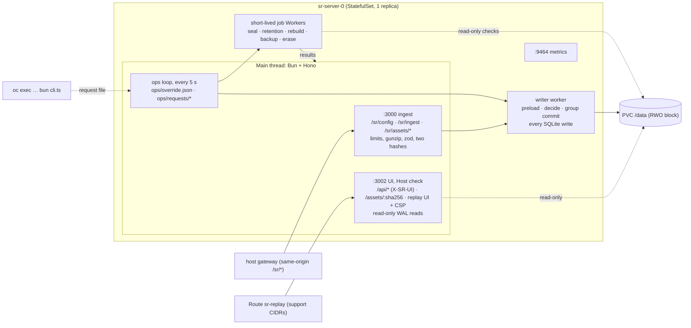
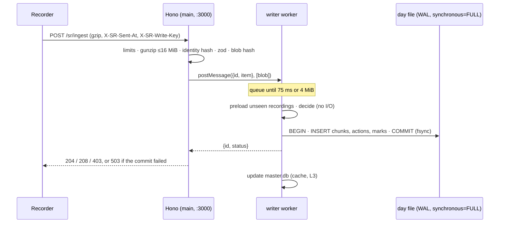

# 05 — Server
Status: draft · Size: large · Parent: [01-session-replay.md](01-session-replay.md)

## Goal

`apps/server` is one Bun process per region (D37), listening on two ports (D30). It does four jobs:
- takes recorder batches and stores them safely, acking a batch only once it is on disk;
- keeps one SQLite file per UTC day as the source of truth;
- serves the replay UI and its query API behind a strict CSP, on a port app users can't reach;
- runs the day close, retention and backup jobs, and the steps of the written erasure runbook.

It must never lose a batch it has acked, never store a duplicate silently, and never let a replay fire a live request.
It runs on OpenShift as a single-replica StatefulSet on block storage. Contracts come from [03-protocol.md](03-protocol.md).

## Decisions

Inherited: D12, D13, D18, D20, D21, D22, D26, D27, D28, D29, D30, D31, D32, D33, D36, D37, D38. From 03: L2 (stream positions), L3 (additive only), L4 (zod is the source of truth), L5 (gzip or plain JSON), L7 (`X-SR-Sent-At`), L8 (identity and stored bytes), L9 (half-open ranges), L12 (raw client time), L13 (write key), L14 (`X-SR-UI`).

| # | Decision | Why |
|---|---|---|
| L1 | **One `writer` Bun Worker; reads on the main thread; short-lived job Workers** (D31; architect A12).<br>• `writer` does every SQLite write in short group commits.<br>• MVP2 (09-L11): one short-lived runner per analytics query, stopped at 10 s; never on the main thread.<br>• Reads run on the main thread through read-only WAL connections, with indexed, `LIMIT`ed queries only.<br>• Day close, retention, rebuild, backup and erasure rewrites each run in a **short-lived Worker** per run: it starts, does the job, returns its result and exits. Checks (`quick_check`, hashing) use read-only handles, so they never block the writer (devil X17).<br>• A job Worker writes only files nobody else has open (`master.db.rebuild`, `holds/*.db`, sidecars, backup copies, erasure temp files). Anything else it needs written, it returns, and the main thread hands it to `writer`.<br>• **Fallback:** if S13 shows event-loop lag over 20 ms at p99, a resident `jobs` worker takes the reads (A12). | bun:sqlite is synchronous, so a write or a long scan on the main thread stalls every request. Reads don't need a worker: chunks are stored gzip bytes served as they are (03-L8), so a read is an index lookup plus a byte copy, with no inflate and no parse. A resident second worker would add a hop to every read and sit idle most of the day. |
| L2 | **Three kinds of state file instead of one `master.db`** (D21).<br>• `master.db` is a pure cache and can be rebuilt.<br>• `control.db` holds the wrapped user keys (only when D27 is on) and subjects. It is never rebuilt and is copied off the PVC daily.<br>• `audit/access-<yyyy>.db` is append-only, and copied off the PVC the same way.<br>• **Legal holds live in the ConfigMap** (L8), not in a database (architect A14). | A rebuild of a cache that also held the access log and the keys would wipe the audit trail and make every encrypted chunk unreadable. Holds in the ConfigMap need no admin endpoint and get Git review. |
| L3 | **Ack after the day-file commit.** `master.db` is updated afterwards, in its own transaction. If that update fails, the session is marked for repair. | SQLite transactions over several WAL databases aren't atomic as a set. The day file is the truth, so a catalog error must never un-ack or lose data. |
| L4 | **Identity = SHA-256 of the decoded body bytes** (03-L8, architect A4).<br>• A gzip body is stored **as it arrived**. The plain `pagehide` tail is gzipped once, on the way in.<br>• A second hash, over the bytes actually stored, is the **read integrity check** (D28).<br>• A chunk read never inflates, parses or re-stringifies: the stored bytes go out in 03's framed response, and the browser inflates them. | A gzip retry and a plain tail of the same batch decode to the same bytes, so they get the same identity. Hashing the stored bytes lets a read check integrity without inflating anything. |
| L5 | **De-dup with an LRU map of 8-byte hash prefixes per recording, preloaded before `decide()`** (devil X18).<br>• Key: `recordingId`. Value: `seq →` the 8-byte identity prefixes seen for that seq.<br>• Before each group's `decide()`, `writer` loads any recording it doesn't have yet, from the session's files plus today's and yesterday's files (new rows only go to those two).<br>• `decide()` then does no I/O.<br>• Default cap `SR_DEDUP_MAX_SEQS = 500 000` entries (about 40 MB); the pilot region writes about 290 k batches a day at the 5 s cadence. | A retry can arrive days later (queue cap 72 h) and land in another file, so a per-file unique key alone would store it twice. A global catalog of every `seq` would grow by millions of rows. 8 bytes is enough: two different batches for the same seq share a prefix about once in 10¹⁹. |
| L6 | **Batch day = UTC day of `t0 + (receivedAt − sentAt)`.** A day is sealed at 00:00 UTC plus a 30 min grace. **A batch for a sealed day goes to the current day's file**, linked through `session_files` (D31, architect A13). There are no late files. | The grace absorbs normal in-flight traffic. After that, only real backlog arrives, and it is small. A late chunk is deleted with the file that holds it, so it may outlive the 30-day retention by its backlog age: at most 72 h, the recorder's queue cap. No late files means no late-file routing, sealing or rebuild cases. |
| L7 | **No `segments` table.** The day file has a small `marks` table (seek anchors, `sr:meta`, `sr:rate-caps`, `sr:asset`, `sr:close`). `master.db` has `session_files`, `session_days` and `snapshots`. | `IngestBatch` has no segment field. Readers need the file map and the seek anchors. A rebuild reads `marks` and `actions`, so it never inflates a chunk. |
| L8 | **Config is a ConfigMap-mounted JSON file** with the kill switch, allow-list, rate caps and **legal holds** (D22). The server checks it every 15 s; with the kubelet's sync, a change reaches running tabs in **about 2 min**.<br>**Emergency kill:** an override file `ops/override.json` in the data dir, written with `oc exec` (L9) and checked every 5 s, stops recording in **about 20 s**. It can only switch recording **off**. | The MVP has no login (D38), so an admin endpoint would let anyone on the internal network switch recording off or lower rate caps. ConfigMap edits go through Git review and cluster RBAC. The override skips Git review, so it may only do the safe thing. It lives on the PVC, so it survives a restart. |
| L9 | **No admin listener. Admin work is a CLI run with `oc exec … bun apps/server/src/cli.ts <cmd>`.** The CLI never opens a database: it writes a **request file** into `ops/requests/`, and the running server picks it up, runs it through the normal write path, and writes a result file the CLI prints. | **Why request files, not "stop the server":** the server is the only writer of its files, so the CLI must go through it. Stopping it would stop ingest for the whole region (one replica), and a stopped pod can't be reached with `oc exec`: you'd need to scale to 0 and attach the RWO volume to a debug pod. With request files, ingest keeps running, every rule (holds, append-only log, one writer) still applies, and cluster RBAC (`pods/exec`) stays the gate. |
| L10 | **Viewer grant:** a signed cookie `sr_viewer={vid,name}` plus an in-memory grant per `vid` (one browser), created by `POST /api/access`. One grant covers **every session** opened in that browser for 8 h or until the server restarts (user, Q30); each open and chunk fetch is still logged under that grant's name and reason. | Meets D38 (a self-entered name and reason, every access logged) without a login. A restart only costs a re-prompt. |
| L11 | **Limits and the quota are derived from P1's measured bytes per minute** (02; architect A1). The starting defaults below are **provisional** until P1 reports:<br>• body 4 MiB, sized from P1's full-snapshot sizes (devil X10); gunzip output 16 MiB;<br>• per userId + IP: 20 req/s with a burst of 100, and 8 MiB/min (about 3× P1's busiest scenario, once measured);<br>• **daily quota: a fuse at about 3× a busy user's day** (P1's S2 gzip bytes/min × 60 × 8 h × 3), keyed on **userId + IP** (devil X16). Until P1 reports: 500 MB/day;<br>• global `503` + `Retry-After` when the writer queue is over 64 MiB or free disk is under `SR_MIN_FREE_BYTES`. | Limits that sit below real traffic cut audit data. The first sizing assumption and the architect's estimate differ 15–70×, so the numbers must come from P1. Keying on userId + IP means a flood under one userId from another IP can't use up the real user's quota. |
| L12 | **Pinned versions:**<br>• `hono` 4.13.x with `@hono/bun` 1.0.x, not hono 5 (still an rc);<br>• `zod` 4.6.x, `@hono/zod-validator` 0.9.x;<br>• `pino` for logs, `prom-client` for metrics.<br>Each is pinned to the newest release that is at least 2 weeks old. | `hono/bun` is deprecated in 4.13 in favour of `@hono/bun`, so the later move to v5 stays small. |
| L13 | **The UI CSP is D30's, word for word**, on `/` and every SPA route. It lives in one constant, and a test compares it with D30. | The about:blank replay iframe inherits it. A drift between plan and server would quietly re-open live requests. |
| L14 | **`/assets/:sha256` is served with** `Content-Security-Policy: default-src 'none'; style-src 'unsafe-inline'; sandbox` and `nosniff`. | Without it, a cached SVG opened directly on our origin could run script. |
| L15 | **Two ports** (D30; devil X15).<br>• **Ingest port 3000:** `/sr/*` (config, ingest, asset upload) and the health probes. Anything else is 404.<br>• **UI port 3002:** `/api/*`, `/assets/:sha256` and the replay UI. A Host check refuses any `Host` not in `SR_UI_HOSTS` with 421.<br>• One NetworkPolicy per port. The host's gateway reaches only 3000; the `sr-replay` Route reaches only 3002. | A gateway mistake can then never expose recordings to app users, and a forged recording can't reach the ingest port from the replay iframe. 3002, not 3001, so nothing is confused with the old admin listener in earlier drafts. |
| L16 | **Write key per recording** (03-L13). The server stores SHA-256 of `X-SR-Write-Key` with the recording's seq 0. Later batches must match: a mismatch → 403 `{reason:'write-key'}`; a missing header → 400 `{reason:'invalid'}`. If seq 0 never arrived (it was dropped), the recording's first stored batch fixes the hash (C10). | Session and recording ids are visible in the session list. Without the key, anyone on the network could append batches to a colleague's live recording. |
| L17 | **`/api/*` requires `X-SR-UI: 1`** (03-L14). A missing header → 400 `{error:'ui-header'}` and a `denied` access row, before any other check. | The replay iframe can request same-origin URLs but can't add headers, so a forged recording can't call the API with the viewer's cookie. |
| L18 | **"Touches day" is a `session_days` table** in `master.db`: one row per (day, user, session), filled from each batch's day (L6) (devil X17). | SQLite can't index inside a JSON array, so a `days` JSON column would need the same table anyway, hidden behind `json_each`. A plain table answers both "this day" and "this user on this day" from one primary key. |
| L19 | **Every `t` stays raw client time** in storage and DTOs (03-L12; devil X2). Each recording's `clockOffsetMs` = the **smallest** `offset_ms` of its chunks. The server uses offsets only to pick a batch's day (L6). | Each `offset_ms` = the clock difference plus that upload's delay, and the delay is never negative, so the smallest one is the closest estimate. It's a plain `MIN()`, so a rebuild gets the same value. |

## Design

### How it works



**Files on the PVC (`SR_DATA_DIR`, default `/data`):**

| Path | What |
|---|---|
| `<yyyymmdd>/<class>.db` | Day file, one per retention class (D26). v1 has a single class, `std` (30 days). It also holds late batches for earlier, sealed days (L6). |
| `<file>.sha256` | Written at the seal. Lets `day_files` be rebuilt. |
| `master.db` | Cache (L2). Safe to delete. |
| `control.db` | Wrapped user keys (D27 on only) and subjects. Never rebuilt. |
| `audit/access-<yyyy>.db` | Append-only access log, kept for at least 2 years. |
| `holds/<sessionId>.db` | Verified copies of sessions under a legal hold. |
| `assets/<aa>/<sha256>` | Content-addressed assets (D33). |
| `ops/override.json` | Emergency kill (L8). Absent normally. |
| `ops/requests/<id>.json` → `.running` → `.result.json` | CLI requests and their results (L9). |
| `ops/backup/` | Staging for the daily off-PVC copy; emptied after upload. |

**Startup order:**
1. Parse the env with zod.
2. Run the filesystem check (below).
3. If `master.db` is missing or its `user_version` is old, run a **full rebuild** in a job Worker (into `master.db.rebuild`, then an atomic rename) before anything opens `master.db`.
4. Start `writer`. It opens the files, then **repairs** sessions marked for repair and those in today's and yesterday's files (idempotent rollups, a few seconds).
5. The main thread opens its read-only handles, loads the config and any override file, starts the ops loop and both listeners, and turns `/healthz/ready` green.
6. Seal any overdue days.

**Shutdown:** on SIGTERM, stop both listeners, let `writer` flush its queue (commit and reply), terminate any running job Worker (every job resumes cleanly), then exit.

### Routes

**Ingest port 3000** (the host gateway):

| Route | Caller | Notes |
|---|---|---|
| `GET /sr/config?app=&user=` | recorder | `RecorderConfig` (03) plus `X-SR-Config-Version`, with `Cache-Control: no-store`. An unknown app gets `enabled:false`. |
| `POST /sr/ingest` | recorder | See Ingest. |
| `POST /sr/assets/missing`, `PUT /sr/assets/:sha256` | recorder | D33 negotiation (03, Assets). |
| `GET /healthz/live`, `/healthz/ready` | probes | `ready` = rebuild done, fs check passed, writer heartbeat under 10 s, disk above the floor. |
| anything else | — | 404. |

**UI port 3002** (the `sr-replay` Route; Host check first, L15):

| Route | Caller | Notes |
|---|---|---|
| `GET /api/sessions` | UI | From `master.db`. Logged as `search`. |
| `POST /api/access` | UI | `{name, reason, sessionId?}` → 204, plus the cookie and a browser-wide grant (L10). Logged as `grant`; each later session open is logged as `open`. |
| `GET /api/sessions/:id`, `…/actions`, `…/chunks` | UI | Need a grant, or they return 403 `{need:'access'}` and log a `denied` row. |
| `GET /api/hotspots?day=&app=` | UI | Aggregation, see below. |
| `GET /assets/:sha256` | replay iframe | The route only matches `[a-f0-9]{64}`. Immutable cache headers plus L14. |
| `GET /*` | browser | The replay UI static build, plus `index.html` as the SPA fallback, with the D30 CSP (L13). |

- Every `/api/*` request needs `X-SR-UI: 1` first (L17).
- Query routes are chained and exported as `export type QueryApi = typeof api`, so the UI can use `hc<QueryApi>`.
- Use `zValidator('query' | 'json' | 'param', schema)` on `/api/*`. Ingest parses the body by hand (gzip, see below).
- The replay UI is built with **Vite** (06-L1, `build.assetsDir: 'ui'`). Its build must not write anything under `dist/assets/`, because that would collide with `/assets/:sha256` (06 checks it with a test). The static route serves `/ui/*`, `/theme-boot.js` and `index.html`.
- **Metrics port 9464:** `/metrics` only.

```ts
// Sample — not final code. src/main.ts — two listeners in one process (L15).
const ingestApp = new Hono()
  .route('/', configRoute).route('/', ingest).route('/', assetUpload).route('/', health)
  .notFound((c) => c.body(null, 404));                         // nothing but /sr/* and health here

const uiApp = new Hono()
  .use('*', hostCheck(env.SR_UI_HOSTS))                         // 421 for any other Host
  .use('/api/*', requireUiHeader)                               // L17
  .route('/api', api).route('/', assetRead).route('/', spa);    // spa sends the D30 CSP (L13)

// Pass the server through, so getConnInfo (@hono/bun) can see the socket peer.
Bun.serve({ port: env.SR_INGEST_PORT, maxRequestBodySize: env.SR_MAX_BODY + 1024 * 1024,
            fetch: (req, server) => ingestApp.fetch(req, { server }) });
Bun.serve({ port: env.SR_UI_PORT, fetch: (req, server) => uiApp.fetch(req, { server }) });
```

```ts
// Sample — not final code. src/http/guards.ts
export const requireUiHeader = createMiddleware(async (c, next) => {
  if (c.req.header('x-sr-ui') === '1') return next();
  await audit.log({ action: 'denied', result: 'ui-header', ip: clientIp(c), detail: c.req.path });
  return c.json({ error: 'ui-header' }, 400);
});
```

### Ingest

1. `bodyLimit({ maxSize: SR_MAX_BODY })` (4 MiB to start, L11) returns 413. `Bun.serve`'s `maxRequestBodySize` is the backstop.
2. Require `X-SR-Sent-At` and `X-SR-Write-Key`. Either missing → 400 `{reason:'invalid'}`.
3. Decode the body. If `Content-Encoding: gzip`, use `gunzipSync(raw, { maxOutputLength: 16 MiB })`. Bun throws `ERR_BUFFER_TOO_LARGE`, which maps to 413. Otherwise the body is plain JSON, whatever the `Content-Type` (the `pagehide` tail).
4. `sha = SHA-256(decoded bytes)`: the batch identity (L4). Then `JSON.parse` and `IngestBatch.safeParse`. Failure → 400.
5. Rate limit (token bucket per `userId|ip`) and daily quota per userId + IP → 429 with `{reason:'rate'|'quota'}` and `Retry-After` (until UTC midnight for `quota`). Global backpressure → 503 with `Retry-After`.
6. Prepare the chunk on the main thread:
   - `blob` = the raw gzip body as received, or `gzip(decoded)` for the plain tail (once). With D27 on, the main thread encrypts it here (see Crypto-shredding);
   - `blobSha = SHA-256(blob)` over the bytes that will be stored: the integrity hash;
   - `writeKeySha = SHA-256(X-SR-Write-Key)`;
   - `t0`/`t1` (raw client ms), `offsetMs = receivedAt − sentAt`, and the batch day (L6). A day older than retention → 400 `{reason:'expired'}`;
   - **action rows, sparse kinds only** (03 `ActionKind`; architect A11): `sr:click`, `sr:input`, `sr:nav`, `sr:error`, `sr:net` **only when failed** (status 0 or ≥ 400), `sr:fidelity`, `sr:report`, `sr:hotspot`, and `sr:console` **only for `error` and `warn`** (D43; `info`, `log` and `debug` stay in the chunks, 03-L15). Console rows store `name` = the level, `summary` = the message cut to 200 characters, and `count`. `console.error` lines not marked `same` add to `counts.consoleErrors`; `counts.errors` stays `sr:error` only (03-L15). The decode walks each batch's events **once**, with one switch per tag, so 09's `extract()` can plug in at MVP2 (D44);
   - **marks** (L7): every rrweb FullSnapshot (`type 2`) as a seek anchor with its `idx`, plus `sr:meta`, `sr:rate-caps`, `sr:asset` and `sr:close`. These are **not** action rows (devil X25). `sr:state`, `sr:redacted` and everything else stay only inside the blob.
7. Hand the chunk to `writer` (the blob's buffer is transferred, not copied) and wait for the commit. Map the result to 204 / 208 / 403 / 503.
8. Every 2xx carries `X-SR-Config-Version`.

**Rules inside `writer` (`decide`, no I/O, after the preload in L5):**
- **Binding:** the session is bound to the first userId seen for it. A different userId → 403 `{reason:'user-mismatch'}` (D20).
- **Write key:** the recording's stored hash must equal `writeKeySha`, or → 403 `{reason:'write-key'}`. The first stored batch of a recording (normally seq 0) stores it (L16).
- **Same `(recordingId, seq)` with the same identity prefix:** 208, nothing written.
- **Same `(recordingId, seq)` with a different identity:** stored with `dup = 1`, counted in `dups`, answered 204. It is never dropped (D29).
- **Target file:** the batch day's file, or today's file if that day is already sealed (L6).
- Earlier items of the same group count: two copies of one seq in one group give one row and one 208.

**Client IP:** `X-Forwarded-For` is trusted only when the socket peer (`getConnInfo` from `@hono/bun`) is inside `SR_TRUSTED_PROXY_CIDRS`.

### Write path (D31: group commit, ack after commit)



```ts
// Sample — not final code. src/db/rpc.ts — request/response over a Bun Worker.
type Reply = { id: number; ok: boolean; value?: unknown; error?: string };

export const connectWorker = (url: URL) => {
  const worker = new Worker(url.href);
  const pending = new Map<number, { resolve: (v: unknown) => void; reject: (e: Error) => void }>();
  let nextId = 1;
  worker.onmessage = ({ data }: MessageEvent<Reply>) => {
    const p = pending.get(data.id);
    pending.delete(data.id);
    data.ok ? p?.resolve(data.value) : p?.reject(new Error(data.error));
  };
  // A dead worker must fail every waiting request (the client retries on 5xx), never leave it hanging.
  worker.onerror = (err) => { for (const p of pending.values()) p.reject(new Error(err.message)); pending.clear(); };
  const call = <T>(op: string, arg: unknown, transfer: Transferable[] = []) =>
    new Promise<T>((resolve, reject) => {
      const id = nextId++;
      pending.set(id, { resolve: resolve as (v: unknown) => void, reject });
      worker.postMessage({ id, op, arg }, transfer);    // the blob's ArrayBuffer moves, it isn't copied
    });
  return { call, worker };
};
```

```ts
// Sample — not final code. src/ingest/route.ts — ingest port only (L15).
import { gunzipSync, gzipSync } from 'node:zlib';
import { bodyLimit } from 'hono/body-limit';
import { IngestBatch } from '@sr/protocol';

const sha256 = (b: Uint8Array) => new Bun.CryptoHasher('sha256').update(b).digest();   // 32 bytes

const decode = (raw: Uint8Array, encoding?: string) => {
  try {
    const gz = encoding === 'gzip';
    const bytes = gz ? gunzipSync(raw, { maxOutputLength: env.SR_MAX_INFLATED }) : raw;
    return { ok: true as const, gz, bytes, json: JSON.parse(new TextDecoder().decode(bytes)) as unknown };
  } catch (e) {
    const tooBig = (e as { code?: string }).code === 'ERR_BUFFER_TOO_LARGE';   // a gzip bomb, not bad JSON
    return { ok: false as const, status: tooBig ? (413 as const) : (400 as const) };
  }
};

export const ingest = new Hono().post('/sr/ingest',
  bodyLimit({ maxSize: env.SR_MAX_BODY, onError: (c) => c.json({ reason: 'too-big' }, 413) }),
  async (c) => {
    const receivedAt = clock.now();
    const sentAt = Number(c.req.header('x-sr-sent-at'));
    const writeKey = c.req.header('x-sr-write-key');
    if (!Number.isFinite(sentAt) || !writeKey) return c.json({ reason: 'invalid' }, 400);   // both required (03)
    const raw = new Uint8Array(await c.req.arrayBuffer());
    const body = decode(raw, c.req.header('content-encoding'));
    if (!body.ok) return c.json({ reason: body.status === 413 ? 'too-big' : 'invalid' }, body.status);
    const parsed = IngestBatch.safeParse(body.json);
    if (!parsed.success) return c.json({ reason: 'invalid' }, 400);
    const limited = limits.take(parsed.data.userId, clientIp(c), raw.byteLength);  // 'rate' | 'quota' | 'busy' | null
    if (limited) return c.json({ reason: limited }, limited === 'busy' ? 503 : 429, { 'Retry-After': retryAfter(limited) });
    const gzipped = body.gz ? raw : gzipSync(body.bytes);                 // stored as received; the tail gzipped once (L4)
    const blob = await cipher.seal(gzipped, parsed.data);                 // identity when D27 is off
    const item = prepareChunk(parsed.data, {
      sha: sha256(body.bytes),                                            // identity: the decoded body (03-L8)
      blob, blobSha: sha256(blob),                                        // integrity: the stored bytes
      writeKeySha: sha256(new TextEncoder().encode(writeKey)),
      sentAt, receivedAt });                                              // day, t0/t1, sparse actions, marks
    if (item.expired) return c.json({ reason: 'expired' }, 400);
    const res = await writer.call<IngestResult>('ingest', item, [item.blob.buffer]).catch(() => ({ status: 503 as const }));
    if (res.status >= 300) return c.json({ reason: res.reason ?? 'not-stored' }, res.status);
    return c.body(null, res.status, { 'X-SR-Config-Version': config.version() });   // 204 or 208
  });
```

```ts
// Sample — not final code. src/db/writer.ts — runs in a Bun Worker; the only SQLite writer (L1).
declare var self: Worker;
const store = openStore(env.SR_DATA_DIR);                  // day files, master.db, control.db, audit
let queue: { id: number; item: ChunkItem }[] = [];
let queuedBytes = 0;
let timer: ReturnType<typeof setTimeout> | undefined;

self.onmessage = (e: MessageEvent<WriterMsg>) => {
  const { id, op, arg } = e.data;
  if (op !== 'ingest') return handleOther(id, op, arg);    // access rows, seal steps, catalog swaps: same queue
  queue.push({ id, item: arg });
  queuedBytes += arg.blob.byteLength;
  if (queuedBytes >= env.SR_COMMIT_MAX_BYTES) flush();     // byte cap: a backlog drain commits early
  else timer ??= setTimeout(flush, env.SR_COMMIT_MS);
};

const flush = () => {
  clearTimeout(timer); timer = undefined;
  const group = queue; queue = []; queuedBytes = 0;
  store.preload(group);               // I/O: seq prefixes, bindings and write-key hashes of unseen recordings (L5)
  const plan = store.decide(group);   // no I/O: binding, write key, seq (208 or flag), target file (L6)
  for (const [file, items] of plan.writesByFile) {
    try {
      store.insertChunks(file, items);   // one transaction per file; synchronous=FULL fsyncs the WAL
      plan.commit(items);                // the seq/binding/key marks become real
    } catch (err) {
      plan.rollback(items);              // forget the marks, and fail any 208 that leaned on them
      log.error({ err, file }, 'commit failed');
    }
  }
  for (const { id } of group) postMessage({ id, ok: true, value: plan.resultFor(id) });  // ack only now
  try { store.updateCatalog(plan.committed()); }             // the cache, after the ack on purpose (L3)
  catch (err) { store.markForRepair(plan.committedSessions(), err); }
};
```

Each database is opened with `new Database(path, { create: true, strict: true })`, then `PRAGMA journal_mode = WAL`, `PRAGMA synchronous = FULL` and `PRAGMA busy_timeout = 5000`. All inserts are prepared once per file and wrapped in `db.transaction(fn)`, which is synchronous: never `await` inside one. Main-thread and job-Worker handles are opened with `{ readonly: true }`.

### Storage (D26, D27)

```sql
-- Sample — not final code. <yyyymmdd>/<class>.db: the source of truth. user_version = 1.
CREATE TABLE chunks (
  id INTEGER PRIMARY KEY,                        -- rowid table: blobs are large, so not WITHOUT ROWID
  recording_id TEXT NOT NULL, seq INTEGER NOT NULL,
  sha BLOB NOT NULL,                             -- 32 bytes: SHA-256 of the decoded body, the identity (L4)
  blob_sha BLOB NOT NULL,                        -- 32 bytes: SHA-256 of the stored bytes, the read check (D28)
  session_id TEXT NOT NULL, user_id TEXT NOT NULL, app TEXT NOT NULL,
  t0 INTEGER NOT NULL, t1 INTEGER NOT NULL,      -- raw client ms (L19)
  sent_at INTEGER NOT NULL, received_at INTEGER NOT NULL, offset_ms INTEGER NOT NULL,
  dup INTEGER NOT NULL DEFAULT 0,                -- 1 = flagged duplicate: this seq already had another identity (D29)
  write_key_sha BLOB,                            -- only on the recording's first stored chunk (L16)
  enc INTEGER NOT NULL DEFAULT 0,                -- 0 = gzip, 1 = AES-GCM(gzip) under the user's key
  blob BLOB NOT NULL);                           -- the request body as gzip, envelope included
CREATE INDEX chunks_rec_seq ON chunks (recording_id, seq);   -- the only index (architect A11)

CREATE TABLE actions (                           -- sparse kinds only: 03 ActionKind
  recording_id TEXT NOT NULL, seq INTEGER NOT NULL, idx INTEGER NOT NULL,   -- stream position (03-L2)
  session_id TEXT NOT NULL, user_id TEXT NOT NULL, t INTEGER NOT NULL,
  kind TEXT NOT NULL,                            -- click | input | nav | error | net (failed only) | fidelity | report | hotspot | console (error, warn)
  name TEXT NOT NULL, app TEXT,                  -- plaintext for audit search (D27)
  failed INTEGER NOT NULL DEFAULT 0, enc INTEGER NOT NULL DEFAULT 0,
  count INTEGER,                                 -- console and error rows: folded repeats (03-L15)
  summary BLOB,                                  -- short text; encrypted when enc = 1
  PRIMARY KEY (recording_id, seq, idx)) WITHOUT ROWID;

CREATE TABLE marks (                             -- small facts for the catalog, so a rebuild never inflates (L7)
  recording_id TEXT NOT NULL, seq INTEGER NOT NULL, idx INTEGER NOT NULL,
  t INTEGER NOT NULL,                            -- raw client ms
  kind TEXT NOT NULL,                            -- anchor | meta | rate-caps | asset | close
  payload TEXT,                                  -- JSON for meta, rate-caps, asset; NULL for anchor and close
  PRIMARY KEY (recording_id, seq, idx)) WITHOUT ROWID;

-- master.db: a cache. Delete it and it is rebuilt from the files (D12, L2).
CREATE TABLE sessions (session_id TEXT PRIMARY KEY, user_id TEXT NOT NULL, app TEXT NOT NULL,
  started_at INTEGER, ended_at INTEGER,          -- raw client ms
  last_received_at INTEGER,                      -- server ms, for `live`
  meta TEXT,                                     -- the latest sr:meta (JSON)
  errors INTEGER, console_errors INTEGER, failed_reqs INTEGER, reports INTEGER, bands INTEGER, missing_batches INTEGER,
  dups INTEGER, bytes INTEGER);
CREATE TABLE session_days (day TEXT, user_id TEXT, session_id TEXT,
  PRIMARY KEY (day, user_id, session_id)) WITHOUT ROWID;          -- "touches day" (L18)
CREATE TABLE recordings (recording_id TEXT PRIMARY KEY, session_id TEXT NOT NULL,
  started_at INTEGER, ended_at INTEGER, max_seq INTEGER, distinct_seqs INTEGER, dups INTEGER,
  clock_offset_ms INTEGER,                       -- MIN(offset_ms) (L19)
  pipeline TEXT, clean_close INTEGER, write_key_sha BLOB);
CREATE INDEX recordings_session ON recordings (session_id, started_at);
CREATE TABLE session_files (session_id TEXT, storage_key TEXT, PRIMARY KEY (session_id, storage_key)) WITHOUT ROWID;
CREATE TABLE snapshots (recording_id TEXT, seq INTEGER, idx INTEGER, t INTEGER,
  PRIMARY KEY (recording_id, seq, idx)) WITHOUT ROWID;            -- seek anchors (03 SessionDetail.snapshots)
CREATE TABLE rate_caps (session_id TEXT, t INTEGER, config_version TEXT, caps TEXT,
  PRIMARY KEY (session_id, t, config_version));                  -- the D36 legend
CREATE TABLE hotspots (day TEXT, app TEXT, remote TEXT, area TEXT, session_id TEXT, user_id TEXT,
  recording_id TEXT, seq INTEGER, idx INTEGER, t INTEGER, mutations_per_sec REAL, paused_ms INTEGER);
CREATE INDEX hotspots_day_app ON hotspots (day, app);
CREATE TABLE bad_chunks (recording_id TEXT, seq INTEGER, why TEXT, found_at INTEGER,
  PRIMARY KEY (recording_id, seq));              -- hash mismatches found by a read or the seal; refilled after a rebuild
CREATE TABLE quota_bytes (day TEXT, user_id TEXT, ip TEXT, bytes INTEGER, PRIMARY KEY (day, user_id, ip));
CREATE TABLE day_files (storage_key TEXT PRIMARY KEY, sealed_at INTEGER, sha256 TEXT, bytes INTEGER, quick_check TEXT);
CREATE TABLE assets (sha256 TEXT PRIMARY KEY, type TEXT, bytes INTEGER, first_seen INTEGER, last_ref_day TEXT);

-- control.db: never rebuilt; copied off the PVC daily; copies kept ≤ 30 days so erased keys age out.
CREATE TABLE user_keys (user_id TEXT PRIMARY KEY, wrapped_key BLOB NOT NULL, created_at INTEGER NOT NULL);  -- D27 on only
CREATE TABLE subjects (subject_hmac TEXT PRIMARY KEY, user_id TEXT NOT NULL);   -- row deleted on erasure

-- audit/access-<yyyy>.db: append-only, kept at least 2 years; whole yearly files are deleted.
CREATE TABLE access_log (id INTEGER PRIMARY KEY, at INTEGER NOT NULL, viewer_id TEXT, viewer_name TEXT,
  action TEXT NOT NULL,   -- search | open | chunks | denied | config-change | override | cli | seal | retention | backup | erase
  result TEXT NOT NULL, session_id TEXT, subject_hmac TEXT, day TEXT, reason TEXT, ip TEXT,
  user_agent TEXT, detail TEXT);
CREATE TRIGGER access_log_no_update BEFORE UPDATE ON access_log BEGIN SELECT RAISE(ABORT, 'append-only'); END;
CREATE TRIGGER access_log_no_delete BEFORE DELETE ON access_log BEGIN SELECT RAISE(ABORT, 'append-only'); END;
```

- **One index on `chunks`.** Session-level reads go through `master.db` (`recordings`) to `recording_id`. Erasure with D27 off scans a whole file, which is fine for a rare, manual step. Add an `actions (kind, name)` index only when a search route exists.
- Action rows and marks come only from the first stored chunk for a `(recording_id, seq)`. A flagged duplicate keeps its blob in `chunks` but adds no actions or marks.
- Access rows ride the same group commit as chunks. The API waits for that commit before returning any data: no data leaves without its log row.
- The access log names recorded users only by `subject_hmac = HMAC-SHA256(SR_SUBJECT_KEY, userId)`.
- `quota_bytes` is a fuse, not a record: a rebuild resets today's counters, which is acceptable.

**Rebuild:** `master.db` is rebuilt from the files, in a job Worker.

```ts
// Sample — not final code. src/jobs/rebuild.ts — a short-lived Worker (L1). It writes only master.db.rebuild.
declare var self: Worker;
self.onmessage = ({ data: { dataDir } }: MessageEvent<{ dataDir: string }>) => {
  const tmp = join(dataDir, 'master.db.rebuild');
  rmSync(tmp, { force: true });
  const m = openMaster(tmp);                                   // fresh schema, user_version = current
  for (const key of listChunkFiles(dataDir)) {                 // 20261110/std.db, …, holds/*.db
    const f = new Database(join(dataDir, key), { readonly: true, strict: true });
    for (const page of pages(f, SESSION_ROLLUP)) m.mergeSessions(page, key);   // min/max, counts, days, user_id
    for (const page of pages(f, RECORDING_ROLLUP)) m.mergeRecordings(page);    // max_seq, distinct_seqs, dups, MIN(offset_ms), key
    for (const page of pages(f, MARK_ROLLUP)) m.mergeMarks(page);              // anchors, meta, rate caps, assets, close
    for (const page of pages(f, ACTION_ROLLUP)) m.mergeActions(page);          // counts, hotspots
    m.addDayFile(key, readSidecarSha(dataDir, key));
    f.close();
  }
  m.db.close();
  postMessage({ ok: true, value: { file: tmp } });             // the caller swaps it in with a rename (atomic)
};
```

- `pages()` reads in short transactions, so the WAL of today's file can still checkpoint while a rebuild runs.
- At startup the rename happens before `writer` opens `master.db`. A rebuild on a running server (CLI `rebuild`): `writer` closes `master.db`, renames the new file in, reopens it, and repairs the sessions it touched since the rebuild started. Then the main thread reopens its read handle (an open handle would keep reading the old, unlinked file).
- `repairSession(id)` runs the same rollups, limited to that session's `session_files`. The merges recompute values instead of adding to them, so running them twice is safe.

**Crypto-shredding (D27, `SR_CRYPTO_SHRED=on`, default off).** The master key is 32 bytes, base64, in the `SR_MASTER_KEY` env var from a Secret.

```ts
// Sample — not final code. src/crypto/keys.ts — per-user data keys wrapped by the master key.
const kek = await crypto.subtle.importKey('raw', Buffer.from(env.SR_MASTER_KEY, 'base64'), 'AES-KW', false,
  ['wrapKey', 'unwrapKey']);

export const newUserKey = async () => {
  const dek = await crypto.subtle.generateKey({ name: 'AES-GCM', length: 256 }, true, ['encrypt', 'decrypt']);
  const wrapped = new Uint8Array(await crypto.subtle.wrapKey('raw', dek, kek, 'AES-KW'));   // 40 bytes → control.db
  return { wrapped, dek: await unwrapUserKey(wrapped) };    // keep only a non-extractable copy in memory
};
export const unwrapUserKey = (wrapped: Uint8Array) =>
  crypto.subtle.unwrapKey('raw', wrapped, kek, 'AES-KW', { name: 'AES-GCM', length: 256 }, false, ['encrypt', 'decrypt']);

// The AAD binds a blob to its row: moving it to another recording or seq makes decryption fail.
export const sealBlob = async (dek: CryptoKey, plain: Uint8Array, recordingId: string, seq: number) => {
  const iv = crypto.getRandomValues(new Uint8Array(12));
  const additionalData = new TextEncoder().encode(`${recordingId}:${seq}`);
  const ct = new Uint8Array(await crypto.subtle.encrypt({ name: 'AES-GCM', iv, additionalData }, dek, plain));
  const out = new Uint8Array(12 + ct.length);
  out.set(iv); out.set(ct, 12);                             // iv ‖ ciphertext ‖ tag
  return out;
};
```

- **The main thread encrypts and decrypts; `writer` never holds a key.** The blob and action summaries are encrypted before the hand-off, so the writer's flush stays synchronous. `blob_sha` is taken over the encrypted bytes.
- A new user's key is made once on the main thread (one pending promise per user, so two first batches can't make two keys), stored by `writer` in `control.db`, then cached unwrapped and non-extractable.
- Random 96-bit IVs are safe below 2³² messages per key. A busy user sends about 1.5 M chunks a year at the 5 s cadence.
- A deleted key makes those chunks `integrity:'unreadable'`. Other users still replay.

### Asset store (D33)

- **`POST /sr/assets/missing`** takes `{hashes ≤ 100}` (03) and returns the hashes not yet on disk, checked against the `assets` table.
- **`PUT /sr/assets/:sha256`** accepts `image/*` or `font/*`, up to 2 MB (03).
  - The server re-hashes the bytes. A mismatch → 400.
  - It writes `assets/<aa>/<sha>.tmp`, then renames it into place, then inserts the row through `writer`.
- **`sr:asset` marks** update `last_ref_day` at ingest.
- **Retention** deletes assets whose `last_ref_day` is older than the longest retention period.
- **`GET /assets/:sha256`** (UI port) sends `Cache-Control: public, max-age=31536000, immutable` and the stored `Content-Type`, plus L14.

### Config, override and CLI (D22, D36, L8, L9)

**The ConfigMap file.** `SR_CONFIG_FILE` (default `/etc/sr/recorder-config.json`) is mounted from the ConfigMap `sr-recorder-config`, **without `subPath`**, because subPath mounts never update. The kubelet syncs a changed ConfigMap into the pod within about a minute; the server checks the file's content hash every 15 s:
- **Content changed and `version` changed:** the server swaps in the new config and writes a `config-change` access row (old and new version; the apps, keys and holds that changed).
- **Content changed but `version` didn't:** the new file is refused, the old config is kept, and an alert fires.

**End to end, a change reaches running tabs in about 2 min:** kubelet sync (up to about 1 min, plus its cache) + the 15 s check + the tab's next upload response (within 5 s while recording) + the tab's config fetch.

Sample — not final code (the config file for one region):

```json
{ "v": 1, "version": "2026-11-10.3", "killSwitch": false,
  "defaults": { "killSwitch": false, "checkpointMinutes": 12, "checkpointMutations": 200000,
                "pipeline": "main", "retentionClass": "std",
                "budget": { "cpuPct": 3, "longFrameMs": 50, "resumeAfterMs": 10000 },
                "assetCache": { "enabled": false, "allow": ["/assets/", "/static/"] } },
  "apps": { "blotter": { "allowUsers": ["u123", "u456"], "allowAll": false,
                         "rateCaps": { "positions": { "bid": 2, "ask": 2, "mid": 2 } } } },
  "legalHolds": [ { "sessionId": "s_8f2k1q", "ticket": "LEGAL-142", "since": "2026-11-10" } ] }
```

**What `/sr/config` serves:**
- `RecorderConfig` = `defaults` merged with `apps[app]`.
- `enabled = !killed && (allowAll || allowUsers.includes(user))`, where `killed` = the top-level or per-app `killSwitch`, or the override file.
- `X-SR-Config-Version` carries the file's `version`, plus a suffix while an override is active (`2026-11-10.3+kill.1a2b`), so every tab sees a new version.
- Each answer counts in `sr_config_requests_total{app,enabled}`. An `enabled: true` answer also opens a 5-minute wait for a seq 0 from that user and app; if none arrives, `sr_enabled_no_start_total{app}` goes up (devil X20).

**Legal holds** come from `legalHolds`. `SessionDetail.legalHold` is true for a listed session, and retention copies it to `holds/` before deleting its day files. A hold removed from the list drops its copy at the next retention run (logged).

**Emergency override (about 20 s).** `ops/override.json` in the data dir. The ops loop checks it every 5 s.
- It can only kill: `{ "killSwitch": true, "apps": ["blotter"], "by": "…", "ticket": "…", "at": "…" }`. No `apps` = every app.
- On pickup, the server writes an `override` access row and serves the killed config at once. Tabs stop on their next upload response.
- **Fail closed:** a file that doesn't parse counts as a kill of every app, and an alert fires. Stopping recording is always the safe direction (D8).
- It survives a restart (it's on the PVC). It stays until someone removes it; an active override raises an info alert, so it isn't forgotten.
- The CLI writes and removes it (`kill on` / `kill off`, below), with a temp file and a rename, so the server never reads half a file.

**The CLI (L9).** Run inside the pod: `oc exec sr-server-0 -- bun apps/server/src/cli.ts <cmd> --by <name> --ticket <ref>`.

| Command | What the server does | Runs in |
|---|---|---|
| `status` | Prints the config version, override state, last seal, retention and backup, queue depth, open requests. Needs no `--by`. | main thread (read-only) |
| `kill on [--app <name>]` / `kill off` | The CLI writes or removes `ops/override.json` itself: a plain file, not a database. | — |
| `seal --day <yyyymmdd>` | Seals an overdue day. | `writer` + seal Worker |
| `retention --dry-run` / `retention --run` | Lists, or runs, today's retention. | retention Worker + `writer` |
| `rebuild` | Rebuilds `master.db` and swaps it in. | rebuild Worker + `writer` |
| `erase --user <id> [--day <yyyymmdd>] [--dry-run]` | One step of the erasure runbook (below). | `writer`, or an erase Worker for a day-file rewrite |

```ts
// Sample — not final code. src/cli.ts — never opens a database; drops a request for the running server (L9).
const [cmd, ...rest] = Bun.argv.slice(2);
const req = CliRequest.parse({ cmd, ...parseFlags(rest) });        // zod: --by and --ticket required except for status
if (cmd === 'kill') { writeOverride(req); process.exit(0); }       // tmp file + rename; the server sees it within 5 s
const dir = join(env.SR_DATA_DIR, 'ops/requests');
const id = `${Date.now()}-${crypto.randomUUID().slice(0, 8)}`;
await Bun.write(join(dir, `${id}.json.tmp`), JSON.stringify(req));
renameSync(join(dir, `${id}.json.tmp`), join(dir, `${id}.json`));  // atomic: never half a request
const result = await waitForFile(join(dir, `${id}.result.json`), req.timeoutMs ?? 600_000);
console.log(result ?? `still queued: the server is down or busy. Check later with: status`);
process.exit(result?.ok ? 0 : 1);
```

- The ops loop takes one request at a time: it renames `<id>.json` to `.running`, runs it, writes `<id>.result.json`, and logs a `cli` access row (command, `--by`, `--ticket`, result).
- A `.running` file found at startup was interrupted by a restart: it gets a failed result ("interrupted; run it again"). Every command is safe to run twice.
- Who may run the CLI or the override is whoever has `pods/exec` in the region's namespace: the same gate the old admin listener had. Keep that role to the region's ops group (Q35).

### Query API, access and hotspots (D32, D38)

All reads run on the main thread (L1): `master.db` for lists, summaries and the file map; the day files through read-only handles, by `recording_id` only.

**Sessions:** `GET /api/sessions?user=&day=&hasErrors=1&limit=50&cursor=`. `day` matches every session that **touches** that UTC day, through `session_days` (L18). Newest first by `started_at`; the cursor is `(started_at, session_id)`.

**Detail:** the summary, plus:
- `recordings`, in start order, each with `clockOffsetMs` (L19), `lastSeq` (`max_seq`), `pipeline`, `cleanClose` (an `sr:close` mark arrived), `dups` and **`gaps`**;
- `snapshots`: every anchor mark as `{recordingId, seq, idx, t}`;
- `bands` and `notes` (rules below), `rateCaps` (the legend, from the `rate_caps` table), `meta`, `files` (`{day, file}` from `session_files`), `identity:'client-asserted'` and `legalHold` (from the ConfigMap).

**Gaps (devil X25):** the distinct seqs missing from `0 … max_seq`, as inclusive ranges. A seq is present if it has at least one row; extra rows for one seq (flagged duplicates) never fill a gap elsewhere. Fast path: when `distinct_seqs = max_seq + 1` there are no gaps; otherwise read the seqs from `chunks_rec_seq` (an index-only scan).

**Bands and notes made by the server** (03, bands and notes). Every time is raw client time (L19).

| Reason | Kind | From | To |
|---|---|---|---|
| `missing-batches` | gap band | `t1` of the last chunk before the gap (the recording's start if the gap starts at seq 0) | **the next anchor** after the gap (devil X1); none yet: `null` while the recording is live, else the recording's end |
| `chunk-unreadable` | gap band | `t0` of the bad chunk | the next anchor after it, same fallback |
| `no-clean-close` | note | the recording's last `t1` | — |

- `chunk-unreadable` covers a shredded key (known from `control.db`) and the hash mismatches in `bad_chunks` (found by an earlier read or by the seal). A mismatch found for the first time during playback comes back in the chunks header, and the UI treats it the same way.
- `no-clean-close` applies to a recording with no `sr:close` mark and no batch in the last 2 min (devil X19). It's worked out at read time, so a late `sr:close` removes it.
- The recorder's own fidelity events (action rows of kind `fidelity`) become bands (a start and an end) or notes (a start alone), per 03's table.

**Actions:** `?kinds=&after=&to=&failedOnly=1&limit=1000` (03). Recording by recording, in start order; within a recording by the primary key `(recording_id, seq, idx)`. `after` and `to` are exclusive. `next` is the position of the last row returned.

**Chunks:** `?from=&to=&cursor=` (03). `from` inclusive, `to` exclusive, both inside one recording.
- The server returns whole chunks: seqs from `from.seq` up to `to.seq` (included only when `to.idx > 0`), merged by seq across the recording's files.
- **The first row per seq is served; extra rows only raise that chunk's `dups`** (devil X16).
- For each served row: `integrity` = `ok` if `SHA-256(blob) = blob_sha`, else `mismatch` (and a `bad_chunks` row); `unreadable` with 0 bytes when the user's key is gone. With D27 on, the blob is decrypted to its gzip bytes before it is sent.
- `missing` lists the seqs in the range with no row. Responses stop at 8 MiB of blobs with a `next` cursor.
- **Nothing is inflated or parsed** (L4). The response is 03's framing: a 4-byte big-endian header length, the `ChunksHeader` JSON, then the blobs.

```ts
// Sample — not final code. src/api/chunks.ts — stored bytes, framed per 03 ("Chunk response framing").
const enc = new TextEncoder();

export const frameChunks = (header: ChunksHeader, blobs: Uint8Array[]) => {
  const head = enc.encode(JSON.stringify(header));
  const len = new Uint8Array(4);
  new DataView(len.buffer).setUint32(0, head.byteLength);           // big-endian by default
  return new Response(new Blob([len, head, ...blobs]),
    { headers: { 'Content-Type': 'application/vnd.sr.chunks', 'Cache-Control': 'private, no-store' } });
};

/** Rows arrive ordered by seq, then id, so the first row of each seq is the original (X16). */
export const pickFirstPerSeq = (rows: Iterable<ChunkRow>) => {
  const out: { row: ChunkRow; dups: number }[] = [];
  for (const row of rows) {
    const last = out.at(-1);
    if (last?.row.seq === row.seq) last.dups++;                      // a flagged duplicate: counted, never served
    else out.push({ row, dups: 0 });
  }
  return out;
};
```

A chunk read costs one SHA-256 over at most 8 MiB per response (a few ms with `Bun.CryptoHasher`). S13 measures it under load.

**Access (L10):**
- `POST /api/access` waits for the `open` row to commit, then sets `sr_viewer` (signed with `SR_COOKIE_KEY`; `HttpOnly; Secure; SameSite=Strict`, on the UI host only) and creates the grant.
- Chunk fetches are logged once per (viewer, session, 15 min).
- Searches without a cookie are logged as `anonymous` with the IP.
- A missing `X-SR-UI` is logged as `denied` with `result: 'ui-header'` (L17).

**Hotspots:** `GET /api/hotspots` groups the day's `hotspots` rows by `(app, remote, area)`. Each group returns the pause count, the total gap (`SUM(paused_ms)`), the peak mutation rate, `COUNT(DISTINCT user_id)`, and an example link: the stream position of the longest single pause.

### Day close, retention, backups, filesystem check

**Seal (00:00 UTC + `SR_DAY_CLOSE_GRACE_MIN`, default 30).** Each step checks its own state, so a crash mid-way resumes cleanly, and startup seals any overdue day.
1. Batches for the day now route to today's file (L6: the rule is time-based, so nothing needs storing).
2. The main thread closes its read handles for the day. A read that needs the file during the next step waits a few milliseconds.
3. `writer` runs `wal_checkpoint(TRUNCATE)` and `journal_mode=DELETE`, then closes the file. This is quick: SQLite checkpoints the WAL all day, so little is left.
4. A **seal Worker** opens the file read-only: `PRAGMA quick_check`, a check of every chunk's `blob_sha`, the file's SHA-256 into the `.sha256` sidecar, then `chmod 0444`. This takes minutes on a 1.2 GB file and never blocks the writer (devil X17).
5. `writer` writes the `day_files` row and any `bad_chunks` rows, and a `seal` access row.

**Backups (devil X21), daily after the seal.**
- A **backup Worker** writes `VACUUM INTO` copies of `control.db` and the current audit file (and last year's in January) to `ops/backup/<yyyymmdd>/`, runs `quick_check` on each copy, then sends them **off the PVC** to `SR_BACKUP_TARGET`: object storage through Bun's built-in S3 client, or a second volume on a different storage backend (Q37). `VACUUM INTO` is a read transaction, so the writer keeps going.
- 30 daily copies are kept, so erased keys age out (D27). A `backup` access row records each run.
- `master.db` isn't copied off the PVC: it can be rebuilt. Closed day files are copied to object storage if the cluster has one (01 Ops); hourly VolumeSnapshots cover today's file.
- **Key escrow:** `SR_MASTER_KEY` (D27) and `SR_SUBJECT_KEY` are escrowed **outside the cluster**: a Vault path with its own backup, or a sealed offline copy held by two named people. Without the master key, a restored `control.db` can't unwrap any user key, and every encrypted chunk is lost.
- **Restore drill** (S15, before the pilot): restore `control.db`, the audit file and one closed day file into an empty namespace with the escrowed keys. The server must start, rebuild `master.db` and replay one session, including an encrypted one when D27 is on.

**Retention (daily at 01:00 UTC, after the seal).** For each class, take the day folders older than its retention period:
1. Re-read the config file and take its `legalHolds`.
2. A **retention Worker** copies each held session's rows (chunks, actions, marks) into `holds/<id>.db` and verifies the copy (row counts and byte-equal blobs). Hold files are written only by this Worker.
3. `writer` repoints `session_files` from the day file to the hold file.
4. The main thread drops its read handles for the folder; the folder is deleted.
5. `writer` drops the catalog rows that no longer have a file, deletes hold copies whose hold left the ConfigMap, garbage-collects assets, and writes a `retention` row (days deleted, holds copied, holds dropped).

`--dry-run` only lists and logs. A late chunk is deleted with the file that holds it, at most 72 h after its own day would have been (L6). The audit files are deleted by whole year once they are past 2 years.

**Erasure runbook** (a written manual procedure, D22; no erase API, UI or automation beyond this). It ships as `deploy/openshift/runbooks/erasure.md`; 08 §6 points here.
1. Open a ticket and confirm the user id. If any of the user's sessions is under a legal hold, stop: the hold wins until it is lifted in the ConfigMap.
2. Dry run: `oc exec sr-server-0 -- bun apps/server/src/cli.ts erase --user <id> --by <name> --ticket <ref> --dry-run`. It lists the user's sessions, the day files that hold them, and which rows are encrypted (`enc`).
3. **Rows written with D27 on:** run the same command without `--dry-run`. The server deletes the `user_keys` and `subjects` rows (through `writer`), evicts the key from the main thread, and drops the catalog rows. From then on those chunks read as `unreadable`. Their ids, `kind` and `name` stay readable until their files age out (D27).
4. **Rows written with D27 off:** for each sealed day file the dry run lists, run `erase --user <id> --day <yyyymmdd>`. An erase Worker copies the file, deletes the user's rows in the copy, `VACUUM INTO`s a fresh file (so no free pages keep the old data), and hashes it. Then the main thread drops its handles, `writer` renames the new file over the old one, writes the new sidecar and `day_files` row, and updates the catalog. Today's file waits for its seal.
5. Check: a second dry run lists nothing. The user's sessions are gone (D27 off) or unreadable (on); a colleague's session from the same day still replays.
6. Record: each step writes an `erase` row with the date when the last backup or VolumeSnapshot that still holds the data expires (at most 30 days). Put that date in the ticket. Assets aren't touched: they're shared, allow-listed static files (D33). The staff notice already says a person can still appear in other users' recordings.

**Filesystem check.** On Linux, at startup:
1. Find the mount that holds `realpath(SR_DATA_DIR)`: the longest matching mount point in `/proc/self/mountinfo`. The fs type is the first field after ` - `.
2. Refuse to start if the type is `nfs`, `nfs4`, `cifs`, `smb3`, `smbfs`, `ceph`, `fuse.cephfs`, `glusterfs`, `fuse.glusterfs`, `9p`, `fuse.sshfs`, `lustre` or `gpfs`.
3. Also refuse if free space is under `SR_MIN_FREE_BYTES`.

`SR_ALLOW_UNSAFE_FS=1` is for dev and test only. On Windows the check is skipped with a warning.

### Test helper: `grep-day` (devil X25)

`apps/server/test/helpers/grep-day.ts` searches **everything** stored for a day for planted secrets: every chunk row (duplicates too, inflated, and decrypted when a test key is given), every action summary and every mark payload. The privacy acceptance in 01 uses it, and so does the dry-run check in 08 §8.

```ts
// Sample — not final code. apps/server/test/helpers/grep-day.ts
import { Database } from 'bun:sqlite';
import { gunzipSync } from 'node:zlib';

export type Hit = { table: 'chunks' | 'actions' | 'marks'; recordingId: string; seq: number; needle: string };
type Open = (blob: Uint8Array, recordingId: string, seq: number) => Promise<Uint8Array>;

export const grepDay = async (file: string, needles: string[], open: Open = async (b) => b) => {
  // JSON escapes some characters, so look for the escaped form too (e.g. a quote inside a password).
  const forms = needles.flatMap((n) => [...new Set([n, JSON.stringify(n).slice(1, -1)])].map((f) => ({ n, f })));
  const db = new Database(file, { readonly: true, strict: true });
  const hits: Hit[] = [];
  const scan = (table: Hit['table'], recordingId: string, seq: number, text: string) => {
    for (const { n, f } of forms) if (text.includes(f)) hits.push({ table, recordingId, seq, needle: n });
  };
  for (const r of db.query('SELECT recording_id, seq, blob FROM chunks').all() as ChunkRow[])
    scan('chunks', r.recording_id, r.seq, new TextDecoder().decode(gunzipSync(await open(r.blob, r.recording_id, r.seq))));
  for (const r of db.query('SELECT recording_id, seq, name, summary FROM actions').all() as ActionRow[])
    scan('actions', r.recording_id, r.seq, `${r.name}\n${new TextDecoder().decode(r.summary ?? new Uint8Array())}`);
  for (const r of db.query('SELECT recording_id, seq, payload FROM marks').all() as MarkRow[])
    scan('marks', r.recording_id, r.seq, r.payload ?? '');
  db.close();
  return hits;
};
// `bun apps/server/test/helpers/grep-day.ts <file> <needle>…` runs it from a shell (import.meta.main).
```

### OpenShift per region (D37)

**Kustomize:** `deploy/openshift/base` holds the StatefulSet, Service, Route, NetworkPolicies, ConfigMaps, PrometheusRule, snapshot CronJob and runbooks. `overlays/{nam,apac,emea}` set the hosts, allow-list CIDRs, storage class, `SR_REGION`, the business-hours window for alerts, and the image digest. Apply one with `oc apply -k deploy/openshift/overlays/nam`.

```yaml
# Sample — not final code. deploy/openshift/base/statefulset.yaml
apiVersion: apps/v1
kind: StatefulSet
metadata: { name: sr-server, labels: { app: sr-server } }
spec:
  serviceName: sr-server
  replicas: 1                                  # SQLite: one writer per file. Never scale up.
  selector: { matchLabels: { app: sr-server } }
  template:
    metadata: { labels: { app: sr-server } }
    spec:
      terminationGracePeriodSeconds: 30        # SIGTERM → stop, flush the commit queue, exit
      containers:
        - name: server
          image: REGISTRY/session-replay/sr-server@sha256:DIGEST    # registry: open question
          ports:
            - { name: ingest, containerPort: 3000 }                 # /sr/* only (L15)
            - { name: ui, containerPort: 3002 }                     # /api/*, /assets/*, replay UI
            - { name: metrics, containerPort: 9464 }
          envFrom:
            - configMapRef: { name: sr-server-env }    # SR_REGION, SR_UI_HOSTS, limits, retention, SR_CRYPTO_SHRED, SR_BACKUP_TARGET
            - secretRef: { name: sr-server-secrets }   # SR_MASTER_KEY, SR_COOKIE_KEY, SR_SUBJECT_KEY, backup credentials
          volumeMounts:
            - { name: data, mountPath: /data }
            - { name: recorder-config, mountPath: /etc/sr, readOnly: true }   # no subPath (L8)
          startupProbe:   { httpGet: { path: /healthz/live, port: ingest }, periodSeconds: 10, failureThreshold: 180 }
          readinessProbe: { httpGet: { path: /healthz/ready, port: ingest }, periodSeconds: 10 }
          livenessProbe:  { httpGet: { path: /healthz/live, port: ingest }, periodSeconds: 20, failureThreshold: 3 }
          resources: { requests: { cpu: 500m, memory: 1Gi }, limits: { memory: 2Gi } }   # re-size from P1 (K3)
          securityContext: { allowPrivilegeEscalation: false, runAsNonRoot: true, capabilities: { drop: [ALL] } }
      volumes:
        - { name: recorder-config, configMap: { name: sr-recorder-config } }
  volumeClaimTemplates:
    - metadata: { name: data }
      spec:
        accessModes: [ReadWriteOnce]
        storageClassName: BLOCK_STORAGE_CLASS  # e.g. Ceph RBD. Never NFS or CephFS.
        resources: { requests: { storage: 150Gi } }   # a floor; re-size from P1's bytes/min (01 Ops)
---
apiVersion: v1
kind: Service
metadata: { name: sr-server }
spec:
  selector: { app: sr-server }
  ports:
    - { name: ingest, port: 3000, targetPort: ingest }
    - { name: ui, port: 3002, targetPort: ui }
    - { name: metrics, port: 9464, targetPort: metrics }
---
apiVersion: route.openshift.io/v1
kind: Route
metadata:
  name: sr-replay
  annotations:
    haproxy.router.openshift.io/ip_allowlist: "SUPPORT_CIDRS"   # space-separated; D38 risk mitigation
spec:
  host: sr-replay-REGION.apps.CLUSTER_DOMAIN                     # must be in SR_UI_HOSTS (L15)
  to: { kind: Service, name: sr-server }
  port: { targetPort: ui }                                       # never the ingest port
  tls: { termination: edge, insecureEdgeTerminationPolicy: Redirect }
---
apiVersion: networking.k8s.io/v1                # one policy per port; policies add up
kind: NetworkPolicy
metadata: { name: sr-ingest }
spec:
  podSelector: { matchLabels: { app: sr-server } }
  policyTypes: [Ingress]
  ingress:
    - from: [{ namespaceSelector: { matchLabels: { kubernetes.io/metadata.name: HOST_GATEWAY_NAMESPACE } } }]
      ports: [{ port: 3000 }]
---
apiVersion: networking.k8s.io/v1
kind: NetworkPolicy
metadata: { name: sr-ui }
spec:
  podSelector: { matchLabels: { app: sr-server } }
  policyTypes: [Ingress]
  ingress:
    - from: [{ namespaceSelector: { matchLabels: { policy-group.network.openshift.io/ingress: "" } } }]   # the router
      ports: [{ port: 3002 }]
---
apiVersion: snapshot.storage.k8s.io/v1        # created hourly by a CronJob (`oc create`), pruned to 48
kind: VolumeSnapshot
metadata: { generateName: sr-data-, labels: { app: sr-server } }
spec:
  volumeSnapshotClassName: BLOCK_SNAPSHOT_CLASS
  source: { persistentVolumeClaimName: data-sr-server-0 }
```

**Network paths:**
- Recorders reach `/sr/*` through the host app's gateway, which proxies to the Service's `ingest` port. They never use the `sr-replay` Route.
- The `sr-replay` Route (support CIDRs only) reaches only the `ui` port.
- NetworkPolicies: `sr-ingest` admits 3000 only from the host gateway's namespace; `sr-ui` admits 3002 only from the OpenShift router; a third admits 9464 only from user-workload monitoring.
- If a host's front door is a plain Route rather than a gateway, the router namespace reaches both ports, and the Routes' `targetPort` is what keeps them apart. Prefer a gateway (08 §2c).
- S14 checks on the pilot cluster that the policies don't block the kubelet's probes on 3000.

**Snapshots** are crash-consistent. That is safe here: with `synchronous=FULL`, every acked commit is already on disk.

**Image:** `apps/server/Dockerfile`, built from the repo root on `oven/bun:1.4.4-slim`.
- It runs `bun install --frozen-lockfile --production`, builds the replay UI with Bun (06-L1), copies the server source (Bun runs the TS directly) plus `test/helpers/grep-day.ts` (for the in-pod check in 08 §8), and ends with `CMD ["bun", "apps/server/src/main.ts"]`.
- OpenShift runs the container as an arbitrary UID in group 0, so the image makes its own folders group-writable (`chgrp -R 0 … && chmod -R g=u …`). The PVC gets write access from the SCC's `fsGroup`.

### Observability

**Logs:** `pino` JSON to stdout.
- Never log event content, cookies, keys, write keys or raw userIds. Use the first 8 characters of `subject_hmac` instead.
- One summary line per minute (requests, bytes, statuses), plus errors.

**Metrics** (`prom-client` on :9464):
- `sr_ingest_requests_total{status,reason}`, `sr_ingest_bytes_total`;
- `sr_ack_seconds`, `sr_commit_seconds`, `sr_commit_group_items`, `sr_writer_queue_bytes`, `sr_event_loop_lag_seconds`;
- `sr_seq_gaps`, `sr_flagged_dups_total`, `sr_quota_hits_total`, `sr_rate_limited_total`, `sr_denied_total{reason}`;
- `sr_fidelity_total{reason}`, `sr_hotspots_total{app}`;
- `sr_config_requests_total{app,enabled}`, `sr_enabled_no_start_total{app}`, `sr_override_active`, `sr_config_version_info`;
- `sr_disk_free_bytes`, `sr_job_seconds{job}`, `sr_seal_last_success_timestamp`, `sr_retention_last_success_timestamp`, `sr_backup_last_success_timestamp`.

**Alerts** (PrometheusRule):
- **From 01 Monitoring:** a seq gap still open after 1 h; any flagged duplicate; any quota hit; a `pause-budget` rate above baseline.
- **Silent recorders (devil X20):** for one app, 3 or more `enabled` answers in 30 min that got no seq 0 within 5 min; and `sr_config_requests_total` flat for 15 min **inside the region's business hours** (set per overlay, in UTC): a host deploy that lost the script tag. These replace the old "enabled but silent users" alert, which fired on every user who simply closed the tab.
- **Server health:** commit p99 over 500 ms; event-loop lag p99 over 20 ms (the L1 fallback trigger); 5xx over 1 %; free disk under 15 %; no seal in 26 h; no backup in 26 h; newest snapshot older than 2 h; config file refused; an override active (info); a CLI request failed.

### Contract change requests (to 03 and 01)

C1–C9 from the first draft are applied (03, 01 D30, 06). C9 now reads: the replay UI's **Vite** build (`build.assetsDir: 'ui'`; Bun until 2026-11-11) must not write under `dist/assets/` (devil X28).

| # | Change | Why |
|---|---|---|
| C10 | 03-L13: "If seq 0 never arrived, the recording's first stored batch fixes the write-key hash." | A dropped seq 0 (400/413) would otherwise leave a recording that accepts any key. |

## Guidelines

**Do:**
- Reply to an ingest request only after `writer` reports its file's commit. A 208 or 403 that depends on an uncommitted item in the same group waits for that item's commit.
- Keep `db.transaction` bodies synchronous. Do hashing and encryption before them, on the main thread.
- Route every database write, including access rows, seal steps and catalog swaps, through `writer`. Job Workers write only files nobody else has open.
- Close the main thread's read handles before a seal, swap, erase rewrite or delete touches a file.
- Read today's file in short transactions (pages of rows), so its WAL can still checkpoint.
- Keep every `t` raw client time in storage and DTOs (L19).
- Inject `clock` and `env` everywhere, so tests can move time across midnight.
- Treat clock-skew edge cases as data, not errors. If the corrected `t0` is in the future, use the receive day. Keep `offset_ms` per chunk.
- Batches older than the retention period → 400 `{reason:'expired'}`.

**Don't:**
- Don't put anything non-rebuildable in `master.db` (L2).
- Don't write a day file from anything but `writer`. Job Workers read; the CLI never opens one.
- Don't add an admin route or listener on any port (L9).
- Don't serve `/sr/*` on the UI port, or anything but `/sr/*` and health on the ingest port (L15).
- Don't inflate, parse or re-gzip a stored chunk on read (L4).
- Don't use `subPath` for the config mount.
- Don't log payloads or write keys.
- Don't use `zValidator('json')` on ingest: the body may be gzip.
- Don't import from `hono/bun`. Use `@hono/bun`.

## Acceptance

- [ ] **Commit then ack:** a 204 or 208 is sent only after the row is readable from a fresh connection. A failed transaction returns 503 to every request in its group, and none of them is stored half-way.
- [ ] **Duplicates:** the same `(recordingId, seq)` and body → 208, one row. A gzip retry and a plain tail of the same batch → 208. Same `seq`, different body → both stored, the second flagged, `dups = 1`, the alert fires; chunks serve the first row with `dups: 1`.
- [ ] **De-dup map:** with `SR_DEDUP_MAX_SEQS` set low, an evicted recording's retry is still answered 208 after the preload; `decide()` does no I/O (a test fails on any database call inside it).
- [ ] **Retry across a seal:** a retry of yesterday's seq after the seal is still detected (L5).
- [ ] **Binding and write key:** a second userId on a session → 403 `user-mismatch`. A different write key on a recording → 403 `write-key`. A missing `X-SR-Write-Key` or `X-SR-Sent-At` → 400. Every chunk of a session has the same `user_id`.
- [ ] **Limits:** over the body limit → 413; a gzip bomb (inflates past 16 MiB) → 413; bad JSON or schema → 400; rate → 429 `rate` and quota → 429 `quota`, both with `Retry-After`. A flood under one userId from a second IP doesn't use up the first IP's quota.
- [ ] **Restart mid-batch:** killing the writer before the commit gives 503 and the retry stores the batch once. Killing it after the commit gives 208 on the retry.
- [ ] **Disk full** (`PRAGMA max_page_count`): 503 to the whole group, ingest refuses below the floor, reads still work, the alert fires.
- [ ] **Clock skew:** a client 5 min behind → `offset_ms ≈ 300000`, the right day file, `clockOffsetMs ≈ 300000`, and every `t` in the DTOs is still raw client time.
- [ ] **Midnight:** a session across 00:00 UTC is listed under both days, has two files, and its chunks come back in order across both.
- [ ] **Late batch:** a batch for a sealed day lands in today's file, is linked through `session_files`, comes back from `chunks` in seq order, and its session is still listed under the batch's own day.
- [ ] **Seal:** the file ends in `journal_mode=delete`, read-only, with a sidecar sha256. While a 1.2 GB file is sealed, ingest ack p99 stays under 1 s. A crash mid-seal resumes.
- [ ] **Backlog drain:** 50 clients × 2,000 queued batches drain with no loss, only 2xx/429/503, ack p99 < 1 s at steady state, and no starvation. Event-loop lag p99 is recorded (over 20 ms → the L1 fallback).
- [ ] **Rebuild:** delete `master.db` → the rebuilt catalog equals the original (sessions, session_days, recordings, session_files, snapshots, rate_caps, hotspots). `control.db` and the audit file are untouched. A rebuild on a running server loses no catalog update.
- [ ] **Gaps and bands:** seqs 0–3 and 6–9 stored → `gaps: [{fromSeq: 4, toSeq: 5}]` and a `missing-batches` band from seq 3's `t1` to the next anchor. A flagged duplicate never hides a gap. A recording with no `sr:close` and no batch for 2 min gets a `no-clean-close` note.
- [ ] **Chunks:** the response round-trips through 03's `readChunks`. No read inflates (a test fails on any gunzip in the read path). A flipped byte → `mismatch`; a deleted key → `unreadable` with 0 bytes; an 8 MiB cut → `next`. `to` is exclusive.
- [ ] **Crypto:** with crypto-shredding on, erasing a user makes their chunks `unreadable` while others replay. With it off, the erasure rewrite leaves no trace in a `grep-day` of the file.
- [ ] **Retention:** a dry run lists the deletions. A real run keeps ConfigMap-held sessions in `holds/`, verified and still replayable. A hold removed from the ConfigMap drops its copy at the next run.
- [ ] **Backups:** the daily copy of `control.db` and the audit file reaches the backup target, and restores into an empty data dir that starts and replays.
- [ ] **Access:** the access log rejects UPDATE and DELETE. `actions` and `chunks` without a grant → 403 plus a `denied` row. `/api/*` without `X-SR-UI` → 400 `ui-header` plus a `denied` row. `open` rows carry the name, reason, IP and session.
- [ ] **Ports:** `/api/*`, `/assets/*` and `/` on port 3000 → 404; `/sr/*` on port 3002 → 404; a wrong `Host` on 3002 → 421.
- [ ] **Config:** a changed file is picked up within 15 s of landing in the pod, the version header changes, and a `config-change` row is written. A file whose content changed but whose `version` didn't is refused, and the old config stays live. Legal holds are read from it.
- [ ] **Override:** `kill on` → `/sr/config` answers `killSwitch: true` within 5 s of the file write, and keeps doing so after a restart. A malformed override kills every app and fires an alert. `kill off` brings back the ConfigMap's state.
- [ ] **CLI:** every command runs through a request file in the running server, writes a `cli` row, and never opens a database itself. A request interrupted by a restart is reported failed and can be run again.
- [ ] **CSP:** `/` carries exactly D30's CSP. `/assets/<sha>` carries L14. A `/assets/` path that isn't a valid hash is never served by the SPA fallback.
- [ ] **Filesystem:** startup refuses an `nfs4` or `fuse.cephfs` mount (mountinfo fixtures).
- [ ] **Assets:** asset negotiation returns only the missing hashes, and a hash mismatch → 400.
- [ ] **`grep-day`:** finds a secret planted in a chunk, a duplicate chunk, an action summary and a mark payload, including a JSON-escaped one.

## Tasks

Every slice is done when `bunx tsc --noEmit -p apps/server` passes and `bun test apps/server` passes for the slice's tests. Within the server lane the slices run one after another (S13 and S14 may overlap; they share no files).
`apps/server/src/app.ts` is the wiring file: S1 owns it, and each later slice may add only its own wiring lines, because server slices never run at the same time (01, rule 3).

- [ ] **S1 Scaffold** — owns: `apps/server/{package.json,tsconfig.json}`, `apps/server/src/{main,app,env,log}.ts`, `apps/server/src/http/**`, `apps/server/src/ops/fs-check.ts`, `apps/server/test/{http,fs-check}.test.ts` — batch: B1 — depends on: 03 T1 — done when: both ports, the Host check (421), the `X-SR-UI` guard (400 `ui-header`, with a stub audit), health routes, the D30 CSP constant, the SPA fallback and the `/assets/` guard are tested, plus the mountinfo fixtures.
- [ ] **S2 Storage layer** (schemas, migrations, file router with the L6 rule, read-handle cache, triggers) — owns: `apps/server/src/store/**`, `apps/server/test/store.test.ts` — batch: B2 — depends on: S1 — done when: the schema, append-only trigger, day-routing (today, grace, sealed day → today) and handle-release tests pass.
- [ ] **S3a Writer: commit and ack** (RPC, group commit, ack after commit, failed group, shutdown flush, catalog after ack, mark for repair) — owns: `apps/server/src/db/{rpc,writer,types}.ts`, `apps/server/test/writer-commit.test.ts` — batch: B2 — depends on: S2 — done when: the commit-then-ack, failed-group, restart-mid-batch and disk-full tests pass, with a stub `decide` that accepts everything.
- [ ] **S3b Writer: decide, de-dup, binding, catalog** (LRU prefix map, preload, binding, write key, target file, gaps, catalog rollups, quota counters) — owns: `apps/server/src/db/{decide,dedup,catalog}.ts`, `apps/server/test/{decide,dedup,catalog}.test.ts` — batch: B2 — depends on: S3a — done when: the duplicate, binding, write-key, eviction-and-preload, no-I/O-in-decide, gaps and `MIN(offset_ms)` tests pass.
- [ ] **S4 Ingest route** (headers, decode, identity hash, gzip-once, blob hash, limits, zod, sparse actions, marks, status mapping, config header stub) and **`grep-day`** — owns: `apps/server/src/ingest/**`, `apps/server/test/ingest.test.ts`, `apps/server/test/helpers/grep-day.ts` — batch: B2 — depends on: S3b — done when: the limit, 413/400/429/503, missing-header, gzip-vs-plain identity, sparse-kind (including console rows for `error` and `warn` only), marks, clock-skew and `grep-day` tests pass.
- [ ] **S5a Startup and rebuild** (startup order, the job-Worker runner, full rebuild, live rebuild swap, repair) — owns: `apps/server/src/ops/{startup,run-job}.ts`, `apps/server/src/jobs/rebuild.ts`, `apps/server/test/{startup,rebuild}.test.ts` — batch: B2 — depends on: S4 — done when: the rebuild-equality, live-swap, repair-idempotence and startup-order tests pass.
- [ ] **S5b Seal, day close and backups** — owns: `apps/server/src/ops/day-close.ts`, `apps/server/src/jobs/{seal,backup}.ts`, `apps/server/test/{day-close,backup}.test.ts` — batch: B2 — depends on: S5a — done when: the seal, seal-resume, ack-during-seal, late-batch and backup-restore tests pass.
- [ ] **S6 Access and audit** — owns: `apps/server/src/api/access.ts`, `apps/server/src/audit/**`, `apps/server/test/access.test.ts` — batch: B3 — depends on: S5b — done when: the cookie, grant, `denied` row (grant and `ui-header`) and 15-min chunk-row tests pass.
- [ ] **S7 Query API** (sessions by "touches day", detail with gaps, bands and notes, actions, framed chunks, `QueryApi` type) — owns: `apps/server/src/api/{query,detail,chunks,index}.ts`, `apps/server/test/{query,detail,chunks}.test.ts` — batch: B3 — depends on: S6 — done when: the paging, touches-day, half-open range, gaps-and-bands, first-row-per-seq, integrity, no-inflate, `readChunks` round-trip and cross-file ordering tests pass, and `hc<QueryApi>` compiles in a test.
- [ ] **S8 Config and hotspots** (ConfigMap file, allow-list, holds, `/sr/config`, the X20 counters, hotspots) — owns: `apps/server/src/config/**`, `apps/server/src/api/hotspots.ts`, `apps/server/test/{config,hotspots}.test.ts` — batch: B3 — depends on: S7 — done when: the reload, version-refusal, allow-list, kill-switch, holds, enabled-no-start and aggregation tests pass.
- [ ] **S9 Retention, CLI and override** (hold-aware retention with verified copies, the request-file ops loop, the CLI, the override file, the erasure runbook's `erase` step; no admin listener and no erase tooling beyond the runbook) — owns: `apps/server/src/ops/{retention,inbox,override,erase}.ts`, `apps/server/src/jobs/{retention,erase}.ts`, `apps/server/src/cli.ts`, `apps/server/test/{retention,cli,override,erase}.test.ts` — batch: B3 — depends on: S8 — done when: the dry-run, hold-copy verification, hold-lifted, request-file, interrupted-request, override (fail closed, survives restart) and erasure-rewrite tests pass.
- [ ] **S10 Crypto-shredding toggle** — owns: `apps/server/src/crypto/**`, `apps/server/test/crypto.test.ts` — batch: B3 — depends on: S9 — done when: the round-trip, wrong-AAD, one-key-per-user and erase-key → `unreadable` tests pass. It plugs into the `Cipher` seam (declared in `src/db/types.ts` by S3a) that the ingest (S4) and chunk-read (S7) code already call; until then it is a pass-through.
- [ ] **S11 Asset store** — owns: `apps/server/src/assets/**`, `apps/server/test/assets.test.ts` — batch: B4 — depends on: S10 — done when: the negotiation, hash-mismatch, L14 header and GC tests pass.
- [ ] **S12 Observability** — owns: `apps/server/src/ops/metrics.ts`, `deploy/openshift/base/prometheusrule.yaml`, `apps/server/test/metrics.test.ts` — batch: B4 — depends on: S11 — done when: `/metrics` exposes every listed series (prom-client on Bun is verified here), and the rule file holds every listed alert.
- [ ] **S13 Backlog-drain load test** — owns: `apps/server/test/load/**` — batch: B4 — depends on: S12, 02 K3 (P1's rates) — done when: the drain acceptance item passes locally at P1's rates (the L11 rates if K3 changed nothing), and main-thread CPU and event-loop lag p99 are recorded. It runs once: K3 is done long before B4.
- [ ] **S14 Image and OpenShift manifests** — owns: `apps/server/Dockerfile*`, `deploy/openshift/**` except `deploy/openshift/base/prometheusrule.yaml` (S12) — batch: B4 — depends on: S12; also waits for K3 (PVC size, resource requests) — done when: `oc kustomize` renders each overlay (or a `bun test` YAML check if `oc` is missing); a test asserts `replicas: 1`, RWO, no NFS class, the probes, the Secret refs, two Service ports, the Route on `ui`, and one NetworkPolicy per port; the runbooks (`erasure`, `kill-switch`, `restore`) exist; and the image builds locally.
- [ ] **S15 Real-workspace integration** (scope rename, registry, real storage classes, CIDRs, backup target, pilot config) — owns: `deploy/openshift/overlays/**`, `apps/server/package.json` — batch: B5 — depends on: S14 and open questions 1–6 — done when: the pilot overlay renders, the image runs in the pilot namespace, and the restore drill passes there with the escrowed keys (devil X21).

## Risks

| Risk | Mitigation |
|---|---|
| Main-thread CPU and event-loop lag: ingest (gunzip, parse, two hashes) and reads share one thread. | Reads never inflate (L4); 8 MiB per response; the global 503 valve (L11). S13 measures CPU and lag. Lag p99 over 20 ms → a resident `jobs` worker for reads (L1). Ingest CPU over 50 % of a core → move the prepare step into its own worker. |
| A hold added just before the 01:00 retention run may miss it (kubelet sync). | Retention re-reads the config file when it starts; the daily dry run lists what the next run deletes; the runbook says to set holds well before day 30. |
| A late chunk outlives the 30-day retention by up to 72 h (L6). | Accepted (architect A13). Say so in the DPIA. |
| `style-src 'unsafe-inline'` weakens the CSP. | Only CSS can run. Exfiltration is blocked by `img-src`, `font-src` and `connect-src` (D30). |
| With crypto-shredding on, ids, `kind` and `name` stay plaintext (D27), and click labels can hold personal data. | Accepted in D27. The erasure runbook says so. Privacy review after the MVP. |
| Erased keys survive in `control.db` backups and VolumeSnapshots. | Keep those copies ≤ 30 days. The erase record states when the last one expires. |
| Without the escrowed master key, a restore loses every encrypted chunk. | Escrow outside the cluster; the restore drill before the pilot (S15). |
| Anyone with `pods/exec` can run the CLI or the override. | The same gate as before (cluster RBAC); keep the role to the region's ops group; every request writes an access row. |
| Triggers stop bugs, not an admin with file access (`DROP TRIGGER`). | Forward access rows to the SIEM if one exists. The hash chain is deferred (D28). |
| A restart drops grants and rate-limit state. | Users re-enter name and reason. The quota is persisted in `quota_bytes`. |
| The kill switch lags: about 2 min through the ConfigMap. | The `oc exec` override takes about 20 s (L8). Both are in the kill-switch runbook (08 §6). |
| A spoofed `X-Forwarded-For` dodges the per-IP limits. | Trust only the proxies in `SR_TRUSTED_PROXY_CIDRS`. |
| A corrupt day file affects everyone for that day. | `quick_check` and per-chunk hash checks at the seal, hourly snapshots, and copies of closed files. |
| Two different batches share an 8-byte prefix, and the second is answered 208 and dropped. | About once in 10¹⁹ per pair; accepted (L5). |

## Open questions

Answered on 2026-11-10 (01): one retention class of 30 days (Q33); crypto-shredding off for the pilot, so erasure uses the rewrite runbook (Q34); one central team approves and operates config for all regions (Q35); the "config fetches dropped to zero" alert uses 08:00–18:00 local time, Mon–Fri, per region, adjustable in config (Q42). Key escrow matters only if D27 is turned on later.

Still open, needed before B5 (01 Q36, Q37):
1. Which image registry, and how are images promoted per region (NAM/APAC/EMEA)?
2. Which block storage class and VolumeSnapshotClass does each cluster have? CronJob or OADP/Velero for snapshots?
3. Is there object storage for copies of closed day files and for the daily `control.db` and audit copies? If not, which second volume?
4. Which support-network CIDRs go on the replay UI Route's allow-list, and is there a SIEM target for access rows (or are stdout logs enough)?

## Log

- 2026-11-10 — drafted for the plan split (agent)
- 2026-11-10 — Reviewed and merged into `plan/` by the leader. C1–C6 applied in 03; C7, C8 and the L2/L8/L9 changes applied in 01 (D21, D22, D30, Server summary); C9 is in 06. `sentAt` now arrives in the `X-SR-Sent-At` header (03-L7); the body no longer has it.
- 2026-11-10 — Architect and devil review merged (leader): one `writer` worker, main-thread reads, short-lived job Workers, the resident `jobs` worker only as a fallback (L1; A12, X17); holds in the ConfigMap, `control.db` keeps wrapped keys and subjects (L2; A14); identity = hash of the decoded body, gzip stored as received, integrity over the stored bytes, framed chunk response, first row per seq with `dups` (L4; A4, X16); LRU prefix de-dup preloaded before `decide()` (L5; X18); no late files (L6; A13); no admin listener: a request-file CLI and an `oc exec` override file, about 2 min / 20 s (L8, L9; A14, X23); limits and the quota derived from P1, quota on userId + IP, 4 MiB body to start (L11; A1, X10, X16); two ports with a Host check and a NetworkPolicy each (L15; X15); write key (L16); `X-SR-UI` (L17); `session_days` (L18; X17); raw times and `clockOffsetMs` (L19; X2); lean schema with `marks`, sparse actions, gaps, server-made bands and the `no-clean-close` note (A11, X1, X19, X25); `grep-day` helper (X25); silent-recorder alerts (X20); off-PVC backups, key escrow and a restore drill (X21); S3 and S5 split, S9 reshaped, ownership overlaps removed, the UI built with Bun (A15, X27, X28).
- 2026-11-10 — Open questions answered (user): one 30-day class; crypto-shredding off for the pilot; one central config team; alert business hours 08:00–18:00 local Mon–Fri. The viewer grant now covers every session in that browser for 8 h (D38, Q30).
- 2026-11-10 — Auditor pass (01): S13 waits for K3 and runs once, with P1's rates.
- 2026-11-10 — Console capture (01 D43, 03-L15): `sr:console` `error` and `warn` lines become action rows and `console.error` counts as an error; S4 tests it. Ingest walks each batch once, so MVP2's `extract()` (09) can plug in.
- 2026-11-10 — Console and analytics review merged (leader): console action rows carry `name` = level, a 200-character summary and `count` (new `count` column); `console.error` lines count in `counts.consoleErrors` (new `console_errors` column), not `errors`; L1 notes 09's per-query runner.
- 2026-11-11 — Replay UI build note reworded (leader, from 06 L1): Vite with `build.assetsDir: 'ui'`; the static route also serves `/ui/*` and `/theme-boot.js`.
