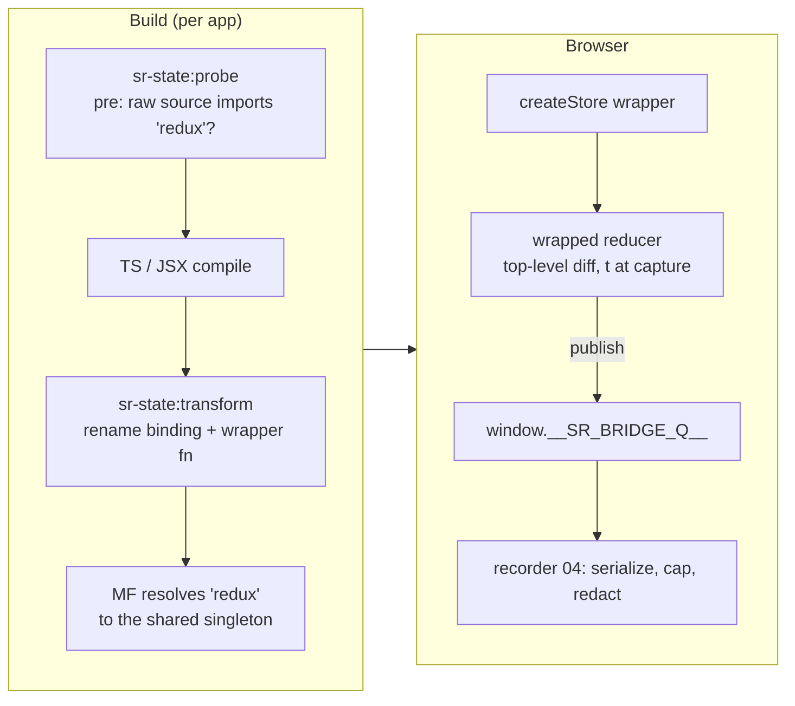

# 07 — State plugin
Status: draft · Size: large · Parent: [01-session-replay.md](01-session-replay.md)

## Goal

`packages/state-plugin` captures **plain Redux** state changes in every module-federation app and
hands them to the recorder through the global bridge queue (D5). It has two parts:
- **a build plugin** (one line in each app's Vite or webpack config) that wraps `createStore` and
  `legacy_createStore` from `redux` where the app imports them (D4);
- **a small runtime** that wraps the reducer (D6) and publishes changes with their capture time (D2).

It must never break the app, never change how MF shares `redux`, and cost almost nothing when
recording is off. `fixtures/apps/` proves it on a React 17 + webpack 5 host with React 18/19 + Vite 7 remotes.

## Decisions

Inherited: D2, D4, D5, D6, D18 (secret keys), D22 (kill), D39 (plain Redux only); 03: `BridgeMsg`,
`publish`, L3 (additive only). Vite 7 only for the MVP (01 Scope).

| # | Decision | Why |
|---|---|---|
| L1 | **Rewrite the import binding, not each call.** `import { createStore }` becomes `import { createStore as __sr$createStore }`, plus a hoisted `function createStore()` that calls the wrapper. | It catches every use, including `applyMiddleware(...)(createStore)` style. A function declaration is hoisted, so there's no temporal-dead-zone error. The specifier `'redux'` is untouched, so MF sharing still matches (D4). |
| L2 | **The order check checks the outcome.** A `pre` probe notes files whose raw source imports from `'redux'`; the main transform must still find that import in each of them, or the build fails. A short list of known import-rewriting plugins (originjs federation) may not run before ours. | `@module-federation/vite` redirects shared imports at resolve time in its `pre` plugin; it doesn't rewrite the text (per its docs; *verify in P1b*). A name-based "ours before theirs" rule would fail every build. What matters is that `'redux'` reaches us intact. |
| L3 | **The wrapper publishes references.** Serialization, the 256 KB cap and secret-key redaction run in the recorder, in idle time (04-L14). | Redux state is immutable, so a reference is a faithful snapshot. No serializer is copied into every remote, and nothing is serialized when recording is off. |
| L4 | **`denyKeys` drops top-level state keys in the diff.** | The cheapest place: 200 market-data actions/s never reach the bridge. 01 deny-lists them for volume, not privacy. |
| L5 | **The runtime imports `publish` from a zod-free entry** (contract request E). | 03 puts `publish` next to the zod schemas; importing it would pull zod into every app bundle. |
| L6 | **Only named imports and `export { … } from 'redux'` are rewritten.** Namespace, default, dynamic and CommonJS imports get a build warning that points to the manual fallback. | Rewriting those safely needs scope analysis. They are rare in app code. |
| L7 | **webpack: a `post` loader. Vite: the normal phase.** | `es-module-lexer` lexes JavaScript, so we run after TS/Babel (webpack) and after `vite:esbuild` (Vite), and before Vite's dev import analysis rewrites bare specifiers. |
| L8 | **Embedded meta uses root-relative paths** (`src/store.ts`). | Absolute paths would leak usernames and hostnames into shipped bundles. |
| L9 | **Store names are `<app>/redux#<n>`**, with `n` counting per app in creation order. | Matches 03. Plain Redux has no devtools name we can read. Counting per app keeps names stable when remotes load in a different order. |
| L10 | **Fixture e2e uses a bridge probe, not the real recorder.** | B4 runs alongside 04; the plugin is tested on its own. The full path is tested in B5. |
| L11 | **Vite 8 or newer: a build warning "untested"**, not an error. | MVP targets Vite 7 (user). Rolldown's plugin order may differ (01 Risks). |

## Design

### How it works



### Options and setup

```ts
// Sample — not final code. packages/state-plugin/src/options.ts
export type StatePluginOptions = {
  app: string;                       // required; same name as data-sr-app and setMeta remotes (04 Q3)
  include?: (string | RegExp)[];     // packages under node_modules to transform as well
  exclude?: (string | RegExp)[];     // app files to leave alone
  denyKeys?: (string | RegExp)[];    // top-level state keys never published (volume, L4)
  expectStores?: number;             // build fails if fewer call sites were wrapped
  runtime?: string;                  // default '@sr/state-plugin/runtime'
};
```

```ts
// Sample — not final code. A Vite 7 remote: vite.config.ts
import { federation } from '@module-federation/vite';
import { srState } from '@sr/state-plugin';
export default defineConfig({
  plugins: [react(), srState.vite({ app: 'positions', denyKeys: ['marketData'] }),
            federation({ name: 'positions', shared: { redux: { singleton: true } } /* … */ })],
});
```

```js
// Sample — not final code. The webpack 5 host: webpack.config.js
const { srState } = require('@sr/state-plugin');
module.exports = { plugins: [srState.webpack({ app: 'shell', expectStores: 1 }), new ModuleFederationPlugin({ /* … */ })] };
```

The position in the `plugins` array doesn't matter: `enforce` and the outcome check (L2) decide.
The package ships the plugin as ESM and CJS for Node configs, and the runtime as browser ESM.

### The call-site transform (D4, L1)

**Before** (the app's `src/store.ts`, after TS compilation):

```js
import { createStore, applyMiddleware, combineReducers } from 'redux';
import { thunk } from 'redux-thunk';
export const store = createStore(combineReducers({ orders, ui }), applyMiddleware(thunk));
```

**After** (what the bundler sees; one-line output shown wrapped):

```js
import { __srWrapCreateStore } from '@sr/state-plugin/runtime';
import { createStore as __sr$createStore, applyMiddleware, combineReducers } from 'redux';
function createStore() { return __srWrapCreateStore(__sr$createStore,
  { app: 'blotter', file: 'src/store.ts', lib: 'redux@4.2.1', deny: ['marketData'] }, arguments); }
export const store = createStore(combineReducers({ orders, ui }), applyMiddleware(thunk));
```

- **Hoisting is wanted here,** so the wrapper is a `function` declaration (the code-style exception).
  It works even if a hoisted function calls `createStore` before the import line.
- **Aliases** keep their local name: `import { legacy_createStore as mk }` gets `function mk()`.
- **Re-exports:** `export { createStore } from 'redux'` becomes an import, a wrapper function and
  `export { createStore }`. Other specifiers in the same statement stay as they were.
- **`meta` is an inline literal,** not a module constant, so no constant is read before it's set.
  `RegExp` deny keys are embedded as `"/^quotes/i"` strings and compiled once at runtime.

```ts
// Sample — not final code. packages/state-plugin/src/transform/redux.ts
import { init, parse } from 'es-module-lexer';
import MagicString from 'magic-string';

const WRAPPED = new Set(['createStore', 'legacy_createStore']);
const NAMED = /^\s*(import|export)\s*\{([^}]*)\}\s*from\s*$/;   // the clause before the specifier

export const transformRedux = async (code: string, id: string, ctx: TransformCtx) => {
  await init;                                               // v1 exports a promise; v2 minimal: init()
  const [imports] = parse(code, id);
  const s = new MagicString(code);
  let found = false, wrapped = 0;
  for (const imp of imports) {
    if (imp.n !== 'redux') continue;
    found = true;
    if (imp.d !== -1) { ctx.warn(`${ctx.rel(id)}: dynamic import of redux is not captured`); continue; }
    const clause = NAMED.exec(code.slice(imp.ss, imp.s - 1));
    if (!clause) { ctx.warn(`${ctx.rel(id)}: namespace or default import of redux; use srAttach()`); continue; }
    const [, kind, list] = clause;
    const decls: string[] = [];
    const specs = list.split(',').map((p) => p.trim()).filter(Boolean).map((p) => {
      const [imported, local = imported] = p.split(/\s+as\s+/);
      if (!WRAPPED.has(imported)) return p;
      wrapped++;
      decls.push(`function ${local}(){return __srWrapCreateStore(__sr$${local},${ctx.meta(id, imported)},arguments)}`);
      if (kind === 'export') decls.push(`export { ${local} };`);
      return `${imported} as __sr$${local}`;
    });
    if (!decls.length) continue;
    s.overwrite(imp.ss, imp.s - 1, `import { ${specs.join(', ')} } from `);  // export-from → import
    s.appendRight(imp.se, `\n${decls.join('\n')}\n`);
  }
  if (wrapped) s.prepend(`import { __srWrapCreateStore } from ${JSON.stringify(ctx.runtime)};\n`);
  return { found, wrapped, result: wrapped ? { code: s.toString(), map: s.generateMap({ hires: true, source: id }) } : null };
};
```

One gap in the sample: an `export { createStore, compose } from 'redux'` must keep `compose` as a
re-export. The real code splits the statement into an import (wrapped names) and an export-from
(the rest). Unit tests cover it.

**Version per importing file** (01): `createRequire(importer).resolve('redux/package.json')`.
Redux 5 exports `./package.json`; Redux 4 has no `exports` field. Results are cached per resolved
path. Majors 4 and 5 are accepted; anything else is a build error naming the file and version.
The runtime still checks features at run time, because an MF singleton may run a different copy
than the one the app was built against.

### Runtime wrapper (D5, D6)

```ts
// Sample — not final code. packages/state-plugin/src/runtime/redux.ts
import { publish } from '@sr/protocol/publish';            // zod-free entry (request E)

type Meta = { app: string; file: string; lib: string; deny?: string[] };
type Reducer = (state: unknown, action: { type?: unknown }) => unknown;
type Store = { getState(): unknown; replaceReducer(r: Reducer): void };

const killed = () => window.__SR_BRIDGE_Q__?.killed === true;            // D22 kill flag
const now = () => performance.timeOrigin + performance.now();            // 03 BridgeMsg.t
const counts = new Map<string, number>();

/** Top-level keys whose reference changed, skipping deny-listed keys (L4). Null if nothing left. */
const topDiff = (prev: unknown, next: unknown, deny: (k: string) => boolean) => {
  if (!isPlainObject(prev) || !isPlainObject(next)) return { changes: { $root: next } };
  const changes: Record<string, unknown> = {};
  const removed: string[] = [];
  for (const k in next) if (prev[k] !== next[k] && !deny(k)) changes[k] = next[k];
  for (const k in prev) if (!(k in next) && !deny(k)) removed.push(k);     // request F (06-C9)
  if (!removed.length && !Object.keys(changes).length) return null;
  return removed.length ? { changes, removed } : { changes };
};

const wrapReducer = (reducer: Reducer, store: string, deny: (k: string) => boolean): Reducer =>
  (state, action) => {
    const next = reducer(state, action);          // the app's own errors propagate untouched
    if (state === undefined || next === state || killed()) return next;  // @@INIT, no-ops, kill
    try {
      const d = topDiff(state, next, deny);
      if (d) publish({ v: 1, store, kind: 'redux', op: 'action', type: String(action?.type), ...d, t: now() });
    } catch { /* fail open (D5) */ }
    return next;
  };

const attach = (store: Store, name: string, deny: (k: string) => boolean, meta: Meta) => {
  const replace = store.replaceReducer;
  store.replaceReducer = (r) => replace.call(store, typeof r === 'function' ? wrapReducer(r, name, deny) : r);
  publish({ v: 1, store: name, kind: 'redux', op: 'register', state: store.getState(), t: now(),
            meta: { app: meta.app, lib: meta.lib } });                    // request F
};

export const __srWrapCreateStore = (original: (...a: unknown[]) => Store, meta: Meta, args: IArguments) => {
  const [reducer, ...rest] = Array.from(args);
  if (killed() || typeof reducer !== 'function') return original.apply(undefined, Array.from(args)); // Redux reports bad input
  const n = (counts.get(meta.app) ?? 0) + 1;
  counts.set(meta.app, n);
  const name = `${meta.app}/redux#${n}`;
  const deny = compileDeny(meta.deny);
  const store = original(wrapReducer(reducer as Reducer, name, deny), ...rest);   // keep argument count
  try { attach(store, name, deny, meta); } catch { /* fail open */ }
  return store;
};
```

- **Why the reducer** (D6): thunk and saga middleware dispatch through the enhanced `dispatch`
  closure, not `store.dispatch`. Every action still reaches the root reducer.
- **Enhancers** (`applyMiddleware`, devtools) get our wrapped reducer, because we wrap before
  calling Redux. `replaceReducer` is patched on the returned (outermost) store.
- **Cost per dispatch:** one extra call, a flag check, and a loop over the top-level keys (10–50
  in practice). There is no deep walk and no serialization (L3).
- **Fail-open rules:** the original `createStore` is called exactly once. Our code after it is in
  `try/catch`. The app's reducer errors are never caught or changed.
- **Kill flag** (D22): checked on every publish. The recorder's loader sets it for non-enabled
  users and on the kill switch (04), so the wrappers become pass-through without a rebuild.
- **Early stores:** `publish` creates the queue if the recorder isn't there yet (03), so a store
  created before the recorder loads is registered when the recorder adopts the queue.

### Manual fallback (D5): 3 lines

For stores the plugin can't see: CommonJS `require`, namespace imports, a store built inside a
package not listed in `include`, or a factory in a shared library.

```ts
// Sample — not final code.
import { srAttach } from '@sr/state-plugin/runtime';
const store = createStore(rootReducer, preloadedState, enhancer);
srAttach(store, rootReducer, { app: 'blotter' }); // wraps via replaceReducer, patches it, registers
```

`srAttach` calls `store.replaceReducer(wrapReducer(rootReducer, …))`. Redux dispatches one
`@@redux/REPLACE` action, which changes no state, so nothing is published. Actions dispatched
before `srAttach` aren't captured.

### Plugin wiring and the order check (L2, L7)

```ts
// Sample — not final code. packages/state-plugin/src/plugin/index.ts
import { createUnplugin, type UnpluginFactory } from 'unplugin';

export const factory: UnpluginFactory<StatePluginOptions, true> = (opts, meta) => {
  const seen = new Set<string>();                      // raw source imports from 'redux'; ids without ?query
  const late = meta.framework === 'webpack' || meta.framework === 'rspack';
  let wrappedTotal = 0;
  return [
    { name: 'sr-state:probe', enforce: 'pre',
      transform: { filter: { code: /from\s*['"]redux['"]/ },
                   handler(_code, id) { if (inScope(id, opts)) seen.add(id); return null; } } },
    { name: 'sr-state:transform', enforce: late ? 'post' : undefined,  // L7
      async transform(code, id) {
        if (!seen.has(id)) return null;                // cheap: only files the probe flagged
        const out = await transformRedux(code, id, ctxFor(this, opts));
        if (!out.found) this.error(`${rel(id)}: 'redux' import was rewritten before sr-state ran. ` +
          'Move the plugin that did it after sr-state, or keep TS/Babel from emitting CommonJS (modules: false).');
        wrappedTotal += out.wrapped;
        return out.result;
      },
      buildEnd() { if (opts.expectStores && wrappedTotal < opts.expectStores) this.error(`sr-state wrapped ${wrappedTotal} call sites; expected ${opts.expectStores}`); },
      vite: { config: () => ({ optimizeDeps: { exclude: packageNames(opts.include) } }), configResolved: checkViteOrder },
      webpack: (compiler) => logFederation(compiler) },
  ];
};
export const srState = createUnplugin(factory);
```

- **The outcome check works in dev and build.** It runs per file, so a broken order shows up in
  Vite's dev overlay at once.
- **Vite `configResolved`:**
  - fails if `originjs:federation` runs before us, since it rewrites shared imports in `transform`;
  - warns on Vite ≥ 8 (L11);
  - logs the resolved plugin order when `DEBUG=sr-state` is set.
- **Vite `config`:** packages in `include` are excluded from dev pre-bundling. Otherwise esbuild
  bundles them before any plugin sees them. They must be ESM (a warning says so).
- **webpack:** loaders always run before webpack resolves the requests they leave behind, so
  `ConsumeSharedPlugin` still sees the raw `'redux'` request. `logFederation` finds a
  `ModuleFederationPlugin` (built-in `container.` or `@module-federation/enhanced`) and warns if
  `redux` isn't shared as a singleton. That's informational: capture works either way.
- **`include`:** package names or regexes. They are matched on the path after `node_modules/`,
  so the default skip of `node_modules` is lifted only for them.
- **Cost:** the probe's code filter skips almost every file natively (Vite 7 hook filters). The
  lexer runs only on the few files that import `redux`.

### Fixture apps (`fixtures/apps/`)

| App | Stack | Plugin | Redux | What it proves |
|---|---|---|---|---|
| `host-webpack-r17` | React 17, webpack 5, MF host (open question 1) | yes, `expectStores: 1` | 4.2.1, shared singleton, eager | Creates its store at module load, before the probe (the recorder stand-in) loads. Mounts each remote into its own `data-sr-app` container. |
| `remote-vite-r18` | React 18, Vite 7, `@module-federation/vite` | yes | `^4.2.1` singleton, `redux-thunk`, `redux-saga` | Thunk and saga actions; a lazy slice added with `replaceReducer`. |
| `remote-vite-r19` | React 19, Vite 7 | yes, `include: ['@fixture/store-kit']` | built against 5.0.1, `requiredVersion: false`, so it runs the host's 4.2.1 | Runtime feature checks; a store created inside a package under `node_modules`. |
| `remote-plain` | React 18, Vite 7 | **no** | singleton | Sharing still works; nothing is captured from it. |
| `shared/bridge-probe` | plain JS | — | — | Stands in for the recorder. It drains `__SR_BRIDGE_Q__` into `window.__SR_PROBE__`. `?probeDelay=3000` loads it late; `?kill=1` sets `killed`. |
| `shared/store-kit` | in-house style package | — | — | Calls `createStore` itself. Installed from a packed tarball (`bun pm pack`), so it really sits under `node_modules` and isn't a symlink. |

- **Each remote brings its own React,** because React isn't shared across majors. Only `redux`
  is shared.
- **Sharing proof:** the host stamps `compose.__fixtureMark = 'host'` on load. Each remote then
  reports `compose.__fixtureMark` from its own `import { compose } from 'redux'` (unwrapped). A
  shared singleton shows `'host'` everywhere.
- **Commands** (root scripts from the B1 root scaffold, 01 X1, which also lists each fixture app and `shared/bridge-probe` as a workspace by explicit path; `store-kit` stays out of the workspaces so it installs as a real package): `bun run fixtures:build` builds all four apps. `fixtures:serve` serves them on
  ports 3410–3413 (`FIXTURE_PORT_BASE` changes them). `fixtures:e2e` runs the Playwright specs,
  tagged `@state-plugin`.
- **Tooling:** webpack and Vite run through `bunx --bun`, because Node isn't on this machine's
  PATH. Whether webpack 5 runs cleanly under Bun on Windows is *unverified* (P1b). The real
  workspace uses Node 22.

## Guidelines

**Do**
- Keep the runtime tiny and dependency-free apart from `publish`. Check its size in a test (≤ 2 KB min+gzip).
- Treat every wrapper line as running inside the app's dispatch: no allocation beyond the diff, no I/O, no logging.
- Return the app's own values and errors exactly as Redux would. Only our additions sit in `try/catch`.
- Give errors and warnings the root-relative file and a fix ("use `srAttach`", "set `modules: false`").
- Test the transform against both Redux majors and both bundlers before changing it.

**Don't**
- Don't change, add or resolve the `'redux'` specifier, and don't add `redux` to `resolve.alias` (D4).
- Don't serialize, clone or deep-diff state in the wrapper (L3), and don't patch `store.dispatch` (D6).
- Don't embed absolute paths, environment values or secrets in the injected meta (L8).
- Don't wrap RTK, Zustand or TanStack Query yet (D39).

## Acceptance

**Transform**
- [ ] Golden before/after tests: a named import, an alias, both functions in one statement, a mixed statement, an `export { … } from 'redux'`, and a file with no Redux (output `null`, so no map).
- [ ] Namespace, default, dynamic and `require` imports leave the file unchanged and print one warning each.
- [ ] Source maps point errors in transformed files at the original lines.
- [ ] Redux 4.2 and 5 are accepted; 3.x and 6.x fail the build with the file and version; two versions in one repo resolve per importer.

**Order and build checks**
- [ ] A test plugin that rewrites `'redux'` between `pre` and the normal phase fails the build, naming the file. So does `originjs:federation` placed before us.
- [ ] Builds with `@module-federation/vite` (Vite 7) and the webpack 5 MF plugin pass. The emitted bundle still requests the shared `redux`.
- [ ] `expectStores` fails a build that wrapped too few call sites; Vite 8 prints the "untested" warning.
- [ ] A package in `include` is transformed in `vite build` and in `vite dev` (excluded from pre-bundling).

**Runtime**
- [ ] Captured: plain `dispatch`, thunk and saga actions, and slices added with `replaceReducer`. `@@INIT` and no-change actions publish nothing.
- [ ] `denyKeys` never appear; removed keys are listed; a non-object root state is published as `$root`.
- [ ] `t` is taken inside the reducer, before `dispatch` returns.
- [ ] A throwing reducer gives the app the same error as unwrapped Redux. A throwing `publish` leaves the app unaffected.
- [ ] With `killed` set, nothing is published and the store behaves exactly as unwrapped. Setting it mid-session stops publishing at once.
- [ ] `srAttach` captures a store created with `require('redux')`.
- [ ] Overhead: p99 ≤ 0.05 ms added per dispatch on a 30-key root (micro-bench in the unit tests).
- [ ] The runtime bundle contains no zod and stays ≤ 2 KB min+gzip.

**Fixtures (e2e, `@state-plugin`)**
- [ ] Every fixture builds. The probe receives `register` and `action` messages from the host, `remote-vite-r18` and `remote-vite-r19`, with the expected store names and types.
- [ ] `remote-plain` sends nothing, works normally, and reports the shared singleton (`'host'`).
- [ ] The host's early store is registered when the probe loads 3 s late (`?probeDelay=3000`).
- [ ] `remote-vite-r19` works against the host's Redux 4.2.1 at run time; its `store-kit` store is captured.
- [ ] `?kill=1`: no messages, and every app still works.

## Tasks

- [ ] **PL0 MF call-site spike** — this is 02's K4 (P1b), owned there (`spike/mf-plugin/`) — batch: B0 — its findings feed PL3–PL6: the `@module-federation/vite` behaviour (L2), webpack under Bun, and the host MF plugin.
- [ ] **PL1 Package scaffold** — owns: `packages/state-plugin/{package.json,tsconfig.json,build.ts,test/setup.ts}` — batch: B1 — depends on: 03 T1 — done when: `exports` for `.` (plugin, ESM + CJS) and `./runtime` (browser ESM) exist; `redux4`/`redux5` dev aliases (`npm:redux@4.2.1`, `npm:redux@5.0.1`) install; `bunx tsc --noEmit`, lint and an empty `bun test` pass.
- [ ] **PL2 Runtime wrappers** — owns: `packages/state-plugin/src/runtime/**` — batch: B3 — depends on: PL1, 03 T1, request E — done when: unit tests against both Redux majors (thunk, saga, `replaceReducer`, kill flag, fail-open, deny keys, removed keys, `$root`, `srAttach`) and the micro-bench pass; type-check and lint pass.
- [ ] **PL3 Transform core** — owns: `packages/state-plugin/src/transform/**` — batch: B3 — depends on: PL1 — done when: golden before/after tests, the warning cases, the source-map test and the version-resolution tests (fake `node_modules` trees for Redux 3/4/5/6) pass; type-check and lint pass.
- [ ] **PL4 Plugin wiring and checks** — owns: `packages/state-plugin/src/{plugin,options}/**`, `src/index.ts` — batch: B3 — depends on: PL3 — done when: unit tests drive the factory with fake Vite and webpack contexts (probe/transform outcome check, `expectStores`, the originjs order error, the Vite 8 warning, `optimizeDeps.exclude`); type-check and lint pass.
- [ ] **PL5 Fixtures: host, r18 remote, probe** — owns: `fixtures/apps/{host-webpack-r17,remote-vite-r18,shared/bridge-probe}/**` — batch: B4 — depends on: PL2, PL4 — done when: `bun run fixtures:build` builds both apps, and type-check passes for them.
- [ ] **PL6 Fixtures: r19 remote, plain remote, store-kit** — owns: `fixtures/apps/{remote-vite-r19,remote-plain,shared/store-kit}/**` — batch: B4 — depends on: PL5 — done when: `bun run fixtures:build` builds all four apps and the packed `store-kit` installs under `node_modules`.
- [ ] **PL7 Fixture e2e specs** (qa, `specs` mode) — owns: `fixtures/apps/e2e/**` — batch: B4 (alongside PL5–PL6) — depends on: the Acceptance list above — done when: the specs compile. They first run at the gate.
- Real-workspace integration (webpack 5 host, Vite 7 remotes): B5, in 08.

## Risks

| Risk | Mitigation |
|---|---|
| A future `@module-federation/vite` rewrites `'redux'` in a `transform` that runs before ours. | The outcome check fails the build with the file name (L2). P1b and the fixtures pin the version. |
| Babel or TS emits CommonJS (`modules: 'commonjs'`), so no import is left to rewrite. | The probe sees the raw import and the transform doesn't, so the build fails with a hint to set `modules: false`. |
| An app mutates state in place, so a reference changes later or the diff misses the change. | Redux forbids it; the screen recording still shows the effect. Note it in the pilot runbook. |
| Redux DevTools recomputes reducers on "jump" or "toggle", which publishes duplicates. | Dev only; production has no DevTools. Documented. |
| The pre-recorder queue grows when no recorder is on the page (a remote's own dev server). | Request G: `publish` caps a queue nobody has adopted. |
| webpack 5 under Bun on Windows misbehaves. | P1b checks it. Fixtures fall back to Node where it exists; the real workspace runs Node 22. |
| Store numbering changes if an app creates stores in a varying order. | Rare (stores are made at module load). The register message carries `meta.lib` and the file for support. |

## Open questions

Tracked in 01 as part of Q39 (needed for B5).

1. Which MF plugin does the real webpack host use: webpack's built-in `container.ModuleFederationPlugin` or `@module-federation/enhanced`? The fixture host should match it.
2. Which top-level slices hold market data in the pilot app, so they go in `denyKeys`?
3. Does any pilot code create stores through CommonJS, namespace imports or a shared library? Those need `srAttach` or `include`.
4. Is `redux` shared as a singleton across all pilot remotes, and are they on the same major (4 or 5)?

## Log

- 2026-11-10 — drafted for the plan split (agent)
- 2026-11-10 — Reviewed and merged into `plan/` by the leader. Requests E, F and G applied in 03 (zod-free `@sr/protocol/publish`, `removed` and register `meta`, queue folding before adoption). Task ids renamed S0–S7 → PL0–PL7 so they no longer clash with 05. Root fixture scripts and workspaces moved to 01 X1.
