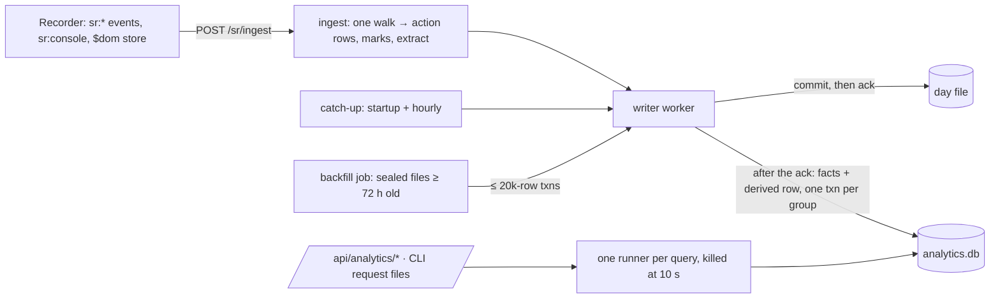

# 09 — Analytics infrastructure (MVP2)
Status: draft v2 (reviewed: architect, devil, auditor; MVP2 starts after the v1 pilot) · Size: large · Parent: [01-session-replay.md](01-session-replay.md)

## Goal

Answer questions across recorded users from the data the recorder already sends, for example:
- how many users have the **Orders** tab open, how many have it on screen, and for how long;
- the top errors this week, and how many users hit each one;
- console errors and warnings, overall or per host app. The mini-app (`app`) isn't filled in the
  MVP (01 Q27), so "per app" means the host app for now.

MVP2 builds **the infrastructure only** (user, 2026-11-10):
- facts derived on the server, with daily summaries in an analytics store;
- a backfill job;
- the DOM tab reader (`$dom`);
- a query API and CLI that run any number of saved query specs.

**Out of scope for MVP2:**
- the `/analytics` page and its drill-down to sessions;
- totals across regions;
- facts for users who aren't recorded;
- a MongoDB or AMPS store.

The master plan holds the cross-cutting decisions: D43 (console) and D44 (this plan's scope).

## Decisions

| # | Decision | Why | Who |
|---|---|---|---|
| L1 | **The server derives facts at ingest, from one batch at a time.** `extract(batch, ctx)` is pure: the same batch always gives the same facts. It has no memory of earlier batches; values are de-duplicated only within the batch. It runs in the ingest walk, and its facts are written after the ack. The browser sends nothing new except console lines (D43) and the `$dom` store (L4). | No extra browser work. A new fact needs only config or a server release. Facts can be rebuilt. | user (architect option c); review fix (devil B4, architect 1) |
| L2 | **Writes are idempotent.** A `derived(recording_id, seq, xv)` row is written in the same transaction as that batch's facts, and a batch that already has one is skipped. Facts use `INSERT OR IGNORE` on their key. `fact_days` is updated **only from rows actually inserted**. A catch-up step (at startup, then hourly) derives any first-stored chunk in today's and yesterday's day files that has no `derived` row. That replaces "mark for re-derivation". | Retries, crashes between the day-file commit and the analytics commit, and out-of-order arrival never double-count. Counts in `fact_days` can't be rebuilt after 30 days, so they must be right the first time. | review fix (devil B4, architect 1) |
| L3 | **Two tables in `data/analytics.db`.** `facts` holds one row per occurrence: kept 30 days, the same as the recordings, and rebuildable. `fact_days` is a daily summary: kept 13 months (`SR_FACT_DAYS=395`), not rebuildable after 30 days. Only `fact_days` goes into the daily off-PVC backup, since `facts` can be rebuilt. | Trends beyond a month without keeping raw data longer. | user (retention), architect |
| L4 | **Tabs are read from the page.** Central config lists CSS selectors (flexlayout's tab buttons). The recorder reads the labels into a built-in `$dom` store, tracking both open and visible tabs. Names are the labels: the `title` or `aria-label` if set, else the label text. The server strips counts such as "Orders (3)" with a config pattern, and duplicate labels are counted, not merged. flexlayout renders a button for every tab, including ones scrolled out of the strip, so overflowed tabs are counted (Q3 answered). Border tabs need their own selector. A `data-sr-tab` id comes later only if renamed labels skew the counts. | No app change at all, and it works for any app with tabs. | user; review fixes (devil R7, architect 9) |
| L5 | **Visible time per tab is recorded from MVP2 start** (user). `extract()` turns two `$dom` changes in the same batch, or a change and the batch's end, into visible milliseconds, stored as `visible_ms` in `fact_days`. | Time on screen can't be rebuilt after 30 days, so its history must start with MVP2. | user |
| L6 | **Click facts are named by stable ids only:** `data-sr-grid` (its grid id, after any `<remote>/` prefix, 08-L7) plus the cell's `col-id`, a `data-sr-*` attribute, or a button's `aria-label`/`title`. **Never cell or link text.** Example text (`sample`) lives only in `facts` (30 days), never in `fact_days`. Fingerprints strip quoted strings. | A click on a blotter cell would otherwise keep "ACME CAPITAL 25,000 AAPL @187.20" for 13 months. | review fix (devil B3) |
| L7 | **Console facts come from `error` and `warn` only**, by default (`analytics.consoleLevels`). Each recording is capped at 5,000 facts per day; past that, one `capped` fact. | With `log` on, facts would grow about 100 times. | review fix (devil R9) |
| L8 | **Summary days are the recorded user's local day** (from the batch envelope's `tz`, 03-L18, so `extract()` sees it per batch; else `sr:meta.tz`, D42), falling back to the region's zone. Day files stay UTC (D31). | A Sydney morning is the UTC evening before, so UTC days would split one trading day across two. | review fix (devil R13) |
| L9 | **Recorded users only, checked on the server.** `extract()` makes facts only for user ids that the allow-list enables. Ingest itself is unchanged. | Ingest trusts the client's user id (D20), so a script could otherwise invent users. | user (coverage); review fix (devil R15) |
| L10 | **A neutral query spec** (filter, group by, metrics, sort, top N per group, time range) is compiled **straight to SQL**. No `FactStore` interface until a second store is real (architect, 2026-11-11); the spec stays the API and the saved-query format, so a later MongoDB or AMPS store adds a compiler then. | The query side outlives the database choice, without building a seam nobody has asked for. | architect; the store move is the user's call later |
| L11 | **One short-lived child process per query (`Bun.spawn`), killed at 10 s** (05-L1 since 2026-11-11: Bun's docs call Worker termination experimental). bun:sqlite has no interrupt call; killing the process stops the query. Up to 3 queries wait in a queue; more get a 429. | Queries never run on the main thread (05-L1), and a runaway query can't hold a CPU core or stop the WAL from checkpointing. | review fix (architect 3, devil R12) |
| L12 | **A query API and CLI, with saved query specs** from the ConfigMap. The CLI goes through request files like every other command (05-L9), with `--by` and `--ticket`. No page in MVP2. | "We need multiple queries" (user). The CLI never opens a database itself. | user; review fix (architect 2) |
| L13 | **Off until access is decided.** Two ConfigMap flags, `analytics.extract` and `analytics.api`, default to off. While off, nothing is derived and `/api/analytics/*` returns 404. Q1 (who may query, login, minimum group size, pseudonymous ids, DPIA) is answered before AN0 starts, because it shapes the schema. Until a login exists, `/api/analytics/*` also needs the viewer grant (05-L10), so every query is logged under a name and a reason. | `X-SR-UI` only guards against cross-site requests; it isn't a login. Deriving facts is itself new processing that the DPIA must cover. | user (access at MVP2 start); review fix (devil R5, R6; architect 11) |
| L14 | **Summaries hold no working-hours log.** `first_t` and `last_t` are rounded to the hour. When Q1 sets a minimum group size, it also applies to samples and to the later drill-down. | Per-user first and last times kept 13 months would amount to a working-hours log. | review fix (devil R6) |
| L15 | **Fingerprints group errors and console lines.** Numbers longer than 3 digits and UUID or hex ids become `#`. HTTP statuses and short error codes are kept. Quoted strings are stripped. The top stack frame is reduced to its function name and file name, with origin, content hash and `line:col` dropped. Golden tests cover all of this. Redux action types are counted per day (live only; a backfill doesn't rebuild them). | "The same error from 50 users" becomes one row, while a 401 stays apart from a 503. | architect (leader's call); review fix (devil R14, architect 12) |
| L16 | **A config ignore list** drops noisy fingerprints, for example `*AG Grid Enterprise License*` (the banner starts with asterisks) and React development warnings. | Keeps console analytics useful. | architect |

## Design



### Fact model (server-only, `apps/server/src/analytics/fact.ts`)

```ts
// Sample — not final code. Facts never leave the server, so the type lives there (architect 12).
export type Fact = {
  recordingId: string; seq: number; idx: number; sub: number;  // key: one event can give several facts
  t: number; offsetMs: number; day: string;                    // day = the user's local day (L8)
  sessionId: string; userId: string; app: string;
  kind: 'session' | 'nav' | 'click' | 'error' | 'console' | 'net' | 'action' | 'state' | 'fidelity';
  name: string;            // ≤ 200: path id, fingerprint, stable click id, route template ('' if none)
  value: string;           // ≤ 200: state value, console level, HTTP status ('' if none; never NULL)
  visibleMs: number;       // state facts of `$dom` visible sets (L5); 0 otherwise
  sample: string;          // ≤ 500, facts table only (L6); '' if none
  xv: number;              // extractor version
};
```

| Kind | From | `name` | `value` |
|---|---|---|---|
| `session` | first and last batch | `start` / `end` | — |
| `nav` | `sr:nav` | route template (numeric and UUID segments become `:id`) | — |
| `click` | `sr:click` | **stable id only** (L6): `grid:col`, `data-sr-*`, or the aria label/title; otherwise `unnamed` | — |
| `error` | `sr:error`, not marked `same` | fingerprint (L15) | — |
| `console` | `sr:console` at the levels in `analytics.consoleLevels` (L7), not marked `same` | fingerprint (L15) | level |
| `net` | failed `sr:net` only | method + route template | status |
| `action` | `sr:state` actions | action type, counted per day only | — |
| `state` | `sr:state` for configured paths and every `$dom` probe | path id (`layout.visible`) | the value, with the config's strip pattern applied; one fact per item of a set |
| `fidelity` | `sr:fidelity` | reason | start/end |

### Config: the ConfigMap's `analytics` section, plus `domProbes` in the recorder config

```json
{ "analytics": {
    "extract": false, "api": false,
    "consoleLevels": ["error", "warn"],
    "dayZone": "user",
    "statePaths": [
      { "id": "blotter.view", "store": "*/redux#1", "path": "ui.blotter.view", "as": "value" }
    ],
    "labelStrip": "\\s*\\(\\d+\\)$",
    "ignore": ["console:*AG Grid Enterprise License*", "console:Warning: Each child in a list*"],
    "savedQueries": { "tab-visible-30d": { "v": 1, "range": { "last": "30d" },
      "where": [{ "field": "kind", "op": "eq", "value": "state" },
                { "field": "name", "op": "eq", "value": "layout.visible" }],
      "groupBy": ["value"], "metrics": ["users", "visibleMinutes"], "limit": 50 } } },
  "domProbes": [
    { "id": "layout.open",    "selector": ".flexlayout__tab_button", "as": "set" },
    { "id": "layout.visible", "selector": ".flexlayout__tab_button--selected", "as": "set" }
  ] }
```

**State paths:**
- They use a small path language (`a.b`, `[n]`, `[*]`, about 40 lines): no JSONPath library and no filter expressions.
- Only scalars are extracted. Values are capped at 200 characters and sets at 50 items.
- A value the recorder left out (`NotRecorded`) becomes the reserved token `⟨not recorded⟩`, so it can't clash with real data.
- A path with a secret-named segment (`isSecretKey` from `@sr/protocol/secrets`) is refused when the config loads.
- Every DOM probe is also a state path in store `$dom`; it needs no second entry.

### DOM probe (recorder, L4)

```ts
// Sample — not final code. packages/recorder/src/dom-probe/index.ts (MVP2, AN5).
// Reads tab labels with config selectors into a built-in `$dom` store in the state intake (04 R6):
// a snapshot at start and after every FullSnapshot, then an action only when a value changes.
type Probe = { id: string; selector: string; as: 'set' | 'first'; within?: string };
const MAX_ITEMS = 50, MAX_MATCHES = 200, MAX_LABEL = 200;

const labelOf = (el: Element) =>
  (el.getAttribute('title') || el.getAttribute('aria-label') ||
   (el.querySelector('.flexlayout__tab_button_content') ?? el).textContent || '').trim().slice(0, MAX_LABEL);

export const startDomProbe = (probes: Probe[], intake: StateIntake, onHotspot: (id: string) => void) => {
  const off = new Set<string>();                         // probes switched off for matching too much
  const read = () => Object.fromEntries(probes.filter((p) => !off.has(p.id)).map((p) => {
    const root = p.within ? document.querySelector(p.within) : document;
    const list = root ? root.querySelectorAll(p.selector) : [];
    if (list.length > MAX_MATCHES) { off.add(p.id); onHotspot(p.id); return [p.id, null]; } // a bad selector
    const labels: string[] = [];
    for (let i = 0; i < list.length && labels.length < MAX_ITEMS; i++) labels.push(labelOf(list[i]));
    return [p.id, p.as === 'set' ? labels.sort() : (labels[0] ?? null)];  // duplicates kept (L4)
  }));
  let state = read();
  let key = JSON.stringify(state);
  intake.registerBuiltIn('$dom', () => (state = read()));  // the FullSnapshot read reads afresh

  let timer: ReturnType<typeof setTimeout> | undefined;
  const check = () => {
    timer = undefined;
    if (document.visibilityState === 'hidden') return;
    const next = read();
    const nextKey = JSON.stringify(next);
    if (nextKey === key) return;                          // send only on change
    const changes = Object.fromEntries(Object.entries(next)
      .filter(([k, v]) => JSON.stringify(v) !== JSON.stringify(state[k])));
    state = next;
    key = nextKey;
    intake.action('$dom', { type: 'dom/probe', changes, t: Date.now() });
  };
  const soon = () => { timer ??= setTimeout(check, 300); }; // one combined check per burst
  for (const type of ['pointerup', 'keyup', 'dragend']) addEventListener(type, soon, { capture: true, passive: true });
  document.addEventListener('visibilitychange', soon);
  setTimeout(check, 2_000); setTimeout(check, 5_000);       // layouts load asynchronously
  const every = setInterval(check, 30_000);
  return () => clearInterval(every);                       // the listeners go inert on stop, like 04's patches
};
```

**Polling, not a MutationObserver.** Watching the layout subtree would also watch every AG Grid cell
under it, doubling mutation work on the busiest path, which rrweb already pays once.

**Known gaps:**
- a maximized tabset leaves other tabsets' selected buttons in the page, so "visible" overcounts (a `within` selector or a later `data-sr-tab` helps);
- popped-out tabs are in another window (D34);
- during a rename, a textbox replaces the label.

Check the exact class names at the real flexlayout version in the B5 run.

### Storage

```sql
-- Sample — not final code. data/analytics.db (WAL, synchronous=NORMAL), written only by the writer.
CREATE TABLE facts (recording_id TEXT NOT NULL, seq INT NOT NULL, idx INT NOT NULL, sub INT NOT NULL,
  t INT, offset_ms INT, day TEXT NOT NULL, session_id TEXT, user_id TEXT NOT NULL, app TEXT NOT NULL DEFAULT '',
  kind TEXT NOT NULL, name TEXT NOT NULL DEFAULT '', value TEXT NOT NULL DEFAULT '', visible_ms INT NOT NULL DEFAULT 0,
  sample TEXT NOT NULL DEFAULT '', xv INT NOT NULL,
  PRIMARY KEY (recording_id, seq, idx, sub)) WITHOUT ROWID;
CREATE INDEX facts_day ON facts (day);                          -- retention in batches
CREATE INDEX facts_kind_name_day ON facts (kind, name, day);
CREATE INDEX facts_user ON facts (user_id);                     -- erasure

CREATE TABLE fact_days (day TEXT NOT NULL, kind TEXT NOT NULL, name TEXT NOT NULL, value TEXT NOT NULL,
  app TEXT NOT NULL, user_id TEXT NOT NULL,
  n INT NOT NULL, visible_ms INT NOT NULL DEFAULT 0,
  first_hour INT, last_hour INT,                                -- rounded to the hour (L14)
  example_session TEXT, example_pos TEXT,                        -- ids only, no text (L6)
  xv INT NOT NULL, config_version TEXT NOT NULL,                 -- a trend shows when its rules changed
  PRIMARY KEY (kind, name, day, value, app, user_id)) WITHOUT ROWID;
CREATE INDEX fact_days_day ON fact_days (day);

CREATE TABLE derived (recording_id TEXT NOT NULL, seq INT NOT NULL, xv INT NOT NULL, at INT NOT NULL,
  PRIMARY KEY (recording_id, seq)) WITHOUT ROWID;               -- the idempotency guard (L2), kept 3 days
CREATE TABLE erased (user_id TEXT PRIMARY KEY, until_day TEXT NOT NULL);  -- extract() skips these (below)
```

**Writing:**
- One analytics transaction per writer group commit: the `derived` rows, `INSERT OR IGNORE` facts, and `fact_days` upserts built from the rows that `changes()` reports as inserted.
- A circuit breaker stops analytics writes when `analytics.db` fails, so ingest never slows. The catch-up step fills the gap later.

**Retention:**
- Daily, `facts` older than 30 days and `fact_days` older than `SR_FACT_DAYS` are deleted in batches of 10,000 rows, by `day`.
- `derived` rows go after 3 days.

**Erasure** (05 runbook):
1. `PRAGMA secure_delete=ON`.
2. Delete from `facts` and `fact_days` where `user_id = ?`.
3. Add the user to `erased` until their last recording expires, so catch-up and backfill can't re-create them.
4. `PRAGMA wal_checkpoint(TRUNCATE)`. No `VACUUM`, which would stop ingest while it rewrites the file.

**Backup:** `fact_days` only, copied daily with the off-PVC backup (check the size against 01 Q37).

**Volume:** 09's earlier estimate assumed click labels. With stable ids only (L6), error and warn console facts only (L7), and a cap per recording, a region stays under about 1 GB of `facts` and a few million `fact_days` rows. AN1 and AN7 measure this on generated data.

### Backfill and catch-up

- **Catch-up (AN3):** at startup and then hourly, finds first-stored chunks in today's and yesterday's files with no `derived` row and derives them. That covers crashes and circuit-breaker gaps.
- **Backfill (AN3):** `analytics backfill --days N` starts a **background job** and returns a job id. Progress, resume and `--cancel` go through `analytics status`.
  - It works on **sealed files at least 72 h old (plus the grace period)**, one file at a time, in a short-lived Worker.
  - It replaces that file's facts by `(recording_id, seq)` and recomputes those days' `fact_days` from `facts`. Action counts can't be rebuilt that way, so they stay as they were.
  - It sends merges to the writer in transactions of at most 20,000 rows, and pauses while the writer queue is over 05-L11's limit.
- A backfill is needed only after an extractor or config change. `fact_days` records `xv` and `config_version`, so a trend shows where its rules changed.

### Query spec, API and CLI

```ts
// Sample — not final code. packages/protocol/src/analytics.ts (a later page will use it too).
export const AnalyticsQuery = z.object({
  v: z.literal(1),
  range: z.union([z.object({ from: Day, to: Day }),                    // half-open local days (L8)
                  z.object({ last: z.enum(['1d', '7d', '30d', '90d', '365d']) })]),
  where: z.array(z.object({ field: z.enum(['kind', 'name', 'value', 'app']),
                            op: z.enum(['eq', 'neq', 'in', 'nin', 'prefix']),
                            value: z.union([z.string(), z.array(z.string()).max(50)]) })).max(8),
  groupBy: z.array(z.enum(['name', 'value', 'app', 'day', 'week', 'session'])).max(2), // session: facts, ≤ 30 days
  metrics: z.array(z.enum(['users', 'events', 'sessions', 'visibleMinutes'])).min(1),
  sort: z.object({ by: z.string(), dir: z.enum(['asc', 'desc']) }).optional(),          // a metric or a group
  top: z.object({ per: z.enum(['name', 'value', 'app', 'day', 'week']), n: z.number().int().min(1).max(50) }).optional(),
  limit: z.number().int().min(1).max(500).default(50),
});
export const AnalyticsResult = z.object({
  columns: z.array(z.string()), rows: z.array(z.array(z.union([z.string(), z.number(), z.null()]))),
  source: z.enum(['fact_days', 'facts']), truncated: z.boolean(), tookMs: z.number(),
});
```

**How a spec compiles:**
- The compiler reads `fact_days`. `sessions` and `groupBy: 'session'` need `facts`, so their range must be at most 30 days; a longer range gets a 400.
- Fields and operators come only from the enums, and values are always bound parameters.
- `top` compiles to `ROW_NUMBER() OVER (PARTITION BY …)`.
- The minimum group size from Q1 becomes `HAVING users >= ?`.

```sql
-- "tab-visible-30d": users and minutes on screen per tab, last 30 local days
SELECT value, COUNT(DISTINCT user_id) AS users, SUM(visible_ms) / 60000 AS visible_minutes
FROM fact_days WHERE day >= ?1 AND day < ?2 AND kind = 'state' AND name = 'layout.visible'
GROUP BY value ORDER BY users DESC LIMIT ?3;

-- "top-errors-7d": uncaught errors and console errors together, de-duplicated by `same` at extraction
SELECT name, SUM(n) AS events, COUNT(DISTINCT user_id) AS users
FROM fact_days WHERE day >= ?1 AND day < ?2
  AND (kind = 'error' OR (kind = 'console' AND value = 'error'))
GROUP BY name ORDER BY users DESC, events DESC LIMIT ?3;
```

The same spec on a later store:
- **MongoDB:** `$match → $group {events: {$sum: '$n'}, users: {$addToSet: '$user_id'}} → $project {users: {$size: '$users'}} → $sort → $limit`.
- **AMPS:** an aggregated `sow` query with `projection=[/name, SUM(/n) AS /events, COUNT_DISTINCT(/user_id) AS /users], grouping=[/name]`.

```ts
// Sample — not final code. apps/server/src/analytics/store/sqlite.ts — the SQLite store's functions (no interface yet, L10).
export type SqliteFacts = {
  insert(group: { derived: DerivedRow[]; facts: Fact[] }): void; // one txn; fact_days from inserted rows only
  query(spec: AnalyticsQuery): Promise<AnalyticsResult>;         // runs in the per-query runner (L11)
  retain(now: Date): void;
  erase(userId: string, untilDay: string): void;
};
```

**API** (UI port 3002, `X-SR-UI: 1`, the Host check, and the viewer grant until a login exists, L13).
It returns 404 while `analytics.api` is off.

| Route | Answer |
|---|---|
| `POST /api/analytics/query` (`AnalyticsQuery`) | `AnalyticsResult`; 400 for a bad spec; 429 when 3 queries are queued; 504 at 10 s |
| `GET /api/analytics/queries` | the saved specs by name, from the ConfigMap |
| `POST /api/analytics/queries/:name/run` | runs a saved spec |

Every call writes an access row `analytics-query` with the spec in `detail`. The drill-down to
sessions (`/api/analytics/sessions`) comes later, with the page.

**CLI** (request files, like every 05 command; `--by` and `--ticket` are required):
```
bun apps/server/src/cli.ts analytics run top-errors-7d --by jdoe --ticket SUP-123
bun apps/server/src/cli.ts analytics query '{"v":1,"range":{"last":"7d"},"where":[{"field":"kind","op":"eq","value":"console"}],"groupBy":["name"],"metrics":["users","events"]}' --by jdoe --ticket SUP-123
bun apps/server/src/cli.ts analytics backfill --days 30 --by jdoe --ticket OPS-9   # returns a job id
bun apps/server/src/cli.ts analytics status [--job <id>] [--cancel]
```

**Later, tied to Q1:**
- a raw-SQL escape hatch (`analytics sql`) for funnels and "users who never…": read-only (`query_only`), logged, with row and time limits;
- latency percentiles, which need facts for successful requests.

**Saved queries for day one (proposal, Q2):**
- `top-errors-7d`
- `console-errors-7d`, `console-warnings-7d`
- `tab-open-30d`, `tab-visible-30d` (users and minutes)
- `failed-requests-by-route-7d`
- `routes-used-30d`
- `action-types-7d`

### Store choice

SQLite stays the store for MVP2.

| Move to | When | Note |
|---|---|---|
| MongoDB | the facts become a shared company store (other tools, BI, across regions), or grow past about 100M rows | The server is under the SSPL licence (not OSI open source), and it's a new stateful service per region |
| AMPS | the goal becomes **live** boards, e.g. errors right now per desk | Aggregated `sow` queries work, but it's the weakest fit for history queries |
| DuckDB | a typical 13-month query takes more than 2 s | It can `ATTACH` `analytics.db` read-only; it's a native add-on whose Bun support isn't documented |

## Acceptance

**Facts and idempotency:**
- [ ] On the fixture layout app, opening and switching tabs:
  - shows a `$dom` store in the replay's state panel;
  - produces `state` facts `layout.open` and `layout.visible`, with `visible_ms`, within 5 s of the batch's ack.
- [ ] Each of these gives the same facts and `fact_days` as a single clean delivery:
  - the same batch delivered twice;
  - a 208 retry;
  - out-of-order seqs (7 before 6);
  - a server restart between batches;
  - a simulated crash between the day-file commit and the analytics commit, repaired by catch-up.
- [ ] A backfill over sealed days gives the same facts as live ingest. Action counts aren't rebuilt by a backfill.

**Privacy:**
- [ ] A click on a blotter cell makes a click fact named by grid and column id, and no fact contains the cell text.
- [ ] `fact_days` has no `sample` text, and its `first_hour`/`last_hour` are whole hours.
- [ ] Console facts come only from `analytics.consoleLevels` (default `error`, `warn`).
- [ ] An error seen by both `console.error` and `window.onerror` counts once.
- [ ] A recording's facts stop at the cap, with one `capped` fact.
- [ ] A user id the allow-list doesn't enable makes no facts.
- [ ] A state path with a secret-named segment is refused when the config loads.
- [ ] `NotRecorded` becomes `⟨not recorded⟩`.
- [ ] Ignore-listed fingerprints make no facts.
- [ ] Erasure removes a user's rows from both tables, and catch-up or a backfill doesn't bring them back.

**Days and fingerprints:**
- [ ] A Sydney session at 09:00 local counts on that local day.
- [ ] Golden fingerprint tests:
  - "status code 401" and "status code 503" stay apart;
  - two deploys with different bundle hashes give the same fingerprint;
  - quoted client names are stripped.

**Queries:**
- [ ] The saved queries return the expected rows (golden) on the fixture data set:
  - tab usage, with users and minutes;
  - top errors, including console errors;
  - console warnings.
- [ ] A bad spec gets 400: an unknown field or operator, a limit over 500, more than 8 filters, or `sessions` over 30 days. Values never appear in SQL text.
- [ ] A query running longer than 10 s returns 504 and is really stopped (CPU drops, the WAL checkpoints).
- [ ] While queries and a backfill run, ingest p99 and event-loop lag stay within 05's limits.
- [ ] With `analytics.api` off, `/api/analytics/*` returns 404. With `analytics.extract` off, no facts are made.
- [ ] Without a viewer grant the API answers 403 `{need: 'access'}`. Every API and CLI query writes an access row with its spec.

**Operations and cost:**
- [ ] Facts older than 30 days and summaries older than `SR_FACT_DAYS` are deleted. The daily backup includes `fact_days`.
- [ ] The DOM probe:
  - costs ≤ 0.2 ms per check on the P1 S2 page;
  - sends only on change;
  - does nothing while the tab is hidden;
  - switches itself off with a hotspot when a selector matches more than 200 nodes;
  - needs no app change.
- [ ] `extract()` adds ≤ 1 ms per batch at P1's S2 rate.

## Tasks

MVP2 runs after the v1 pilot, in the same way as v1: coder on Sonnet, one task per run, at most 3
agents, reviewer and qa batched. **AN0 waits for Q1 and Q2.**

Order: AN0 → (AN1 ∥ AN2 ∥ AN5) → reviewer → (AN3 ∥ AN4, with qa writing the AN7 specs) → reviewer
(opus: AN4 covers SQL injection) → AN7 gate. The old AN6 (saved queries and guide) is folded into
AN0 and AN4.

- [ ] **AN0 Contracts, fixtures and day-one specs** — owns:
  - `packages/protocol/src/analytics.ts` (`AnalyticsQuery`, `AnalyticsResult`, the `analytics` config section, `domProbes`);
  - the additive `sr:state.kind` enum `['redux', 'dom']` in `packages/protocol/src/events.ts`;
  - the replay UI's `sr:state` parser in `apps/replay-ui/src/features/state/**`, which must accept `dom`;
  - `packages/protocol/fixtures/analytics/**`: a deterministic generator, like T2's `build-chunks.ts`, for a multi-user, multi-app day with errors, console lines at every level, `$dom` changes, a 208 retry, a duplicate and out-of-order seqs; plus the day-one saved specs as fixtures;
  - `apps/server/src/analytics/fact.ts` (the `Fact` type and the `extract` signature).

  Depends on: v1 done; Q1 and Q2 answered; the plan owner's approval (03-L3). Done when: the fixtures validate; tier 1 passes.
- [ ] **AN1 `extract()`** — owns: `apps/server/src/analytics/extract/**` and its tests, and the one call from the ingest walk in `apps/server/src/ingest/**`. Depends on: AN0. Done when unit tests on the generated fixtures cover:
  - every kind in the table, with stable click ids only, `same` skipped, the console levels and the cap;
  - state paths, `labelStrip`, duplicates, `⟨not recorded⟩`;
  - visible time;
  - local days;
  - fingerprints (L15 goldens);
  - the allow-list check and the `erased` skip;
  - a benchmark of ≤ 1 ms per typical batch, also run on 1–2 S2 batches copied from K5's kept day files.
- [ ] **AN2 Store, writer hook, flags and dispatch** — owns:
  - `apps/server/src/analytics/store/**`;
  - `apps/server/src/db/writer.ts` (the after-ack call and the circuit breaker);
  - `apps/server/src/ops/retention.ts`, `apps/server/src/jobs/retention.ts`;
  - `apps/server/src/ops/erase.ts`, `apps/server/src/jobs/backup.ts`, `deploy/openshift/runbooks/erasure.md`;
  - `apps/server/src/config/**` (the `analytics` section, the two flags, the secret-path refusal);
  - one-line `analytics` dispatches in `apps/server/src/cli.ts`, `apps/server/src/ops/inbox.ts` and `apps/server/src/app.ts`, pointing at the stubs `apps/server/src/analytics/backfill/command.ts` and `apps/server/src/analytics/query/command.ts`.

  Depends on: AN0 (it needs only `Fact` and the `extract` signature). Done when tests cover:
  - the `derived` guard and `INSERT OR IGNORE`, with `fact_days` built from inserted rows only;
  - the circuit breaker;
  - retention in batches;
  - erasure with `secure_delete` and the `erased` list;
  - the `fact_days`-only backup;
  - flags off → nothing derived.
- [ ] **AN3 Catch-up and backfill** — owns: `apps/server/src/analytics/{catchup,backfill}/**` (including `backfill/command.ts`). Depends on: AN1, AN2. Done when:
  - catch-up repairs a simulated crash;
  - a backfill on sealed fixture days equals live ingest;
  - the job has an id, status, resume and cancel, and pauses on writer backlog;
  - throughput is measured on `spike/perf-grid/results-built/data/` (read as data, not imported) and logged here.
- [ ] **AN4 Query layer** — owns:
  - `apps/server/src/analytics/query/**` (including `command.ts`, the compiler and the per-query runner);
  - `apps/server/src/api/analytics.ts` and its mount line in `apps/server/src/api/index.ts`;
  - the `analytics-query` kind in `apps/server/src/audit/**`;
  - `apps/server/test/load/analytics.ts` (a heavy-query driver added to S13's harness);
  - the region config samples' `analytics` section;
  - `docs/analytics/**`.

  Depends on: AN2. **Starts with the query-stop spike (L11).** Done when:
  - golden SQL exists for each saved spec, including `top`, `neq`/`nin`, `sort` and `session`;
  - injection tests pass (enums and bound values only);
  - queue, 429 and 504 work with a stubbed slow query, and the runner really stops;
  - 404 while off, and the viewer grant is required;
  - audit rows are written;
  - a short guide shows how to write and run a spec.
- [ ] **AN5 DOM probe and layout fixture** — owns:
  - `packages/recorder/src/dom-probe/**`;
  - the `$dom` built-in store hook in `packages/recorder/src/state/**`;
  - the probe start in `packages/recorder/src/config/**`;
  - `fixtures/apps/layout-tabs/**`: a small flexlayout app with border tabs, a maximizable tabset and tabs with counts, copied from K2's flexlayout shell, not imported.

  Depends on: AN0. Done when:
  - happy-dom unit tests and a real-markup test on the fixture cover selectors, labels (`title`, then `aria-label`, then text), duplicates, the 200-match switch-off, the debounced check, hidden tabs and the FullSnapshot read;
  - the cost per check is measured with K2's harness on the S2 page (`--bundles`, `domProbes` in the config).
- [ ] **AN7 Gate** (qa + leader) — owns: `e2e/analytics/**`, written in `specs` mode while AN3 and AN4 build, reusing X2's host page and Playwright setup. Depends on: AN3, AN4, AN5. Done when the leader has run, once each and in the background, the e2e specs, S13 with `test/load/analytics.ts`, and the K2 probe variant; then the qa `gate` check passes the Acceptance list.

## Risks

| Risk | Mitigation |
|---|---|
| Counts double, or drift with arrival order. | L1 and L2: pure per-batch `extract()`, the `derived` guard, `INSERT OR IGNORE`, summaries from inserted rows only, catch-up instead of marks; Acceptance covers each case. |
| Free text with client data survives 13 months. | L6: stable click ids only, no `sample` in `fact_days`, quoted strings stripped; L14: hour-rounded times. |
| The API or extraction goes live before access is decided. | L13: both flags default to off, 404 while off, the viewer grant until a login exists, and AN0 waits for Q1. |
| `extract()` slows ingest. | One walk shared with the action rows (05); ≤ 1 ms per batch measured (AN1, AN7); writes after the ack, with a circuit breaker. |
| A backfill reads tens of GB of gzip. | Only after a rule change; sealed files only, one at a time, in a short-lived Worker, with 20k-row transactions and a pause on writer backlog (AN3). |
| A query can't be stopped. | L11: one child process per query, killed at 10 s. |
| Console noise swamps the results. | L7 (error and warn only), L15 fingerprints, L16 ignore list. |
| Tab labels skew counts (badges, duplicates, renames, a maximized tabset). | L4: `labelStrip`, duplicates counted, `title`/`aria-label` first, `within` selectors; `data-sr-tab` later. |
| A bad selector reads a whole grid into `$dom`. | Indexed loop capped at 50 items and 200 characters; switch-off with a hotspot over 200 matches. |
| Someone active in two regions is counted twice later. | Cross-region totals are out of scope; a later fan-out adds counts only. |

## Open questions

1. **Before AN0** (user: decide at MVP2 start):
   - who may run queries;
   - whether the `oauth-proxy` login comes first;
   - the minimum group size;
   - whether to use a pseudonymous user key in `analytics.db`;
   - the DPIA and staff-notice update for the new purpose;
   - whether the raw-SQL escape hatch is allowed.
2. **Before AN0:** confirm or change the day-one saved queries above.
3. ~~Does flexlayout draw overflowed tabs?~~ **Answered (architect):** it renders a button for every tab, so overflowed tabs are counted. Check the class names in B5.
4. ~~Visible time?~~ **Answered (user):** recorded from MVP2 start (L5).
5. What triggers a move to MongoDB or AMPS?
6. Should the pilot app add `data-sr-tab` up front (stable names), or wait until labels prove unreliable? Currently: wait (L4).

## Log

- 2026-11-10 — Created (leader) from the user's analytics brainstorm and the architect's design.
  - **User decisions:** the server derives facts (architect option c); tabs are read from the DOM as labels, both open and visible; recorded users only; facts kept 30 days and summaries 13 months; MVP2 is the infrastructure only (facts, store, backfill, DOM probe, query API and CLI with saved queries, no page); access decided at MVP2 start.
  - **v1 gets only console capture** (01 D43).
- 2026-11-10 — Review by architect, devil and auditor merged (leader).
  - **Devil's blockers fixed:**
    - B3: L6, stable click ids only, no text in `fact_days`;
    - B4: L1, L2, idempotent per-batch derivation, the `derived` guard, catch-up, and a backfill limited to sealed files.
  - **Risks fixed:** off-by-default flags and the viewer grant (L13); short-lived query runners (L11); local-day buckets (L8); allow-list check (L9); console facts from error and warn only, with a cap (L7); fingerprint rules (L15); hour-rounded times (L14); label handling and the probe's limits (L4); erasure without `VACUUM`; backfill as a throttled job; `''` instead of NULL in keys; `⟨not recorded⟩`.
  - **Architect:** the query spec gains `neq`/`nin`, `sort`, `top` and `groupBy: session`, while funnels, "never" and latency wait. The CLI goes through request files. `Fact` moves to the server. Q3 is answered.
  - **Auditor:** every file named per task; the dispatch stubs end the `cli.ts` clash; AN2 runs alongside AN1; one fixture generator in AN0; AN6 folded into AN0 and AN4; the drill-down moved to later; performance checks run once at the gate; the layout fixture moved to AN5.
  - **User:** visible time is recorded from MVP2 start (L5).
- 2026-11-11 — Overall architect and devil review (01 → Overall review resolution): queries run in a child process killed at 10 s, no `terminate()` spike (L11); no `FactStore` interface until a second store is real (L10); `tz` comes from the batch envelope (L8); click facts use the grid id after any `<remote>/` prefix (L6).
